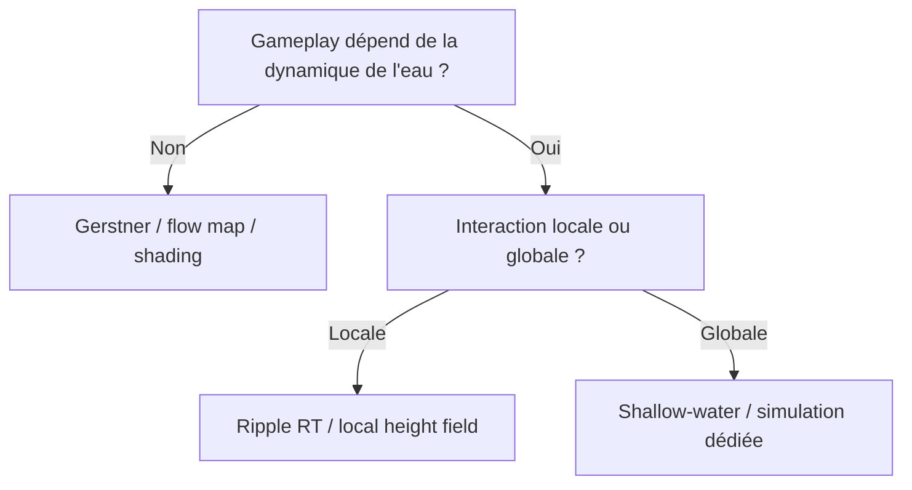
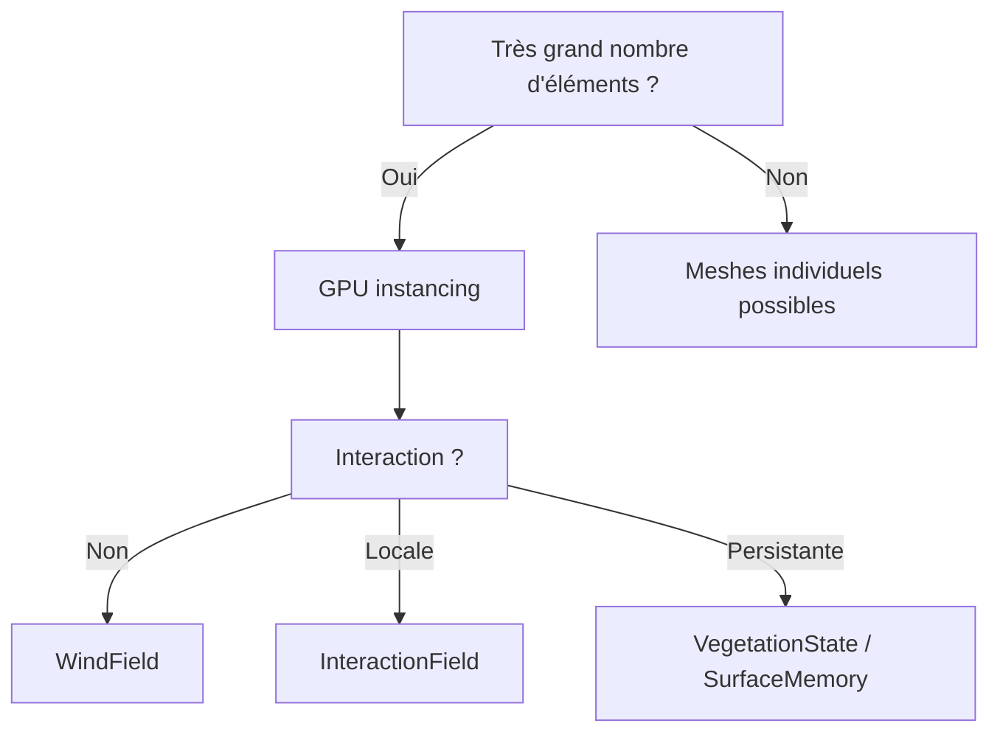
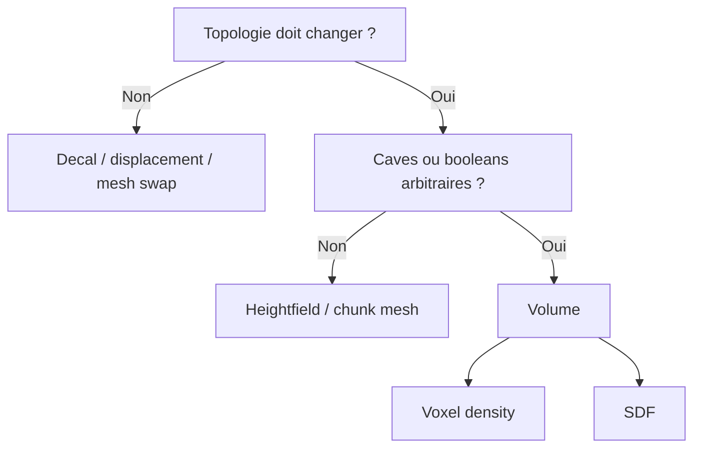
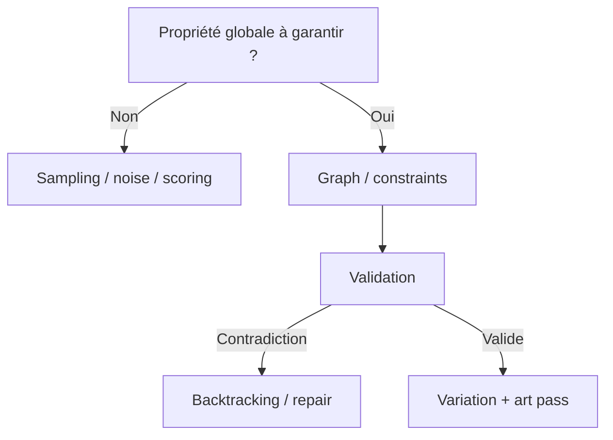
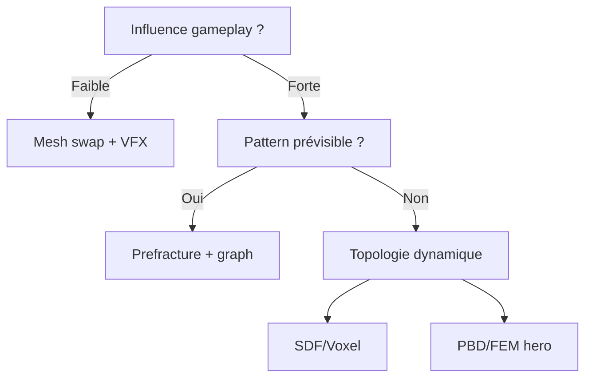
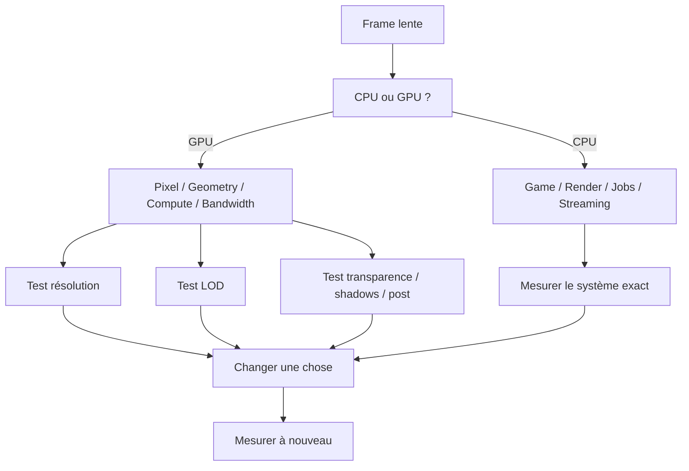
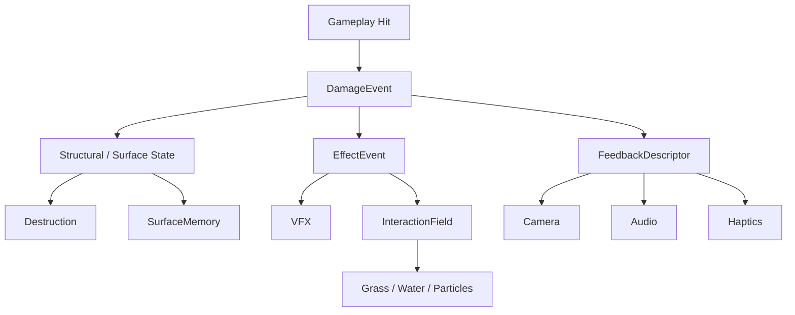

# ÉDITION V3 — Knowledge Base enrichie

Cette édition transforme la Bible en **référence opérationnelle** et en base de connaissances exploitable par Claude.

Ajouts :
- identifiants stables pour toutes les techniques ;
- tags, coût, difficulté et niveau de preuve ;
- 200 fiches prioritaires ;
- stacks de production ;
- comparatifs ;
- arbres de décision ;
- troubleshooting ;
- ROI tables ;
- progression pédagogique et exercices ;
- tests/invariants ;
- templates RFC/benchmark ;
- architecture de projet de référence ;
- index coût/difficulté ;
- bibliographie par domaine ;
- références visuelles ;
- Cycle II cookbook ;
- package modulaire avec CSV/JSON/YAML.

> Les champs `cost`, `difficulty`, `ROI` et plusieurs relations sont des **heuristiques** destinées au tri et à la décision, pas des mesures universelles.

# TECH ART BIBLE — Édition consolidée complète
> Version Markdown consolidée pour transfert à un autre modèle ou à une base de connaissances.
> **Important :** ce document est une **synthèse structurée et normalisée** de tout le premier cycle. Il ne cherche pas à reproduire mot pour mot chaque réponse de la conversation ; il conserve les concepts, listes de techniques, équations, architectures, recettes et principes directeurs.

## Objectif

Cette Bible vise à fournir un vocabulaire commun entre **art, rendu, gameplay, simulation, audio, outils et performance**.

Le principe transversal est :

```text
CAUSE
  ↓
STATE
  ↓
FIELD / DATA
  ↓
RESPONSE
  ↓
STYLE
  ↓
PERCEPTION
```

Les meilleurs systèmes ne fabriquent pas des effets indépendants ; ils fabriquent des **causes partagées** dont plusieurs sous-systèmes lisent les conséquences.

Principes récurrents :

1. **Décrire des règles, pas seulement le résultat.**
2. **Une cause → plusieurs conséquences.**
3. **Macro → méso → micro.**
4. **Structure → variation**, pas hasard → structure.
5. **State ≠ Appearance.**
6. **Simulation ≠ Representation.**
7. **Physical truth → Artistic transformation.**
8. **Perceptual importance → Computational budget.**
9. **Une donnée globale ou spatiale doit avoir un propriétaire et un contrat.**
10. **Un système devient vraiment productif quand quelqu’un d’autre peut l’utiliser sans son auteur.**


## Extensions de cette édition

Cette V2 ajoute :
- un mode d’emploi pour assistant IA ;
- un index transversal par intention ;
- des contrats de données de référence ;
- des arbres de décision ;
- une matrice de compatibilité ;
- un mapping conceptuel Godot / Unity / Unreal ;
- une roadmap de framework Tech Art ;
- des checklists de production ;
- un modèle de maturité ;
- un squelette complet du Cycle II ;
- un glossaire et des anti-patterns.

## Table des matières
- [Volume 0 — Fondamentaux mathématiques, signaux procéduraux, shading, mouvement, génération spatiale & performance](#volume-0)
- [Volume 1 — Eau — océans, rivières, lacs, foam, refraction, caustiques & interaction](#volume-1)
- [Volume 2 — Herbe, végétation & forêts — distribution, écologie, shading, vent & interaction](#volume-2)
- [Volume 3 — Terrain, roches, falaises, sols & biomes](#volume-3)
- [Volume 4 — Atmosphère, ciel, nuages, brouillard, météo & cycle jour/nuit](#volume-4)
- [Volume 5 — VFX — feu, fumée, explosions, poussière, magie, particules, trails, shockwaves & distortion](#volume-5)
- [Volume 6 — Animation procédurale, IK, locomotion, secondary motion & motion systems](#volume-6)
- [Volume 7 — PCG — génération procédurale de mondes, villes, villages, donjons & contraintes](#volume-7)
- [Volume 8 — Éclairage, PBR, toon shading & rendu stylisé](#volume-8)
- [Volume 9 — Surfaces dynamiques & mémoire du monde](#volume-9)
- [Volume 10 — Destruction, fracture & géométrie dynamique](#volume-10)
- [Volume 11 — Audio systémique, acoustique spatiale, synthèse procédurale & musique adaptative](#volume-11)
- [Volume 12 — Caméra, game feel, impacts, feedback & perception](#volume-12)
- [Volume 13 — Optimisation GPU/CPU, profiling, streaming & architecture de performance](#volume-13)
- [Volume 14 — Architecture shader, pipeline de données & bibliothèque Tech Art](#volume-14)
- [Volume 15 — Outils Tech Art, automation, validation, CI & pipeline de production](#volume-15)

---
# Schéma de fiche recommandé


```text
TECHNIQUE
├ But visuel
├ Principe
├ Pourquoi ça marche perceptuellement ?
├ Intuition mathématique
├ Implémentation minimale
├ Version avancée
├ Paramètres artistiques
├ Coût GPU/CPU/mémoire
├ Difficulté
├ Pièges fréquents
├ Techniques compatibles
├ Alternatives
├ Exemples jeux
├ Godot / Unity / Unreal
└ Sources / niveau de preuve
```

Tags utiles : `Geometry`, `Shader`, `WorldField`, `Simulation`, `PCG`, `GPU`, `CPU`, `Stylized`, `Physical`, `Approximation`, `Persistent`, `ScreenSpace`, `WorldSpace`, `Temporal`, `Performance`, `Tooling`.

---

<a id="volume-0"></a>
# Volume 0 — Fondamentaux mathématiques, signaux procéduraux, shading, mouvement, génération spatiale & performance

**Thèse :** Les briques universelles. La plupart des effets avancés sont des combinaisons de quelques opérations mathématiques, de signaux multi-échelle, de transformations d’espace et de représentations de données.

## Techniques

01. **Lerp / interpolation**
02. **Remap**
03. **Smoothstep**
04. **Produit scalaire (dot product)**
05. **Produit vectoriel (cross product)**
06. **Espaces de coordonnées**
07. **Gradient**
08. **Dérivées écran ddx/ddy/fwidth**
09. **Saturate / Clamp**
10. **Courbes artistiques**
11. **Hash déterministe**
12. **Gradient / Perlin noise**
13. **fBm**
14. **Ridged noise**
15. **Domain warping**
16. **Voronoi / Worley**
17. **Animated noise**
18. **Curl noise**
19. **Masques multi-échelle**
20. **Seuil procédural**
21. **Fresnel**
22. **Toon Ramp**
23. **Rim Light**
24. **Fake subsurface / transmission**
25. **Triplanar mapping**
26. **World-space mapping**
27. **Depth fade / intersection**
28. **Screen-space refraction**
29. **Normal blending**
30. **Curvature / cavity mask**
31. **Vertex displacement**
32. **Gerstner waves**
33. **Flow map**
34. **Vector field**
35. **Spring / oscillateur amorti**
36. **Hierarchical motion**
37. **Temporal quantization**
38. **InteractionField**
39. **Poisson disk / blue noise**
40. **Voronoi spatial**
41. **Delaunay**
42. **Wave Function Collapse**
43. **Shape grammars**
44. **L-systems**
45. **Cellular automata**
46. **Erosion / flow accumulation**
47. **GPU instancing**
48. **LOD / impostors**
49. **Signed Distance Fields**
50. **Global World Fields**

## Équations / intuitions centrales

- **Interpolation** : `$lerp(a,b,t)=a+(b-a)t`
- **Smoothstep** : `$s(t)=3t^2-2t^3, après normalisation et clamp`
- **fBm** : `$f(p)=Σ a_i N(f_i p)`
- **Rim / Fresnel artistique** : `$R=(1-N·V)^p`
- **Ressort amorti** : `$x''+c x'+k x=F`

## Architecture

Le motif fondateur est le **World Field** : une donnée spatiale partagée telle que le vent, l’humidité, l’interaction ou la température. Les shaders et systèmes ne recalculent pas chacun leur version du monde ; ils lisent une cause commune et appliquent leur propre réponse.

## Recettes / stacks

- Rivière stylisée : spline + flow map + profondeur + foam + world-space noise + refraction légère.
- Prairie : blue-noise placement + instancing + WindField + InteractionField + variation macro/instance.
- Montagne : ridged fBm + domain warp + érosion + slope masks + triplanar.
- Townscaper-like : grille irrégulière + dual grid + contraintes locales + modules + déformation.

---

<a id="volume-1"></a>
# Volume 1 — Eau — océans, rivières, lacs, foam, refraction, caustiques & interaction

**Thèse :** L’eau crédible combine géométrie, micro-normales, profondeur, réflexion, écume, flux, interaction et temporalité. Le réalisme vient de la continuité ; le stylisé de la sélection et de la quantification des signaux.

## Techniques

01. **Plan simple**
02. **Grille subdivisée**
03. **Mesh adaptatif caméra**
04. **Mesh concentrique**
05. **Onde sinusoïdale**
06. **Somme de sinusoïdes**
07. **Ondes directionnelles**
08. **Ondes circulaires**
09. **Gerstner**
10. **Somme de Gerstner**
11. **Spectre de vagues**
12. **Océan FFT**
13. **Height field**
14. **Shallow-water simulation**
15. **Rivière par spline**
16. **Normal map**
17. **Scrolling normals**
18. **Crossed normals**
19. **Normales multi-échelle**
20. **Vitesses de normales différentes**
21. **Rotation de normales**
22. **Height-derived normals**
23. **Normales procédurales**
24. **Distance fade du détail**
25. **Normales quantifiées**
26. **Couleur plate**
27. **Gradient par profondeur**
28. **Couleur depuis depth buffer**
29. **Beer-Lambert**
30. **Couleur selon hauteur**
31. **Couleur selon orientation**
32. **Macro color noise**
33. **Micro color noise**
34. **Palette LUT**
35. **Fresnel**
36. **Cubemap reflection**
37. **Reflection probe**
38. **Sky-only reflection**
39. **Planar reflection**
40. **SSR**
41. **Ray-traced reflection**
42. **Reflection blur**
43. **Screen refraction**
44. **Depth-based refraction**
45. **Animated refraction**
46. **Refraction stylisée quantifiée**
47. **Chromatic refraction**
48. **Intersection foam**
49. **Shoreline foam**
50. **Foam width via smoothstep**
51. **Foam noise**
52. **Double-noise foam**
53. **Domain-warped foam**
54. **Crest foam**
55. **Agitation foam**
56. **Foam persistence**
57. **Foam advection**
58. **Object foam**
59. **Trail foam**
60. **Flipbook foam**
61. **UV scrolling flow**
62. **Flow map**
63. **Dual-phase flow**
64. **Spline tangent flow**
65. **Terrain gradient flow**
66. **Flow accumulation**
67. **Velocity variation**
68. **Edge friction**
69. **Obstacle turbulence**
70. **Vortex flow**
71. **Specular water**
72. **Toon specular**
73. **Sun streak**
74. **Sparkles**
75. **Temporal sparkles**
76. **Hand-drawn highlights**
77. **Crest highlight**
78. **Rim water highlight**
79. **Projected caustics texture**
80. **Crossed caustics**
81. **Voronoi caustics**
82. **Domain-warped caustics**
83. **Light-cookie caustics**
84. **Screen-space caustics**
85. **Caustic distance fade**
86. **Quantized caustic animation**
87. **Analytic ripple**
88. **Multiple analytic ripples**
89. **Ripple render target**
90. **Interactive height field**
91. **Wake**
92. **Speed-dependent wake**
93. **Splash particles**
94. **Buoyancy**
95. **Wetness after exit**
96. **Underwater fog**
97. **Chromatic absorption**
98. **God rays**
99. **Suspended particles**
100. **Underside water surface**

## Équations / intuitions centrales

- **Beer-Lambert** : `$T=e^{-σ d}`
- **Gerstner, intuition** : `$P'=P + déplacement sinusoïdal directionnel en fonction de phase`
- **Flow depuis terrain** : `$F≈-∇H`

## Architecture

`WaterState { Height, Normal, Flow, Velocity, Depth, Foam, Turbulence, Temperature }` doit servir à la fois au rendu, aux bateaux, à la mousse, aux particules et au gameplay. Les interactions générales peuvent écrire dans un `InteractionField` partagé avec végétation et surfaces.

## Recettes / stacks

- Ghibli/animation : faible displacement + 2 couleurs de profondeur + Fresnel faible + lignes de flux dessinées + foam graphique + 8–12 fps pour certains accents.
- Zelda-like : Gerstner léger + turquoise profondeur + dual normals + sky reflection + shore foam + rares sparkles.
- Rivière painterly : spline + flow + macro color + hand-painted flow lines + rock foam + vortices + caustics.
- Océan : mesh LOD + spectre/Gerstner + normales multi-échelle + crest foam + haze + buoyancy + wake.

---

<a id="volume-2"></a>
# Volume 2 — Herbe, végétation & forêts — distribution, écologie, shading, vent & interaction

**Thèse :** La végétation est un système spatial et écologique avant d’être une collection de meshes : Distribution + Géométrie + Shading + Motion + Interaction + Ecology.

## Techniques

01. **Billboard simple**
02. **Cross Billboard**
03. **Grass Card Cluster**
04. **Mesh Blade**
05. **Segmented Blade**
06. **Curved Blade**
07. **Taper**
08. **Twist**
09. **Procedural Blade Generation**
10. **GPU Geometry Expansion**
11. **Uniform Random**
12. **Jittered Grid**
13. **Poisson Disk**
14. **Blue Noise**
15. **Density Map**
16. **Terrain Layer Mask**
17. **Slope Mask**
18. **Altitude Mask**
19. **Moisture Mask**
20. **Distance to Water**
21. **Distance to Paths**
22. **Distance to Buildings**
23. **Distance Fields placement**
24. **Noise Density**
25. **Macro Clustering**
26. **Biome Map**
27. **Temperature Field**
28. **Moisture Field**
29. **Sun Exposure**
30. **Canopy Suppression**
31. **Competition Radius**
32. **Ecological Succession**
33. **Ecotones**
34. **Seed Dispersion**
35. **Disturbance Zones**
36. **Random Rotation**
37. **Random Scale**
38. **Non-uniform height/width scale**
39. **Random Lean**
40. **Random Curvature**
41. **Random Hue**
42. **Random Saturation**
43. **Random Brightness**
44. **Random Phase**
45. **Variant Selection via hash**
46. **Root-to-tip gradient**
47. **Terrain Color Sampling**
48. **Macro Color Noise**
49. **Meso Variation**
50. **Instance Variation**
51. **Seasonal Gradient**
52. **Moisture Coloring**
53. **Height Coloring**
54. **Double-Sided Shading**
55. **Normal Correction**
56. **Spherical Normals**
57. **Fake Transmission**
58. **Wrap Lighting**
59. **Tip Highlights**
60. **Rim Light**
61. **Root AO**
62. **Per-instance AO**
63. **Toon Ramp**
64. **Colored Shadows**
65. **Sine Wind**
66. **Position-dependent phase**
67. **Wind Direction vector**
68. **Height-weighted bending**
69. **Vertex-painted stiffness**
70. **Object stiffness**
71. **Wind Noise**
72. **Gust Noise**
73. **Traveling Gust**
74. **Multiple Frequencies**
75. **Directional Turbulence**
76. **Wind Shadow**
77. **Local Wind Source**
78. **Global Wind Field**
79. **Main Trunk Sway**
80. **Branch Bending**
81. **Twig Motion**
82. **Leaf Flutter**
83. **Hierarchical Phase**
84. **Branch Stiffness by Radius**
85. **Drag Approximation**
86. **Spring Return**
87. **Sphere Bending**
88. **Capsule Bending**
89. **Directional Bending**
90. **Velocity-dependent Bend**
91. **Persistent Flattening**
92. **Spring Recovery**
93. **Interaction Render Texture**
94. **Vector Interaction Field**
95. **Explosion Field**
96. **Projectile Trails**
97. **Creature Trails**
98. **Destruction / Cutting state**
99. **Burning State**
100. **Global Vegetation State**

## Équations / intuitions centrales

- **Pente** : `$s=N·Up`
- **Dispersion de graines** : `$P(d)=e^{-k d}`
- **Retour élastique** : `$x''+cx'+kx=F`
- **Vent voyageant** : `$G(x,t)=Noise(x-Wt)`

## Architecture

`WORLD → WindField / ClimateFields / InteractionField → VegetationSystem → Grass / Bushes / Trees → Renderer`. La végétation doit être pilotée par des champs partagés plutôt que par des managers indépendants.

## Recettes / stacks

- Prairie Zelda-like : Poisson/blue-noise + slope/moisture masks + instancing + macro color + WindField + interaction.
- Forêt painterly : canopy masses + spherical normals + colored shadows + fog + macro wind.
- Forêt inquiétante : faible saturation + anisotropie des silhouettes + fog local + vent lent désynchronisé + audio sparse.
- Monde réactif : InteractionField + flattening + burning + projectile trails + persistent state.

---

<a id="volume-3"></a>
# Volume 3 — Terrain, roches, falaises, sols & biomes

**Thèse :** Le terrain est une base de données spatiale : géologie → érosion → hydrologie → climat → biomes → végétation → routes → matériaux. L’élévation n’est qu’un des champs.

## Techniques

01. **Heightmap**
02. **Mesh terrain**
03. **Voxels**
04. **SDF terrain**
05. **Marching Cubes**
06. **Dual Contouring**
07. **Chunking**
08. **Quadtree terrain**
09. **Geometry Clipmaps**
10. **Planetary terrain**
11. **Value Noise**
12. **Gradient Noise**
13. **fBm terrain**
14. **Ridged Noise**
15. **Ridged multifractal**
16. **Domain Warping**
17. **Multi-domain warping**
18. **Voronoi Mountains**
19. **Distance-to-feature terrain**
20. **Terrace Function**
21. **Strata**
22. **Tilted strata**
23. **Folded strata**
24. **Fault lines**
25. **Simplified tectonic plates**
26. **Uplift field**
27. **Rock hardness field**
28. **Sedimentary bands**
29. **Columnar structures**
30. **Geological Material ID**
31. **Thermal Erosion**
32. **Talus Angle**
33. **Hydraulic erosion droplets**
34. **Grid-based water erosion**
35. **Sediment Capacity**
36. **Deposition**
37. **Evaporation**
38. **Rainfall Map**
39. **Hardness-dependent erosion**
40. **Wind Erosion**
41. **Gradient Flow**
42. **D8 Flow**
43. **Flow Accumulation**
44. **Drainage Basin**
45. **Watershed boundaries**
46. **River extraction**
47. **River width from accumulation**
48. **River depth**
49. **River carving via spline + distance field**
50. **Valley widening**
51. **Height Mask**
52. **Slope Mask**
53. **Aspect**
54. **Curvature**
55. **Convexity**
56. **Concavity**
57. **Flow Mask**
58. **Wetness potential**
59. **Exposure to Sky**
60. **Distance-to-water**
61. **Splat Mapping**
62. **Height-based blend**
63. **Slope-based material**
64. **Altitude-based material**
65. **Curvature-based material**
66. **Triplanar**
67. **World-space mapping**
68. **Macro texture**
69. **Detail texture**
70. **Multi-scale material**
71. **Texture Rotation**
72. **Mirroring**
73. **Texture Bombing**
74. **Stochastic texture sampling**
75. **Color variation**
76. **Normal variation**
77. **Material variant sets**
78. **Procedural decals**
79. **Runtime Virtual Texturing**
80. **Mesh-to-terrain blending**
81. **Procedural Boulder Shapes**
82. **Low-frequency rock deformation**
83. **Faceted Normals**
84. **Fracture Planes**
85. **Voronoi Fracture**
86. **Stratified Cliff**
87. **Cliff Overhangs**
88. **Talus / Scree**
89. **Rock Orientation from Slope**
90. **Embedded Rocks**
91. **Temperature Field**
92. **Altitude Cooling**
93. **Moisture Field**
94. **Rain Shadow**
95. **Whittaker-like biome space**
96. **Ecotones**
97. **Patch Noise**
98. **Biome-specific Geology**
99. **Biome-specific Distribution Rules**
100. **World Field Stack**

## Équations / intuitions centrales

- **Terrain multi-octave** : `$H(p)=Σ a_i N(f_i p)`
- **Flux** : `$F=-∇H`
- **Largeur de rivière** : `$w∝Accumulation^α`
- **Score placement** : `$S=Biome×Moisture×Sun×Flatness×RoadDistance×GeologyCompatibility`

## Architecture

`TerrainState { Height, Normal, Slope, Curvature, Geology, Hardness, Flow, FlowAccumulation, WaterDistance, Moisture, Temperature, Snow, Wetness, Biome, HumanInfluence }`. Le pipeline doit produire et réutiliser ces champs dans les systèmes en aval.

## Recettes / stacks

- Monde cohérent : tectonics → geology → elevation → erosion → hydrology → climate → soil → biomes → vegetation → settlements → roads → landmarks.
- Zelda-like : composition large volontaire + procédural dans les détails, silhouettes nettes, routes/rivières guidant le joueur.
- Canyon : strata + fault + erosion + scree + triplanar + distance fog.
- Archipel stylisé : large forms authored + domain warp + coastline shaping + biome bands.

---

<a id="volume-4"></a>
# Volume 4 — Atmosphère, ciel, nuages, brouillard, météo & cycle jour/nuit

**Thèse :** Une météo convaincante est un état causal partagé : pression/climat → nuages → lumière → vent → précipitation → wetness → fog → audio → gameplay.

## Techniques

01. **Sky Gradient**
02. **Horizon Gradient**
03. **Multi-band Sky LUT**
04. **Rayleigh Scattering**
05. **Mie Scattering**
06. **Ozone Absorption**
07. **Single Scattering**
08. **Multiple Scattering**
09. **Precomputed Atmospheric LUT**
10. **Aerial Perspective**
11. **Analytic Sun Disc**
12. **Soft Sun Disc**
13. **Sun Halo**
14. **Bloom**
15. **Sun Shafts**
16. **Moon Disc**
17. **Moon Phase**
18. **Moonlight Tint**
19. **Stars**
20. **Star Twinkle**
21. **Solar Time**
22. **Sun Trajectory**
23. **Dawn/Day/Dusk states**
24. **Lighting Curves**
25. **Color Gradient over Time**
26. **Shadow Softness**
27. **Exposure Adaptation**
28. **Artificial Lights Activation**
29. **Night Emissive Boost**
30. **Circadian World State**
31. **Sky-dome Clouds**
32. **Scrolling Cloud Layer**
33. **Dual Cloud Layers**
34. **Cloud Parallax**
35. **Alpha Cloud Noise Threshold**
36. **fBm Clouds**
37. **Domain-warped Clouds**
38. **Hand-painted Cloud Cards**
39. **Layered Painted Clouds**
40. **Stepped Cloud Animation**
41. **Volumetric Density Field**
42. **Ray Marching**
43. **Base Shape Noise**
44. **Detail Erosion Noise**
45. **Worley**
46. **Perlin-Worley**
47. **Cloud Coverage Map**
48. **Cloud Type Map**
49. **Height Profile**
50. **Vertical Density Gradient**
51. **Beer-Lambert Cloud Transmittance**
52. **Light March toward Sun**
53. **Cloud Self-shadow**
54. **Powder Effect Approximation**
55. **Silver Lining**
56. **Ground Bounce**
57. **Cloud Ambient**
58. **Cloud Shadow Map**
59. **Animated Cloud Shadows**
60. **Stylized Quantized Cloud Lighting**
61. **Linear Fog**
62. **Exponential Fog**
63. **Exponential Squared Fog**
64. **Height Fog**
65. **Ground Fog**
66. **Distance + Height Fog**
67. **Local Fog Volumes**
68. **Noise-modulated Fog**
69. **Animated Fog Noise**
70. **Fog Layers**
71. **Froxel Grid**
72. **Volumetric Light Injection**
73. **Volumetric Shadows**
74. **Local Density Injection**
75. **Negative Fog Volume**
76. **Temporal Reprojection**
77. **Jittered Sampling**
78. **Resolution LOD**
79. **Anisotropic Scattering**
80. **Fog Color from Sky**
81. **Rain Particle Field**
82. **Camera-centered Rain**
83. **Wind-driven Rain**
84. **Rain Streak Stretch**
85. **Rain Depth Fade**
86. **Rain Collision**
87. **Splashes**
88. **Water Ripples**
89. **Global Wetness**
90. **Wetness Accumulation**
91. **Puddle Mask**
92. **Puddle Roughness**
93. **Puddle Reflection**
94. **Puddle Ripple**
95. **Surface Flow**
96. **Dripping after Rain**
97. **Delayed Drying**
98. **Material-specific Wetness**
99. **Rain Occlusion**
100. **Global Weather State**

## Équations / intuitions centrales

- **Rayleigh** : `$β_R ∝ 1/λ^4`
- **Beer-Lambert** : `$T=e^{-σd}`
- **Height fog** : `$ρ(y)=ρ_0 e^{-ky}`
- **Wetness** : `$dW/dt=RainRate-Evaporation`

## Architecture

`EnvironmentState { Time, Climate, Weather, Wind, Surface }` alimente ciel, nuages, fog, lighting, eau, végétation, terrain, particules, audio et gameplay. Le vent est un champ `W = W_global + W_gust + W_turbulence + W_local`.

## Recettes / stacks

- Journée Ghibli : sky gradient + painted clouds + soft warm sun + cool aerial perspective.
- Tempête : coverage↑ + sun↓ + wind↑ + rain + wetness + volumetric fog + lightning events + thunder delay.
- Nuit magique : moon/stars + colored fog + low-key lighting + emissive accents.
- Matin brumeux : height fog + low sun + warm aerial perspective + dew/wetness résiduelle.

---

<a id="volume-5"></a>
# Volume 5 — VFX — feu, fumée, explosions, poussière, magie, particules, trails, shockwaves & distortion

**Thèse :** Un VFX est un événement structuré dans le temps : Anticipation → Impact → Expansion → Dissipation → Résidu. Les particules ne sont qu’un moyen de représentation.

## Techniques

01. **CPU particles**
02. **GPU particles**
03. **Point sprites**
04. **Camera-facing billboard**
05. **Velocity-facing billboard**
06. **Mesh particles**
07. **Particle attributes**
08. **Normalized age**
09. **Curves over lifetime**
10. **Deterministic random per particle**
11. **Emission rate**
12. **Burst emission**
13. **Spawn point**
14. **Spawn sphere**
15. **Spawn cone**
16. **Spawn box**
17. **Spawn mesh**
18. **Local-space particles**
19. **World-space particles**
20. **Particle LOD / budget**
21. **Ballistic motion**
22. **Linear drag**
23. **Quadratic drag**
24. **Attractor**
25. **Repulsor**
26. **Vortex force**
27. **Vector field**
28. **Curl noise motion**
29. **Multi-scale turbulence**
30. **Flow field**
31. **SDF collision**
32. **Depth collision**
33. **Physics collision**
34. **Surface conformity**
35. **Orbital motion**
36. **Spring / return motion**
37. **Flipbook animation**
38. **SubUV interpolation**
39. **Random start frame**
40. **Frame blending**
41. **Temporal quantization**
42. **Hand-drawn sprite sheets**
43. **Random flipbook variant**
44. **Soft particles**
45. **Camera fade**
46. **Particle normal lighting**
47. **Additive flame sprites**
48. **Alpha-blended painterly fire**
49. **Mesh flame**
50. **Vertex-displaced flame**
51. **Noise dissolve flame**
52. **SDF flame shape**
53. **Buoyancy**
54. **Temperature field**
55. **Blackbody-inspired palette**
56. **Emissive core**
57. **Flame color ramp**
58. **Flicker**
59. **Correlated dynamic light**
60. **Sparks / embers**
61. **Scorch / burn field**
62. **Alpha smoke sprites**
63. **Flipbook smoke**
64. **Volumetric smoke**
65. **Density + extinction**
66. **Smoke buoyancy**
67. **Smoke curl/turbulence**
68. **Dissipation**
69. **Expansion over lifetime**
70. **Smoke self-shadow approximation**
71. **Lit smoke**
72. **Ground dust ring**
73. **Directional dust trail**
74. **Persistent dust volume**
75. **Explosion phase orchestration**
76. **Flash**
77. **Fireball**
78. **Shockwave ring mesh**
79. **Screen-space shockwave distortion**
80. **Debris**
81. **Directional sparks**
82. **Smoke plume**
83. **Ground dust**
84. **Impact decal / scorch**
85. **Camera shake hook**
86. **Point-light flash**
87. **Interaction impulse field**
88. **Audio / haptic sync**
89. **Ribbon trail**
90. **Velocity trail**
91. **Spline trail**
92. **Trail width over age**
93. **Trail color over age**
94. **UV flow along trail**
95. **Noisy beam**
96. **Lightning branching**
97. **SDF beam / glow**
98. **Dissolve / reveal**
99. **Procedural magic circle**
100. **Signed-distance glyphs**
101. **Particles attracted to path**
102. **Heat haze distortion**
103. **Distortion buffer**
104. **Decals**
105. **Persistent residue / fields**
106. **VFX scalability budget**
107. **EffectEvent architecture**

## Équations / intuitions centrales

- **Âge normalisé** : `$τ=clamp(age/lifetime,0,1)`
- **Balistique** : `$p(t)=p_0+v_0t+\frac12gt^2`
- **Curl field** : `$W=∇×A, donc ∇·W=0`
- **Dissipation** : `$ρ(t+Δt)=ρ(t)e^{-kΔt}`
- **Shock ring** : `$M=1-smoothstep(w_0,w_1,|d-r(t)|)`

## Architecture

`EffectEvent { position, normal, energy, radius, materialID, sourceVelocity, seed }` pilote simultanément lumière, InteractionField, particules, decals, caméra, audio et résidus. Une explosion n’est pas un emitter : c’est une cause multi-couches.

## Recettes / stacks

- Explosion lisible : flash ultra-court + fireball + shockwave + hero debris + sparks + smoke + dust + decal + impulse world.
- Feu stylisé : mesh/sprites + buoyancy + noise dissolve + color ramp + flicker + embers + heat haze + correlated light.
- Impact matériau-aware : pierre→dust/chips, métal→sparks, bois→splinters, eau→splash/foam/ripple.
- Magie graphique : SDF glyphs + ribbons + particles attracted to shape + temporal quantization + bloom contrôlé.

---

<a id="volume-6"></a>
# Volume 6 — Animation procédurale, IK, locomotion, secondary motion & motion systems

**Thèse :** L’animation procédurale ne remplace pas l’animation authored ; elle l’adapte au monde. Le bon modèle est : Intent → Pose → Constraints → Procedural Corrections → Secondary Motion.

## Techniques

01. **Animation state machine**
02. **Blend tree**
03. **1D blend**
04. **2D blend**
05. **Normalized locomotion speed**
06. **Animation phase**
07. **Root motion**
08. **In-place locomotion**
09. **Motion warping**
10. **Stride scaling**
11. **Speed matching**
12. **Turn-in-place**
13. **Orientation warping**
14. **Upper/lower body layering**
15. **Additive animation**
16. **Animation masks**
17. **Pose cache**
18. **Pose interpolation**
19. **Temporal smoothing**
20. **Critically damped pose spring**
21. **Bone spring**
22. **Procedural bob**
23. **Breathing cycle**
24. **Look-at constraint**
25. **Aim constraint**
26. **Two-bone IK**
27. **FABRIK**
28. **CCD IK**
29. **Foot IK**
30. **Hand IK**
31. **Ground alignment**
32. **Foot locking**
33. **Foot contact detection**
34. **Pelvis compensation**
35. **Slope adaptation**
36. **Step height adaptation**
37. **Stair adaptation**
38. **Leg reach limit**
39. **Foot roll**
40. **Toe pivot**
41. **Pole vector control**
42. **Procedural spine aim**
43. **Head tracking**
44. **Eye tracking**
45. **Look target prioritization**
46. **Look dead zone**
47. **Gaze saccades**
48. **Secondary gaze**
49. **Reach IK**
50. **Object interaction anchors**
51. **Hand socket correction**
52. **Weapon alignment**
53. **Recoil pose**
54. **Recoil spring**
55. **Procedural weapon sway**
56. **Weapon lag**
57. **Breathing sway**
58. **Procedural leaning**
59. **Acceleration lean**
60. **Turn lean**
61. **Banking**
62. **Inertialization**
63. **Pose matching**
64. **Motion matching**
65. **Trajectory prediction**
66. **Future trajectory query**
67. **Footstep phase events**
68. **Contact-driven VFX/audio**
69. **Landing compression**
70. **Jump anticipation**
71. **Apex shaping**
72. **Landing recovery**
73. **Squash & stretch transform**
74. **Smear pose**
75. **Overshoot pose**
76. **Follow-through**
77. **Drag / overlap**
78. **Pendulum secondary motion**
79. **Spring chains**
80. **Hair chains**
81. **Tail procedural motion**
82. **Cloth proxy bones**
83. **Breastplate/gear jiggle proxy**
84. **Jiggle constraints**
85. **Wind-driven bones**
86. **Collision-aware secondary motion**
87. **Ragdoll**
88. **Partial ragdoll**
89. **Physical animation**
90. **Active ragdoll**
91. **Ragdoll blend-in**
92. **Ragdoll recovery**
93. **Pose-from-physics**
94. **Constraint motors**
95. **Procedural reachability**
96. **Retargeting**
97. **Retarget pose normalization**
98. **Skeleton LOD**
99. **Animation frequency LOD**
100. **Network-friendly deterministic animation state**
101. **CharacterMotionState**

## Équations / intuitions centrales

- **Ressort** : `$x''+cx'+kx=F`
- **Look direction** : `$d=normalize(target-position)`
- **Stride scaling, intuition** : `$scale≈desiredSpeed/clipSpeed`
- **Blend 1D** : `$P=(1-t)P_A+tP_B`

## Architecture

`CharacterMotionState { speed, acceleration, grounded, slope, gait, phase, intentDirection, aimDirection, contacts }` devient la donnée commune pour animation, audio, VFX, caméra et gameplay. L’animation procédurale corrige la pose à partir du monde plutôt que d’inventer un état séparé.

## Recettes / stacks

- Locomotion terrain : blend tree + stride scaling + foot IK + pelvis compensation + slope adaptation + foot locking.
- Combat stylisé : authored key poses + recoil springs + motion warping + IK mains + hit reactions.
- Creature : gait phase + procedural spine/head + spring tail + foot placement multi-leg.
- Ragdoll contrôlé : physical animation + partial ragdoll + recovery pose matching.

---

<a id="volume-7"></a>
# Volume 7 — PCG — génération procédurale de mondes, villes, villages, donjons & contraintes

**Thèse :** La génération procédurale robuste produit d’abord une structure et des relations, puis de la variation. `Structure → Variation`, jamais `Random → Structure`.

## Techniques

01. **Deterministic seed hierarchy**
02. **Random stream isolation**
03. **Spatial hash seed**
04. **Chunk seed**
05. **Rule-based generation**
06. **Constraint-based generation**
07. **Grammar-based generation**
08. **Graph-based generation**
09. **Field-driven generation**
10. **Sample-driven generation**
11. **Uniform sampling**
12. **Jittered grid**
13. **Poisson disk**
14. **Blue-noise sampling**
15. **Weighted random selection**
16. **Alias-table weighted sampling**
17. **Noise density field**
18. **Biome mask placement**
19. **Distance-field placement**
20. **Slope / altitude constraints**
21. **Exclusion zones**
22. **Attraction zones**
23. **Priority masks**
24. **Spatial queries**
25. **Neighbourhood queries**
26. **Voronoi partition**
27. **Delaunay adjacency**
28. **Minimum spanning tree**
29. **Shortest path**
30. **A* cost fields**
31. **Flow-field pathing**
32. **Road cost field**
33. **Spline fitting**
34. **Spline carving**
35. **Road hierarchy**
36. **Primary / secondary streets**
37. **Plot subdivision**
38. **Parcel generation**
39. **Lot frontage constraints**
40. **Building footprint generation**
41. **Shape grammars**
42. **Split grammars**
43. **Facade grammars**
44. **Floor grammars**
45. **Roof grammars**
46. **Module sockets**
47. **Socket compatibility**
48. **Adjacency rules**
49. **WFC tile constraints**
50. **Entropy selection**
51. **Constraint propagation**
52. **Backtracking**
53. **Contradiction recovery**
54. **Tile weighting**
55. **Boundary rules**
56. **Symmetry constraints**
57. **Global count constraints**
58. **Connectivity constraints**
59. **Reachability validation**
60. **Critical path guarantee**
61. **Room graph**
62. **Dungeon spanning tree**
63. **Loop insertion**
64. **Dead-end control**
65. **Key / lock graph**
66. **Boss-room placement**
67. **Start/end constraints**
68. **Encounter spacing**
69. **Landmark scoring**
70. **Viewshed analysis**
71. **Silhouette scoring**
72. **Negative-space scoring**
73. **Composition bias**
74. **Author intent field**
75. **Design anchors**
76. **Protected regions**
77. **Forbidden regions**
78. **Story beats as constraints**
79. **Settlement suitability**
80. **Resource proximity score**
81. **Water accessibility**
82. **Defense score**
83. **Terrain flatness score**
84. **Climate suitability**
85. **Village center placement**
86. **Building clustering**
87. **Social hierarchy zoning**
88. **Farm field generation**
89. **Forest edge generation**
90. **Ecotone-aware placement**
91. **Procedural ruin aging**
92. **Damage history generation**
93. **Weather history pass**
94. **Vegetation succession pass**
95. **Generated navigation graph**
96. **Generated structural graph**
97. **Semantic metadata output**
98. **Validation invariants**
99. **Seed corpus tests**
100. **Statistical distribution tests**
101. **Generation time budgets**
102. **Async chunk PCG**
103. **Incremental regeneration**
104. **PCG WorldState**

## Équations / intuitions centrales

- **Placement score** : `$S=Σ w_i f_i(x)`
- **Road cost** : `$C=distance+α·slope+β·water+γ·cliff`
- **Weighted choice** : `$P_i=w_i/Σ_j w_j`
- **Landmark score** : `$L=visibility+accessibility+uniqueness+flatness-separationPenalty`

## Architecture

Le PCG doit produire plus que des meshes : géométrie + graphes + metadata + fields. Un bâtiment procédural peut fournir son graphe structurel ; une ville son graphe routier ; un donjon son graphe de progression. `Simulation + Art Direction + Game Design` doit remplacer le hasard pur.

## Recettes / stacks

- Townscaper-like : irrégularité de grille + contraintes locales + modules artisanaux + règles de voisinage + warp.
- Village : suitability field → centre → routes → lots → bâtiments → végétation → histoire/weathering.
- Donjon : room graph → contraintes reachability → locks/keys → embedding spatial → corridors → validation.
- Ruines : générer structure logique → appliquer dommages/histoire → supprimer éléments instables → weathering/vegetation.

---

<a id="volume-8"></a>
# Volume 8 — Éclairage, PBR, toon shading & rendu stylisé

**Thèse :** Le rendu stylisé ne consiste pas à désactiver le PBR : il conserve les indices physiques utiles puis transforme valeurs, couleurs, highlights, ombres, contours et temporalité.

## Techniques

01. **N·L**
02. **Lambert Diffuse**
03. **Half-Lambert**
04. **Wrap Lighting**
05. **Inverse-square Attenuation**
06. **Artistic Falloff**
07. **Directional Light**
08. **Point Light**
09. **Spot Light**
10. **Area Light**
11. **Light Size**
12. **HDR Lighting**
13. **Linear Color Space**
14. **Exposure**
15. **Tone Mapping**
16. **BRDF**
17. **Diffuse + Specular decomposition**
18. **Energy Conservation**
19. **Physical Fresnel**
20. **Schlick Fresnel**
21. **F0**
22. **Microfacet Model**
23. **Normal Distribution Function**
24. **GGX / Trowbridge-Reitz**
25. **Roughness**
26. **Geometry / Visibility Term**
27. **Smith Masking**
28. **Metallic Workflow**
29. **Specular Workflow**
30. **Principled Material**
31. **Clearcoat**
32. **Sheen**
33. **Anisotropy**
34. **Transmission**
35. **Subsurface Scattering**
36. **Fake SSS**
37. **Thickness Map**
38. **Normal Mapping**
39. **Detail Normal**
40. **Bent Normals**
41. **Shadow Mapping**
42. **Shadow Bias**
43. **Normal Bias**
44. **Cascaded Shadow Maps**
45. **PCF**
46. **PCSS**
47. **Variance Shadow Maps**
48. **EVSM**
49. **Contact Shadows**
50. **Blob Shadow**
51. **Capsule Shadows**
52. **Distance Field Shadows**
53. **Ray-traced Shadows**
54. **Stylized Shadow Shapes**
55. **Shadow Color**
56. **Direct Lighting**
57. **Indirect Lighting**
58. **Color Bleeding**
59. **Baked Lightmaps**
60. **Directional Lightmaps**
61. **Light Probes**
62. **Spherical Harmonics**
63. **Probe Volumes**
64. **Reflection Probes**
65. **Irradiance Environment Map**
66. **Prefiltered Specular Environment**
67. **Split-Sum IBL**
68. **Screen-Space GI**
69. **SSIL**
70. **Voxel GI**
71. **SDF GI**
72. **Dynamic Probe GI**
73. **Ray-traced GI**
74. **Hybrid GI**
75. **Hybrid Baked + Dynamic**
76. **Ambient Occlusion**
77. **Baked AO**
78. **Vertex AO**
79. **Texture AO**
80. **SSAO**
81. **Horizon-based AO**
82. **GTAO-like approaches**
83. **Contact Darkening**
84. **Cavity Map**
85. **Artistic AO**
86. **Binary Toon**
87. **Multi-band Toon**
88. **Ramp Texture**
89. **Smooth Toon Edge**
90. **Shadow Tint**
91. **Gooch Shading**
92. **Artistic Half-Lambert**
93. **Quantized Diffuse**
94. **Posterized Lighting**
95. **Toon Specular**
96. **Quantized Specular**
97. **Stylized Highlight Shape**
98. **Rim Light**
99. **Quantized Rim**
100. **Matcap**

## Équations / intuitions centrales

- **Lambert** : `$L_o∝Albedo·max(0,N·L)`
- **Schlick** : `$F=F_0+(1-F_0)(1-\cosθ)^5`
- **Rim** : `$R=(1-N·V)^p`
- **Quantification** : `$q=floor(L·n)/n`

## Architecture

Séparer `PhysicalLightingState` de `ArtDirectionState`. Le premier conserve cohérence spatiale et photométrique approximative ; le second transforme palette, ramp, shadow tint, rim, outlines et contraste. `FinalImage = ArtTransform(PhysicalLighting)`.

## Recettes / stacks

- Zelda-like : PBR léger + sun soft + cool ambient + warm bounce + shadow tint + gentle toon ramp.
- Ghibli/painterly : grandes masses colorées + warm/cool + faible micro-detail + colored shadows + atmosphere.
- Anime : custom face shading + 2–3 bands + custom normals + rim + outline + binary specular.
- Comic : hard toon + outlines depth/normal + variable line width + halftone + palette forte.

---

<a id="volume-9"></a>
# Volume 9 — Surfaces dynamiques & mémoire du monde

**Thèse :** Le monde se souvient : `State(x,t) + Events + Evolution`. Wetness, neige, boue, brûlures, saleté et dégâts sont des états persistants ou semi-persistants, pas seulement des VFX temporaires.

## Techniques

01. **Scalar State Field**
02. **Multi-channel Surface State**
03. **State Texture**
04. **Render-to-Texture**
05. **Ping-Pong Buffers**
06. **Persistent Buffer**
07. **World-space UV**
08. **Local-space State Texture**
09. **Object-local Memory**
10. **Hybrid Global + Local**
11. **Stamp**
12. **Circular Stamp**
13. **Texture Stamp**
14. **Directional Stamp**
15. **Velocity-aware Stamp**
16. **Pressure-aware Stamp**
17. **Brush Stamp**
18. **Additive Stamp**
19. **Subtractive Stamp**
20. **Max / Min Composition**
21. **Projected Decal**
22. **Deferred Decal**
23. **Color-only Decal**
24. **Normal-only Decal**
25. **Roughness-only Decal**
26. **Multi-channel Decal**
27. **Mesh Decal**
28. **Decal Atlas**
29. **Random Decal Variant**
30. **Decal Aging**
31. **Dynamic Heightmap**
32. **Vertex Displacement from Heightmap**
33. **Normal Reconstruction**
34. **Gradient-based Normal**
35. **Height Compression**
36. **Material Displacement**
37. **Conservation Approximation**
38. **Relaxation**
39. **Plastic Deformation**
40. **Elastic Deformation**
41. **Footprint Mask**
42. **Left / Right Variants**
43. **Foot Orientation**
44. **Heel-to-Toe Pressure**
45. **Footprint Depth from Weight**
46. **Trail Interpolation**
47. **Wheel Track Spline**
48. **Track Width**
49. **Slip-based Track**
50. **Directional Surface Smear**
51. **Snow Coverage Field**
52. **Orientation Accumulation**
53. **Sky Exposure**
54. **Snow Thickness**
55. **Snow Edge Rounding**
56. **Snow Normal Blend**
57. **Snow Roughness**
58. **Snow Sparkles**
59. **Compressed Snow**
60. **Snow Refill**
61. **Snow Melt**
62. **Meltwater Wetness**
63. **Refreeze**
64. **Wind Exposure**
65. **Snow Drift**
66. **Obstacle Drift**
67. **Snow Occlusion**
68. **Snow Collapse**
69. **Sand Height Field**
70. **Sand Footprints**
71. **Dune Ripples**
72. **Wind-driven Sand**
73. **Sand Accumulation**
74. **Sand Avalanche**
75. **Angle of Repose**
76. **Buried Object Mask**
77. **Soil Moisture**
78. **Mud Darkening**
79. **Mud Roughness**
80. **Mud Deformation**
81. **Mud Ridge**
82. **Mud Splash**
83. **Mud Transfer**
84. **Mud on Character**
85. **Wetness State**
86. **Global Rain Contribution**
87. **Drying**
88. **Temperature-dependent Drying**
89. **Concavity Wetness**
90. **Puddle Formation**
91. **Dirt Accumulation**
92. **Water Streaks**
93. **Moss Growth**
94. **Rust**
95. **Burn / Char**
96. **Damage Map**
97. **Fluid Contamination**
98. **Runtime Virtual Texture / Large Surface Cache**
99. **Sparse / Tiled Surface Memory**
100. **Surface Memory System**

## Équations / intuitions centrales

- **Relaxation** : `$H_{t+1}=H_t+λ∇²H`
- **Drying** : `$W(t)=W_0e^{-kt}`
- **Puddle** : `$P=Wetness·Flatness·Concavity`
- **Heat dose** : `$HeatDose+=Temperature·dt`

## Architecture

Un `SurfaceEvent { position, normal, radius, pressure, velocity, temperature, material, type, seed }` modifie un `SurfaceMemory`. Séparer `State` de l’apparence : `wetness=0.8` peut piloter rendu, audio, friction, VFX et gameplay.

## Recettes / stacks

- Neige : height field + footprints + compression + normal reconstruction + refill + melt.
- Boue : soil moisture + deformation + wet darkening + ridges + transfer to character + drying.
- Route après pluie : rain→wetness→concavity puddles→reflections→wheel tracks→slow drying.
- Ruine : age + water streaks + dirt + cracks + moss + rust + vegetation intrusion.

---

<a id="volume-10"></a>
# Volume 10 — Destruction, fracture & géométrie dynamique

**Thèse :** La destruction demande de répondre à : qu’est-ce qui maintient l’objet ensemble ? Les fragments sont des nœuds ; les connexions portent force, damage et matériau.

## Techniques

01. **Swap Mesh**
02. **Multi-stage Mesh**
03. **Modular Destruction**
04. **Hidden Interior Geometry**
05. **Interior Material**
06. **Destruction State**
07. **Piece Representation**
08. **Rigid Fragment**
09. **Compound Rigid Body**
10. **Destruction LOD Representation**
11. **Constructive Solid Geometry**
12. **Boolean Subtraction**
13. **Boolean Union**
14. **Boolean Intersection**
15. **Cutter Primitive**
16. **Arbitrary Mesh Cutter**
17. **Manifold Geometry**
18. **Cap Generation**
19. **Interior UV Generation**
20. **CSG Baking**
21. **Voronoi Sites**
22. **Voronoi Cells**
23. **Voronoi Fracture**
24. **Uniform Voronoi**
25. **Clustered Voronoi**
26. **Radial Fracture**
27. **Directional Fracture**
28. **Anisotropic Fracture**
29. **Noise-distorted Voronoi**
30. **Material-specific Fracture Pattern**
31. **Multi-level Fracture**
32. **Cluster Hierarchy**
33. **Coarse-to-fine Destruction**
34. **Lazy Fragment Activation**
35. **Fracture Budget**
36. **Adaptive Fragment Size**
37. **Impact-local Refinement**
38. **Recursive Fracture**
39. **Fracture Depth Limit**
40. **Fracture State Cache**
41. **Connection Graph**
42. **Bond Strength**
43. **Material Bond Strength**
44. **Damage Accumulation**
45. **Strain**
46. **Support Graph**
47. **Anchors**
48. **Connectivity-to-support Test**
49. **Load-bearing Tags**
50. **Cascading Collapse**
51. **Distance Constraint**
52. **Angular Constraint**
53. **Breakable Constraint**
54. **Direction-dependent Strength**
55. **Tensile Failure**
56. **Compression Failure**
57. **Shear Failure**
58. **Fatigue**
59. **Weakening Field**
60. **Structural Damage Field**
61. **Plane Slice**
62. **Triangle Clipping**
63. **Intersection Loop**
64. **Cap Triangulation**
65. **Multi-plane Cut**
66. **Swept Cutter**
67. **Cutting Path**
68. **Dynamic Portal Hole**
69. **Bullet Hole Geometry**
70. **Runtime Cutting of Deformables**
71. **Binary Voxel Grid**
72. **Density Field**
73. **Destructive Brush**
74. **Additive Brush**
75. **Sphere Brush**
76. **Capsule Brush**
77. **Noise Brush**
78. **Voxel Flood Fill**
79. **Connected Components**
80. **Adaptive Octree**
81. **Signed Distance Field**
82. **SDF Digging**
83. **Smooth Boolean**
84. **SDF Damage Field**
85. **Marching Cubes**
86. **Dual Contouring**
87. **Surface Nets**
88. **Local Remeshing**
89. **Mesh Seam Stitching**
90. **Collision Remeshing**
91. **Mass-Spring Solid**
92. **Position Based Dynamics**
93. **Breakable PBD Constraints**
94. **Shape Matching**
95. **Plasticity**
96. **FEM**
97. **Corotational FEM**
98. **Stress-based Fracture**
99. **Crack Propagation**
100. **Hybrid Destruction Architecture**

## Équations / intuitions centrales

- **Distance constraint** : `$||p_i-p_j||=L`
- **Damage** : `$D_{t+1}=D_t+ΔD`
- **SDF union** : `$min(A,B)`
- **SDF subtraction** : `$max(A,-B)`

## Architecture

`DestructionState { PieceGraph, Bonds, Anchors, ActiveClusters, DetachedPieces, DamageFields, History }`. Une `DamageEvent` porte position, direction, rayon, impulse, énergie, chaleur et type. Synchroniser l’état structurel ; laisser les petits débris cosmétiques locaux.

## Recettes / stacks

- Mur stylisé : 6–12 hero chunks + interior material + dust + debris particles.
- Bâtiment : hierarchical clustering + support graph + anchors + load-bearing tags + progressive release.
- Terrain destructible : density/SDF chunks + local remesh + collision simplifiée + debris.
- Métal : PBD/shape matching + plasticity + dents + breakable constraints.

---

<a id="volume-11"></a>
# Volume 11 — Audio systémique, acoustique spatiale, synthèse procédurale & musique adaptative

**Thèse :** Le son doit confirmer les mêmes causes que l’image. `PhysicalAudioState` décrit distance, occlusion, room et propagation ; `ArtisticAudioState` gère priorité, mix et lisibilité.

## Techniques

01. **Waveform**
02. **Frequency**
03. **Sample Rate**
04. **Gain**
05. **Decibel intuition**
06. **Envelope**
07. **Low-pass Filter**
08. **High-pass Filter**
09. **Band-pass**
10. **Dynamic Range Processing**
11. **Distance Attenuation**
12. **Attenuation Curve**
13. **Minimum Distance**
14. **Maximum Distance**
15. **Air Absorption**
16. **Source Directivity**
17. **Stereo Panning**
18. **HRTF**
19. **Binaural Rendering**
20. **Ambisonics**
21. **Doppler Effect**
22. **Doppler Scale**
23. **Velocity Smoothing**
24. **Motion-based Whoosh**
25. **Relative Velocity Audio**
26. **Binary Raycast Occlusion**
27. **Partial Occlusion**
28. **Frequency-dependent Occlusion**
29. **Transmission**
30. **Acoustic Material**
31. **Diffraction**
32. **Corner Diffraction**
33. **Portal Audio**
34. **Multi-room Path**
35. **Path Distance Attenuation**
36. **Acoustic Graph**
37. **Sound Pathfinding**
38. **Multiple Paths**
39. **Path Crossfade**
40. **Portal Aperture**
41. **Early Reflection**
42. **Late Reverb**
43. **Impulse Response**
44. **Convolution Reverb**
45. **Parametric Reverb**
46. **Hybrid Reverb**
47. **RT60**
48. **Frequency-dependent RT60**
49. **Pre-delay**
50. **Reverb Send**
51. **Acoustic Room**
52. **Room Tone**
53. **Outdoor Acoustic Zone**
54. **Canyon Reflection**
55. **Cave Acoustics**
56. **Acoustic Material from SurfaceSystem**
57. **Dynamic Acoustic Geometry**
58. **Door Openness**
59. **Window State**
60. **Acoustic State Cache**
61. **Surface Query**
62. **Surface-specific Footstep**
63. **Footstep Variants**
64. **Random Pitch Variation**
65. **Random Gain Variation**
66. **Weight-dependent Footsteps**
67. **Layered Footstep**
68. **Surface State Audio**
69. **Material Transfer Audio**
70. **Footstep Event Architecture**
71. **Impact Energy**
72. **Impact Velocity Normal Component**
73. **Scrape**
74. **Rolling Sound**
75. **Material Pair**
76. **Material Interaction Matrix**
77. **Resonance by Object Size**
78. **Resonant Modes**
79. **Collision Cooldown**
80. **Contact Aggregation**
81. **Oscillator Synthesis**
82. **White Noise**
83. **Pink/Brown Noise**
84. **Filtered Noise**
85. **Wavetable Synthesis**
86. **Amplitude Modulation**
87. **Frequency Modulation**
88. **Granular Synthesis**
89. **Modal Synthesis**
90. **Procedural Audio Graph**
91. **Adaptive Ambient Bed**
92. **Spatial Ambient Emitters**
93. **Ecology-driven Audio**
94. **Time-of-day Ecology**
95. **Weather Ecology**
96. **Ambient Scheduler**
97. **Vertical Remixing**
98. **Horizontal Resequencing**
99. **Beat-synchronous Transition**
100. **Stinger**
101. **Intensity Parameter**
102. **Music State Memory**
103. **Voice Limiting**
104. **Ducking**
105. **Audio Priority**
106. **AudioWorldState**

## Équations / intuitions centrales

- **Décibels amplitude** : `$dB=20log_{10}(A)`
- **Énergie impact** : `$E=\frac12mv^2`
- **Distance libre, intuition** : `$I∝1/r^2`
- **Modal synthesis** : `$x(t)=Σ A_i e^{-d_i t}\sin(2πf_i t)`

## Architecture

`AudioWorldState` rassemble listener, environment, acoustics, gameplay et mix. Un `AudioEvent` porte type, position, velocity, intensity, surface/material pair, seed et priorité. La propagation gameplay peut être un graphe simplifié distinct du rendu audio sample-rate.

## Recettes / stacks

- Pas : FootContact + surface + wetness + footwear + weight + variants + reverb.
- Forêt : WindField + biome ecology + time-of-day + sparse one-shots.
- Maison sous pluie : outdoor rain → portal/window filtering → roof impacts → room reverb.
- Combat adaptatif : vertical layering + beat-synchronous transitions + hysteresis + release state.

---

<a id="volume-12"></a>
# Volume 12 — Caméra, game feel, impacts, feedback & perception

**Thèse :** Le game feel communique une hiérarchie perceptuelle. Une action forte est une cause, puis une orchestration temporelle cohérente entre caméra, audio, VFX, haptics, animation et UI.

## Techniques

01. **Camera Target**
02. **Pivot**
03. **Camera Rig**
04. **Follow Point**
05. **Look-at Point**
06. **Camera Space**
07. **World Space Camera Motion**
08. **Event Space**
09. **Screen-space Composition**
10. **Camera State**
11. **Linear Lerp**
12. **Exponential Smoothing**
13. **Half-life Smoothing**
14. **Spring Camera**
15. **Critically Damped Camera**
16. **Underdamped Camera**
17. **Axis-dependent Damping**
18. **Asymmetric Smoothing**
19. **Velocity-aware Follow**
20. **Acceleration-aware Follow**
21. **Dead Zone**
22. **Soft Zone**
23. **Hard Zone**
24. **Look-ahead**
25. **Smoothed Look-ahead**
26. **Directional Look-ahead**
27. **Intent-based Look-ahead**
28. **Aim Look-ahead**
29. **Threat Look-ahead**
30. **Contextual Bias**
31. **Random Shake**
32. **Continuous Noise Shake**
33. **Shake Frequency**
34. **Frequency Bands**
35. **Trauma**
36. **Trauma Decay**
37. **Additive Trauma**
38. **Translational Shake**
39. **Rotational Shake**
40. **FOV Shake**
41. **Directional Shake**
42. **Distance Attenuation**
43. **Occlusion-aware Shake**
44. **Shake Envelope**
45. **Shake Layers**
46. **Camera Impulse**
47. **Positional Impulse**
48. **Rotational Impulse**
49. **Recoil Impulse**
50. **Recoil Pattern**
51. **Camera Lag**
52. **Rotation Lag**
53. **Camera Overshoot**
54. **Recoil Recovery Curve**
55. **Event-specific Response**
56. **Dynamic FOV**
57. **Speed-based FOV**
58. **Smoothed FOV**
59. **FOV Kick**
60. **Impact FOV Compression**
61. **Aim FOV**
62. **Zoom Sensitivity Compensation**
63. **Dolly Zoom**
64. **Narrow-FOV Diorama**
65. **Orthographic Camera**
66. **Rule-of-thirds Bias**
67. **Lead Room**
68. **Head Room**
69. **Dual-target Framing**
70. **Dynamic Group Bounds**
71. **Target Importance Weight**
72. **Camera Interest Point**
73. **Contextual Framing**
74. **Boss Scale Framing**
75. **Environment Reveal**
76. **Camera Collision**
77. **Sphere Cast Camera**
78. **Camera Push-in**
79. **Collision Damping**
80. **Line-of-sight Preservation**
81. **Shoulder Swap**
82. **Occluder Fade**
83. **Cutaway Geometry**
84. **Camera Confiner**
85. **Safe Framing Volume**
86. **Anticipation**
87. **Hit Stop**
88. **Selective Hit Stop**
89. **Local Time Scale**
90. **Global Time Dilation**
91. **Freeze Frame**
92. **Impact Frame**
93. **Smear Frame**
94. **Overshoot Pose**
95. **Recoil Pose**
96. **Visual Flash**
97. **Audio Transient**
98. **Haptic Impulse**
99. **UI Confirmation**
100. **Feedback Event Architecture**

## Équations / intuitions centrales

- **Exponential smoothing** : `$α=1-e^{-kΔt}`
- **Trauma** : `$ShakeIntensity=Trauma^2 ou Trauma^3`
- **Look-ahead** : `$P_{future}=P+Vt`
- **Weighted midpoint** : `$P=(w_1P_1+w_2P_2)/(w_1+w_2)`

## Architecture

`PhysicalEvent → GameDesign mapping → PerceptualEvent → camera/audio/VFX/haptics/UI`. Un `FeedbackDescriptor { magnitude, sharpness, weight, directionality, persistence }` permet à chaque canal de traduire une identité sensorielle commune.

## Recettes / stacks

- Mêlée : anticipation + trail + contact flash + hit stop + recoil + audio transient + directional camera impulse.
- Marteau : long wind-up + low-frequency camera + deep audio + dust ring + slow recovery.
- FPS : muzzle flash + weapon recoil + camera kick + shell + target feedback.
- Platformer précis : dead zone + intent look-ahead + asymmetric follow + landing impulse minimal.

---

<a id="volume-13"></a>
# Volume 13 — Optimisation GPU/CPU, profiling, streaming & architecture de performance

**Thèse :** On optimise le bottleneck réel, en millisecondes. `Cost = Frequency × WorkPerOccurrence`. Ne pas faire le travail est généralement plus rentable que micro-optimiser son arithmétique.

## Techniques

01. **Frame Time**
02. **CPU Bound vs GPU Bound**
03. **Target Hardware First**
04. **Profile Shipping-like Builds**
05. **CPU Markers**
06. **GPU Markers**
07. **Representative Capture**
08. **Percentiles**
09. **A/B Profiling**
10. **Performance Regression Tracking**
11. **Draw Call**
12. **Draw Call Cost**
13. **Batching**
14. **Static Batching**
15. **Dynamic Batching**
16. **GPU Instancing**
17. **Instance Data**
18. **InstanceID**
19. **Material Consolidation**
20. **Texture Arrays / Atlases**
21. **Pipeline State Changes**
22. **Sort by Material**
23. **State Bucketing**
24. **Material Variants**
25. **Bindless-style Resource Access**
26. **Vertex Cost**
27. **Indexed Geometry**
28. **Vertex Cache Locality**
29. **Vertex Format Compression**
30. **Mesh LOD**
31. **Screen-space Error**
32. **Vertex Animation LOD**
33. **Skeletal Bone LOD**
34. **Skinning LOD**
35. **Impostor**
36. **Hierarchical LOD**
37. **Cluster LOD**
38. **Geometry Virtualization**
39. **Meshlets**
40. **Cluster Culling**
41. **Frustum Culling**
42. **Distance Culling**
43. **Size Culling**
44. **Backface Culling**
45. **Occlusion Culling**
46. **Hierarchical Z Buffer**
47. **Conservative Occlusion**
48. **Temporal Occlusion**
49. **Portal Culling**
50. **Culling Cost Awareness**
51. **Compute Culling**
52. **Visible Instance Buffer**
53. **Indirect Draw**
54. **GPU LOD Selection**
55. **GPU Material Bin**
56. **GPU Resident Scene**
57. **Fill Rate**
58. **Screen Coverage**
59. **Overdraw**
60. **Overdraw Visualization**
61. **Alpha Blending**
62. **Alpha Test / Cutout**
63. **Tight Particle Quads**
64. **Particle LOD**
65. **Low-resolution Transparency**
66. **Early-Z**
67. **Depth Prepass**
68. **Front-to-back Sorting**
69. **Selective Z-prepass**
70. **Depth Pyramid Reuse**
71. **ALU Cost**
72. **Texture Sampling**
73. **ALU vs Bandwidth Trade**
74. **Shader Branching**
75. **Divergence**
76. **Branchless Is Not Always Faster**
77. **Register Pressure**
78. **Occupancy**
79. **Occupancy Is Not the Goal**
80. **Shader Specialization**
81. **Variant Explosion**
82. **Static Feature**
83. **Dynamic Feature**
84. **Variant Stripping**
85. **Uber vs Specialized Shader**
86. **Massive Parallel Compute**
87. **Workgroup Size**
88. **Shared / Local Memory**
89. **Coalesced Access**
90. **Barriers**
91. **Graphics + Compute Overlap**
92. **Async Candidates**
93. **Async Is Not Free**
94. **Resource Hazard**
95. **Profile Overlap**
96. **Memory Bandwidth**
97. **Render Target Bandwidth**
98. **Texture Compression**
99. **Mipmaps**
100. **Performance Architecture**

## Équations / intuitions centrales

- **Frame budget** : `$T=1/FPS`
- **Pixel cost** : `$C_pixel≈ScreenArea·Overdraw·ShaderComplexity`
- **CPU update cost** : `$C_CPU≈UpdateFrequency·PerUpdateCost`
- **Importance** : `$I=ScreenSize·GameplayImportance·Proximity·Visibility`

## Architecture

Chaque système reçoit un budget de frame et un `Importance` commun peut piloter geometry LOD, shader LOD, animation rate, simulation rate, audio et VFX. Ordre d’optimisation : ne pas faire → moins souvent → moins précis → réutiliser → batcher → paralléliser → micro-optimiser.

## Recettes / stacks

- Open world : HLOD + instancing + visibility + streaming + importance-based simulation.
- Prairie dense : GPU instancing/culling + blade/cluster LOD + shadow LOD + tight alpha geometry.
- VFX combat : GPU particles + screen-area budget + low-res smoke + light budget + temporal suppression.
- Mobile : bandwidth + fill-rate + render-target discipline + simple shadows + thermal stability.

---

<a id="volume-14"></a>
# Volume 14 — Architecture shader, pipeline de données & bibliothèque Tech Art

**Thèse :** Les shaders doivent être des vues spécialisées sur un modèle du monde partagé. Le problème central devient : où vit la donnée, qui en est propriétaire, dans quel espace et sous quelle forme ?

## Techniques

01. **Convention de nommage des espaces**
02. **Object Space**
03. **World Space**
04. **View Space**
05. **Clip Space**
06. **NDC**
07. **Screen UV**
08. **Tangent Space**
09. **Handedness / axes convention**
10. **Contrat d’unités**
11. **Vertex Position**
12. **Vertex Normal**
13. **Tangent**
14. **UV0**
15. **UV1**
16. **UV2/UV3 comme données**
17. **Vertex Color**
18. **Masques vertex bakés**
19. **Custom Vertex Streams**
20. **Contrat de mesh**
21. **Uniform**
22. **Material Parameter**
23. **Material Instance**
24. **Global Shader Parameters**
25. **Per-instance Data**
26. **Instance Custom Data**
27. **Custom Primitive Data**
28. **Material Property Override**
29. **Deterministic Instance Seed**
30. **State plutôt qu’Appearance**
31. **sRGB vs linear data**
32. **Channel Packing**
33. **Mask Atlas**
34. **Texture Atlas**
35. **Texture Array**
36. **1D LUT**
37. **2D LUT**
38. **Curve Atlas**
39. **3D LUT**
40. **SDF Atlas**
41. **Structured Buffer**
42. **Storage Buffer**
43. **Read/Write Buffer**
44. **Ping-Pong Buffer**
45. **Atomic Operations**
46. **Append Buffer**
47. **Indirect Arguments**
48. **Compute → Vertex Pipeline**
49. **Avoid GPU Readbacks**
50. **Buffer Ownership**
51. **Render Target**
52. **Depth Buffer**
53. **Scene Color**
54. **Normal Buffer**
55. **Motion Vectors**
56. **Multiple Render Targets**
57. **Temporary Render Target**
58. **Read/Write Declaration**
59. **Pass Culling**
60. **Transient Resource Lifetime**
61. **CoreMath Library**
62. **CoordinateLibrary**
63. **NoiseLibrary**
64. **MaskLibrary**
65. **LightingLibrary**
66. **MotionLibrary**
67. **SurfaceLibrary**
68. **WorldFieldLibrary**
69. **DebugLibrary**
70. **Pure Shader Functions**
71. **Feature Stack**
72. **Material Families**
73. **Static Feature**
74. **Dynamic Feature**
75. **Variant Budget**
76. **Feature Dependency**
77. **Mutual Exclusion**
78. **Vertex vs Fragment Placement**
79. **Precision Tier**
80. **Quality Feature Levels**
81. **Naming Convention**
82. **Asset Metadata**
83. **Scale Validation**
84. **Orientation Validation**
85. **UV Validation**
86. **Vertex Color Validation**
87. **Material Slot Validation**
88. **Automatic LOD Generation**
89. **Automatic Collision**
90. **Offline Baking**
91. **WorldGlobals**
92. **World Field Atlas**
93. **Interaction Field API**
94. **Surface Memory API**
95. **Wind Field API**
96. **Climate/Biome Fields**
97. **Lighting State API**
98. **Semantic Instance State**
99. **Observability**
100. **Material Context**

## Équations / intuitions centrales

- **Object→World** : `$P_WS=M_model·P_OS`
- **Clip** : `$P_CS=P·V·P_WS`
- **NDC** : `$P_NDC=P_CS.xyz/P_CS.w`

## Architecture

Hiérarchie recommandée : `Core → Procedural → World → Material`. Séparer `DATA → RESPONSE → STYLE`. Les globals sont réellement globaux ; les données régionales, matériaux, instances, vertices et pixels utilisent des portées adaptées.

## Recettes / stacks

- Grass stack : Core.Math + Noise + World.Wind + Interaction + Surface + Vegetation.Bend/Color/Lighting.
- Rock stack : SurfaceMemory + Climate + Slope/Cavity + Triplanar + Moss + StylizedLighting.
- Water stack : Wind + Waves + Flow + Depth + Foam + Fresnel + ScreenDepth/SceneColor.
- Character stack : FaceLighting + ToonRamp + Rim + LightingState + Wetness + Normal debug.

---

<a id="volume-15"></a>
# Volume 15 — Outils Tech Art, automation, validation, CI & pipeline de production

**Thèse :** Le premier cycle se ferme en transformant techniques et systèmes en infrastructure d’équipe. Automatiser les décisions mécaniques ; assister le jugement artistique.

## Techniques

01. **Automate Mechanical Decisions**
02. **Convention over Configuration**
03. **Explicit Override**
04. **Idempotence**
05. **Deterministic Tooling**
06. **Non-destructive Tooling**
07. **Source of Truth**
08. **Generated vs Authored**
09. **Rebuildability**
10. **Observability**
11. **Editor Plugin**
12. **Custom Inspector**
13. **Conditional Inspector**
14. **Unit-aware Controls**
15. **Visual Handles**
16. **Live Preview**
17. **Preview Isolation**
18. **Contextual Actions**
19. **Editor Utility UI**
20. **Command Palette / Search**
21. **Import Hook**
22. **Pre-import Configuration**
23. **Post-import Processing**
24. **Custom File Importer**
25. **Naming-driven Import**
26. **Folder-driven Import**
27. **Metadata-driven Import**
28. **Import Presets**
29. **Importer Version**
30. **Import Report**
31. **DCC as Source Processor**
32. **Blender Python**
33. **Headless Blender**
34. **Geometry Nodes as Tool**
35. **Modifier Bake**
36. **Houdini Digital Asset**
37. **Procedural Wedge**
38. **DCC Semantic Metadata**
39. **DCC Validation**
40. **DCC Export / Publish Button**
41. **Dependency Graph**
42. **DAG**
43. **Dirty Propagation**
44. **Incremental Build**
45. **Parallel Work Items**
46. **Task Scheduler**
47. **Fan-out**
48. **Fan-in**
49. **Content Hash**
50. **Build Cache**
51. **Asset Validator**
52. **Naming Validation**
53. **Topology Validation**
54. **UV Validation**
55. **Material Slot Budget**
56. **Texture Resolution Validation**
57. **Texture Format Validation**
58. **LOD Validation**
59. **Collision Validation**
60. **Dependency Validation**
61. **Automatic LOD Generation**
62. **LOD Error Measurement**
63. **Screen-space LOD Validation**
64. **Automatic Collision Primitive**
65. **Convex Hull Generation**
66. **Convex Decomposition**
67. **Automatic Impostor**
68. **Automatic Billboard**
69. **Automatic SDF Bake**
70. **Derived Data Generation**
71. **Standard Preview Scene**
72. **Auto Thumbnail**
73. **Canonical Camera**
74. **Canonical Lighting**
75. **Golden Image**
76. **Absolute Pixel Difference**
77. **Thresholded Difference**
78. **Perceptual Image Metric**
79. **Difference Heatmap**
80. **Intentional Baseline Update**
81. **Shader Compilation Test**
82. **Shader Variant Test**
83. **Shader Render Test**
84. **NaN / Inf Detection**
85. **Asset Stress Scene**
86. **Feature Benchmark Scene**
87. **Performance Baseline**
88. **Performance Threshold**
89. **Multi-run Benchmark**
90. **Hardware-specific Baselines**
91. **Continuous Integration**
92. **Command-line Validation**
93. **Pre-submit Validation**
94. **Nightly Validation**
95. **Build Artifact**
96. **Machine-readable Reports**
97. **Trend Monitoring**
98. **Tool Telemetry**
99. **Tool Versioning & Migration**
100. **Tech Art Framework**

## Équations / intuitions centrales

- **Fingerprint** : `$F=hash(source,parameters,toolVersion)`
- **ROI outil** : `$ROI≈Frequency·ManualCost·Users·ErrorReduction-ToolMaintenance`
- **Iteration time** : `$T_iteration=T_edit+T_process+T_launch+T_navigate+T_observe`

## Architecture

`TechArtFramework = Schemas + Import + Tools + Generation + Validation + Testing + CI`. Le core des outils doit idéalement être headless, réutilisable depuis l’éditeur, la ligne de commande et la CI. Les assets générés doivent être reconstruisibles et traçables via provenance, versions et fingerprints.

## Recettes / stacks

- Pipeline asset : source DCC → publish → import → validate → LOD/collision/bake → engine asset → regression/perf tests → build.
- Pipeline PCG : rules → seed corpus → generation → invariants → metrics → contact sheet → performance.
- Pipeline shader : shared library → compile matrix → golden scenes → performance capture → publish.
- Pipeline destruction : source mesh → fracture → interior → clusters/bonds → collision → validation → benchmark.

---
# Synthèse transversale — Architecture du monde


```text
                             WORLD STATE
                                  │
        ┌─────────────────────────┼─────────────────────────┐
        ↓                         ↓                         ↓
     STATIC DATA              DYNAMIC STATE              EVENTS
        │                         │                         │
 terrain / biome        weather / surface / wind   impact / fire / etc.
        │                         │                         │
        └─────────────────────────┼─────────────────────────┘
                                  ↓
                              WORLD FIELDS
                                  │
        ┌─────────────────────────┼─────────────────────────┐
        ↓                         ↓                         ↓
     CPU SYSTEMS               GPU DATA                  TEXTURES
        │                         │                         │
        └─────────────────────────┼─────────────────────────┘
                                  ↓
                        RENDER / AUDIO / PHYSICS
                                  ↓
                           PLAYER EXPERIENCE
```

World states proposés :

```text
TerrainState
WaterState
VegetationState
EnvironmentState
LightingState
SurfaceMemory
DestructionState
CharacterMotionState
AudioWorldState
PerceptionState
InteractionField
WindField
PCG WorldState
VFX / Feedback Events
PerformanceState
```

## Data → Response → Style

Exemple wetness :

```text
DATA
wetness = 0.7
↓
RESPONSE
roughness ↓
albedo darkens
audio changes
friction changes
↓
STYLE
quantization / painterly exaggeration / color shift
```

Exemple vent :

```text
DATA
WindField
↓
RESPONSE
grass bend / branch sway / particles / cloth / audio
↓
STYLE
stepped animation / exaggerated arcs / palette / timing
```

## Physical State + Artistic State

Séparer autant que possible :

```text
Physical / Semantic State
- sun direction
- wetness
- temperature
- velocity
- damage
- wind
```

de :

```text
Artistic State
- palette
- toon ramp
- shadow tint
- outline
- contrast hierarchy
- temporal quantization
```

Cela permet de changer le style sans casser la cohérence causale du monde.

# Matrice universelle d’analyse d’un système visuel


Pour n’importe quel effet ou environnement, analyser :

| Dimension | Question |
|---|---|
| Shape | quelle silhouette / géométrie ? |
| Distribution | où et selon quelles contraintes ? |
| Variation | quelles fréquences et quels seeds ? |
| Material | quelles propriétés de surface ? |
| Macro | quelles grandes masses ? |
| Micro | quel détail proche ? |
| Motion | quelles dynamiques ? |
| World | quels champs partagés ? |
| Player | quelles interactions ? |
| Weather | quelles conséquences météo ? |
| Secondary FX | quelles particules / résidus ? |
| Temporal | quelle mémoire / quel rythme ? |
| Audio | quelle confirmation sonore ? |
| Style | quelles transformations artistiques ? |
| Performance | quels LOD / budgets / fréquences ? |

# Ordre recommandé d’implémentation


1. **Établir les conventions de données** : espaces, unités, schemas, ownership.
2. **Créer les World Fields fondamentaux** : Wind, Interaction, Surface, Climate.
3. **Construire les bibliothèques shader communes**.
4. **Créer les material families** plutôt qu’un uber-shader unique.
5. **Brancher les systèmes visuels** : terrain, végétation, eau, météo.
6. **Brancher les événements** : VFX, destruction, surface memory.
7. **Brancher l’audio et le feedback** sur les mêmes causes.
8. **Ajouter LOD / budgets / streaming** dès que la densité augmente.
9. **Ajouter debug views, validators et benchmarks**.
10. **Automatiser le pipeline DCC → moteur → CI**.

# Niveaux de preuve


Le contenu de cette Bible mélange volontairement plusieurs niveaux :

- **Établi / scientifique** : algèbre vectorielle, interpolation, BRDF microfacet, Fresnel, Beer-Lambert, diffusion/advection, PBD/FEM, acoustique de base, graphes, sampling, etc.
- **Production éprouvée** : instancing, LOD, shadow maps, decals, render targets, WFC-like constraint solving, GPU particles, render graphs, virtual texturing, occlusion culling, editor automation.
- **Approximation de jeu** : fake SSS, simplified tectonics, pseudo-écologie, stylized flow, simplified structural graphs, fake ground bounce, heuristic weathering.
- **Heuristique artistique / engineering** : recipes de look, budgets perceptuels, importance scores, palette logic, signal hierarchy, UI de tooling.

Toujours distinguer **une loi physique**, **une approximation numérique**, et **une décision de direction artistique**.

# Références générales à consulter


Sans prétendre être exhaustive, la bibliographie technique de base peut inclure :

- **NVIDIA GPU Gems** — shaders, végétation, terrain, particules, AO, rendu temps réel.
- **PBRT (Physically Based Rendering)** — BRDF, microfacettes, lumière, Monte Carlo.
- **Disney / Principled BRDF** — matériaux artist-friendly physiquement plausibles.
- **Bruneton & Neyret** — atmospheric scattering précalculé.
- **Stam, “Stable Fluids”** — advection et fluides temps réel.
- **Bridson et al., Curl Noise** — champs de flux divergence-free.
- **L-systems / Algorithmic Botany** — génération végétale.
- **Runions, Lane, Prusinkiewicz** — Space Colonization.
- **Position Based Dynamics (Müller et al.)** — déformables temps réel.
- **Gooch et al.** — non-photorealistic shading.
- **Documentation officielle Godot / Unity / Unreal** — API moteur, instancing, shaders, render graphs, VFX, audio, tools.
- **Houdini PDG/TOPs** — dependency graphs et procedural pipeline.

# Fin du premier cycle


Le premier cycle est maintenant complet :

```text
Volume 0   Fondamentaux
Volume 1   Eau
Volume 2   Végétation
Volume 3   Terrain
Volume 4   Atmosphère & météo
Volume 5   VFX
Volume 6   Animation procédurale
Volume 7   PCG
Volume 8   Lighting & stylisation
Volume 9   Surface Memory
Volume 10  Destruction
Volume 11  Audio systémique
Volume 12  Caméra & game feel
Volume 13  Performance
Volume 14  Architecture shader & données
Volume 15  Tools & pipeline
```

La suite naturelle est un **Cycle II — Cookbook & implémentations** :

- prairie Zelda-like complète ;
- rivière Ghibli complète ;
- forêt systémique ;
- Townscaper-like PCG ;
- monde neige / boue / météo persistant ;
- combat stylisé VFX + audio + caméra ;
- village procédural vivant ;
- architectures Godot / Unity / Unreal ;
- mini-projets de référence avec buffers, shaders, pseudo-code, budgets et tests.


---

# SUPPLÉMENT A — Mode d’emploi pour un assistant IA

Ce document est conçu pour pouvoir être donné à un autre modèle comme **base de connaissance Tech Art**.  
Lorsqu’un assistant répond à partir de cette Bible, il devrait respecter les règles suivantes.

## A.1 — Règles de réponse

1. **Distinguer le niveau de preuve.**
   - `Établi` : mathématiques, physique, algorithmes ou techniques documentées.
   - `Production` : pattern courant dans les moteurs et pipelines.
   - `Approximation` : modèle simplifié pour le temps réel.
   - `Heuristique artistique` : choix de style, timing, composition ou workflow.

2. **Ne pas présenter une reconstruction comme le code exact d’un jeu.**
   Si une technique est inspirée de Townscaper, Zelda, Ghibli, Bad North, etc., dire clairement :
   - ce qui est documenté publiquement ;
   - ce qui est une reconstruction plausible ;
   - ce qui est une recette artistique.

3. **Toujours raisonner en stack.**
   Un effet visuel convaincant est rarement une technique isolée.
   Exemple :
   ```text
   Water
   = Geometry
   + Flow
   + Depth
   + Reflection
   + Foam
   + Interaction
   + Temporal accents
   ```

4. **Toujours considérer le coût.**
   Pour toute proposition importante, indiquer au minimum :
   - CPU ;
   - GPU vertex ;
   - GPU pixel / overdraw ;
   - mémoire ;
   - fréquence de mise à jour ;
   - difficulté d’authoring.

5. **Toujours chercher une représentation moins chère.**
   Avant de recommander une simulation complète :
   ```text
   Peut-on obtenir le même signal perceptuel
   avec une approximation ?
   ```

6. **Séparer état et apparence.**
   Favoriser :
   ```text
   wetness = 0.8
   ```
   plutôt que :
   ```text
   baseColor = darkBlue
   ```

7. **Partager les causes.**
   Le vent, la pluie, les impacts, la température ou l’humidité doivent idéalement être des données communes.

8. **Éviter les managers indépendants qui décrivent le même phénomène.**
   Mauvais :
   ```text
   GrassWindManager
   TreeWindManager
   ParticleWindManager
   AudioWindManager
   ```
   Bon :
   ```text
   WindField
   ↓
   plusieurs réponses spécialisées
   ```

9. **Ne demander le moteur cible que si cela change réellement l’implémentation.**
   L’abstraction doit être expliquée avant son équivalent Godot / Unity / Unreal.

10. **Quand plusieurs choix sont valides, expliciter les compromis.**
    Éviter les réponses du type :
    > “X est la meilleure technique.”

    Préférer :
    > “X est préférable si le coût principal est Y ; Z est préférable si la priorité est W.”

---

# SUPPLÉMENT B — Index transversal par intention

Cette section inverse la Bible : au lieu de chercher par domaine, on cherche par **objectif visuel ou système**.

## B.1 — “Je veux un monde qui réagit au joueur”

Stack minimale :

```text
InteractionEvent
↓
InteractionField
├ vegetation bend
├ water ripple
├ snow / mud deformation
├ dust / debris
└ audio / haptics
```

Volumes utiles :
- V0 : InteractionField, springs, vector fields.
- V1 : ripples, wakes, foam.
- V2 : vegetation bending / flattening.
- V5 : VFX event layering.
- V9 : SurfaceMemory.
- V11 : audio event.
- V12 : feedback event.

## B.2 — “Je veux un monde qui se souvient”

Stack :

```text
WorldEvent
↓
Persistent State
↓
Sparse / Tiled Memory
↓
Lazy Evolution
↓
Save / Reload
```

Techniques :
- SurfaceMemory.
- DamageState.
- Weather memory.
- Ecological succession.
- Event log.
- Snapshot + delta.
- Sparse tiles.
- Analytical decay.

Volumes : 4, 9, 10, 15.

## B.3 — “Je veux un rendu Ghibli / painterly”

Priorités :

```text
1 silhouette
2 grandes masses colorées
3 palette cohérente
4 ombres colorées
5 atmosphère
6 détail rare
```

Stack possible :

```text
soft geometry
+ world-space macro color
+ stylized lighting
+ colored shadows
+ low-frequency normal detail
+ aerial perspective
+ hand-authored accents
+ temporal stepping ponctuel
```

Volumes : 1, 2, 3, 4, 8, 12.

## B.4 — “Je veux un rendu Zelda-like”

Stack générique :

```text
clean broad forms
+ moderate PBR
+ stylized direct light
+ readable color hierarchy
+ soft atmosphere
+ sparse procedural detail
+ strong interaction feedback
```

Volumes : 1, 2, 3, 4, 8, 12, 13.

## B.5 — “Je veux un monde procédural mais dirigé artistiquement”

Pipeline :

```text
Design Intent
↓
Global Constraints
↓
Structural Generation
↓
Local Rules
↓
Variation
↓
Validation
↓
Art Pass
```

À éviter :

```text
random everywhere
↓
hope for beauty
```

Volumes : 3, 7, 15.

## B.6 — “Je veux réduire la répétition”

Utiliser plusieurs échelles :

```text
MACRO
biome / large color / density

MESO
clusters / material variants / paths

MICRO
instance seed / normal / small hue
```

Techniques :
- domain warp ;
- blue noise ;
- stochastic texture sampling ;
- texture rotation ;
- variant sets ;
- instance color ;
- procedural decals.

Volumes : 0, 2, 3, 14.

## B.7 — “Je veux rendre une scène plus vivante sans ajouter beaucoup de contenu”

ROI élevé :

```text
WindField
WeatherState
SurfaceMemory
Ambient one-shots
InteractionField
TimeOfDay
Rare accents
```

Une poignée de champs partagés peut faire réagir :
- herbe ;
- arbres ;
- eau ;
- tissu ;
- particules ;
- audio ;
- matériaux.

## B.8 — “Je veux rendre un impact puissant”

Ordre de priorité :

```text
Timing
Pose
Audio transient
Contact signal
Reaction
Camera
Particles
```

Pas l’inverse.

Stack :

```text
Anticipation
→ Contact
→ Hit stop
→ Directional response
→ Audio/VFX/Haptics
→ Follow-through
→ Recovery
```

Volumes : 5, 6, 11, 12.

## B.9 — “Je veux optimiser une scène”

Ordre de diagnostic :

```text
1 reproduire
2 mesurer frame time
3 CPU ou GPU ?
4 thread / pass ?
5 ressource limitante ?
6 feature / objet responsable ?
7 représentation moins chère ?
8 mesurer de nouveau
```

Volumes : 13, 14, 15.

---

# SUPPLÉMENT C — Graphe de dépendances conceptuel

```text
MATH / COORDINATES / NOISE
            │
            ▼
       WORLD FIELDS
            │
 ┌──────────┼──────────┐
 ▼          ▼          ▼
Terrain   Climate     Interaction
 │          │          │
 ▼          ▼          ▼
Water   Vegetation   SurfaceMemory
 │          │          │
 └──────┬───┴──────┬───┘
        ▼          ▼
      VFX       Destruction
        │          │
        └────┬─────┘
             ▼
         World Events
             │
     ┌───────┼────────┐
     ▼       ▼        ▼
   Audio   Camera   Haptics
     │       │        │
     └───────┼────────┘
             ▼
        PERCEPTION
```

À côté de ce graphe :

```text
PERFORMANCE
   │
   ├ LOD
   ├ Streaming
   ├ Update Rate
   └ Budgets
```

s’applique transversalement à tous les systèmes.

Et :

```text
TOOLS / PIPELINE
```

automatise la production, validation et livraison de toutes ces données.

---

# SUPPLÉMENT D — Contrats de données de référence

Ces structures sont conceptuelles ; leur syntaxe exacte dépend du moteur.

## D.1 — WindSample

```text
WindSample {
    directionWS
    strength
    gust
    turbulence
    verticalComponent
}
```

Utilisateurs :
- herbe ;
- arbres ;
- tissu ;
- fumée ;
- pluie ;
- neige ;
- audio.

## D.2 — InteractionSample

```text
InteractionSample {
    directionWS
    strength
    persistence
    category
}
```

Sources :
- joueur ;
- véhicule ;
- projectile ;
- explosion ;
- créature.

Utilisateurs :
- végétation ;
- eau ;
- neige ;
- poussière ;
- particules.

## D.3 — SurfaceSample

```text
SurfaceSample {
    surfaceType
    height
    normalWS

    wetness
    snowDepth
    mudDepth
    dirt
    burn
    damage
    temperature

    hardness
    friction
    deformability
}
```

Utilisateurs :
- shading ;
- footsteps ;
- particles ;
- gameplay ;
- physics ;
- VFX.

## D.4 — ClimateSample

```text
ClimateSample {
    temperature
    moisture
    precipitation
    windExposure
    sunExposure
    biomeID
}
```

## D.5 — DamageEvent

```text
DamageEvent {
    positionWS
    directionWS
    radius

    impulse
    energy
    heat
    penetration

    damageType
    sourceID
    seed
}
```

## D.6 — EffectEvent

```text
EffectEvent {
    positionWS
    normalWS
    velocityWS

    magnitude
    radius
    materialID

    seed
}
```

## D.7 — FeedbackDescriptor

```text
FeedbackDescriptor {
    magnitude
    sharpness
    weight
    directionality
    persistence
    priority
}
```

## D.8 — CharacterMotionState

```text
CharacterMotionState {
    positionWS
    velocityWS
    accelerationWS

    grounded
    slope
    gait
    locomotionPhase

    moveIntentWS
    aimDirectionWS

    leftFootContact
    rightFootContact
}
```

## D.9 — WorldGlobals

```text
WorldGlobals {
    time
    deltaTime

    cameraPositionWS

    sunDirectionWS
    sunColor

    windGlobal
    rainRate
    snowRate
    temperature

    season
    timeOfDay
}
```

---

# SUPPLÉMENT E — Choisir la bonne représentation

## E.1 — Uniform vs Texture vs Buffer vs Vertex Data

| Besoin | Représentation |
|---|---|
| Quelques valeurs identiques partout | Uniform / Global |
| Champ spatial régulier | Texture / Clipmap |
| Liste d’entités | Structured Buffer |
| Donnée liée à un sommet | Vertex Attribute |
| Donnée liée à une instance | Instance Custom Data |
| État local d’un objet | Local texture / object data |
| Très grand champ sparse | Tiled / virtual representation |

## E.2 — Mesh vs Heightfield vs Voxel vs SDF

| Besoin | Représentation préférée |
|---|---|
| Surface statique précise | Mesh |
| Terrain sans caves | Heightfield |
| Destruction volumique | Voxels / density |
| Booleans flexibles | SDF |
| Sharp features volumétriques | Dual Contouring |
| Surface organique volumétrique | Marching Cubes |

## E.3 — Simulation réelle vs approximation

Choisir une simulation plus complète lorsque :
- le gameplay dépend du résultat ;
- le joueur peut manipuler directement la variable simulée ;
- la structure produit des comportements émergents utiles ;
- la précision augmente réellement la lisibilité.

Choisir une approximation lorsque :
- seul le signal visuel compte ;
- l’effet est lointain ;
- l’état n’a pas besoin d’être persistant ;
- une solution analytique donne le même résultat perceptuel.

---

# SUPPLÉMENT F — Anti-patterns à surveiller

## F.1 — Le shader-orchestre

```text
OneMasterShader
├ water
├ snow
├ hair
├ glass
├ skin
├ grass
└ VFX
```

Problèmes :
- variants ;
- UI incompréhensible ;
- registres ;
- dépendances ;
- maintenance.

Préférer :
```text
material families
+ shared libraries
```

## F.2 — Les données dupliquées

```text
RainManager says 0.7
AudioRain says 0.4
Wetness shader says 0.9
```

Créer une seule source de vérité.

## F.3 — Le random sans structure

```text
position = random()
rotation = random()
scale = random()
```

ne produit pas automatiquement un monde naturel.

Ajouter :
- champs ;
- contraintes ;
- clusters ;
- écologie ;
- composition.

## F.4 — Tout simuler à 60 Hz

De nombreux systèmes peuvent fonctionner :
- à 10 Hz ;
- à 2 Hz ;
- sur événement ;
- analytiquement lors du reload.

## F.5 — Tout rendre avec la même fidélité

Le monde distant n’a pas besoin :
- du même mesh ;
- du même shader ;
- de la même animation ;
- de la même simulation ;
- du même audio.

## F.6 — Optimiser avant de mesurer

Une optimisation sans mesure est une hypothèse.

## F.7 — Stocker l’apparence au lieu de l’état

Mauvais :
```text
darkColorAmount
```

Bon :
```text
wetness
```

## F.8 — Absence de debug view

Si un field influence le monde :
```text
il doit pouvoir être visualisé.
```

## F.9 — Tool logique enfermée dans l’UI

Mauvais :
```text
on_button_pressed():
    500 lignes
```

Bon :
```text
GenerateLOD(asset, settings)
```
appelable depuis :
- UI ;
- CLI ;
- CI.

## F.10 — Paramètres artistiques sans sémantique

Éviter :
```text
Amount1
Amount2
Magicness
Detail2
```

Préférer :
```text
FoamWidthMeters
WetDarkening
WindBendMeters
```

---

# SUPPLÉMENT G — Arbres de décision pratiques

## G.1 — Eau

```text
Le joueur interagit physiquement avec l’eau ?
├ Non
│  └ analytic waves + flow map + shading
└ Oui
   ├ petites perturbations ?
   │  └ ripple RT / interaction field
   └ vagues réellement gameplay ?
      └ height field / shallow water / simulation dédiée
```

Réflexion :
```text
Besoin de haute fidélité locale ?
├ Oui → planar / SSR / RT selon pipeline
└ Non → probe / sky reflection
```

## G.2 — Végétation

```text
Nombre d’éléments élevé ?
├ Oui → instancing impératif
└ Non → meshes individuels possibles

Interaction nécessaire ?
├ locale courte durée → InteractionField mobile
├ persistante → Surface/Vegetation state
└ aucune → wind only
```

## G.3 — Destruction

```text
La topologie doit réellement changer ?
├ Non → decals / deformation / mesh swap
└ Oui
   ├ pattern peut être pré-calculé ? → prefracture + graph
   ├ terrain / volume ? → voxel / SDF
   └ matériau déformable héroïque ? → PBD / FEM-ish
```

## G.4 — PCG

```text
Le résultat doit garantir une propriété ?
├ Oui → constraint / graph / validation
└ Non → sampling / noise acceptable

Le système doit être dirigé artistiquement ?
└ Ajouter anchors / intent fields / protected zones / scoring
```

## G.5 — Performance

```text
GPU bound ?
├ résolution change fortement le coût
│  └ pixel / overdraw / bandwidth
├ LOD change fortement le coût
│  └ geometry / vertex
└ compute/pass dominant
   └ inspect timeline / hardware counters

CPU bound ?
├ render thread → draws / objects / states
├ game thread → gameplay / animation / physics
└ spikes → GC / streaming / compilation / locks
```

---

# SUPPLÉMENT H — Matrice de compatibilité à haut niveau

Légende :
- ✅ très compatible ;
- ◐ compatible avec précautions ;
- — faible lien direct.

| Technique | WindField | InteractionField | SurfaceMemory | PCG | VFX | Audio | LOD |
|---|---:|---:|---:|---:|---:|---:|---:|
| Herbe | ✅ | ✅ | ◐ | ✅ | ◐ | ◐ | ✅ |
| Arbres | ✅ | ✅ | ◐ | ✅ | ◐ | ✅ | ✅ |
| Eau | ✅ | ✅ | ✅ | ◐ | ✅ | ✅ | ✅ |
| Terrain | ◐ | ◐ | ✅ | ✅ | ✅ | ◐ | ✅ |
| Météo | ✅ | ◐ | ✅ | ◐ | ✅ | ✅ | ✅ |
| Feu | ✅ | ✅ | ✅ | ◐ | ✅ | ✅ | ✅ |
| Destruction | ◐ | ✅ | ✅ | ✅ | ✅ | ✅ | ✅ |
| Characters | ◐ | ✅ | ✅ | ◐ | ✅ | ✅ | ✅ |
| Audio | ✅ | ✅ | ✅ | ◐ | ✅ | — | ✅ |

---

# SUPPLÉMENT I — Mapping conceptuel Godot / Unity / Unreal

| Concept | Godot | Unity | Unreal |
|---|---|---|---|
| paramètres monde | global shader parameters | globals / pipeline data | Material Parameter Collections |
| paramètre objet | instance shader parameter | MaterialPropertyBlock / renderer data | Custom Primitive Data |
| instancing massif | MultiMesh | GPU instancing / BRG | ISM / HISM |
| compute | RenderingDevice | ComputeShader | Compute / RDG |
| buffer structuré | storage buffer | GraphicsBuffer | structured / RDG buffer |
| render target | ViewportTexture / RD | RenderTexture / RenderGraph | Render Target / RDG |
| shader library | includes / functions | HLSL includes / Shader Graph CFN | Material Functions / HLSL |
| particules GPU | GPUParticles | VFX Graph | Niagara |
| PCG | scripts / custom tools | custom graph / packages | PCG Framework |
| destruction | custom / physics integration | custom / packages | Chaos |
| audio procédural | AudioStreamGenerator / DSP custom | DSPGraph / middleware | MetaSounds |
| editor tools | EditorPlugin | EditorWindow / custom inspectors | Editor Utility / Scriptable Tools |

Ce tableau est conceptuel : vérifier les capacités exactes de la version moteur utilisée.

---

# SUPPLÉMENT J — Roadmap d’implémentation d’un framework Tech Art

## Phase 0 — Conventions

Livrables :
- espaces ;
- unités ;
- naming ;
- folders ;
- texture channels ;
- vertex channels ;
- asset schemas.

## Phase 1 — Shared math

Livrables :
- Math ;
- Hash ;
- Noise ;
- Coordinate transforms ;
- Debug visualizations.

## Phase 2 — World state

Livrables :
- `WorldGlobals` ;
- `WindField` ;
- `InteractionField` ;
- `ClimateField`.

## Phase 3 — Material families

Créer :
- opaque surfaces ;
- vegetation ;
- water ;
- characters ;
- VFX.

## Phase 4 — Terrain / environment

Brancher :
- TerrainState ;
- WaterState ;
- VegetationState ;
- WeatherState.

## Phase 5 — Interaction

Ajouter :
- SurfaceMemory ;
- footprints ;
- bending ;
- ripples ;
- wetness ;
- burn.

## Phase 6 — Events

Unifier :
- `DamageEvent` ;
- `EffectEvent` ;
- `AudioEvent` ;
- `FeedbackEvent`.

## Phase 7 — Performance

Ajouter :
- multidimensional LOD ;
- update frequency LOD ;
- streaming ;
- GPU instancing/culling ;
- performance captures.

## Phase 8 — Tools

Ajouter :
- import presets ;
- validators ;
- preview scenes ;
- automatic LOD/collision ;
- debug panels.

## Phase 9 — CI

Ajouter :
- shader compile tests ;
- asset validation ;
- golden renders ;
- performance baselines ;
- PCG seed tests.

---

# SUPPLÉMENT K — Checklists de production

## K.1 — Nouvelle technique shader

Avant intégration :

- [ ] Quel est le but perceptuel ?
- [ ] Quelle donnée d’entrée ?
- [ ] Dans quel espace ?
- [ ] Quelle unité ?
- [ ] Existe-t-elle déjà dans une library ?
- [ ] Coût vertex ou pixel ?
- [ ] Screen coverage probable ?
- [ ] Peut-elle être un paramètre global / instance / texture / buffer ?
- [ ] Debug view disponible ?
- [ ] LOD / fallback ?
- [ ] Low / Medium / High ?
- [ ] Test sur hardware cible ?

## K.2 — Nouveau World Field

- [ ] Source de vérité ?
- [ ] Domaine spatial ?
- [ ] Résolution ?
- [ ] Fréquence temporelle ?
- [ ] Qui écrit ?
- [ ] Qui lit ?
- [ ] Persistence ?
- [ ] Sparse ou dense ?
- [ ] Debug visualization ?
- [ ] Save/load ?
- [ ] LOD ?

## K.3 — Nouveau générateur PCG

- [ ] Seed déterministe ?
- [ ] Random streams séparés ?
- [ ] Contraintes explicites ?
- [ ] Invariants testables ?
- [ ] Contradiction recovery ?
- [ ] Author intent ?
- [ ] Seed corpus ?
- [ ] Statistical tests ?
- [ ] Generation time budget ?
- [ ] Metadata output ?

## K.4 — Nouveau VFX

- [ ] Event cause ?
- [ ] Anticipation ?
- [ ] Impact ?
- [ ] Expansion ?
- [ ] Dissipation ?
- [ ] Residue ?
- [ ] Material-aware ?
- [ ] InteractionField ?
- [ ] Audio sync ?
- [ ] Camera / haptics ?
- [ ] Overdraw budget ?
- [ ] Distance LOD ?

## K.5 — Nouvel outil

- [ ] Core séparé de l’UI ?
- [ ] Idempotent ?
- [ ] Deterministic si possible ?
- [ ] Undo / cancel ?
- [ ] Progress ?
- [ ] Logs ?
- [ ] Dry-run ?
- [ ] Batch mode ?
- [ ] Headless mode ?
- [ ] Versioning ?
- [ ] Migration ?
- [ ] CI integration ?

---

# SUPPLÉMENT L — Modèle de maturité Tech Art

## Niveau 0 — Effets isolés

```text
each shader solves its own problem
```

Symptômes :
- duplication ;
- incohérences ;
- peu de debug ;
- changements risqués.

## Niveau 1 — Libraries

```text
shared math / noise / lighting
```

Gain :
- cohérence ;
- maintenance.

## Niveau 2 — Shared World State

```text
WindField
WeatherState
SurfaceState
```

Gain :
- causalité ;
- cross-system reactions.

## Niveau 3 — Persistent Systems

```text
SurfaceMemory
DamageState
EcologicalState
```

Gain :
- histoire visible ;
- émergence.

## Niveau 4 — Performance Architecture

```text
LOD
streaming
budgets
importance
```

Gain :
- passage à l’échelle.

## Niveau 5 — Production Framework

```text
schemas
validators
automation
CI
```

Gain :
- équipe autonome ;
- reproductibilité ;
- stabilité.

---

# SUPPLÉMENT M — Cookbook Cycle II : structure proposée

Le second cycle peut être lu comme une série de **projets complets**.

## Projet 1 — Prairie Zelda-like

Objectifs :
- terrain stylisé ;
- herbe instanciée ;
- WindField ;
- interaction joueur ;
- macro color ;
- weather integration.

Milestones :
1. terrain + palette ;
2. distribution ;
3. grass geometry ;
4. wind ;
5. interaction ;
6. LOD ;
7. profiling.

## Projet 2 — Rivière Ghibli

Objectifs :
- spline river ;
- stylized flow ;
- depth color ;
- foam ;
- highlights dessinés ;
- interaction.

Milestones :
1. spline mesh ;
2. flow coordinates ;
3. depth / bank mask ;
4. hand-drawn accents ;
5. foam contacts ;
6. ripples ;
7. caustics / underwater.

## Projet 3 — Forêt systémique

Objectifs :
- ecological placement ;
- canopy ;
- hierarchical wind ;
- interaction ;
- fog ;
- audio.

## Projet 4 — Townscaper-like

Objectifs :
- irregular grid ;
- dual structure ;
- adjacency constraints ;
- modular pieces ;
- deterministic generation ;
- geometry deformation.

## Projet 5 — Monde neige / boue persistant

Objectifs :
- SurfaceMemory ;
- footprints ;
- wetness ;
- snow accumulation/melt ;
- mud transfer ;
- sparse persistence.

## Projet 6 — Combat stylisé

Objectifs :
- animation timing ;
- VFX event ;
- audio transient ;
- camera impulse ;
- haptics ;
- feedback hierarchy.

## Projet 7 — Village procédural vivant

Objectifs :
- terrain suitability ;
- roads ;
- plots ;
- building grammar ;
- ecology ;
- weather state ;
- inhabitants / ambience.

## Projet 8 — Framework moteur

Trois déclinaisons :
- Godot ;
- Unity ;
- Unreal.

Chaque déclinaison implémente :
- WorldGlobals ;
- WindField ;
- InteractionField ;
- SurfaceMemory ;
- material families ;
- debug tooling ;
- performance profiles.

---

# SUPPLÉMENT N — Glossaire compact

**Advection** — transport d’une quantité par un champ de vitesse.  
**Aliasing** — artefact créé lorsque la fréquence du signal dépasse la résolution d’échantillonnage.  
**Ambisonics** — représentation sphérique d’un champ sonore.  
**Anisotropy** — comportement dépendant de la direction.  
**AO** — Ambient Occlusion, approximation d’occlusion locale de la lumière ambiante.  
**BRDF** — fonction décrivant la réflexion locale d’une surface.  
**BVH** — hiérarchie de volumes englobants.  
**Clipmap** — représentation multi-résolution centrée autour d’une zone d’intérêt.  
**Compute Shader** — programme GPU généraliste hors rasterisation classique.  
**Culling** — suppression du travail pour ce qui ne contribue pas à l’image.  
**Curl Noise** — champ procédural souvent utilisé pour des flux sans divergence.  
**Decal** — projection ou ajout local de propriétés de surface.  
**Deferred Rendering** — géométrie d’abord, éclairage ensuite via GBuffer.  
**Divergence GPU** — threads voisins exécutant des branches différentes.  
**Domain Warping** — déformation des coordonnées d’un bruit par un autre signal.  
**FEM** — méthode des éléments finis.  
**fBm** — somme multi-octave de bruits à fréquences/amplitudes différentes.  
**FOV** — champ de vision de la caméra.  
**Fresnel** — variation de réflectance selon l’angle de vue.  
**Froxel** — cellule volumétrique dans un frustum discrétisé.  
**GBuffer** — buffers contenant propriétés de surfaces visibles en deferred.  
**GPU Instancing** — rendu de nombreuses copies d’un même mesh/material en peu de draws.  
**HLOD** — LOD hiérarchique regroupant des ensembles d’objets.  
**HRTF** — fonction de transfert directionnelle de tête/oreilles.  
**Importance Score** — score heuristique pilotant qualité, fréquence ou budget.  
**Impostor** — représentation image/proxy d’un objet complexe à distance.  
**InteractionField** — champ spatial partagé enregistrant forces/interactions locales.  
**LOD** — niveau de détail.  
**LUT** — table de correspondance.  
**Marching Cubes** — extraction de surface depuis un champ scalaire voxel.  
**Meshlet** — petit cluster de triangles/vertices pour rendu GPU-driven.  
**Mipmaps** — chaîne de résolutions décroissantes d’une texture.  
**Motion Vector** — déplacement écran d’un pixel entre deux frames.  
**NDC** — coordonnées normalisées après projection perspective.  
**Normal Map** — texture encodant des normales de surface.  
**Occupancy** — quantité de groupes de threads pouvant résider simultanément sur le GPU.  
**Overdraw** — même pixel ombré plusieurs fois.  
**PBD** — Position Based Dynamics.  
**PCG** — Procedural Content Generation.  
**Poisson Disk** — distribution avec distance minimale entre points.  
**Portal Culling** — visibilité propagée à travers des ouvertures entre zones.  
**Render Graph** — graphe déclaratif des passes et ressources de rendu.  
**Render Target** — texture écrite par le GPU.  
**SDF** — Signed Distance Field.  
**Shader Variant** — version compilée selon un ensemble de features.  
**Splat Map** — texture de poids utilisée pour mélanger des matériaux.  
**SSR** — Screen Space Reflections.  
**Temporal Reprojection** — réutilisation d’informations de frames précédentes.  
**Texel Density** — densité de pixels texture par unité de surface.  
**Triplanar** — projection texture depuis trois axes pour réduire l’étirement.  
**Virtual Texturing** — texture logique paginée dont seules les pages nécessaires résident en mémoire.  
**Voronoi** — partition d’espace par proximité à des sites.  
**WFC** — Wave Function Collapse, propagation de contraintes entre tiles/états.  
**World Field** — donnée spatiale globale ou régionale interrogée par plusieurs systèmes.

---

# SUPPLÉMENT O — Questions de conception à poser avant toute implémentation

1. Quel signal perceptuel veut-on créer ?
2. Quelle est la cause logique de ce signal ?
3. Existe-t-il déjà une donnée qui représente cette cause ?
4. Quelle échelle spatiale ?
5. Quelle fréquence temporelle ?
6. Quelle durée de vie ?
7. L’état doit-il être persistant ?
8. Qui écrit la donnée ?
9. Qui doit la lire ?
10. Quelle est la représentation minimale suffisante ?
11. Le joueur peut-il distinguer une simulation plus précise ?
12. Quel est le budget ?
13. Quel LOD ?
14. Quel fallback ?
15. Comment debuguer ?
16. Comment tester ?
17. Comment authorer ?
18. Comment valider ?
19. Comment streamer / sauvegarder ?
20. Quelle est la dette de maintenance créée ?

---

# SUPPLÉMENT P — Heuristique de priorité

Pour comparer deux features Tech Art, utiliser un score approximatif :

```text
Priority
≈
PerceptualImpact
× UsageFrequency
× SystemReuse
× GameplayRelevance
÷
(ImplementationCost + RuntimeCost + MaintenanceCost)
```

Le score n’est pas une science exacte ; il force simplement à considérer autre chose que :
> “ce serait cool”.

Exemple :

```text
Global WindField
```

peut avoir un ROI énorme car il sert :
- herbe ;
- arbres ;
- pluie ;
- fumée ;
- tissu ;
- audio.

Alors qu’un :
```text
ultra-realistic micro-scratch shader
```
peut avoir un ROI faible s’il n’apparaît que sur un prop secondaire.

---

# SUPPLÉMENT Q — Résumé ultra-court pour contexte limité

Si un modèle ou un outil ne peut recevoir qu’un contexte réduit, lui donner au minimum ceci :

```text
1. Décrire des règles, pas des résultats.
2. Une cause partagée doit piloter plusieurs conséquences.
3. State != Appearance.
4. Simulation != Representation.
5. Structure → Variation.
6. Macro → Meso → Micro.
7. World Fields partagés : Wind, Climate, Interaction, Surface.
8. Tous les systèmes doivent avoir LOD + debug + budget.
9. Prioriser les signaux perceptuels plutôt que la fidélité brute.
10. Les outils et validators font partie du Tech Art autant que les shaders.
```

Architecture minimale :

```text
World State
↓
World Fields / Events
↓
Simulation & Gameplay
↓
Rendering / Audio / Feedback
↓
Perception
```

Performance :

```text
don't do work
→ do it less often
→ lower precision/resolution
→ reuse
→ batch
→ parallelize
→ micro-optimize last
```


---
# REGISTRE GLOBAL DES TECHNIQUES

| ID | Vol. | Technique | Coût | Difficulté | Preuve | Tags |
|---|---:|---|---|---|---|---|
| `FUND-LERP-INTERPOLATION-001` | 0 | Lerp / interpolation | low | beginner | production/established | foundation, math, procedural |
| `FUND-REMAP-002` | 0 | Remap | low | beginner | production/established | foundation, math, procedural |
| `FUND-SMOOTHSTEP-003` | 0 | Smoothstep | low | beginner | production/established | foundation, math, procedural |
| `FUND-PRODUIT-SCALAIRE-DOT-PRODUCT-004` | 0 | Produit scalaire (dot product) | low | intermediate | production/established | foundation, math, procedural |
| `FUND-PRODUIT-VECTORIEL-CROSS-PRODUCT-005` | 0 | Produit vectoriel (cross product) | low | intermediate | production/established | foundation, math, procedural |
| `FUND-ESPACES-DE-COORDONNEES-006` | 0 | Espaces de coordonnées | medium | intermediate | production/established | foundation, math, procedural |
| `FUND-GRADIENT-007` | 0 | Gradient | low | beginner | production/established | foundation, math, procedural |
| `FUND-DERIVEES-ECRAN-DDX-DDY-FWIDTH-008` | 0 | Dérivées écran ddx/ddy/fwidth | medium | intermediate | production/established | foundation, math, procedural |
| `FUND-SATURATE-CLAMP-009` | 0 | Saturate / Clamp | low | intermediate | production/established | foundation, math, procedural |
| `FUND-COURBES-ARTISTIQUES-010` | 0 | Courbes artistiques | medium | intermediate | production/established | foundation, math, procedural |
| `FUND-HASH-DETERMINISTE-011` | 0 | Hash déterministe | low | intermediate | production/established | foundation, math, procedural, signal |
| `FUND-GRADIENT-PERLIN-NOISE-012` | 0 | Gradient / Perlin noise | low | beginner | production/established | foundation, math, procedural, signal |
| `FUND-FBM-013` | 0 | fBm | medium | intermediate | production/established | foundation, math, procedural, signal |
| `FUND-RIDGED-NOISE-014` | 0 | Ridged noise | medium | intermediate | production/established | foundation, math, procedural, signal |
| `FUND-DOMAIN-WARPING-015` | 0 | Domain warping | medium | intermediate | production/established | foundation, math, procedural, signal |
| `FUND-VORONOI-WORLEY-016` | 0 | Voronoi / Worley | medium | intermediate | scientific/established | foundation, math, procedural, signal |
| `FUND-ANIMATED-NOISE-017` | 0 | Animated noise | medium | intermediate | production/established | foundation, math, procedural, signal |
| `FUND-CURL-NOISE-018` | 0 | Curl noise | medium | intermediate | production/established | foundation, math, procedural, signal |
| `FUND-MASQUES-MULTI-ECHELLE-019` | 0 | Masques multi-échelle | medium | intermediate | production/established | foundation, math, procedural |
| `FUND-SEUIL-PROCEDURAL-020` | 0 | Seuil procédural | medium | intermediate | production/established | foundation, math, procedural |
| `FUND-FRESNEL-021` | 0 | Fresnel | low | beginner | scientific/established | foundation, math, procedural, shader |
| `FUND-TOON-RAMP-022` | 0 | Toon Ramp | medium | intermediate | heuristic/art-direction | foundation, math, procedural, stylized |
| `FUND-RIM-LIGHT-023` | 0 | Rim Light | low | beginner | production/established | foundation, math, procedural |
| `FUND-FAKE-SUBSURFACE-TRANSMISSION-024` | 0 | Fake subsurface / transmission | medium | intermediate | heuristic/art-direction | foundation, math, procedural |
| `FUND-TRIPLANAR-MAPPING-025` | 0 | Triplanar mapping | medium | intermediate | production/established | foundation, math, procedural |
| `FUND-WORLD-SPACE-MAPPING-026` | 0 | World-space mapping | medium | intermediate | production/established | foundation, math, procedural, world-space |
| `FUND-DEPTH-FADE-INTERSECTION-027` | 0 | Depth fade / intersection | medium | intermediate | production/established | foundation, math, procedural, screen-space |
| `FUND-SCREEN-SPACE-REFRACTION-028` | 0 | Screen-space refraction | medium | intermediate | production/established | foundation, math, procedural, screen-space |
| `FUND-NORMAL-BLENDING-029` | 0 | Normal blending | medium | intermediate | production/established | foundation, math, procedural, shader |
| `FUND-CURVATURE-CAVITY-MASK-030` | 0 | Curvature / cavity mask | medium | intermediate | production/established | foundation, math, procedural |
| `FUND-VERTEX-DISPLACEMENT-031` | 0 | Vertex displacement | medium | intermediate | production/established | foundation, math, procedural |
| `FUND-GERSTNER-WAVES-032` | 0 | Gerstner waves | medium | intermediate | production/established | foundation, math, procedural |
| `FUND-FLOW-MAP-033` | 0 | Flow map | medium | intermediate | production/established | foundation, math, procedural |
| `FUND-VECTOR-FIELD-034` | 0 | Vector field | medium | intermediate | production/established | foundation, math, procedural, world-field |
| `FUND-SPRING-OSCILLATEUR-AMORTI-035` | 0 | Spring / oscillateur amorti | medium | intermediate | production/established | foundation, math, procedural |
| `FUND-HIERARCHICAL-MOTION-036` | 0 | Hierarchical motion | medium | intermediate | production/established | foundation, math, procedural |
| `FUND-TEMPORAL-QUANTIZATION-037` | 0 | Temporal quantization | medium | intermediate | production/established | foundation, math, procedural, temporal |
| `FUND-INTERACTIONFIELD-038` | 0 | InteractionField | medium | intermediate | production/established | foundation, math, procedural, world-field |
| `FUND-POISSON-DISK-BLUE-NOISE-039` | 0 | Poisson disk / blue noise | medium | intermediate | scientific/established | foundation, math, procedural, signal |
| `FUND-VORONOI-SPATIAL-040` | 0 | Voronoi spatial | medium | intermediate | scientific/established | foundation, math, procedural, signal |
| `FUND-DELAUNAY-041` | 0 | Delaunay | medium | intermediate | scientific/established | foundation, math, procedural |
| `FUND-WAVE-FUNCTION-COLLAPSE-042` | 0 | Wave Function Collapse | medium | advanced | production/established | foundation, math, procedural |
| `FUND-SHAPE-GRAMMARS-043` | 0 | Shape grammars | medium | intermediate | production/established | foundation, math, pcg, procedural |
| `FUND-L-SYSTEMS-044` | 0 | L-systems | medium | intermediate | production/established | foundation, math, procedural |
| `FUND-CELLULAR-AUTOMATA-045` | 0 | Cellular automata | medium | intermediate | production/established | foundation, math, procedural |
| `FUND-EROSION-FLOW-ACCUMULATION-046` | 0 | Erosion / flow accumulation | medium | intermediate | production/established | foundation, math, procedural |
| `FUND-GPU-INSTANCING-047` | 0 | GPU instancing | medium | intermediate | production-established | foundation, gpu, math, procedural |
| `FUND-LOD-IMPOSTORS-048` | 0 | LOD / impostors | medium | intermediate | production-established | foundation, math, performance, procedural |
| `FUND-SIGNED-DISTANCE-FIELDS-049` | 0 | Signed Distance Fields | medium | intermediate | production/established | foundation, math, procedural, sdf, world-field |
| `FUND-GLOBAL-WORLD-FIELDS-050` | 0 | Global World Fields | medium | intermediate | production/established | foundation, math, procedural, world-field |
| `WATER-PLAN-SIMPLE-001` | 1 | Plan simple | medium | intermediate | production/established | shader, simulation, water |
| `WATER-GRILLE-SUBDIVISEE-002` | 1 | Grille subdivisée | medium | intermediate | production/established | shader, simulation, water |
| `WATER-MESH-ADAPTATIF-CAMERA-003` | 1 | Mesh adaptatif caméra | medium | intermediate | production/established | shader, simulation, water |
| `WATER-MESH-CONCENTRIQUE-004` | 1 | Mesh concentrique | medium | intermediate | production/established | shader, simulation, water |
| `WATER-ONDE-SINUSOIDALE-005` | 1 | Onde sinusoïdale | medium | intermediate | production/established | shader, simulation, water |
| `WATER-SOMME-DE-SINUSOIDES-006` | 1 | Somme de sinusoïdes | medium | intermediate | production/established | shader, simulation, water |
| `WATER-ONDES-DIRECTIONNELLES-007` | 1 | Ondes directionnelles | medium | intermediate | production/established | shader, simulation, water |
| `WATER-ONDES-CIRCULAIRES-008` | 1 | Ondes circulaires | medium | intermediate | production/established | shader, simulation, water |
| `WATER-GERSTNER-009` | 1 | Gerstner | medium | intermediate | production/established | shader, simulation, water |
| `WATER-SOMME-DE-GERSTNER-010` | 1 | Somme de Gerstner | medium | intermediate | production/established | shader, simulation, water |
| `WATER-SPECTRE-DE-VAGUES-011` | 1 | Spectre de vagues | medium | intermediate | production/established | shader, simulation, water |
| `WATER-OCEAN-FFT-012` | 1 | Océan FFT | high | advanced | production/established | advanced, shader, simulation, water |
| `WATER-HEIGHT-FIELD-013` | 1 | Height field | medium | intermediate | production/established | shader, simulation, water, world-field |
| `WATER-SHALLOW-WATER-SIMULATION-014` | 1 | Shallow-water simulation | high | intermediate | production/established | shader, simulation, water |
| `WATER-RIVIERE-PAR-SPLINE-015` | 1 | Rivière par spline | medium | intermediate | production/established | shader, simulation, water |
| `WATER-NORMAL-MAP-016` | 1 | Normal map | medium | intermediate | production/established | shader, simulation, water |
| `WATER-SCROLLING-NORMALS-017` | 1 | Scrolling normals | medium | intermediate | production/established | shader, simulation, water |
| `WATER-CROSSED-NORMALS-018` | 1 | Crossed normals | medium | intermediate | production/established | shader, simulation, water |
| `WATER-NORMALES-MULTI-ECHELLE-019` | 1 | Normales multi-échelle | medium | intermediate | production/established | shader, simulation, water |
| `WATER-VITESSES-DE-NORMALES-DIFFERENTES-020` | 1 | Vitesses de normales différentes | medium | intermediate | production/established | shader, simulation, water |
| `WATER-ROTATION-DE-NORMALES-021` | 1 | Rotation de normales | medium | intermediate | production/established | shader, simulation, water |
| `WATER-HEIGHT-DERIVED-NORMALS-022` | 1 | Height-derived normals | medium | intermediate | production/established | shader, simulation, water |
| `WATER-NORMALES-PROCEDURALES-023` | 1 | Normales procédurales | medium | intermediate | production/established | shader, simulation, water |
| `WATER-DISTANCE-FADE-DU-DETAIL-024` | 1 | Distance fade du détail | medium | intermediate | production/established | shader, simulation, water |
| `WATER-NORMALES-QUANTIFIEES-025` | 1 | Normales quantifiées | medium | intermediate | production/established | shader, simulation, water |
| `WATER-COULEUR-PLATE-026` | 1 | Couleur plate | medium | intermediate | production/established | shader, simulation, water |
| `WATER-GRADIENT-PAR-PROFONDEUR-027` | 1 | Gradient par profondeur | low | beginner | production/established | shader, simulation, water |
| `WATER-COULEUR-DEPUIS-DEPTH-BUFFER-028` | 1 | Couleur depuis depth buffer | medium | intermediate | production-established | gpu, screen-space, shader, simulation, water |
| `WATER-BEER-LAMBERT-029` | 1 | Beer-Lambert | medium | intermediate | scientific/established | shader, simulation, water |
| `WATER-COULEUR-SELON-HAUTEUR-030` | 1 | Couleur selon hauteur | medium | intermediate | production/established | shader, simulation, water |
| `WATER-COULEUR-SELON-ORIENTATION-031` | 1 | Couleur selon orientation | medium | intermediate | production/established | shader, simulation, water |
| `WATER-MACRO-COLOR-NOISE-032` | 1 | Macro color noise | medium | intermediate | production/established | procedural, shader, signal, simulation, water |
| `WATER-MICRO-COLOR-NOISE-033` | 1 | Micro color noise | medium | intermediate | production/established | procedural, shader, signal, simulation, water |
| `WATER-PALETTE-LUT-034` | 1 | Palette LUT | medium | intermediate | production/established | shader, simulation, water |
| `WATER-FRESNEL-035` | 1 | Fresnel | low | beginner | scientific/established | shader, simulation, water |
| `WATER-CUBEMAP-REFLECTION-036` | 1 | Cubemap reflection | medium | intermediate | production/established | shader, simulation, water |
| `WATER-REFLECTION-PROBE-037` | 1 | Reflection probe | medium | intermediate | production/established | shader, simulation, water |
| `WATER-SKY-ONLY-REFLECTION-038` | 1 | Sky-only reflection | medium | intermediate | production/established | shader, simulation, water |
| `WATER-PLANAR-REFLECTION-039` | 1 | Planar reflection | high | intermediate | production/established | shader, simulation, water |
| `WATER-SSR-040` | 1 | SSR | high | intermediate | production/established | screen-space, shader, simulation, water |
| `WATER-RAY-TRACED-REFLECTION-041` | 1 | Ray-traced reflection | high | advanced | production/established | advanced, shader, simulation, water |
| `WATER-REFLECTION-BLUR-042` | 1 | Reflection blur | medium | intermediate | production/established | shader, simulation, water |
| `WATER-SCREEN-REFRACTION-043` | 1 | Screen refraction | medium | intermediate | production/established | screen-space, shader, simulation, water |
| `WATER-DEPTH-BASED-REFRACTION-044` | 1 | Depth-based refraction | medium | intermediate | production/established | screen-space, shader, simulation, water |
| `WATER-ANIMATED-REFRACTION-045` | 1 | Animated refraction | medium | intermediate | production/established | shader, simulation, water |
| `WATER-REFRACTION-STYLISEE-QUANTIFIEE-046` | 1 | Refraction stylisée quantifiée | medium | intermediate | production/established | shader, simulation, water |
| `WATER-CHROMATIC-REFRACTION-047` | 1 | Chromatic refraction | medium | intermediate | production/established | shader, simulation, water |
| `WATER-INTERSECTION-FOAM-048` | 1 | Intersection foam | medium | intermediate | production/established | shader, simulation, water |
| `WATER-SHORELINE-FOAM-049` | 1 | Shoreline foam | medium | intermediate | production/established | shader, simulation, water |
| `WATER-FOAM-WIDTH-VIA-SMOOTHSTEP-050` | 1 | Foam width via smoothstep | low | beginner | production/established | shader, simulation, water |
| `WATER-FOAM-NOISE-051` | 1 | Foam noise | medium | intermediate | production/established | procedural, shader, signal, simulation, water |
| `WATER-DOUBLE-NOISE-FOAM-052` | 1 | Double-noise foam | medium | intermediate | production/established | procedural, shader, signal, simulation, water |
| `WATER-DOMAIN-WARPED-FOAM-053` | 1 | Domain-warped foam | medium | intermediate | production/established | procedural, shader, signal, simulation, water |
| `WATER-CREST-FOAM-054` | 1 | Crest foam | medium | intermediate | production/established | shader, simulation, water |
| `WATER-AGITATION-FOAM-055` | 1 | Agitation foam | medium | intermediate | production/established | shader, simulation, water |
| `WATER-FOAM-PERSISTENCE-056` | 1 | Foam persistence | medium | intermediate | production/established | shader, simulation, water |
| `WATER-FOAM-ADVECTION-057` | 1 | Foam advection | medium | intermediate | production/established | shader, simulation, water |
| `WATER-OBJECT-FOAM-058` | 1 | Object foam | medium | intermediate | production/established | shader, simulation, water |
| `WATER-TRAIL-FOAM-059` | 1 | Trail foam | medium | intermediate | production/established | shader, simulation, water |
| `WATER-FLIPBOOK-FOAM-060` | 1 | Flipbook foam | medium | intermediate | production/established | shader, simulation, water |
| `WATER-UV-SCROLLING-FLOW-061` | 1 | UV scrolling flow | low | beginner | production/established | shader, simulation, water |
| `WATER-FLOW-MAP-062` | 1 | Flow map | medium | intermediate | production/established | shader, simulation, water |
| `WATER-DUAL-PHASE-FLOW-063` | 1 | Dual-phase flow | medium | intermediate | production/established | shader, simulation, water |
| `WATER-SPLINE-TANGENT-FLOW-064` | 1 | Spline tangent flow | medium | intermediate | production/established | shader, simulation, water |
| `WATER-TERRAIN-GRADIENT-FLOW-065` | 1 | Terrain gradient flow | low | beginner | production/established | shader, simulation, water |
| `WATER-FLOW-ACCUMULATION-066` | 1 | Flow accumulation | medium | intermediate | production/established | shader, simulation, water |
| `WATER-VELOCITY-VARIATION-067` | 1 | Velocity variation | medium | intermediate | production/established | shader, simulation, water |
| `WATER-EDGE-FRICTION-068` | 1 | Edge friction | medium | intermediate | production/established | shader, simulation, water |
| `WATER-OBSTACLE-TURBULENCE-069` | 1 | Obstacle turbulence | medium | intermediate | production/established | shader, simulation, water |
| `WATER-VORTEX-FLOW-070` | 1 | Vortex flow | medium | intermediate | production/established | shader, simulation, water |
| `WATER-SPECULAR-WATER-071` | 1 | Specular water | medium | intermediate | production/established | shader, simulation, water |
| `WATER-TOON-SPECULAR-072` | 1 | Toon specular | medium | intermediate | heuristic/art-direction | shader, simulation, stylized, water |
| `WATER-SUN-STREAK-073` | 1 | Sun streak | medium | intermediate | production/established | shader, simulation, water |
| `WATER-SPARKLES-074` | 1 | Sparkles | medium | intermediate | production/established | shader, simulation, water |
| `WATER-TEMPORAL-SPARKLES-075` | 1 | Temporal sparkles | medium | intermediate | production/established | shader, simulation, temporal, water |
| `WATER-HAND-DRAWN-HIGHLIGHTS-076` | 1 | Hand-drawn highlights | medium | intermediate | heuristic/art-direction | shader, simulation, water |
| `WATER-CREST-HIGHLIGHT-077` | 1 | Crest highlight | medium | intermediate | production/established | shader, simulation, water |
| `WATER-RIM-WATER-HIGHLIGHT-078` | 1 | Rim water highlight | medium | beginner | production/established | shader, simulation, water |
| `WATER-PROJECTED-CAUSTICS-TEXTURE-079` | 1 | Projected caustics texture | medium | intermediate | production/established | shader, simulation, water |
| `WATER-CROSSED-CAUSTICS-080` | 1 | Crossed caustics | medium | intermediate | production/established | shader, simulation, water |
| `WATER-VORONOI-CAUSTICS-081` | 1 | Voronoi caustics | medium | intermediate | scientific/established | procedural, shader, signal, simulation, water |
| `WATER-DOMAIN-WARPED-CAUSTICS-082` | 1 | Domain-warped caustics | medium | intermediate | production/established | procedural, shader, signal, simulation, water |
| `WATER-LIGHT-COOKIE-CAUSTICS-083` | 1 | Light-cookie caustics | medium | intermediate | production/established | shader, simulation, water |
| `WATER-SCREEN-SPACE-CAUSTICS-084` | 1 | Screen-space caustics | medium | intermediate | production/established | screen-space, shader, simulation, water |
| `WATER-CAUSTIC-DISTANCE-FADE-085` | 1 | Caustic distance fade | medium | intermediate | production/established | shader, simulation, water |
| `WATER-QUANTIZED-CAUSTIC-ANIMATION-086` | 1 | Quantized caustic animation | medium | intermediate | heuristic/art-direction | shader, simulation, stylized, water |
| `WATER-ANALYTIC-RIPPLE-087` | 1 | Analytic ripple | medium | intermediate | production/established | shader, simulation, water |
| `WATER-MULTIPLE-ANALYTIC-RIPPLES-088` | 1 | Multiple analytic ripples | medium | intermediate | production/established | shader, simulation, water |
| `WATER-RIPPLE-RENDER-TARGET-089` | 1 | Ripple render target | medium | intermediate | production-established | shader, simulation, water |
| `WATER-INTERACTIVE-HEIGHT-FIELD-090` | 1 | Interactive height field | medium | intermediate | production/established | shader, simulation, water, world-field |
| `WATER-WAKE-091` | 1 | Wake | medium | intermediate | production/established | shader, simulation, water |
| `WATER-SPEED-DEPENDENT-WAKE-092` | 1 | Speed-dependent wake | medium | intermediate | production/established | shader, simulation, water |
| `WATER-SPLASH-PARTICLES-093` | 1 | Splash particles | medium | intermediate | production/established | shader, simulation, water |
| `WATER-BUOYANCY-094` | 1 | Buoyancy | medium | intermediate | production/established | shader, simulation, water |
| `WATER-WETNESS-AFTER-EXIT-095` | 1 | Wetness after exit | medium | intermediate | production/established | shader, simulation, water |
| `WATER-UNDERWATER-FOG-096` | 1 | Underwater fog | medium | intermediate | production/established | shader, simulation, water |
| `WATER-CHROMATIC-ABSORPTION-097` | 1 | Chromatic absorption | medium | intermediate | production/established | shader, simulation, water |
| `WATER-GOD-RAYS-098` | 1 | God rays | medium | intermediate | production/established | advanced, shader, simulation, water |
| `WATER-SUSPENDED-PARTICLES-099` | 1 | Suspended particles | medium | intermediate | production/established | shader, simulation, water |
| `WATER-UNDERSIDE-WATER-SURFACE-100` | 1 | Underside water surface | medium | intermediate | production/established | shader, simulation, water |
| `VEG-BILLBOARD-SIMPLE-001` | 2 | Billboard simple | low | beginner | production/established | instancing, vegetation, world |
| `VEG-CROSS-BILLBOARD-002` | 2 | Cross Billboard | low | beginner | production/established | instancing, vegetation, world |
| `VEG-GRASS-CARD-CLUSTER-003` | 2 | Grass Card Cluster | medium | intermediate | production/established | instancing, vegetation, world |
| `VEG-MESH-BLADE-004` | 2 | Mesh Blade | medium | intermediate | production/established | instancing, vegetation, world |
| `VEG-SEGMENTED-BLADE-005` | 2 | Segmented Blade | medium | intermediate | production/established | instancing, vegetation, world |
| `VEG-CURVED-BLADE-006` | 2 | Curved Blade | medium | intermediate | production/established | instancing, vegetation, world |
| `VEG-TAPER-007` | 2 | Taper | medium | intermediate | production/established | instancing, vegetation, world |
| `VEG-TWIST-008` | 2 | Twist | medium | intermediate | production/established | instancing, vegetation, world |
| `VEG-PROCEDURAL-BLADE-GENERATION-009` | 2 | Procedural Blade Generation | medium | intermediate | production/established | instancing, vegetation, world |
| `VEG-GPU-GEOMETRY-EXPANSION-010` | 2 | GPU Geometry Expansion | medium | intermediate | production/established | gpu, instancing, vegetation, world |
| `VEG-UNIFORM-RANDOM-011` | 2 | Uniform Random | medium | beginner | production/established | instancing, vegetation, world |
| `VEG-JITTERED-GRID-012` | 2 | Jittered Grid | medium | intermediate | production/established | instancing, vegetation, world |
| `VEG-POISSON-DISK-013` | 2 | Poisson Disk | medium | intermediate | scientific/established | instancing, vegetation, world |
| `VEG-BLUE-NOISE-014` | 2 | Blue Noise | medium | intermediate | production/established | instancing, procedural, signal, vegetation, world |
| `VEG-DENSITY-MAP-015` | 2 | Density Map | medium | intermediate | production/established | instancing, vegetation, world |
| `VEG-TERRAIN-LAYER-MASK-016` | 2 | Terrain Layer Mask | medium | intermediate | production/established | instancing, vegetation, world |
| `VEG-SLOPE-MASK-017` | 2 | Slope Mask | medium | intermediate | production/established | instancing, vegetation, world |
| `VEG-ALTITUDE-MASK-018` | 2 | Altitude Mask | medium | intermediate | production/established | instancing, vegetation, world |
| `VEG-MOISTURE-MASK-019` | 2 | Moisture Mask | medium | intermediate | production/established | instancing, vegetation, world |
| `VEG-DISTANCE-TO-WATER-020` | 2 | Distance to Water | medium | intermediate | production/established | instancing, vegetation, world |
| `VEG-DISTANCE-TO-PATHS-021` | 2 | Distance to Paths | medium | intermediate | production/established | instancing, vegetation, world |
| `VEG-DISTANCE-TO-BUILDINGS-022` | 2 | Distance to Buildings | medium | intermediate | production/established | instancing, vegetation, world |
| `VEG-DISTANCE-FIELDS-PLACEMENT-023` | 2 | Distance Fields placement | medium | intermediate | production/established | instancing, sdf, vegetation, world, world-field |
| `VEG-NOISE-DENSITY-024` | 2 | Noise Density | medium | intermediate | production/established | instancing, procedural, signal, vegetation, world |
| `VEG-MACRO-CLUSTERING-025` | 2 | Macro Clustering | medium | intermediate | production/established | instancing, vegetation, world |
| `VEG-BIOME-MAP-026` | 2 | Biome Map | medium | intermediate | production/established | instancing, vegetation, world |
| `VEG-TEMPERATURE-FIELD-027` | 2 | Temperature Field | medium | intermediate | production/established | instancing, vegetation, world, world-field |
| `VEG-MOISTURE-FIELD-028` | 2 | Moisture Field | medium | intermediate | production/established | instancing, vegetation, world, world-field |
| `VEG-SUN-EXPOSURE-029` | 2 | Sun Exposure | medium | intermediate | production/established | instancing, vegetation, world |
| `VEG-CANOPY-SUPPRESSION-030` | 2 | Canopy Suppression | medium | intermediate | production/established | instancing, vegetation, world |
| `VEG-COMPETITION-RADIUS-031` | 2 | Competition Radius | medium | intermediate | production/established | instancing, vegetation, world |
| `VEG-ECOLOGICAL-SUCCESSION-032` | 2 | Ecological Succession | medium | intermediate | production/established | instancing, vegetation, world |
| `VEG-ECOTONES-033` | 2 | Ecotones | medium | intermediate | production/established | instancing, vegetation, world |
| `VEG-SEED-DISPERSION-034` | 2 | Seed Dispersion | medium | intermediate | production/established | instancing, vegetation, world |
| `VEG-DISTURBANCE-ZONES-035` | 2 | Disturbance Zones | medium | intermediate | production/established | instancing, vegetation, world |
| `VEG-RANDOM-ROTATION-036` | 2 | Random Rotation | low | beginner | production/established | instancing, vegetation, world |
| `VEG-RANDOM-SCALE-037` | 2 | Random Scale | low | beginner | production/established | instancing, vegetation, world |
| `VEG-NON-UNIFORM-HEIGHT-WIDTH-SCALE-038` | 2 | Non-uniform height/width scale | medium | intermediate | production/established | instancing, vegetation, world |
| `VEG-RANDOM-LEAN-039` | 2 | Random Lean | medium | beginner | production/established | instancing, vegetation, world |
| `VEG-RANDOM-CURVATURE-040` | 2 | Random Curvature | medium | beginner | production/established | instancing, vegetation, world |
| `VEG-RANDOM-HUE-041` | 2 | Random Hue | medium | beginner | production/established | instancing, vegetation, world |
| `VEG-RANDOM-SATURATION-042` | 2 | Random Saturation | medium | beginner | production/established | instancing, vegetation, world |
| `VEG-RANDOM-BRIGHTNESS-043` | 2 | Random Brightness | medium | beginner | production/established | instancing, vegetation, world |
| `VEG-RANDOM-PHASE-044` | 2 | Random Phase | medium | beginner | production/established | instancing, vegetation, world |
| `VEG-VARIANT-SELECTION-VIA-HASH-045` | 2 | Variant Selection via hash | low | intermediate | production/established | instancing, procedural, signal, vegetation, world |
| `VEG-ROOT-TO-TIP-GRADIENT-046` | 2 | Root-to-tip gradient | low | beginner | production/established | instancing, vegetation, world |
| `VEG-TERRAIN-COLOR-SAMPLING-047` | 2 | Terrain Color Sampling | medium | intermediate | production/established | instancing, vegetation, world |
| `VEG-MACRO-COLOR-NOISE-048` | 2 | Macro Color Noise | medium | intermediate | production/established | instancing, procedural, signal, vegetation, world |
| `VEG-MESO-VARIATION-049` | 2 | Meso Variation | medium | intermediate | production/established | instancing, vegetation, world |
| `VEG-INSTANCE-VARIATION-050` | 2 | Instance Variation | medium | intermediate | production/established | gpu, instancing, vegetation, world |
| `VEG-SEASONAL-GRADIENT-051` | 2 | Seasonal Gradient | low | beginner | production/established | instancing, vegetation, world |
| `VEG-MOISTURE-COLORING-052` | 2 | Moisture Coloring | medium | intermediate | production/established | instancing, vegetation, world |
| `VEG-HEIGHT-COLORING-053` | 2 | Height Coloring | medium | intermediate | production/established | instancing, vegetation, world |
| `VEG-DOUBLE-SIDED-SHADING-054` | 2 | Double-Sided Shading | medium | intermediate | production/established | instancing, vegetation, world |
| `VEG-NORMAL-CORRECTION-055` | 2 | Normal Correction | medium | intermediate | production/established | instancing, shader, vegetation, world |
| `VEG-SPHERICAL-NORMALS-056` | 2 | Spherical Normals | medium | intermediate | production/established | instancing, shader, vegetation, world |
| `VEG-FAKE-TRANSMISSION-057` | 2 | Fake Transmission | medium | intermediate | heuristic/art-direction | instancing, vegetation, world |
| `VEG-WRAP-LIGHTING-058` | 2 | Wrap Lighting | medium | intermediate | production/established | instancing, vegetation, world |
| `VEG-TIP-HIGHLIGHTS-059` | 2 | Tip Highlights | medium | intermediate | production/established | instancing, vegetation, world |
| `VEG-RIM-LIGHT-060` | 2 | Rim Light | low | beginner | production/established | instancing, vegetation, world |
| `VEG-ROOT-AO-061` | 2 | Root AO | medium | intermediate | production/established | instancing, vegetation, world |
| `VEG-PER-INSTANCE-AO-062` | 2 | Per-instance AO | medium | intermediate | production/established | gpu, instancing, vegetation, world |
| `VEG-TOON-RAMP-063` | 2 | Toon Ramp | medium | intermediate | heuristic/art-direction | instancing, stylized, vegetation, world |
| `VEG-COLORED-SHADOWS-064` | 2 | Colored Shadows | medium | intermediate | production/established | instancing, vegetation, world |
| `VEG-SINE-WIND-065` | 2 | Sine Wind | medium | intermediate | production/established | instancing, vegetation, world |
| `VEG-POSITION-DEPENDENT-PHASE-066` | 2 | Position-dependent phase | medium | intermediate | production/established | instancing, vegetation, world |
| `VEG-WIND-DIRECTION-VECTOR-067` | 2 | Wind Direction vector | medium | intermediate | production/established | instancing, vegetation, world |
| `VEG-HEIGHT-WEIGHTED-BENDING-068` | 2 | Height-weighted bending | medium | intermediate | production/established | instancing, vegetation, world |
| `VEG-VERTEX-PAINTED-STIFFNESS-069` | 2 | Vertex-painted stiffness | medium | intermediate | production/established | instancing, vegetation, world |
| `VEG-OBJECT-STIFFNESS-070` | 2 | Object stiffness | medium | intermediate | production/established | instancing, vegetation, world |
| `VEG-WIND-NOISE-071` | 2 | Wind Noise | medium | intermediate | production/established | instancing, procedural, signal, vegetation, world |
| `VEG-GUST-NOISE-072` | 2 | Gust Noise | medium | intermediate | production/established | instancing, procedural, signal, vegetation, world |
| `VEG-TRAVELING-GUST-073` | 2 | Traveling Gust | medium | intermediate | production/established | instancing, vegetation, world |
| `VEG-MULTIPLE-FREQUENCIES-074` | 2 | Multiple Frequencies | medium | intermediate | production/established | instancing, vegetation, world |
| `VEG-DIRECTIONAL-TURBULENCE-075` | 2 | Directional Turbulence | medium | intermediate | production/established | instancing, vegetation, world |
| `VEG-WIND-SHADOW-076` | 2 | Wind Shadow | medium | intermediate | production/established | instancing, vegetation, world |
| `VEG-LOCAL-WIND-SOURCE-077` | 2 | Local Wind Source | medium | intermediate | production/established | instancing, vegetation, world |
| `VEG-GLOBAL-WIND-FIELD-078` | 2 | Global Wind Field | medium | intermediate | production/established | instancing, vegetation, world, world-field |
| `VEG-MAIN-TRUNK-SWAY-079` | 2 | Main Trunk Sway | medium | intermediate | production/established | instancing, vegetation, world |
| `VEG-BRANCH-BENDING-080` | 2 | Branch Bending | medium | intermediate | production/established | instancing, vegetation, world |
| `VEG-TWIG-MOTION-081` | 2 | Twig Motion | medium | intermediate | production/established | instancing, vegetation, world |
| `VEG-LEAF-FLUTTER-082` | 2 | Leaf Flutter | medium | intermediate | production/established | instancing, vegetation, world |
| `VEG-HIERARCHICAL-PHASE-083` | 2 | Hierarchical Phase | medium | intermediate | production/established | instancing, vegetation, world |
| `VEG-BRANCH-STIFFNESS-BY-RADIUS-084` | 2 | Branch Stiffness by Radius | medium | intermediate | production/established | instancing, vegetation, world |
| `VEG-DRAG-APPROXIMATION-085` | 2 | Drag Approximation | medium | intermediate | production/established | instancing, vegetation, world |
| `VEG-SPRING-RETURN-086` | 2 | Spring Return | medium | intermediate | production/established | instancing, vegetation, world |
| `VEG-SPHERE-BENDING-087` | 2 | Sphere Bending | medium | intermediate | production/established | instancing, vegetation, world |
| `VEG-CAPSULE-BENDING-088` | 2 | Capsule Bending | medium | intermediate | production/established | instancing, vegetation, world |
| `VEG-DIRECTIONAL-BENDING-089` | 2 | Directional Bending | medium | intermediate | production/established | instancing, vegetation, world |
| `VEG-VELOCITY-DEPENDENT-BEND-090` | 2 | Velocity-dependent Bend | medium | intermediate | production/established | instancing, vegetation, world |
| `VEG-PERSISTENT-FLATTENING-091` | 2 | Persistent Flattening | medium | intermediate | production/established | instancing, temporal, vegetation, world |
| `VEG-SPRING-RECOVERY-092` | 2 | Spring Recovery | medium | intermediate | production/established | instancing, vegetation, world |
| `VEG-INTERACTION-RENDER-TEXTURE-093` | 2 | Interaction Render Texture | medium | intermediate | production/established | instancing, vegetation, world |
| `VEG-VECTOR-INTERACTION-FIELD-094` | 2 | Vector Interaction Field | medium | intermediate | production/established | instancing, vegetation, world, world-field |
| `VEG-EXPLOSION-FIELD-095` | 2 | Explosion Field | medium | intermediate | production/established | instancing, vegetation, world, world-field |
| `VEG-PROJECTILE-TRAILS-096` | 2 | Projectile Trails | medium | intermediate | production/established | instancing, vegetation, world |
| `VEG-CREATURE-TRAILS-097` | 2 | Creature Trails | medium | intermediate | production/established | instancing, vegetation, world |
| `VEG-DESTRUCTION-CUTTING-STATE-098` | 2 | Destruction / Cutting state | medium | intermediate | production/established | instancing, vegetation, world |
| `VEG-BURNING-STATE-099` | 2 | Burning State | medium | intermediate | production/established | instancing, vegetation, world |
| `VEG-GLOBAL-VEGETATION-STATE-100` | 2 | Global Vegetation State | medium | intermediate | production/established | instancing, vegetation, world |
| `TERRAIN-HEIGHTMAP-001` | 3 | Heightmap | medium | intermediate | production/established | procedural, terrain, world |
| `TERRAIN-MESH-TERRAIN-002` | 3 | Mesh terrain | medium | intermediate | production/established | procedural, terrain, world |
| `TERRAIN-VOXELS-003` | 3 | Voxels | medium | intermediate | production/established | procedural, terrain, world |
| `TERRAIN-SDF-TERRAIN-004` | 3 | SDF terrain | medium | intermediate | production/established | procedural, sdf, terrain, world |
| `TERRAIN-MARCHING-CUBES-005` | 3 | Marching Cubes | medium | advanced | production/established | procedural, terrain, world |
| `TERRAIN-DUAL-CONTOURING-006` | 3 | Dual Contouring | medium | advanced | production/established | procedural, terrain, world |
| `TERRAIN-CHUNKING-007` | 3 | Chunking | medium | intermediate | production/established | procedural, terrain, world |
| `TERRAIN-QUADTREE-TERRAIN-008` | 3 | Quadtree terrain | medium | intermediate | production/established | procedural, terrain, world |
| `TERRAIN-GEOMETRY-CLIPMAPS-009` | 3 | Geometry Clipmaps | medium | intermediate | production/established | procedural, terrain, world |
| `TERRAIN-PLANETARY-TERRAIN-010` | 3 | Planetary terrain | medium | intermediate | production/established | procedural, terrain, world |
| `TERRAIN-VALUE-NOISE-011` | 3 | Value Noise | medium | intermediate | production/established | procedural, signal, terrain, world |
| `TERRAIN-GRADIENT-NOISE-012` | 3 | Gradient Noise | low | beginner | production/established | procedural, signal, terrain, world |
| `TERRAIN-FBM-TERRAIN-013` | 3 | fBm terrain | medium | intermediate | production/established | procedural, signal, terrain, world |
| `TERRAIN-RIDGED-NOISE-014` | 3 | Ridged Noise | medium | intermediate | production/established | procedural, signal, terrain, world |
| `TERRAIN-RIDGED-MULTIFRACTAL-015` | 3 | Ridged multifractal | medium | intermediate | production/established | procedural, terrain, world |
| `TERRAIN-DOMAIN-WARPING-016` | 3 | Domain Warping | medium | intermediate | production/established | procedural, signal, terrain, world |
| `TERRAIN-MULTI-DOMAIN-WARPING-017` | 3 | Multi-domain warping | medium | intermediate | production/established | procedural, signal, terrain, world |
| `TERRAIN-VORONOI-MOUNTAINS-018` | 3 | Voronoi Mountains | medium | intermediate | scientific/established | procedural, signal, terrain, world |
| `TERRAIN-DISTANCE-TO-FEATURE-TERRAIN-019` | 3 | Distance-to-feature terrain | medium | intermediate | production/established | procedural, terrain, world |
| `TERRAIN-TERRACE-FUNCTION-020` | 3 | Terrace Function | medium | intermediate | production/established | procedural, terrain, world |
| `TERRAIN-STRATA-021` | 3 | Strata | medium | intermediate | production/established | procedural, terrain, world |
| `TERRAIN-TILTED-STRATA-022` | 3 | Tilted strata | medium | intermediate | production/established | procedural, terrain, world |
| `TERRAIN-FOLDED-STRATA-023` | 3 | Folded strata | medium | intermediate | production/established | procedural, terrain, world |
| `TERRAIN-FAULT-LINES-024` | 3 | Fault lines | medium | intermediate | production/established | procedural, terrain, world |
| `TERRAIN-SIMPLIFIED-TECTONIC-PLATES-025` | 3 | Simplified tectonic plates | medium | intermediate | production/established | procedural, terrain, world |
| `TERRAIN-UPLIFT-FIELD-026` | 3 | Uplift field | medium | intermediate | production/established | procedural, terrain, world, world-field |
| `TERRAIN-ROCK-HARDNESS-FIELD-027` | 3 | Rock hardness field | medium | intermediate | production/established | procedural, terrain, world, world-field |
| `TERRAIN-SEDIMENTARY-BANDS-028` | 3 | Sedimentary bands | medium | intermediate | production/established | procedural, terrain, world |
| `TERRAIN-COLUMNAR-STRUCTURES-029` | 3 | Columnar structures | medium | intermediate | production/established | procedural, terrain, world |
| `TERRAIN-GEOLOGICAL-MATERIAL-ID-030` | 3 | Geological Material ID | medium | intermediate | production/established | procedural, shader, terrain, world |
| `TERRAIN-THERMAL-EROSION-031` | 3 | Thermal Erosion | medium | intermediate | production/established | procedural, terrain, world |
| `TERRAIN-TALUS-ANGLE-032` | 3 | Talus Angle | medium | intermediate | production/established | procedural, terrain, world |
| `TERRAIN-HYDRAULIC-EROSION-DROPLETS-033` | 3 | Hydraulic erosion droplets | high | advanced | production/established | advanced, procedural, terrain, world |
| `TERRAIN-GRID-BASED-WATER-EROSION-034` | 3 | Grid-based water erosion | medium | intermediate | production/established | procedural, terrain, world |
| `TERRAIN-SEDIMENT-CAPACITY-035` | 3 | Sediment Capacity | medium | intermediate | production/established | procedural, terrain, world |
| `TERRAIN-DEPOSITION-036` | 3 | Deposition | medium | intermediate | production/established | procedural, terrain, world |
| `TERRAIN-EVAPORATION-037` | 3 | Evaporation | medium | intermediate | production/established | procedural, terrain, world |
| `TERRAIN-RAINFALL-MAP-038` | 3 | Rainfall Map | medium | intermediate | production/established | procedural, terrain, world |
| `TERRAIN-HARDNESS-DEPENDENT-EROSION-039` | 3 | Hardness-dependent erosion | medium | intermediate | production/established | procedural, terrain, world |
| `TERRAIN-WIND-EROSION-040` | 3 | Wind Erosion | medium | intermediate | production/established | procedural, terrain, world |
| `TERRAIN-GRADIENT-FLOW-041` | 3 | Gradient Flow | low | beginner | production/established | procedural, terrain, world |
| `TERRAIN-D8-FLOW-042` | 3 | D8 Flow | medium | intermediate | production/established | procedural, terrain, world |
| `TERRAIN-FLOW-ACCUMULATION-043` | 3 | Flow Accumulation | medium | intermediate | production/established | procedural, terrain, world |
| `TERRAIN-DRAINAGE-BASIN-044` | 3 | Drainage Basin | medium | intermediate | production/established | procedural, terrain, world |
| `TERRAIN-WATERSHED-BOUNDARIES-045` | 3 | Watershed boundaries | medium | intermediate | production/established | procedural, terrain, world |
| `TERRAIN-RIVER-EXTRACTION-046` | 3 | River extraction | medium | intermediate | production/established | procedural, terrain, world |
| `TERRAIN-RIVER-WIDTH-FROM-ACCUMULATION-047` | 3 | River width from accumulation | medium | intermediate | production/established | procedural, terrain, world |
| `TERRAIN-RIVER-DEPTH-048` | 3 | River depth | medium | intermediate | production/established | procedural, screen-space, terrain, world |
| `TERRAIN-RIVER-CARVING-VIA-SPLINE-DISTANCE--049` | 3 | River carving via spline + distance field | medium | intermediate | production/established | procedural, sdf, terrain, world, world-field |
| `TERRAIN-VALLEY-WIDENING-050` | 3 | Valley widening | medium | intermediate | production/established | procedural, terrain, world |
| `TERRAIN-HEIGHT-MASK-051` | 3 | Height Mask | medium | intermediate | production/established | procedural, terrain, world |
| `TERRAIN-SLOPE-MASK-052` | 3 | Slope Mask | medium | intermediate | production/established | procedural, terrain, world |
| `TERRAIN-ASPECT-053` | 3 | Aspect | medium | intermediate | production/established | procedural, terrain, world |
| `TERRAIN-CURVATURE-054` | 3 | Curvature | medium | intermediate | production/established | procedural, terrain, world |
| `TERRAIN-CONVEXITY-055` | 3 | Convexity | medium | intermediate | production/established | procedural, terrain, world |
| `TERRAIN-CONCAVITY-056` | 3 | Concavity | medium | intermediate | production/established | procedural, terrain, world |
| `TERRAIN-FLOW-MASK-057` | 3 | Flow Mask | medium | intermediate | production/established | procedural, terrain, world |
| `TERRAIN-WETNESS-POTENTIAL-058` | 3 | Wetness potential | medium | intermediate | production/established | procedural, terrain, world |
| `TERRAIN-EXPOSURE-TO-SKY-059` | 3 | Exposure to Sky | medium | intermediate | production/established | procedural, terrain, world |
| `TERRAIN-DISTANCE-TO-WATER-060` | 3 | Distance-to-water | medium | intermediate | production/established | procedural, terrain, world |
| `TERRAIN-SPLAT-MAPPING-061` | 3 | Splat Mapping | medium | intermediate | production/established | procedural, terrain, world |
| `TERRAIN-HEIGHT-BASED-BLEND-062` | 3 | Height-based blend | medium | intermediate | production/established | procedural, terrain, world |
| `TERRAIN-SLOPE-BASED-MATERIAL-063` | 3 | Slope-based material | medium | intermediate | production/established | procedural, shader, terrain, world |
| `TERRAIN-ALTITUDE-BASED-MATERIAL-064` | 3 | Altitude-based material | medium | intermediate | production/established | procedural, shader, terrain, world |
| `TERRAIN-CURVATURE-BASED-MATERIAL-065` | 3 | Curvature-based material | medium | intermediate | production/established | procedural, shader, terrain, world |
| `TERRAIN-TRIPLANAR-066` | 3 | Triplanar | medium | intermediate | production/established | procedural, terrain, world |
| `TERRAIN-WORLD-SPACE-MAPPING-067` | 3 | World-space mapping | medium | intermediate | production/established | procedural, terrain, world, world-space |
| `TERRAIN-MACRO-TEXTURE-068` | 3 | Macro texture | medium | intermediate | production/established | procedural, terrain, world |
| `TERRAIN-DETAIL-TEXTURE-069` | 3 | Detail texture | medium | intermediate | production/established | procedural, terrain, world |
| `TERRAIN-MULTI-SCALE-MATERIAL-070` | 3 | Multi-scale material | medium | intermediate | production/established | procedural, shader, terrain, world |
| `TERRAIN-TEXTURE-ROTATION-071` | 3 | Texture Rotation | medium | intermediate | production/established | procedural, terrain, world |
| `TERRAIN-MIRRORING-072` | 3 | Mirroring | medium | intermediate | production/established | procedural, terrain, world |
| `TERRAIN-TEXTURE-BOMBING-073` | 3 | Texture Bombing | medium | intermediate | production/established | procedural, terrain, world |
| `TERRAIN-STOCHASTIC-TEXTURE-SAMPLING-074` | 3 | Stochastic texture sampling | medium | intermediate | production/established | procedural, terrain, world |
| `TERRAIN-COLOR-VARIATION-075` | 3 | Color variation | low | intermediate | production/established | procedural, terrain, world |
| `TERRAIN-NORMAL-VARIATION-076` | 3 | Normal variation | medium | intermediate | production/established | procedural, shader, terrain, world |
| `TERRAIN-MATERIAL-VARIANT-SETS-077` | 3 | Material variant sets | medium | intermediate | production/established | procedural, shader, terrain, world |
| `TERRAIN-PROCEDURAL-DECALS-078` | 3 | Procedural decals | medium | intermediate | production/established | procedural, terrain, world |
| `TERRAIN-RUNTIME-VIRTUAL-TEXTURING-079` | 3 | Runtime Virtual Texturing | medium | intermediate | production/established | procedural, terrain, world |
| `TERRAIN-MESH-TO-TERRAIN-BLENDING-080` | 3 | Mesh-to-terrain blending | medium | intermediate | production/established | procedural, terrain, world |
| `TERRAIN-PROCEDURAL-BOULDER-SHAPES-081` | 3 | Procedural Boulder Shapes | medium | intermediate | production/established | procedural, terrain, world |
| `TERRAIN-LOW-FREQUENCY-ROCK-DEFORMATION-082` | 3 | Low-frequency rock deformation | medium | intermediate | production/established | procedural, terrain, world |
| `TERRAIN-FACETED-NORMALS-083` | 3 | Faceted Normals | medium | intermediate | production/established | procedural, shader, terrain, world |
| `TERRAIN-FRACTURE-PLANES-084` | 3 | Fracture Planes | medium | intermediate | production/established | procedural, terrain, world |
| `TERRAIN-VORONOI-FRACTURE-085` | 3 | Voronoi Fracture | medium | intermediate | scientific/established | procedural, signal, terrain, world |
| `TERRAIN-STRATIFIED-CLIFF-086` | 3 | Stratified Cliff | medium | intermediate | production/established | procedural, terrain, world |
| `TERRAIN-CLIFF-OVERHANGS-087` | 3 | Cliff Overhangs | medium | intermediate | production/established | procedural, terrain, world |
| `TERRAIN-TALUS-SCREE-088` | 3 | Talus / Scree | medium | intermediate | production/established | procedural, terrain, world |
| `TERRAIN-ROCK-ORIENTATION-FROM-SLOPE-089` | 3 | Rock Orientation from Slope | medium | intermediate | production/established | procedural, terrain, world |
| `TERRAIN-EMBEDDED-ROCKS-090` | 3 | Embedded Rocks | medium | intermediate | production/established | procedural, terrain, world |
| `TERRAIN-TEMPERATURE-FIELD-091` | 3 | Temperature Field | medium | intermediate | production/established | procedural, terrain, world, world-field |
| `TERRAIN-ALTITUDE-COOLING-092` | 3 | Altitude Cooling | medium | intermediate | production/established | procedural, terrain, world |
| `TERRAIN-MOISTURE-FIELD-093` | 3 | Moisture Field | medium | intermediate | production/established | procedural, terrain, world, world-field |
| `TERRAIN-RAIN-SHADOW-094` | 3 | Rain Shadow | medium | intermediate | production/established | procedural, terrain, world |
| `TERRAIN-WHITTAKER-LIKE-BIOME-SPACE-095` | 3 | Whittaker-like biome space | medium | intermediate | production/established | procedural, terrain, world |
| `TERRAIN-ECOTONES-096` | 3 | Ecotones | medium | intermediate | production/established | procedural, terrain, world |
| `TERRAIN-PATCH-NOISE-097` | 3 | Patch Noise | medium | intermediate | production/established | procedural, signal, terrain, world |
| `TERRAIN-BIOME-SPECIFIC-GEOLOGY-098` | 3 | Biome-specific Geology | medium | intermediate | production/established | procedural, terrain, world |
| `TERRAIN-BIOME-SPECIFIC-DISTRIBUTION-RULES-099` | 3 | Biome-specific Distribution Rules | medium | intermediate | production/established | procedural, terrain, world |
| `TERRAIN-WORLD-FIELD-STACK-100` | 3 | World Field Stack | medium | intermediate | production/established | procedural, terrain, world, world-field |
| `ATM-SKY-GRADIENT-001` | 4 | Sky Gradient | low | beginner | production/established | atmosphere, volumetric, weather |
| `ATM-HORIZON-GRADIENT-002` | 4 | Horizon Gradient | low | beginner | production/established | atmosphere, volumetric, weather |
| `ATM-MULTI-BAND-SKY-LUT-003` | 4 | Multi-band Sky LUT | medium | intermediate | production/established | atmosphere, volumetric, weather |
| `ATM-RAYLEIGH-SCATTERING-004` | 4 | Rayleigh Scattering | medium | intermediate | scientific/established | advanced, atmosphere, volumetric, weather |
| `ATM-MIE-SCATTERING-005` | 4 | Mie Scattering | medium | intermediate | scientific/established | atmosphere, volumetric, weather |
| `ATM-OZONE-ABSORPTION-006` | 4 | Ozone Absorption | medium | intermediate | production/established | atmosphere, volumetric, weather |
| `ATM-SINGLE-SCATTERING-007` | 4 | Single Scattering | medium | intermediate | production/established | atmosphere, volumetric, weather |
| `ATM-MULTIPLE-SCATTERING-008` | 4 | Multiple Scattering | high | intermediate | production/established | atmosphere, volumetric, weather |
| `ATM-PRECOMPUTED-ATMOSPHERIC-LUT-009` | 4 | Precomputed Atmospheric LUT | medium | intermediate | production-established | atmosphere, gpu, volumetric, weather |
| `ATM-AERIAL-PERSPECTIVE-010` | 4 | Aerial Perspective | medium | intermediate | production/established | atmosphere, volumetric, weather |
| `ATM-ANALYTIC-SUN-DISC-011` | 4 | Analytic Sun Disc | medium | intermediate | production/established | atmosphere, volumetric, weather |
| `ATM-SOFT-SUN-DISC-012` | 4 | Soft Sun Disc | medium | intermediate | production/established | atmosphere, volumetric, weather |
| `ATM-SUN-HALO-013` | 4 | Sun Halo | medium | intermediate | production/established | atmosphere, volumetric, weather |
| `ATM-BLOOM-014` | 4 | Bloom | medium | intermediate | production/established | atmosphere, volumetric, weather |
| `ATM-SUN-SHAFTS-015` | 4 | Sun Shafts | medium | intermediate | production/established | atmosphere, volumetric, weather |
| `ATM-MOON-DISC-016` | 4 | Moon Disc | medium | intermediate | production/established | atmosphere, volumetric, weather |
| `ATM-MOON-PHASE-017` | 4 | Moon Phase | medium | intermediate | production/established | atmosphere, volumetric, weather |
| `ATM-MOONLIGHT-TINT-018` | 4 | Moonlight Tint | medium | intermediate | production/established | atmosphere, volumetric, weather |
| `ATM-STARS-019` | 4 | Stars | medium | intermediate | production/established | atmosphere, volumetric, weather |
| `ATM-STAR-TWINKLE-020` | 4 | Star Twinkle | medium | intermediate | production/established | atmosphere, volumetric, weather |
| `ATM-SOLAR-TIME-021` | 4 | Solar Time | medium | intermediate | production/established | atmosphere, volumetric, weather |
| `ATM-SUN-TRAJECTORY-022` | 4 | Sun Trajectory | medium | intermediate | production/established | atmosphere, volumetric, weather |
| `ATM-DAWN-DAY-DUSK-STATES-023` | 4 | Dawn/Day/Dusk states | medium | intermediate | production/established | atmosphere, volumetric, weather |
| `ATM-LIGHTING-CURVES-024` | 4 | Lighting Curves | medium | intermediate | production/established | atmosphere, volumetric, weather |
| `ATM-COLOR-GRADIENT-OVER-TIME-025` | 4 | Color Gradient over Time | low | beginner | production/established | atmosphere, volumetric, weather |
| `ATM-SHADOW-SOFTNESS-026` | 4 | Shadow Softness | medium | intermediate | production/established | atmosphere, volumetric, weather |
| `ATM-EXPOSURE-ADAPTATION-027` | 4 | Exposure Adaptation | medium | intermediate | production/established | atmosphere, volumetric, weather |
| `ATM-ARTIFICIAL-LIGHTS-ACTIVATION-028` | 4 | Artificial Lights Activation | medium | intermediate | production/established | atmosphere, volumetric, weather |
| `ATM-NIGHT-EMISSIVE-BOOST-029` | 4 | Night Emissive Boost | medium | intermediate | production/established | atmosphere, volumetric, weather |
| `ATM-CIRCADIAN-WORLD-STATE-030` | 4 | Circadian World State | medium | intermediate | production/established | atmosphere, volumetric, weather |
| `ATM-SKY-DOME-CLOUDS-031` | 4 | Sky-dome Clouds | medium | intermediate | production/established | atmosphere, volumetric, weather |
| `ATM-SCROLLING-CLOUD-LAYER-032` | 4 | Scrolling Cloud Layer | medium | intermediate | production/established | atmosphere, volumetric, weather |
| `ATM-DUAL-CLOUD-LAYERS-033` | 4 | Dual Cloud Layers | medium | intermediate | production/established | atmosphere, volumetric, weather |
| `ATM-CLOUD-PARALLAX-034` | 4 | Cloud Parallax | medium | intermediate | production/established | atmosphere, volumetric, weather |
| `ATM-ALPHA-CLOUD-NOISE-THRESHOLD-035` | 4 | Alpha Cloud Noise Threshold | medium | intermediate | production/established | atmosphere, procedural, signal, volumetric, weather |
| `ATM-FBM-CLOUDS-036` | 4 | fBm Clouds | medium | intermediate | production/established | atmosphere, procedural, signal, volumetric, weather |
| `ATM-DOMAIN-WARPED-CLOUDS-037` | 4 | Domain-warped Clouds | medium | intermediate | production/established | atmosphere, procedural, signal, volumetric, weather |
| `ATM-HAND-PAINTED-CLOUD-CARDS-038` | 4 | Hand-painted Cloud Cards | medium | intermediate | production/established | atmosphere, volumetric, weather |
| `ATM-LAYERED-PAINTED-CLOUDS-039` | 4 | Layered Painted Clouds | medium | intermediate | production/established | atmosphere, volumetric, weather |
| `ATM-STEPPED-CLOUD-ANIMATION-040` | 4 | Stepped Cloud Animation | medium | intermediate | production/established | atmosphere, volumetric, weather |
| `ATM-VOLUMETRIC-DENSITY-FIELD-041` | 4 | Volumetric Density Field | high | advanced | production/established | advanced, atmosphere, volumetric, weather, world-field |
| `ATM-RAY-MARCHING-042` | 4 | Ray Marching | medium | intermediate | production/established | advanced, atmosphere, volumetric, weather |
| `ATM-BASE-SHAPE-NOISE-043` | 4 | Base Shape Noise | medium | intermediate | production/established | atmosphere, procedural, signal, volumetric, weather |
| `ATM-DETAIL-EROSION-NOISE-044` | 4 | Detail Erosion Noise | medium | intermediate | production/established | atmosphere, procedural, signal, volumetric, weather |
| `ATM-WORLEY-045` | 4 | Worley | medium | intermediate | production/established | atmosphere, volumetric, weather |
| `ATM-PERLIN-WORLEY-046` | 4 | Perlin-Worley | medium | intermediate | production/established | atmosphere, volumetric, weather |
| `ATM-CLOUD-COVERAGE-MAP-047` | 4 | Cloud Coverage Map | medium | intermediate | production/established | atmosphere, volumetric, weather |
| `ATM-CLOUD-TYPE-MAP-048` | 4 | Cloud Type Map | medium | intermediate | production/established | atmosphere, volumetric, weather |
| `ATM-HEIGHT-PROFILE-049` | 4 | Height Profile | medium | intermediate | production/established | atmosphere, volumetric, weather |
| `ATM-VERTICAL-DENSITY-GRADIENT-050` | 4 | Vertical Density Gradient | low | beginner | production/established | atmosphere, volumetric, weather |
| `ATM-BEER-LAMBERT-CLOUD-TRANSMITTANCE-051` | 4 | Beer-Lambert Cloud Transmittance | medium | intermediate | scientific/established | atmosphere, volumetric, weather |
| `ATM-LIGHT-MARCH-TOWARD-SUN-052` | 4 | Light March toward Sun | medium | intermediate | production/established | atmosphere, volumetric, weather |
| `ATM-CLOUD-SELF-SHADOW-053` | 4 | Cloud Self-shadow | medium | intermediate | production/established | atmosphere, volumetric, weather |
| `ATM-POWDER-EFFECT-APPROXIMATION-054` | 4 | Powder Effect Approximation | medium | intermediate | production/established | atmosphere, volumetric, weather |
| `ATM-SILVER-LINING-055` | 4 | Silver Lining | medium | intermediate | production/established | atmosphere, volumetric, weather |
| `ATM-GROUND-BOUNCE-056` | 4 | Ground Bounce | medium | intermediate | production/established | atmosphere, volumetric, weather |
| `ATM-CLOUD-AMBIENT-057` | 4 | Cloud Ambient | medium | intermediate | production/established | atmosphere, volumetric, weather |
| `ATM-CLOUD-SHADOW-MAP-058` | 4 | Cloud Shadow Map | medium | intermediate | production/established | atmosphere, volumetric, weather |
| `ATM-ANIMATED-CLOUD-SHADOWS-059` | 4 | Animated Cloud Shadows | medium | intermediate | production/established | atmosphere, volumetric, weather |
| `ATM-STYLIZED-QUANTIZED-CLOUD-LIGHTING-060` | 4 | Stylized Quantized Cloud Lighting | medium | intermediate | heuristic/art-direction | atmosphere, stylized, volumetric, weather |
| `ATM-LINEAR-FOG-061` | 4 | Linear Fog | medium | intermediate | production/established | atmosphere, volumetric, weather |
| `ATM-EXPONENTIAL-FOG-062` | 4 | Exponential Fog | medium | intermediate | production/established | atmosphere, volumetric, weather |
| `ATM-EXPONENTIAL-SQUARED-FOG-063` | 4 | Exponential Squared Fog | medium | intermediate | production/established | atmosphere, volumetric, weather |
| `ATM-HEIGHT-FOG-064` | 4 | Height Fog | medium | intermediate | production/established | atmosphere, volumetric, weather |
| `ATM-GROUND-FOG-065` | 4 | Ground Fog | medium | intermediate | production/established | atmosphere, volumetric, weather |
| `ATM-DISTANCE-HEIGHT-FOG-066` | 4 | Distance + Height Fog | medium | intermediate | production/established | atmosphere, volumetric, weather |
| `ATM-LOCAL-FOG-VOLUMES-067` | 4 | Local Fog Volumes | medium | intermediate | production/established | atmosphere, volumetric, weather |
| `ATM-NOISE-MODULATED-FOG-068` | 4 | Noise-modulated Fog | medium | intermediate | production/established | atmosphere, procedural, signal, volumetric, weather |
| `ATM-ANIMATED-FOG-NOISE-069` | 4 | Animated Fog Noise | medium | intermediate | production/established | atmosphere, procedural, signal, volumetric, weather |
| `ATM-FOG-LAYERS-070` | 4 | Fog Layers | medium | intermediate | production/established | atmosphere, volumetric, weather |
| `ATM-FROXEL-GRID-071` | 4 | Froxel Grid | medium | intermediate | production/established | atmosphere, volumetric, weather |
| `ATM-VOLUMETRIC-LIGHT-INJECTION-072` | 4 | Volumetric Light Injection | high | advanced | production/established | advanced, atmosphere, volumetric, weather |
| `ATM-VOLUMETRIC-SHADOWS-073` | 4 | Volumetric Shadows | high | advanced | production/established | advanced, atmosphere, volumetric, weather |
| `ATM-LOCAL-DENSITY-INJECTION-074` | 4 | Local Density Injection | medium | intermediate | production/established | atmosphere, volumetric, weather |
| `ATM-NEGATIVE-FOG-VOLUME-075` | 4 | Negative Fog Volume | medium | intermediate | production/established | atmosphere, volumetric, weather |
| `ATM-TEMPORAL-REPROJECTION-076` | 4 | Temporal Reprojection | medium | intermediate | production/established | atmosphere, temporal, volumetric, weather |
| `ATM-JITTERED-SAMPLING-077` | 4 | Jittered Sampling | medium | intermediate | production/established | atmosphere, volumetric, weather |
| `ATM-RESOLUTION-LOD-078` | 4 | Resolution LOD | medium | intermediate | production-established | atmosphere, performance, volumetric, weather |
| `ATM-ANISOTROPIC-SCATTERING-079` | 4 | Anisotropic Scattering | medium | intermediate | production/established | atmosphere, volumetric, weather |
| `ATM-FOG-COLOR-FROM-SKY-080` | 4 | Fog Color from Sky | medium | intermediate | production/established | atmosphere, volumetric, weather |
| `ATM-RAIN-PARTICLE-FIELD-081` | 4 | Rain Particle Field | medium | intermediate | production/established | atmosphere, volumetric, weather, world-field |
| `ATM-CAMERA-CENTERED-RAIN-082` | 4 | Camera-centered Rain | medium | intermediate | production/established | atmosphere, volumetric, weather |
| `ATM-WIND-DRIVEN-RAIN-083` | 4 | Wind-driven Rain | medium | intermediate | production/established | atmosphere, volumetric, weather |
| `ATM-RAIN-STREAK-STRETCH-084` | 4 | Rain Streak Stretch | medium | intermediate | production/established | atmosphere, volumetric, weather |
| `ATM-RAIN-DEPTH-FADE-085` | 4 | Rain Depth Fade | medium | intermediate | production/established | atmosphere, screen-space, volumetric, weather |
| `ATM-RAIN-COLLISION-086` | 4 | Rain Collision | medium | intermediate | production/established | atmosphere, volumetric, weather |
| `ATM-SPLASHES-087` | 4 | Splashes | medium | intermediate | production/established | atmosphere, volumetric, weather |
| `ATM-WATER-RIPPLES-088` | 4 | Water Ripples | medium | intermediate | production/established | atmosphere, volumetric, weather |
| `ATM-GLOBAL-WETNESS-089` | 4 | Global Wetness | medium | intermediate | production/established | atmosphere, volumetric, weather |
| `ATM-WETNESS-ACCUMULATION-090` | 4 | Wetness Accumulation | medium | intermediate | production/established | atmosphere, volumetric, weather |
| `ATM-PUDDLE-MASK-091` | 4 | Puddle Mask | medium | intermediate | production/established | atmosphere, volumetric, weather |
| `ATM-PUDDLE-ROUGHNESS-092` | 4 | Puddle Roughness | medium | intermediate | production/established | atmosphere, shader, volumetric, weather |
| `ATM-PUDDLE-REFLECTION-093` | 4 | Puddle Reflection | medium | intermediate | production/established | atmosphere, volumetric, weather |
| `ATM-PUDDLE-RIPPLE-094` | 4 | Puddle Ripple | medium | intermediate | production/established | atmosphere, volumetric, weather |
| `ATM-SURFACE-FLOW-095` | 4 | Surface Flow | medium | intermediate | production/established | atmosphere, volumetric, weather |
| `ATM-DRIPPING-AFTER-RAIN-096` | 4 | Dripping after Rain | medium | intermediate | production/established | atmosphere, volumetric, weather |
| `ATM-DELAYED-DRYING-097` | 4 | Delayed Drying | medium | intermediate | production/established | atmosphere, volumetric, weather |
| `ATM-MATERIAL-SPECIFIC-WETNESS-098` | 4 | Material-specific Wetness | medium | intermediate | production/established | atmosphere, shader, volumetric, weather |
| `ATM-RAIN-OCCLUSION-099` | 4 | Rain Occlusion | medium | intermediate | production/established | atmosphere, audio, volumetric, weather |
| `ATM-GLOBAL-WEATHER-STATE-100` | 4 | Global Weather State | medium | intermediate | production/established | atmosphere, volumetric, weather |
| `VFX-CPU-PARTICLES-001` | 5 | CPU particles | medium | intermediate | production/established | cpu, events, particles, vfx |
| `VFX-GPU-PARTICLES-002` | 5 | GPU particles | medium | intermediate | production/established | events, gpu, particles, vfx |
| `VFX-POINT-SPRITES-003` | 5 | Point sprites | medium | intermediate | production/established | events, particles, vfx |
| `VFX-CAMERA-FACING-BILLBOARD-004` | 5 | Camera-facing billboard | low | beginner | production/established | events, particles, vfx |
| `VFX-VELOCITY-FACING-BILLBOARD-005` | 5 | Velocity-facing billboard | low | beginner | production/established | events, particles, vfx |
| `VFX-MESH-PARTICLES-006` | 5 | Mesh particles | medium | intermediate | production/established | events, particles, vfx |
| `VFX-PARTICLE-ATTRIBUTES-007` | 5 | Particle attributes | medium | intermediate | production/established | events, particles, vfx |
| `VFX-NORMALIZED-AGE-008` | 5 | Normalized age | medium | intermediate | production/established | events, particles, shader, vfx |
| `VFX-CURVES-OVER-LIFETIME-009` | 5 | Curves over lifetime | medium | intermediate | production/established | events, particles, vfx |
| `VFX-DETERMINISTIC-RANDOM-PER-PARTICLE-010` | 5 | Deterministic random per particle | medium | beginner | production/established | events, particles, vfx |
| `VFX-EMISSION-RATE-011` | 5 | Emission rate | medium | intermediate | production/established | events, particles, vfx |
| `VFX-BURST-EMISSION-012` | 5 | Burst emission | medium | intermediate | production/established | events, particles, vfx |
| `VFX-SPAWN-POINT-013` | 5 | Spawn point | medium | intermediate | production/established | events, particles, vfx |
| `VFX-SPAWN-SPHERE-014` | 5 | Spawn sphere | medium | intermediate | production/established | events, particles, vfx |
| `VFX-SPAWN-CONE-015` | 5 | Spawn cone | medium | intermediate | production/established | events, particles, vfx |
| `VFX-SPAWN-BOX-016` | 5 | Spawn box | medium | intermediate | production/established | events, particles, vfx |
| `VFX-SPAWN-MESH-017` | 5 | Spawn mesh | medium | intermediate | production/established | events, particles, vfx |
| `VFX-LOCAL-SPACE-PARTICLES-018` | 5 | Local-space particles | medium | intermediate | production/established | events, particles, vfx |
| `VFX-WORLD-SPACE-PARTICLES-019` | 5 | World-space particles | medium | intermediate | production/established | events, particles, vfx, world-space |
| `VFX-PARTICLE-LOD-BUDGET-020` | 5 | Particle LOD / budget | medium | intermediate | production-established | events, particles, performance, vfx |
| `VFX-BALLISTIC-MOTION-021` | 5 | Ballistic motion | medium | intermediate | production/established | events, particles, vfx |
| `VFX-LINEAR-DRAG-022` | 5 | Linear drag | medium | intermediate | production/established | events, particles, vfx |
| `VFX-QUADRATIC-DRAG-023` | 5 | Quadratic drag | medium | intermediate | production/established | events, particles, vfx |
| `VFX-ATTRACTOR-024` | 5 | Attractor | medium | intermediate | production/established | events, particles, vfx |
| `VFX-REPULSOR-025` | 5 | Repulsor | medium | intermediate | production/established | events, particles, vfx |
| `VFX-VORTEX-FORCE-026` | 5 | Vortex force | medium | intermediate | production/established | events, particles, vfx |
| `VFX-VECTOR-FIELD-027` | 5 | Vector field | medium | intermediate | production/established | events, particles, vfx, world-field |
| `VFX-CURL-NOISE-MOTION-028` | 5 | Curl noise motion | medium | intermediate | production/established | events, particles, procedural, signal, vfx |
| `VFX-MULTI-SCALE-TURBULENCE-029` | 5 | Multi-scale turbulence | medium | intermediate | production/established | events, particles, vfx |
| `VFX-FLOW-FIELD-030` | 5 | Flow field | medium | intermediate | production/established | events, particles, vfx, world-field |
| `VFX-SDF-COLLISION-031` | 5 | SDF collision | medium | intermediate | production/established | events, particles, sdf, vfx |
| `VFX-DEPTH-COLLISION-032` | 5 | Depth collision | medium | intermediate | production/established | events, particles, screen-space, vfx |
| `VFX-PHYSICS-COLLISION-033` | 5 | Physics collision | medium | intermediate | production/established | events, particles, physics, vfx |
| `VFX-SURFACE-CONFORMITY-034` | 5 | Surface conformity | medium | intermediate | production/established | events, particles, vfx |
| `VFX-ORBITAL-MOTION-035` | 5 | Orbital motion | medium | intermediate | production/established | events, particles, vfx |
| `VFX-SPRING-RETURN-MOTION-036` | 5 | Spring / return motion | medium | intermediate | production/established | events, particles, vfx |
| `VFX-FLIPBOOK-ANIMATION-037` | 5 | Flipbook animation | medium | intermediate | production/established | events, particles, vfx |
| `VFX-SUBUV-INTERPOLATION-038` | 5 | SubUV interpolation | medium | beginner | production/established | events, particles, vfx |
| `VFX-RANDOM-START-FRAME-039` | 5 | Random start frame | medium | beginner | production/established | events, particles, vfx |
| `VFX-FRAME-BLENDING-040` | 5 | Frame blending | medium | intermediate | production/established | events, particles, vfx |
| `VFX-TEMPORAL-QUANTIZATION-041` | 5 | Temporal quantization | medium | intermediate | production/established | events, particles, temporal, vfx |
| `VFX-HAND-DRAWN-SPRITE-SHEETS-042` | 5 | Hand-drawn sprite sheets | medium | intermediate | heuristic/art-direction | events, particles, vfx |
| `VFX-RANDOM-FLIPBOOK-VARIANT-043` | 5 | Random flipbook variant | medium | beginner | production/established | events, particles, vfx |
| `VFX-SOFT-PARTICLES-044` | 5 | Soft particles | medium | intermediate | production/established | events, particles, vfx |
| `VFX-CAMERA-FADE-045` | 5 | Camera fade | medium | intermediate | production/established | events, particles, vfx |
| `VFX-PARTICLE-NORMAL-LIGHTING-046` | 5 | Particle normal lighting | medium | intermediate | production/established | events, particles, shader, vfx |
| `VFX-ADDITIVE-FLAME-SPRITES-047` | 5 | Additive flame sprites | medium | intermediate | production/established | events, particles, vfx |
| `VFX-ALPHA-BLENDED-PAINTERLY-FIRE-048` | 5 | Alpha-blended painterly fire | medium | intermediate | heuristic/art-direction | events, particles, stylized, vfx |
| `VFX-MESH-FLAME-049` | 5 | Mesh flame | medium | intermediate | production/established | events, particles, vfx |
| `VFX-VERTEX-DISPLACED-FLAME-050` | 5 | Vertex-displaced flame | medium | intermediate | production/established | events, particles, vfx |
| `VFX-NOISE-DISSOLVE-FLAME-051` | 5 | Noise dissolve flame | medium | intermediate | production/established | events, particles, procedural, signal, vfx |
| `VFX-SDF-FLAME-SHAPE-052` | 5 | SDF flame shape | medium | intermediate | production/established | events, particles, sdf, vfx |
| `VFX-BUOYANCY-053` | 5 | Buoyancy | medium | intermediate | production/established | events, particles, vfx |
| `VFX-TEMPERATURE-FIELD-054` | 5 | Temperature field | medium | intermediate | production/established | events, particles, vfx, world-field |
| `VFX-BLACKBODY-INSPIRED-PALETTE-055` | 5 | Blackbody-inspired palette | medium | intermediate | production/established | events, particles, vfx |
| `VFX-EMISSIVE-CORE-056` | 5 | Emissive core | medium | intermediate | production/established | events, particles, vfx |
| `VFX-FLAME-COLOR-RAMP-057` | 5 | Flame color ramp | medium | intermediate | production/established | events, particles, vfx |
| `VFX-FLICKER-058` | 5 | Flicker | medium | intermediate | production/established | events, particles, vfx |
| `VFX-CORRELATED-DYNAMIC-LIGHT-059` | 5 | Correlated dynamic light | medium | intermediate | production/established | events, particles, vfx |
| `VFX-SPARKS-EMBERS-060` | 5 | Sparks / embers | medium | intermediate | production/established | events, particles, vfx |
| `VFX-SCORCH-BURN-FIELD-061` | 5 | Scorch / burn field | medium | intermediate | production/established | events, particles, vfx, world-field |
| `VFX-ALPHA-SMOKE-SPRITES-062` | 5 | Alpha smoke sprites | medium | intermediate | production/established | events, particles, vfx |
| `VFX-FLIPBOOK-SMOKE-063` | 5 | Flipbook smoke | medium | intermediate | production/established | events, particles, vfx |
| `VFX-VOLUMETRIC-SMOKE-064` | 5 | Volumetric smoke | high | advanced | production/established | advanced, events, particles, vfx |
| `VFX-DENSITY-EXTINCTION-065` | 5 | Density + extinction | medium | intermediate | production/established | events, particles, vfx |
| `VFX-SMOKE-BUOYANCY-066` | 5 | Smoke buoyancy | medium | intermediate | production/established | events, particles, vfx |
| `VFX-SMOKE-CURL-TURBULENCE-067` | 5 | Smoke curl/turbulence | medium | intermediate | production/established | events, particles, vfx |
| `VFX-DISSIPATION-068` | 5 | Dissipation | medium | intermediate | production/established | events, particles, vfx |
| `VFX-EXPANSION-OVER-LIFETIME-069` | 5 | Expansion over lifetime | medium | intermediate | production/established | events, particles, vfx |
| `VFX-SMOKE-SELF-SHADOW-APPROXIMATION-070` | 5 | Smoke self-shadow approximation | medium | intermediate | production/established | events, particles, vfx |
| `VFX-LIT-SMOKE-071` | 5 | Lit smoke | medium | intermediate | production/established | events, particles, vfx |
| `VFX-GROUND-DUST-RING-072` | 5 | Ground dust ring | medium | intermediate | production/established | events, particles, vfx |
| `VFX-DIRECTIONAL-DUST-TRAIL-073` | 5 | Directional dust trail | medium | intermediate | production/established | events, particles, vfx |
| `VFX-PERSISTENT-DUST-VOLUME-074` | 5 | Persistent dust volume | medium | intermediate | production/established | events, particles, temporal, vfx |
| `VFX-EXPLOSION-PHASE-ORCHESTRATION-075` | 5 | Explosion phase orchestration | medium | intermediate | production/established | events, particles, vfx |
| `VFX-FLASH-076` | 5 | Flash | medium | intermediate | production/established | events, particles, vfx |
| `VFX-FIREBALL-077` | 5 | Fireball | medium | intermediate | production/established | events, particles, vfx |
| `VFX-SHOCKWAVE-RING-MESH-078` | 5 | Shockwave ring mesh | medium | intermediate | production/established | events, particles, vfx |
| `VFX-SCREEN-SPACE-SHOCKWAVE-DISTORTION-079` | 5 | Screen-space shockwave distortion | medium | intermediate | production/established | events, particles, screen-space, vfx |
| `VFX-DEBRIS-080` | 5 | Debris | medium | intermediate | production/established | events, particles, vfx |
| `VFX-DIRECTIONAL-SPARKS-081` | 5 | Directional sparks | medium | intermediate | production/established | events, particles, vfx |
| `VFX-SMOKE-PLUME-082` | 5 | Smoke plume | medium | intermediate | production/established | events, particles, vfx |
| `VFX-GROUND-DUST-083` | 5 | Ground dust | medium | intermediate | production/established | events, particles, vfx |
| `VFX-IMPACT-DECAL-SCORCH-084` | 5 | Impact decal / scorch | medium | intermediate | production/established | events, particles, vfx |
| `VFX-CAMERA-SHAKE-HOOK-085` | 5 | Camera shake hook | medium | intermediate | production/established | events, particles, vfx |
| `VFX-POINT-LIGHT-FLASH-086` | 5 | Point-light flash | medium | intermediate | production/established | events, particles, vfx |
| `VFX-INTERACTION-IMPULSE-FIELD-087` | 5 | Interaction impulse field | medium | intermediate | production/established | events, particles, vfx, world-field |
| `VFX-AUDIO-HAPTIC-SYNC-088` | 5 | Audio / haptic sync | medium | intermediate | production/established | audio, events, particles, vfx |
| `VFX-RIBBON-TRAIL-089` | 5 | Ribbon trail | medium | intermediate | production/established | events, particles, vfx |
| `VFX-VELOCITY-TRAIL-090` | 5 | Velocity trail | medium | intermediate | production/established | events, particles, vfx |
| `VFX-SPLINE-TRAIL-091` | 5 | Spline trail | medium | intermediate | production/established | events, particles, vfx |
| `VFX-TRAIL-WIDTH-OVER-AGE-092` | 5 | Trail width over age | medium | intermediate | production/established | events, particles, vfx |
| `VFX-TRAIL-COLOR-OVER-AGE-093` | 5 | Trail color over age | medium | intermediate | production/established | events, particles, vfx |
| `VFX-UV-FLOW-ALONG-TRAIL-094` | 5 | UV flow along trail | medium | beginner | production/established | events, particles, vfx |
| `VFX-NOISY-BEAM-095` | 5 | Noisy beam | medium | intermediate | production/established | events, particles, vfx |
| `VFX-LIGHTNING-BRANCHING-096` | 5 | Lightning branching | medium | intermediate | production/established | events, particles, vfx |
| `VFX-SDF-BEAM-GLOW-097` | 5 | SDF beam / glow | medium | intermediate | production/established | events, particles, sdf, vfx |
| `VFX-DISSOLVE-REVEAL-098` | 5 | Dissolve / reveal | medium | intermediate | production/established | events, particles, vfx |
| `VFX-PROCEDURAL-MAGIC-CIRCLE-099` | 5 | Procedural magic circle | medium | intermediate | production/established | events, particles, vfx |
| `VFX-SIGNED-DISTANCE-GLYPHS-100` | 5 | Signed-distance glyphs | medium | intermediate | production/established | events, particles, vfx |
| `VFX-PARTICLES-ATTRACTED-TO-PATH-101` | 5 | Particles attracted to path | medium | intermediate | production/established | events, particles, vfx |
| `VFX-HEAT-HAZE-DISTORTION-102` | 5 | Heat haze distortion | medium | intermediate | production/established | events, particles, vfx |
| `VFX-DISTORTION-BUFFER-103` | 5 | Distortion buffer | medium | intermediate | production-established | events, gpu, particles, vfx |
| `VFX-DECALS-104` | 5 | Decals | medium | intermediate | production/established | events, particles, vfx |
| `VFX-PERSISTENT-RESIDUE-FIELDS-105` | 5 | Persistent residue / fields | medium | intermediate | production/established | events, particles, temporal, vfx, world-field |
| `VFX-VFX-SCALABILITY-BUDGET-106` | 5 | VFX scalability budget | medium | intermediate | production/established | events, particles, performance, vfx |
| `VFX-EFFECTEVENT-ARCHITECTURE-107` | 5 | EffectEvent architecture | medium | intermediate | production/established | events, particles, vfx |
| `ANIM-ANIMATION-STATE-MACHINE-001` | 6 | Animation state machine | medium | intermediate | production/established | animation, character, procedural |
| `ANIM-BLEND-TREE-002` | 6 | Blend tree | medium | intermediate | production/established | animation, character, procedural |
| `ANIM-1D-BLEND-003` | 6 | 1D blend | medium | intermediate | production/established | animation, character, procedural |
| `ANIM-2D-BLEND-004` | 6 | 2D blend | medium | intermediate | production/established | animation, character, procedural |
| `ANIM-NORMALIZED-LOCOMOTION-SPEED-005` | 6 | Normalized locomotion speed | medium | intermediate | production/established | animation, character, procedural, shader |
| `ANIM-ANIMATION-PHASE-006` | 6 | Animation phase | medium | intermediate | production/established | animation, character, procedural |
| `ANIM-ROOT-MOTION-007` | 6 | Root motion | medium | intermediate | production/established | animation, character, procedural |
| `ANIM-IN-PLACE-LOCOMOTION-008` | 6 | In-place locomotion | medium | intermediate | production/established | animation, character, procedural |
| `ANIM-MOTION-WARPING-009` | 6 | Motion warping | medium | intermediate | production/established | animation, character, procedural, signal |
| `ANIM-STRIDE-SCALING-010` | 6 | Stride scaling | medium | intermediate | production/established | animation, character, procedural |
| `ANIM-SPEED-MATCHING-011` | 6 | Speed matching | medium | intermediate | production/established | animation, character, procedural |
| `ANIM-TURN-IN-PLACE-012` | 6 | Turn-in-place | medium | intermediate | production/established | animation, character, procedural |
| `ANIM-ORIENTATION-WARPING-013` | 6 | Orientation warping | medium | intermediate | production/established | animation, character, procedural, signal |
| `ANIM-UPPER-LOWER-BODY-LAYERING-014` | 6 | Upper/lower body layering | medium | intermediate | production/established | animation, character, procedural |
| `ANIM-ADDITIVE-ANIMATION-015` | 6 | Additive animation | medium | intermediate | production/established | animation, character, procedural |
| `ANIM-ANIMATION-MASKS-016` | 6 | Animation masks | medium | intermediate | production/established | animation, character, procedural |
| `ANIM-POSE-CACHE-017` | 6 | Pose cache | medium | intermediate | production/established | animation, character, cpu, procedural |
| `ANIM-POSE-INTERPOLATION-018` | 6 | Pose interpolation | medium | intermediate | production/established | animation, character, procedural |
| `ANIM-TEMPORAL-SMOOTHING-019` | 6 | Temporal smoothing | medium | intermediate | production/established | animation, character, procedural, temporal |
| `ANIM-CRITICALLY-DAMPED-POSE-SPRING-020` | 6 | Critically damped pose spring | medium | intermediate | production/established | animation, character, procedural |
| `ANIM-BONE-SPRING-021` | 6 | Bone spring | medium | intermediate | production/established | animation, character, procedural |
| `ANIM-PROCEDURAL-BOB-022` | 6 | Procedural bob | medium | intermediate | production/established | animation, character, procedural |
| `ANIM-BREATHING-CYCLE-023` | 6 | Breathing cycle | medium | intermediate | production/established | animation, character, procedural |
| `ANIM-LOOK-AT-CONSTRAINT-024` | 6 | Look-at constraint | medium | intermediate | production/established | animation, character, pcg, physics, procedural |
| `ANIM-AIM-CONSTRAINT-025` | 6 | Aim constraint | medium | intermediate | production/established | animation, character, pcg, physics, procedural |
| `ANIM-TWO-BONE-IK-026` | 6 | Two-bone IK | medium | intermediate | production/established | animation, character, procedural |
| `ANIM-FABRIK-027` | 6 | FABRIK | medium | intermediate | production/established | animation, character, procedural |
| `ANIM-CCD-IK-028` | 6 | CCD IK | medium | intermediate | production/established | animation, character, procedural |
| `ANIM-FOOT-IK-029` | 6 | Foot IK | medium | intermediate | production/established | animation, character, procedural |
| `ANIM-HAND-IK-030` | 6 | Hand IK | medium | intermediate | production/established | animation, character, procedural |
| `ANIM-GROUND-ALIGNMENT-031` | 6 | Ground alignment | medium | intermediate | production/established | animation, character, procedural |
| `ANIM-FOOT-LOCKING-032` | 6 | Foot locking | medium | intermediate | production/established | animation, character, procedural |
| `ANIM-FOOT-CONTACT-DETECTION-033` | 6 | Foot contact detection | medium | intermediate | production/established | animation, character, procedural |
| `ANIM-PELVIS-COMPENSATION-034` | 6 | Pelvis compensation | medium | intermediate | production/established | animation, character, procedural |
| `ANIM-SLOPE-ADAPTATION-035` | 6 | Slope adaptation | medium | intermediate | production/established | animation, character, procedural |
| `ANIM-STEP-HEIGHT-ADAPTATION-036` | 6 | Step height adaptation | medium | intermediate | production/established | animation, character, procedural |
| `ANIM-STAIR-ADAPTATION-037` | 6 | Stair adaptation | medium | intermediate | production/established | animation, character, procedural |
| `ANIM-LEG-REACH-LIMIT-038` | 6 | Leg reach limit | medium | intermediate | production/established | animation, character, procedural |
| `ANIM-FOOT-ROLL-039` | 6 | Foot roll | medium | intermediate | production/established | animation, character, procedural |
| `ANIM-TOE-PIVOT-040` | 6 | Toe pivot | medium | intermediate | production/established | animation, character, procedural |
| `ANIM-POLE-VECTOR-CONTROL-041` | 6 | Pole vector control | medium | intermediate | production/established | animation, character, procedural |
| `ANIM-PROCEDURAL-SPINE-AIM-042` | 6 | Procedural spine aim | medium | intermediate | production/established | animation, character, procedural |
| `ANIM-HEAD-TRACKING-043` | 6 | Head tracking | medium | intermediate | production/established | animation, character, procedural |
| `ANIM-EYE-TRACKING-044` | 6 | Eye tracking | medium | intermediate | production/established | animation, character, procedural |
| `ANIM-LOOK-TARGET-PRIORITIZATION-045` | 6 | Look target prioritization | medium | intermediate | production/established | animation, character, procedural |
| `ANIM-LOOK-DEAD-ZONE-046` | 6 | Look dead zone | medium | intermediate | production/established | animation, character, procedural |
| `ANIM-GAZE-SACCADES-047` | 6 | Gaze saccades | medium | intermediate | production/established | animation, character, procedural |
| `ANIM-SECONDARY-GAZE-048` | 6 | Secondary gaze | medium | intermediate | production/established | animation, character, procedural |
| `ANIM-REACH-IK-049` | 6 | Reach IK | medium | intermediate | production/established | animation, character, procedural |
| `ANIM-OBJECT-INTERACTION-ANCHORS-050` | 6 | Object interaction anchors | medium | intermediate | production/established | animation, character, procedural |
| `ANIM-HAND-SOCKET-CORRECTION-051` | 6 | Hand socket correction | medium | intermediate | production/established | animation, character, procedural |
| `ANIM-WEAPON-ALIGNMENT-052` | 6 | Weapon alignment | medium | intermediate | production/established | animation, character, procedural |
| `ANIM-RECOIL-POSE-053` | 6 | Recoil pose | medium | intermediate | production/established | animation, character, procedural |
| `ANIM-RECOIL-SPRING-054` | 6 | Recoil spring | medium | intermediate | production/established | animation, character, procedural |
| `ANIM-PROCEDURAL-WEAPON-SWAY-055` | 6 | Procedural weapon sway | medium | intermediate | production/established | animation, character, procedural |
| `ANIM-WEAPON-LAG-056` | 6 | Weapon lag | medium | intermediate | production/established | animation, character, procedural |
| `ANIM-BREATHING-SWAY-057` | 6 | Breathing sway | medium | intermediate | production/established | animation, character, procedural |
| `ANIM-PROCEDURAL-LEANING-058` | 6 | Procedural leaning | medium | intermediate | production/established | animation, character, procedural |
| `ANIM-ACCELERATION-LEAN-059` | 6 | Acceleration lean | medium | intermediate | production/established | animation, character, procedural |
| `ANIM-TURN-LEAN-060` | 6 | Turn lean | medium | intermediate | production/established | animation, character, procedural |
| `ANIM-BANKING-061` | 6 | Banking | medium | intermediate | production/established | animation, character, procedural |
| `ANIM-INERTIALIZATION-062` | 6 | Inertialization | medium | intermediate | production/established | animation, character, procedural |
| `ANIM-POSE-MATCHING-063` | 6 | Pose matching | medium | intermediate | production/established | animation, character, procedural |
| `ANIM-MOTION-MATCHING-064` | 6 | Motion matching | medium | advanced | production/established | animation, character, procedural |
| `ANIM-TRAJECTORY-PREDICTION-065` | 6 | Trajectory prediction | medium | intermediate | production/established | animation, character, procedural |
| `ANIM-FUTURE-TRAJECTORY-QUERY-066` | 6 | Future trajectory query | medium | intermediate | production/established | animation, character, procedural |
| `ANIM-FOOTSTEP-PHASE-EVENTS-067` | 6 | Footstep phase events | medium | intermediate | production/established | animation, character, procedural |
| `ANIM-CONTACT-DRIVEN-VFX-AUDIO-068` | 6 | Contact-driven VFX/audio | medium | intermediate | production/established | animation, audio, character, procedural |
| `ANIM-LANDING-COMPRESSION-069` | 6 | Landing compression | medium | intermediate | production/established | animation, character, procedural |
| `ANIM-JUMP-ANTICIPATION-070` | 6 | Jump anticipation | medium | intermediate | production/established | animation, character, procedural |
| `ANIM-APEX-SHAPING-071` | 6 | Apex shaping | medium | intermediate | production/established | animation, character, procedural |
| `ANIM-LANDING-RECOVERY-072` | 6 | Landing recovery | medium | intermediate | production/established | animation, character, procedural |
| `ANIM-SQUASH-STRETCH-TRANSFORM-073` | 6 | Squash & stretch transform | medium | intermediate | production/established | animation, character, procedural |
| `ANIM-SMEAR-POSE-074` | 6 | Smear pose | medium | intermediate | production/established | animation, character, procedural |
| `ANIM-OVERSHOOT-POSE-075` | 6 | Overshoot pose | medium | intermediate | production/established | animation, character, procedural |
| `ANIM-FOLLOW-THROUGH-076` | 6 | Follow-through | medium | intermediate | production/established | animation, character, procedural |
| `ANIM-DRAG-OVERLAP-077` | 6 | Drag / overlap | medium | intermediate | production/established | animation, character, procedural |
| `ANIM-PENDULUM-SECONDARY-MOTION-078` | 6 | Pendulum secondary motion | medium | intermediate | production/established | animation, character, procedural |
| `ANIM-SPRING-CHAINS-079` | 6 | Spring chains | medium | intermediate | production/established | animation, character, procedural |
| `ANIM-HAIR-CHAINS-080` | 6 | Hair chains | medium | intermediate | production/established | animation, character, procedural |
| `ANIM-TAIL-PROCEDURAL-MOTION-081` | 6 | Tail procedural motion | medium | intermediate | production/established | animation, character, procedural |
| `ANIM-CLOTH-PROXY-BONES-082` | 6 | Cloth proxy bones | medium | intermediate | production/established | animation, character, procedural |
| `ANIM-BREASTPLATE-GEAR-JIGGLE-PROXY-083` | 6 | Breastplate/gear jiggle proxy | medium | intermediate | production/established | animation, character, procedural |
| `ANIM-JIGGLE-CONSTRAINTS-084` | 6 | Jiggle constraints | medium | intermediate | production/established | animation, character, pcg, physics, procedural |
| `ANIM-WIND-DRIVEN-BONES-085` | 6 | Wind-driven bones | medium | intermediate | production/established | animation, character, procedural |
| `ANIM-COLLISION-AWARE-SECONDARY-MOTION-086` | 6 | Collision-aware secondary motion | medium | intermediate | production/established | animation, character, procedural |
| `ANIM-RAGDOLL-087` | 6 | Ragdoll | medium | intermediate | production/established | animation, character, procedural |
| `ANIM-PARTIAL-RAGDOLL-088` | 6 | Partial ragdoll | medium | intermediate | production/established | animation, character, procedural |
| `ANIM-PHYSICAL-ANIMATION-089` | 6 | Physical animation | medium | intermediate | production/established | animation, character, procedural |
| `ANIM-ACTIVE-RAGDOLL-090` | 6 | Active ragdoll | medium | intermediate | production/established | animation, character, procedural |
| `ANIM-RAGDOLL-BLEND-IN-091` | 6 | Ragdoll blend-in | medium | intermediate | production/established | animation, character, procedural |
| `ANIM-RAGDOLL-RECOVERY-092` | 6 | Ragdoll recovery | medium | intermediate | production/established | animation, character, procedural |
| `ANIM-POSE-FROM-PHYSICS-093` | 6 | Pose-from-physics | medium | intermediate | production/established | animation, character, physics, procedural |
| `ANIM-CONSTRAINT-MOTORS-094` | 6 | Constraint motors | medium | intermediate | production/established | animation, character, pcg, physics, procedural |
| `ANIM-PROCEDURAL-REACHABILITY-095` | 6 | Procedural reachability | medium | intermediate | production/established | animation, character, procedural |
| `ANIM-RETARGETING-096` | 6 | Retargeting | medium | intermediate | production/established | animation, character, procedural |
| `ANIM-RETARGET-POSE-NORMALIZATION-097` | 6 | Retarget pose normalization | medium | intermediate | production/established | animation, character, procedural, shader |
| `ANIM-SKELETON-LOD-098` | 6 | Skeleton LOD | medium | intermediate | production-established | animation, character, performance, procedural |
| `ANIM-ANIMATION-FREQUENCY-LOD-099` | 6 | Animation frequency LOD | medium | intermediate | production-established | animation, character, performance, procedural |
| `ANIM-NETWORK-FRIENDLY-DETERMINISTIC-ANI-100` | 6 | Network-friendly deterministic animation state | medium | intermediate | production/established | animation, character, procedural |
| `ANIM-CHARACTERMOTIONSTATE-101` | 6 | CharacterMotionState | medium | intermediate | production/established | animation, character, procedural |
| `PCG-DETERMINISTIC-SEED-HIERARCHY-001` | 7 | Deterministic seed hierarchy | medium | intermediate | production/established | constraints, generation, pcg |
| `PCG-RANDOM-STREAM-ISOLATION-002` | 7 | Random stream isolation | medium | beginner | production/established | constraints, generation, pcg |
| `PCG-SPATIAL-HASH-SEED-003` | 7 | Spatial hash seed | low | intermediate | production/established | constraints, generation, pcg, procedural, signal |
| `PCG-CHUNK-SEED-004` | 7 | Chunk seed | medium | intermediate | production/established | constraints, generation, pcg |
| `PCG-RULE-BASED-GENERATION-005` | 7 | Rule-based generation | medium | intermediate | production/established | constraints, generation, pcg |
| `PCG-CONSTRAINT-BASED-GENERATION-006` | 7 | Constraint-based generation | medium | intermediate | production/established | constraints, generation, pcg, physics |
| `PCG-GRAMMAR-BASED-GENERATION-007` | 7 | Grammar-based generation | medium | intermediate | production/established | constraints, generation, pcg |
| `PCG-GRAPH-BASED-GENERATION-008` | 7 | Graph-based generation | medium | intermediate | production/established | constraints, generation, pcg |
| `PCG-FIELD-DRIVEN-GENERATION-009` | 7 | Field-driven generation | medium | intermediate | production/established | constraints, generation, pcg, world-field |
| `PCG-SAMPLE-DRIVEN-GENERATION-010` | 7 | Sample-driven generation | medium | intermediate | production/established | constraints, generation, pcg |
| `PCG-UNIFORM-SAMPLING-011` | 7 | Uniform sampling | medium | intermediate | production/established | constraints, generation, pcg |
| `PCG-JITTERED-GRID-012` | 7 | Jittered grid | medium | intermediate | production/established | constraints, generation, pcg |
| `PCG-POISSON-DISK-013` | 7 | Poisson disk | medium | intermediate | scientific/established | constraints, generation, pcg |
| `PCG-BLUE-NOISE-SAMPLING-014` | 7 | Blue-noise sampling | medium | intermediate | production/established | constraints, generation, pcg, procedural, signal |
| `PCG-WEIGHTED-RANDOM-SELECTION-015` | 7 | Weighted random selection | medium | beginner | production/established | constraints, generation, pcg |
| `PCG-ALIAS-TABLE-WEIGHTED-SAMPLING-016` | 7 | Alias-table weighted sampling | medium | intermediate | production/established | constraints, generation, pcg |
| `PCG-NOISE-DENSITY-FIELD-017` | 7 | Noise density field | medium | intermediate | production/established | constraints, generation, pcg, procedural, signal |
| `PCG-BIOME-MASK-PLACEMENT-018` | 7 | Biome mask placement | medium | intermediate | production/established | constraints, generation, pcg |
| `PCG-DISTANCE-FIELD-PLACEMENT-019` | 7 | Distance-field placement | medium | intermediate | production/established | constraints, generation, pcg, world-field |
| `PCG-SLOPE-ALTITUDE-CONSTRAINTS-020` | 7 | Slope / altitude constraints | medium | intermediate | production/established | constraints, generation, pcg, physics |
| `PCG-EXCLUSION-ZONES-021` | 7 | Exclusion zones | medium | intermediate | production/established | constraints, generation, pcg |
| `PCG-ATTRACTION-ZONES-022` | 7 | Attraction zones | medium | intermediate | production/established | constraints, generation, pcg |
| `PCG-PRIORITY-MASKS-023` | 7 | Priority masks | medium | intermediate | production/established | constraints, generation, pcg |
| `PCG-SPATIAL-QUERIES-024` | 7 | Spatial queries | medium | intermediate | production/established | constraints, generation, pcg |
| `PCG-NEIGHBOURHOOD-QUERIES-025` | 7 | Neighbourhood queries | medium | intermediate | production/established | constraints, generation, pcg |
| `PCG-VORONOI-PARTITION-026` | 7 | Voronoi partition | medium | intermediate | scientific/established | constraints, generation, pcg, procedural, signal |
| `PCG-DELAUNAY-ADJACENCY-027` | 7 | Delaunay adjacency | medium | intermediate | scientific/established | constraints, generation, pcg |
| `PCG-MINIMUM-SPANNING-TREE-028` | 7 | Minimum spanning tree | medium | intermediate | production/established | constraints, generation, pcg |
| `PCG-SHORTEST-PATH-029` | 7 | Shortest path | medium | intermediate | production/established | constraints, generation, pcg |
| `PCG-A-COST-FIELDS-030` | 7 | A* cost fields | medium | intermediate | production/established | constraints, generation, pcg, world-field |
| `PCG-FLOW-FIELD-PATHING-031` | 7 | Flow-field pathing | medium | intermediate | production/established | constraints, generation, pcg, world-field |
| `PCG-ROAD-COST-FIELD-032` | 7 | Road cost field | medium | intermediate | production/established | constraints, generation, pcg, world-field |
| `PCG-SPLINE-FITTING-033` | 7 | Spline fitting | medium | intermediate | production/established | constraints, generation, pcg |
| `PCG-SPLINE-CARVING-034` | 7 | Spline carving | medium | intermediate | production/established | constraints, generation, pcg |
| `PCG-ROAD-HIERARCHY-035` | 7 | Road hierarchy | medium | intermediate | production/established | constraints, generation, pcg |
| `PCG-PRIMARY-SECONDARY-STREETS-036` | 7 | Primary / secondary streets | medium | beginner | production/established | constraints, generation, pcg |
| `PCG-PLOT-SUBDIVISION-037` | 7 | Plot subdivision | medium | intermediate | production/established | constraints, generation, pcg |
| `PCG-PARCEL-GENERATION-038` | 7 | Parcel generation | medium | intermediate | production/established | constraints, generation, pcg |
| `PCG-LOT-FRONTAGE-CONSTRAINTS-039` | 7 | Lot frontage constraints | medium | intermediate | production/established | constraints, generation, pcg, physics |
| `PCG-BUILDING-FOOTPRINT-GENERATION-040` | 7 | Building footprint generation | medium | intermediate | production/established | constraints, generation, pcg |
| `PCG-SHAPE-GRAMMARS-041` | 7 | Shape grammars | medium | intermediate | production/established | constraints, generation, pcg |
| `PCG-SPLIT-GRAMMARS-042` | 7 | Split grammars | medium | intermediate | production/established | constraints, generation, pcg |
| `PCG-FACADE-GRAMMARS-043` | 7 | Facade grammars | medium | intermediate | production/established | constraints, generation, pcg |
| `PCG-FLOOR-GRAMMARS-044` | 7 | Floor grammars | medium | intermediate | production/established | constraints, generation, pcg |
| `PCG-ROOF-GRAMMARS-045` | 7 | Roof grammars | medium | intermediate | production/established | constraints, generation, pcg |
| `PCG-MODULE-SOCKETS-046` | 7 | Module sockets | medium | intermediate | production/established | constraints, generation, pcg |
| `PCG-SOCKET-COMPATIBILITY-047` | 7 | Socket compatibility | medium | intermediate | production/established | constraints, generation, pcg |
| `PCG-ADJACENCY-RULES-048` | 7 | Adjacency rules | medium | intermediate | production/established | constraints, generation, pcg |
| `PCG-WFC-TILE-CONSTRAINTS-049` | 7 | WFC tile constraints | medium | advanced | production/established | constraints, generation, pcg, physics |
| `PCG-ENTROPY-SELECTION-050` | 7 | Entropy selection | medium | intermediate | production/established | constraints, generation, pcg |
| `PCG-CONSTRAINT-PROPAGATION-051` | 7 | Constraint propagation | medium | intermediate | production/established | constraints, generation, pcg, physics |
| `PCG-BACKTRACKING-052` | 7 | Backtracking | medium | intermediate | production/established | constraints, generation, pcg |
| `PCG-CONTRADICTION-RECOVERY-053` | 7 | Contradiction recovery | medium | intermediate | production/established | constraints, generation, pcg |
| `PCG-TILE-WEIGHTING-054` | 7 | Tile weighting | medium | intermediate | production/established | constraints, generation, pcg |
| `PCG-BOUNDARY-RULES-055` | 7 | Boundary rules | medium | intermediate | production/established | constraints, generation, pcg |
| `PCG-SYMMETRY-CONSTRAINTS-056` | 7 | Symmetry constraints | medium | intermediate | production/established | constraints, generation, pcg, physics |
| `PCG-GLOBAL-COUNT-CONSTRAINTS-057` | 7 | Global count constraints | medium | intermediate | production/established | constraints, generation, pcg, physics |
| `PCG-CONNECTIVITY-CONSTRAINTS-058` | 7 | Connectivity constraints | medium | intermediate | production/established | constraints, generation, pcg, physics |
| `PCG-REACHABILITY-VALIDATION-059` | 7 | Reachability validation | medium | intermediate | production/established | constraints, generation, pcg |
| `PCG-CRITICAL-PATH-GUARANTEE-060` | 7 | Critical path guarantee | medium | intermediate | production/established | constraints, generation, pcg |
| `PCG-ROOM-GRAPH-061` | 7 | Room graph | medium | intermediate | production/established | constraints, generation, pcg |
| `PCG-DUNGEON-SPANNING-TREE-062` | 7 | Dungeon spanning tree | medium | intermediate | production/established | constraints, generation, pcg |
| `PCG-LOOP-INSERTION-063` | 7 | Loop insertion | medium | intermediate | production/established | constraints, generation, pcg |
| `PCG-DEAD-END-CONTROL-064` | 7 | Dead-end control | medium | intermediate | production/established | constraints, generation, pcg |
| `PCG-KEY-LOCK-GRAPH-065` | 7 | Key / lock graph | medium | intermediate | production/established | constraints, generation, pcg |
| `PCG-BOSS-ROOM-PLACEMENT-066` | 7 | Boss-room placement | medium | intermediate | production/established | constraints, generation, pcg |
| `PCG-START-END-CONSTRAINTS-067` | 7 | Start/end constraints | medium | intermediate | production/established | constraints, generation, pcg, physics |
| `PCG-ENCOUNTER-SPACING-068` | 7 | Encounter spacing | medium | intermediate | production/established | constraints, generation, pcg |
| `PCG-LANDMARK-SCORING-069` | 7 | Landmark scoring | medium | intermediate | production/established | constraints, generation, pcg |
| `PCG-VIEWSHED-ANALYSIS-070` | 7 | Viewshed analysis | medium | intermediate | production/established | constraints, generation, pcg |
| `PCG-SILHOUETTE-SCORING-071` | 7 | Silhouette scoring | medium | intermediate | production/established | constraints, generation, pcg |
| `PCG-NEGATIVE-SPACE-SCORING-072` | 7 | Negative-space scoring | medium | intermediate | production/established | constraints, generation, pcg |
| `PCG-COMPOSITION-BIAS-073` | 7 | Composition bias | medium | intermediate | production/established | constraints, generation, pcg |
| `PCG-AUTHOR-INTENT-FIELD-074` | 7 | Author intent field | medium | intermediate | production/established | constraints, generation, pcg, world-field |
| `PCG-DESIGN-ANCHORS-075` | 7 | Design anchors | medium | intermediate | production/established | constraints, generation, pcg |
| `PCG-PROTECTED-REGIONS-076` | 7 | Protected regions | medium | intermediate | production/established | constraints, generation, pcg |
| `PCG-FORBIDDEN-REGIONS-077` | 7 | Forbidden regions | medium | intermediate | production/established | constraints, generation, pcg |
| `PCG-STORY-BEATS-AS-CONSTRAINTS-078` | 7 | Story beats as constraints | medium | intermediate | production/established | constraints, generation, pcg, physics |
| `PCG-SETTLEMENT-SUITABILITY-079` | 7 | Settlement suitability | medium | intermediate | production/established | constraints, generation, pcg |
| `PCG-RESOURCE-PROXIMITY-SCORE-080` | 7 | Resource proximity score | medium | intermediate | production/established | constraints, generation, pcg |
| `PCG-WATER-ACCESSIBILITY-081` | 7 | Water accessibility | medium | intermediate | production/established | constraints, generation, pcg |
| `PCG-DEFENSE-SCORE-082` | 7 | Defense score | medium | intermediate | production/established | constraints, generation, pcg |
| `PCG-TERRAIN-FLATNESS-SCORE-083` | 7 | Terrain flatness score | medium | intermediate | production/established | constraints, generation, pcg |
| `PCG-CLIMATE-SUITABILITY-084` | 7 | Climate suitability | medium | intermediate | production/established | constraints, generation, pcg |
| `PCG-VILLAGE-CENTER-PLACEMENT-085` | 7 | Village center placement | medium | intermediate | production/established | constraints, generation, pcg |
| `PCG-BUILDING-CLUSTERING-086` | 7 | Building clustering | medium | intermediate | production/established | constraints, generation, pcg |
| `PCG-SOCIAL-HIERARCHY-ZONING-087` | 7 | Social hierarchy zoning | medium | intermediate | production/established | constraints, generation, pcg |
| `PCG-FARM-FIELD-GENERATION-088` | 7 | Farm field generation | medium | intermediate | production/established | constraints, generation, pcg, world-field |
| `PCG-FOREST-EDGE-GENERATION-089` | 7 | Forest edge generation | medium | intermediate | production/established | constraints, generation, pcg |
| `PCG-ECOTONE-AWARE-PLACEMENT-090` | 7 | Ecotone-aware placement | medium | intermediate | production/established | constraints, generation, pcg |
| `PCG-PROCEDURAL-RUIN-AGING-091` | 7 | Procedural ruin aging | medium | intermediate | production/established | constraints, generation, pcg |
| `PCG-DAMAGE-HISTORY-GENERATION-092` | 7 | Damage history generation | medium | intermediate | production/established | constraints, generation, pcg, temporal |
| `PCG-WEATHER-HISTORY-PASS-093` | 7 | Weather history pass | medium | intermediate | production/established | constraints, generation, pcg, temporal |
| `PCG-VEGETATION-SUCCESSION-PASS-094` | 7 | Vegetation succession pass | medium | intermediate | production/established | constraints, generation, pcg |
| `PCG-GENERATED-NAVIGATION-GRAPH-095` | 7 | Generated navigation graph | medium | intermediate | production/established | constraints, generation, pcg |
| `PCG-GENERATED-STRUCTURAL-GRAPH-096` | 7 | Generated structural graph | medium | intermediate | production/established | constraints, generation, pcg |
| `PCG-SEMANTIC-METADATA-OUTPUT-097` | 7 | Semantic metadata output | medium | intermediate | production/established | constraints, generation, pcg |
| `PCG-VALIDATION-INVARIANTS-098` | 7 | Validation invariants | medium | intermediate | production/established | constraints, generation, pcg |
| `PCG-SEED-CORPUS-TESTS-099` | 7 | Seed corpus tests | medium | intermediate | production/established | constraints, generation, pcg |
| `PCG-STATISTICAL-DISTRIBUTION-TESTS-100` | 7 | Statistical distribution tests | medium | intermediate | production/established | constraints, generation, pcg |
| `PCG-GENERATION-TIME-BUDGETS-101` | 7 | Generation time budgets | medium | intermediate | production/established | constraints, generation, pcg, performance |
| `PCG-ASYNC-CHUNK-PCG-102` | 7 | Async chunk PCG | medium | intermediate | production/established | constraints, generation, pcg |
| `PCG-INCREMENTAL-REGENERATION-103` | 7 | Incremental regeneration | medium | intermediate | production/established | constraints, generation, pcg |
| `PCG-PCG-WORLDSTATE-104` | 7 | PCG WorldState | medium | intermediate | production/established | constraints, generation, pcg |
| `LIGHT-NL-001` | 8 | N·L | medium | intermediate | production/established | lighting, shading, stylized |
| `LIGHT-LAMBERT-DIFFUSE-002` | 8 | Lambert Diffuse | medium | intermediate | production/established | lighting, shading, stylized |
| `LIGHT-HALF-LAMBERT-003` | 8 | Half-Lambert | medium | intermediate | production/established | lighting, shading, stylized |
| `LIGHT-WRAP-LIGHTING-004` | 8 | Wrap Lighting | medium | intermediate | production/established | lighting, shading, stylized |
| `LIGHT-INVERSE-SQUARE-ATTENUATION-005` | 8 | Inverse-square Attenuation | medium | intermediate | production/established | lighting, shading, stylized |
| `LIGHT-ARTISTIC-FALLOFF-006` | 8 | Artistic Falloff | medium | intermediate | heuristic/art-direction | lighting, shading, stylized |
| `LIGHT-DIRECTIONAL-LIGHT-007` | 8 | Directional Light | medium | intermediate | production/established | lighting, shading, stylized |
| `LIGHT-POINT-LIGHT-008` | 8 | Point Light | medium | intermediate | production/established | lighting, shading, stylized |
| `LIGHT-SPOT-LIGHT-009` | 8 | Spot Light | medium | intermediate | production/established | lighting, shading, stylized |
| `LIGHT-AREA-LIGHT-010` | 8 | Area Light | medium | intermediate | production/established | lighting, shading, stylized |
| `LIGHT-LIGHT-SIZE-011` | 8 | Light Size | medium | intermediate | production/established | lighting, shading, stylized |
| `LIGHT-HDR-LIGHTING-012` | 8 | HDR Lighting | medium | intermediate | production/established | lighting, shading, stylized |
| `LIGHT-LINEAR-COLOR-SPACE-013` | 8 | Linear Color Space | medium | intermediate | production/established | lighting, shading, stylized |
| `LIGHT-EXPOSURE-014` | 8 | Exposure | medium | intermediate | production/established | lighting, shading, stylized |
| `LIGHT-TONE-MAPPING-015` | 8 | Tone Mapping | medium | intermediate | production/established | lighting, shading, stylized |
| `LIGHT-BRDF-016` | 8 | BRDF | medium | intermediate | production/established | lighting, shading, stylized |
| `LIGHT-DIFFUSE-SPECULAR-DECOMPOSITION-017` | 8 | Diffuse + Specular decomposition | medium | intermediate | production/established | lighting, shading, stylized |
| `LIGHT-ENERGY-CONSERVATION-018` | 8 | Energy Conservation | medium | intermediate | production/established | lighting, shading, stylized |
| `LIGHT-PHYSICAL-FRESNEL-019` | 8 | Physical Fresnel | low | beginner | scientific/established | lighting, shader, shading, stylized |
| `LIGHT-SCHLICK-FRESNEL-020` | 8 | Schlick Fresnel | low | beginner | scientific/established | lighting, shader, shading, stylized |
| `LIGHT-F0-021` | 8 | F0 | medium | intermediate | production/established | lighting, shading, stylized |
| `LIGHT-MICROFACET-MODEL-022` | 8 | Microfacet Model | medium | intermediate | production/established | lighting, shading, stylized |
| `LIGHT-NORMAL-DISTRIBUTION-FUNCTION-023` | 8 | Normal Distribution Function | medium | intermediate | production/established | lighting, shader, shading, stylized |
| `LIGHT-GGX-TROWBRIDGE-REITZ-024` | 8 | GGX / Trowbridge-Reitz | medium | intermediate | production/established | lighting, shading, stylized |
| `LIGHT-ROUGHNESS-025` | 8 | Roughness | medium | intermediate | production/established | lighting, shader, shading, stylized |
| `LIGHT-GEOMETRY-VISIBILITY-TERM-026` | 8 | Geometry / Visibility Term | medium | intermediate | production/established | lighting, shading, stylized |
| `LIGHT-SMITH-MASKING-027` | 8 | Smith Masking | medium | intermediate | production/established | lighting, shading, stylized |
| `LIGHT-METALLIC-WORKFLOW-028` | 8 | Metallic Workflow | medium | intermediate | production/established | lighting, shading, stylized |
| `LIGHT-SPECULAR-WORKFLOW-029` | 8 | Specular Workflow | medium | intermediate | production/established | lighting, shading, stylized |
| `LIGHT-PRINCIPLED-MATERIAL-030` | 8 | Principled Material | medium | intermediate | production/established | lighting, shader, shading, stylized |
| `LIGHT-CLEARCOAT-031` | 8 | Clearcoat | medium | intermediate | production/established | lighting, shading, stylized |
| `LIGHT-SHEEN-032` | 8 | Sheen | medium | intermediate | production/established | lighting, shading, stylized |
| `LIGHT-ANISOTROPY-033` | 8 | Anisotropy | medium | intermediate | production/established | lighting, shading, stylized |
| `LIGHT-TRANSMISSION-034` | 8 | Transmission | medium | intermediate | production/established | lighting, shading, stylized |
| `LIGHT-SUBSURFACE-SCATTERING-035` | 8 | Subsurface Scattering | medium | intermediate | production/established | lighting, shading, stylized |
| `LIGHT-FAKE-SSS-036` | 8 | Fake SSS | medium | intermediate | heuristic/art-direction | lighting, shading, stylized |
| `LIGHT-THICKNESS-MAP-037` | 8 | Thickness Map | medium | intermediate | production/established | lighting, shading, stylized |
| `LIGHT-NORMAL-MAPPING-038` | 8 | Normal Mapping | medium | intermediate | production/established | lighting, shader, shading, stylized |
| `LIGHT-DETAIL-NORMAL-039` | 8 | Detail Normal | medium | intermediate | production/established | lighting, shader, shading, stylized |
| `LIGHT-BENT-NORMALS-040` | 8 | Bent Normals | medium | intermediate | production/established | lighting, shader, shading, stylized |
| `LIGHT-SHADOW-MAPPING-041` | 8 | Shadow Mapping | medium | intermediate | production/established | lighting, shading, stylized |
| `LIGHT-SHADOW-BIAS-042` | 8 | Shadow Bias | medium | intermediate | production/established | lighting, shading, stylized |
| `LIGHT-NORMAL-BIAS-043` | 8 | Normal Bias | medium | intermediate | production/established | lighting, shader, shading, stylized |
| `LIGHT-CASCADED-SHADOW-MAPS-044` | 8 | Cascaded Shadow Maps | medium | intermediate | production/established | lighting, shading, stylized |
| `LIGHT-PCF-045` | 8 | PCF | medium | intermediate | production/established | lighting, shading, stylized |
| `LIGHT-PCSS-046` | 8 | PCSS | medium | intermediate | production/established | lighting, shading, stylized |
| `LIGHT-VARIANCE-SHADOW-MAPS-047` | 8 | Variance Shadow Maps | medium | intermediate | production/established | lighting, shading, stylized |
| `LIGHT-EVSM-048` | 8 | EVSM | medium | intermediate | production/established | lighting, shading, stylized |
| `LIGHT-CONTACT-SHADOWS-049` | 8 | Contact Shadows | medium | intermediate | production/established | lighting, shading, stylized |
| `LIGHT-BLOB-SHADOW-050` | 8 | Blob Shadow | medium | intermediate | production/established | lighting, shading, stylized |
| `LIGHT-CAPSULE-SHADOWS-051` | 8 | Capsule Shadows | medium | intermediate | production/established | lighting, shading, stylized |
| `LIGHT-DISTANCE-FIELD-SHADOWS-052` | 8 | Distance Field Shadows | medium | intermediate | production/established | lighting, sdf, shading, stylized, world-field |
| `LIGHT-RAY-TRACED-SHADOWS-053` | 8 | Ray-traced Shadows | high | advanced | production/established | advanced, lighting, shading, stylized |
| `LIGHT-STYLIZED-SHADOW-SHAPES-054` | 8 | Stylized Shadow Shapes | medium | intermediate | heuristic/art-direction | lighting, shading, stylized |
| `LIGHT-SHADOW-COLOR-055` | 8 | Shadow Color | medium | intermediate | production/established | lighting, shading, stylized |
| `LIGHT-DIRECT-LIGHTING-056` | 8 | Direct Lighting | medium | intermediate | production/established | lighting, shading, stylized |
| `LIGHT-INDIRECT-LIGHTING-057` | 8 | Indirect Lighting | medium | intermediate | production/established | gpu, lighting, shading, stylized |
| `LIGHT-COLOR-BLEEDING-058` | 8 | Color Bleeding | medium | intermediate | production/established | lighting, shading, stylized |
| `LIGHT-BAKED-LIGHTMAPS-059` | 8 | Baked Lightmaps | medium | intermediate | production/established | lighting, shading, stylized |
| `LIGHT-DIRECTIONAL-LIGHTMAPS-060` | 8 | Directional Lightmaps | medium | intermediate | production/established | lighting, shading, stylized |
| `LIGHT-LIGHT-PROBES-061` | 8 | Light Probes | medium | intermediate | production/established | lighting, shading, stylized |
| `LIGHT-SPHERICAL-HARMONICS-062` | 8 | Spherical Harmonics | medium | intermediate | production/established | lighting, shading, stylized |
| `LIGHT-PROBE-VOLUMES-063` | 8 | Probe Volumes | medium | intermediate | production/established | lighting, shading, stylized |
| `LIGHT-REFLECTION-PROBES-064` | 8 | Reflection Probes | medium | intermediate | production/established | lighting, shading, stylized |
| `LIGHT-IRRADIANCE-ENVIRONMENT-MAP-065` | 8 | Irradiance Environment Map | medium | intermediate | production/established | lighting, shading, stylized |
| `LIGHT-PREFILTERED-SPECULAR-ENVIRONMENT-066` | 8 | Prefiltered Specular Environment | medium | intermediate | production/established | lighting, shading, stylized |
| `LIGHT-SPLIT-SUM-IBL-067` | 8 | Split-Sum IBL | medium | intermediate | production/established | lighting, shading, stylized |
| `LIGHT-SCREEN-SPACE-GI-068` | 8 | Screen-Space GI | medium | intermediate | production/established | lighting, screen-space, shading, stylized |
| `LIGHT-SSIL-069` | 8 | SSIL | medium | intermediate | production/established | lighting, shading, stylized |
| `LIGHT-VOXEL-GI-070` | 8 | Voxel GI | medium | intermediate | production/established | lighting, shading, stylized |
| `LIGHT-SDF-GI-071` | 8 | SDF GI | medium | intermediate | production/established | lighting, sdf, shading, stylized |
| `LIGHT-DYNAMIC-PROBE-GI-072` | 8 | Dynamic Probe GI | medium | intermediate | production/established | lighting, shading, stylized |
| `LIGHT-RAY-TRACED-GI-073` | 8 | Ray-traced GI | high | advanced | production/established | advanced, lighting, shading, stylized |
| `LIGHT-HYBRID-GI-074` | 8 | Hybrid GI | medium | intermediate | production/established | lighting, shading, stylized |
| `LIGHT-HYBRID-BAKED-DYNAMIC-075` | 8 | Hybrid Baked + Dynamic | medium | intermediate | production/established | lighting, shading, stylized |
| `LIGHT-AMBIENT-OCCLUSION-076` | 8 | Ambient Occlusion | medium | intermediate | production/established | audio, lighting, shading, stylized |
| `LIGHT-BAKED-AO-077` | 8 | Baked AO | medium | intermediate | production/established | lighting, shading, stylized |
| `LIGHT-VERTEX-AO-078` | 8 | Vertex AO | medium | intermediate | production/established | lighting, shading, stylized |
| `LIGHT-TEXTURE-AO-079` | 8 | Texture AO | medium | intermediate | production/established | lighting, shading, stylized |
| `LIGHT-SSAO-080` | 8 | SSAO | medium | intermediate | production/established | lighting, screen-space, shading, stylized |
| `LIGHT-HORIZON-BASED-AO-081` | 8 | Horizon-based AO | medium | intermediate | production/established | lighting, shading, stylized |
| `LIGHT-GTAO-LIKE-APPROACHES-082` | 8 | GTAO-like approaches | medium | intermediate | production/established | lighting, shading, stylized |
| `LIGHT-CONTACT-DARKENING-083` | 8 | Contact Darkening | medium | intermediate | production/established | lighting, shading, stylized |
| `LIGHT-CAVITY-MAP-084` | 8 | Cavity Map | medium | intermediate | production/established | lighting, shading, stylized |
| `LIGHT-ARTISTIC-AO-085` | 8 | Artistic AO | medium | intermediate | heuristic/art-direction | lighting, shading, stylized |
| `LIGHT-BINARY-TOON-086` | 8 | Binary Toon | medium | intermediate | heuristic/art-direction | lighting, shading, stylized |
| `LIGHT-MULTI-BAND-TOON-087` | 8 | Multi-band Toon | medium | intermediate | heuristic/art-direction | lighting, shading, stylized |
| `LIGHT-RAMP-TEXTURE-088` | 8 | Ramp Texture | medium | intermediate | production/established | lighting, shading, stylized |
| `LIGHT-SMOOTH-TOON-EDGE-089` | 8 | Smooth Toon Edge | medium | intermediate | heuristic/art-direction | lighting, shading, stylized |
| `LIGHT-SHADOW-TINT-090` | 8 | Shadow Tint | medium | intermediate | production/established | lighting, shading, stylized |
| `LIGHT-GOOCH-SHADING-091` | 8 | Gooch Shading | medium | intermediate | production/established | lighting, shading, stylized |
| `LIGHT-ARTISTIC-HALF-LAMBERT-092` | 8 | Artistic Half-Lambert | medium | intermediate | heuristic/art-direction | lighting, shading, stylized |
| `LIGHT-QUANTIZED-DIFFUSE-093` | 8 | Quantized Diffuse | medium | intermediate | heuristic/art-direction | lighting, shading, stylized |
| `LIGHT-POSTERIZED-LIGHTING-094` | 8 | Posterized Lighting | medium | intermediate | production/established | lighting, shading, stylized |
| `LIGHT-TOON-SPECULAR-095` | 8 | Toon Specular | medium | intermediate | heuristic/art-direction | lighting, shading, stylized |
| `LIGHT-QUANTIZED-SPECULAR-096` | 8 | Quantized Specular | medium | intermediate | heuristic/art-direction | lighting, shading, stylized |
| `LIGHT-STYLIZED-HIGHLIGHT-SHAPE-097` | 8 | Stylized Highlight Shape | medium | intermediate | heuristic/art-direction | lighting, shading, stylized |
| `LIGHT-RIM-LIGHT-098` | 8 | Rim Light | low | beginner | production/established | lighting, shading, stylized |
| `LIGHT-QUANTIZED-RIM-099` | 8 | Quantized Rim | medium | beginner | heuristic/art-direction | lighting, shading, stylized |
| `LIGHT-MATCAP-100` | 8 | Matcap | medium | intermediate | production/established | lighting, shading, stylized |
| `SURF-SCALAR-STATE-FIELD-001` | 9 | Scalar State Field | medium | intermediate | production/established | persistence, surface, world-field, world-state |
| `SURF-MULTI-CHANNEL-SURFACE-STATE-002` | 9 | Multi-channel Surface State | medium | intermediate | production/established | persistence, surface, world-state |
| `SURF-STATE-TEXTURE-003` | 9 | State Texture | medium | intermediate | production/established | persistence, surface, world-state |
| `SURF-RENDER-TO-TEXTURE-004` | 9 | Render-to-Texture | medium | intermediate | production/established | persistence, surface, world-state |
| `SURF-PING-PONG-BUFFERS-005` | 9 | Ping-Pong Buffers | medium | intermediate | production-established | gpu, persistence, surface, world-state |
| `SURF-PERSISTENT-BUFFER-006` | 9 | Persistent Buffer | medium | intermediate | production-established | gpu, persistence, surface, temporal, world-state |
| `SURF-WORLD-SPACE-UV-007` | 9 | World-space UV | medium | beginner | production/established | persistence, surface, world-space, world-state |
| `SURF-LOCAL-SPACE-STATE-TEXTURE-008` | 9 | Local-space State Texture | medium | intermediate | production/established | persistence, surface, world-state |
| `SURF-OBJECT-LOCAL-MEMORY-009` | 9 | Object-local Memory | medium | intermediate | production/established | persistence, surface, temporal, world-state |
| `SURF-HYBRID-GLOBAL-LOCAL-010` | 9 | Hybrid Global + Local | medium | intermediate | production/established | persistence, surface, world-state |
| `SURF-STAMP-011` | 9 | Stamp | medium | intermediate | production/established | persistence, surface, world-state |
| `SURF-CIRCULAR-STAMP-012` | 9 | Circular Stamp | medium | intermediate | production/established | persistence, surface, world-state |
| `SURF-TEXTURE-STAMP-013` | 9 | Texture Stamp | medium | intermediate | production/established | persistence, surface, world-state |
| `SURF-DIRECTIONAL-STAMP-014` | 9 | Directional Stamp | medium | intermediate | production/established | persistence, surface, world-state |
| `SURF-VELOCITY-AWARE-STAMP-015` | 9 | Velocity-aware Stamp | medium | intermediate | production/established | persistence, surface, world-state |
| `SURF-PRESSURE-AWARE-STAMP-016` | 9 | Pressure-aware Stamp | medium | intermediate | production/established | persistence, surface, world-state |
| `SURF-BRUSH-STAMP-017` | 9 | Brush Stamp | medium | intermediate | production/established | persistence, surface, world-state |
| `SURF-ADDITIVE-STAMP-018` | 9 | Additive Stamp | medium | intermediate | production/established | persistence, surface, world-state |
| `SURF-SUBTRACTIVE-STAMP-019` | 9 | Subtractive Stamp | medium | intermediate | production/established | persistence, surface, world-state |
| `SURF-MAX-MIN-COMPOSITION-020` | 9 | Max / Min Composition | medium | intermediate | production/established | persistence, surface, world-state |
| `SURF-PROJECTED-DECAL-021` | 9 | Projected Decal | medium | intermediate | production/established | persistence, surface, world-state |
| `SURF-DEFERRED-DECAL-022` | 9 | Deferred Decal | medium | intermediate | production/established | persistence, surface, world-state |
| `SURF-COLOR-ONLY-DECAL-023` | 9 | Color-only Decal | medium | intermediate | production/established | persistence, surface, world-state |
| `SURF-NORMAL-ONLY-DECAL-024` | 9 | Normal-only Decal | medium | intermediate | production/established | persistence, shader, surface, world-state |
| `SURF-ROUGHNESS-ONLY-DECAL-025` | 9 | Roughness-only Decal | medium | intermediate | production/established | persistence, shader, surface, world-state |
| `SURF-MULTI-CHANNEL-DECAL-026` | 9 | Multi-channel Decal | medium | intermediate | production/established | persistence, surface, world-state |
| `SURF-MESH-DECAL-027` | 9 | Mesh Decal | medium | intermediate | production/established | persistence, surface, world-state |
| `SURF-DECAL-ATLAS-028` | 9 | Decal Atlas | medium | intermediate | production/established | persistence, surface, world-state |
| `SURF-RANDOM-DECAL-VARIANT-029` | 9 | Random Decal Variant | medium | beginner | production/established | persistence, surface, world-state |
| `SURF-DECAL-AGING-030` | 9 | Decal Aging | medium | intermediate | production/established | persistence, surface, world-state |
| `SURF-DYNAMIC-HEIGHTMAP-031` | 9 | Dynamic Heightmap | medium | intermediate | production/established | persistence, surface, world-state |
| `SURF-VERTEX-DISPLACEMENT-FROM-HEIGHTMAP-032` | 9 | Vertex Displacement from Heightmap | medium | intermediate | production/established | persistence, surface, world-state |
| `SURF-NORMAL-RECONSTRUCTION-033` | 9 | Normal Reconstruction | medium | intermediate | production/established | persistence, shader, surface, world-state |
| `SURF-GRADIENT-BASED-NORMAL-034` | 9 | Gradient-based Normal | low | beginner | production/established | persistence, shader, surface, world-state |
| `SURF-HEIGHT-COMPRESSION-035` | 9 | Height Compression | medium | intermediate | production/established | persistence, surface, world-state |
| `SURF-MATERIAL-DISPLACEMENT-036` | 9 | Material Displacement | medium | intermediate | production/established | persistence, shader, surface, world-state |
| `SURF-CONSERVATION-APPROXIMATION-037` | 9 | Conservation Approximation | medium | intermediate | production/established | persistence, surface, world-state |
| `SURF-RELAXATION-038` | 9 | Relaxation | medium | intermediate | production/established | persistence, surface, world-state |
| `SURF-PLASTIC-DEFORMATION-039` | 9 | Plastic Deformation | medium | intermediate | production/established | persistence, surface, world-state |
| `SURF-ELASTIC-DEFORMATION-040` | 9 | Elastic Deformation | medium | intermediate | production/established | persistence, surface, world-state |
| `SURF-FOOTPRINT-MASK-041` | 9 | Footprint Mask | medium | intermediate | production/established | persistence, surface, world-state |
| `SURF-LEFT-RIGHT-VARIANTS-042` | 9 | Left / Right Variants | medium | intermediate | production/established | persistence, surface, world-state |
| `SURF-FOOT-ORIENTATION-043` | 9 | Foot Orientation | medium | intermediate | production/established | persistence, surface, world-state |
| `SURF-HEEL-TO-TOE-PRESSURE-044` | 9 | Heel-to-Toe Pressure | medium | intermediate | production/established | persistence, surface, world-state |
| `SURF-FOOTPRINT-DEPTH-FROM-WEIGHT-045` | 9 | Footprint Depth from Weight | medium | intermediate | production/established | persistence, screen-space, surface, world-state |
| `SURF-TRAIL-INTERPOLATION-046` | 9 | Trail Interpolation | medium | intermediate | production/established | persistence, surface, world-state |
| `SURF-WHEEL-TRACK-SPLINE-047` | 9 | Wheel Track Spline | medium | intermediate | production/established | persistence, surface, world-state |
| `SURF-TRACK-WIDTH-048` | 9 | Track Width | medium | intermediate | production/established | persistence, surface, world-state |
| `SURF-SLIP-BASED-TRACK-049` | 9 | Slip-based Track | medium | intermediate | production/established | persistence, surface, world-state |
| `SURF-DIRECTIONAL-SURFACE-SMEAR-050` | 9 | Directional Surface Smear | medium | intermediate | production/established | persistence, surface, world-state |
| `SURF-SNOW-COVERAGE-FIELD-051` | 9 | Snow Coverage Field | medium | intermediate | production/established | persistence, surface, world-field, world-state |
| `SURF-ORIENTATION-ACCUMULATION-052` | 9 | Orientation Accumulation | medium | intermediate | production/established | persistence, surface, world-state |
| `SURF-SKY-EXPOSURE-053` | 9 | Sky Exposure | medium | intermediate | production/established | persistence, surface, world-state |
| `SURF-SNOW-THICKNESS-054` | 9 | Snow Thickness | medium | intermediate | production/established | persistence, surface, world-state |
| `SURF-SNOW-EDGE-ROUNDING-055` | 9 | Snow Edge Rounding | medium | intermediate | production/established | persistence, surface, world-state |
| `SURF-SNOW-NORMAL-BLEND-056` | 9 | Snow Normal Blend | medium | intermediate | production/established | persistence, shader, surface, world-state |
| `SURF-SNOW-ROUGHNESS-057` | 9 | Snow Roughness | medium | intermediate | production/established | persistence, shader, surface, world-state |
| `SURF-SNOW-SPARKLES-058` | 9 | Snow Sparkles | medium | intermediate | production/established | persistence, surface, world-state |
| `SURF-COMPRESSED-SNOW-059` | 9 | Compressed Snow | medium | intermediate | production/established | persistence, surface, world-state |
| `SURF-SNOW-REFILL-060` | 9 | Snow Refill | medium | intermediate | production/established | persistence, surface, world-state |
| `SURF-SNOW-MELT-061` | 9 | Snow Melt | medium | intermediate | production/established | persistence, surface, world-state |
| `SURF-MELTWATER-WETNESS-062` | 9 | Meltwater Wetness | medium | intermediate | production/established | persistence, surface, world-state |
| `SURF-REFREEZE-063` | 9 | Refreeze | medium | intermediate | production/established | persistence, surface, world-state |
| `SURF-WIND-EXPOSURE-064` | 9 | Wind Exposure | medium | intermediate | production/established | persistence, surface, world-state |
| `SURF-SNOW-DRIFT-065` | 9 | Snow Drift | medium | intermediate | production/established | persistence, surface, world-state |
| `SURF-OBSTACLE-DRIFT-066` | 9 | Obstacle Drift | medium | intermediate | production/established | persistence, surface, world-state |
| `SURF-SNOW-OCCLUSION-067` | 9 | Snow Occlusion | medium | intermediate | production/established | audio, persistence, surface, world-state |
| `SURF-SNOW-COLLAPSE-068` | 9 | Snow Collapse | medium | intermediate | production/established | persistence, surface, world-state |
| `SURF-SAND-HEIGHT-FIELD-069` | 9 | Sand Height Field | medium | intermediate | production/established | persistence, surface, world-field, world-state |
| `SURF-SAND-FOOTPRINTS-070` | 9 | Sand Footprints | medium | intermediate | production/established | persistence, surface, world-state |
| `SURF-DUNE-RIPPLES-071` | 9 | Dune Ripples | medium | intermediate | production/established | persistence, surface, world-state |
| `SURF-WIND-DRIVEN-SAND-072` | 9 | Wind-driven Sand | medium | intermediate | production/established | persistence, surface, world-state |
| `SURF-SAND-ACCUMULATION-073` | 9 | Sand Accumulation | medium | intermediate | production/established | persistence, surface, world-state |
| `SURF-SAND-AVALANCHE-074` | 9 | Sand Avalanche | medium | intermediate | production/established | persistence, surface, world-state |
| `SURF-ANGLE-OF-REPOSE-075` | 9 | Angle of Repose | medium | intermediate | production/established | persistence, surface, world-state |
| `SURF-BURIED-OBJECT-MASK-076` | 9 | Buried Object Mask | medium | intermediate | production/established | persistence, surface, world-state |
| `SURF-SOIL-MOISTURE-077` | 9 | Soil Moisture | medium | intermediate | production/established | persistence, surface, world-state |
| `SURF-MUD-DARKENING-078` | 9 | Mud Darkening | medium | intermediate | production/established | persistence, surface, world-state |
| `SURF-MUD-ROUGHNESS-079` | 9 | Mud Roughness | medium | intermediate | production/established | persistence, shader, surface, world-state |
| `SURF-MUD-DEFORMATION-080` | 9 | Mud Deformation | medium | intermediate | production/established | persistence, surface, world-state |
| `SURF-MUD-RIDGE-081` | 9 | Mud Ridge | medium | intermediate | production/established | persistence, surface, world-state |
| `SURF-MUD-SPLASH-082` | 9 | Mud Splash | medium | intermediate | production/established | persistence, surface, world-state |
| `SURF-MUD-TRANSFER-083` | 9 | Mud Transfer | medium | intermediate | production/established | persistence, surface, world-state |
| `SURF-MUD-ON-CHARACTER-084` | 9 | Mud on Character | medium | intermediate | production/established | persistence, surface, world-state |
| `SURF-WETNESS-STATE-085` | 9 | Wetness State | medium | intermediate | production/established | persistence, surface, world-state |
| `SURF-GLOBAL-RAIN-CONTRIBUTION-086` | 9 | Global Rain Contribution | medium | intermediate | production/established | persistence, surface, world-state |
| `SURF-DRYING-087` | 9 | Drying | medium | intermediate | production/established | persistence, surface, world-state |
| `SURF-TEMPERATURE-DEPENDENT-DRYING-088` | 9 | Temperature-dependent Drying | medium | intermediate | production/established | persistence, surface, world-state |
| `SURF-CONCAVITY-WETNESS-089` | 9 | Concavity Wetness | medium | intermediate | production/established | persistence, surface, world-state |
| `SURF-PUDDLE-FORMATION-090` | 9 | Puddle Formation | medium | intermediate | production/established | persistence, surface, world-state |
| `SURF-DIRT-ACCUMULATION-091` | 9 | Dirt Accumulation | medium | intermediate | production/established | persistence, surface, world-state |
| `SURF-WATER-STREAKS-092` | 9 | Water Streaks | medium | intermediate | production/established | persistence, surface, world-state |
| `SURF-MOSS-GROWTH-093` | 9 | Moss Growth | medium | intermediate | production/established | persistence, surface, world-state |
| `SURF-RUST-094` | 9 | Rust | medium | intermediate | production/established | persistence, surface, world-state |
| `SURF-BURN-CHAR-095` | 9 | Burn / Char | medium | intermediate | production/established | persistence, surface, world-state |
| `SURF-DAMAGE-MAP-096` | 9 | Damage Map | medium | intermediate | production/established | persistence, surface, world-state |
| `SURF-FLUID-CONTAMINATION-097` | 9 | Fluid Contamination | medium | intermediate | production/established | persistence, surface, world-state |
| `SURF-RUNTIME-VIRTUAL-TEXTURE-LARGE-SURF-098` | 9 | Runtime Virtual Texture / Large Surface Cache | medium | intermediate | production/established | cpu, persistence, surface, world-state |
| `SURF-SPARSE-TILED-SURFACE-MEMORY-099` | 9 | Sparse / Tiled Surface Memory | medium | intermediate | production/established | persistence, surface, temporal, world-state |
| `SURF-SURFACE-MEMORY-SYSTEM-100` | 9 | Surface Memory System | medium | intermediate | production/established | persistence, surface, temporal, world-state |
| `DEST-SWAP-MESH-001` | 10 | Swap Mesh | medium | intermediate | production/established | destruction, physics, topology |
| `DEST-MULTI-STAGE-MESH-002` | 10 | Multi-stage Mesh | medium | intermediate | production/established | destruction, physics, topology |
| `DEST-MODULAR-DESTRUCTION-003` | 10 | Modular Destruction | medium | intermediate | production/established | destruction, physics, topology |
| `DEST-HIDDEN-INTERIOR-GEOMETRY-004` | 10 | Hidden Interior Geometry | medium | intermediate | production/established | destruction, physics, topology |
| `DEST-INTERIOR-MATERIAL-005` | 10 | Interior Material | medium | intermediate | production/established | destruction, physics, shader, topology |
| `DEST-DESTRUCTION-STATE-006` | 10 | Destruction State | medium | intermediate | production/established | destruction, physics, topology |
| `DEST-PIECE-REPRESENTATION-007` | 10 | Piece Representation | medium | intermediate | production/established | destruction, physics, topology |
| `DEST-RIGID-FRAGMENT-008` | 10 | Rigid Fragment | medium | intermediate | production/established | destruction, physics, topology |
| `DEST-COMPOUND-RIGID-BODY-009` | 10 | Compound Rigid Body | medium | intermediate | production/established | destruction, physics, topology |
| `DEST-DESTRUCTION-LOD-REPRESENTATION-010` | 10 | Destruction LOD Representation | medium | intermediate | production-established | destruction, performance, physics, topology |
| `DEST-CONSTRUCTIVE-SOLID-GEOMETRY-011` | 10 | Constructive Solid Geometry | medium | intermediate | production/established | destruction, physics, topology |
| `DEST-BOOLEAN-SUBTRACTION-012` | 10 | Boolean Subtraction | medium | intermediate | production/established | destruction, physics, topology |
| `DEST-BOOLEAN-UNION-013` | 10 | Boolean Union | medium | intermediate | production/established | destruction, physics, topology |
| `DEST-BOOLEAN-INTERSECTION-014` | 10 | Boolean Intersection | medium | intermediate | production/established | destruction, physics, topology |
| `DEST-CUTTER-PRIMITIVE-015` | 10 | Cutter Primitive | medium | beginner | production/established | destruction, physics, topology |
| `DEST-ARBITRARY-MESH-CUTTER-016` | 10 | Arbitrary Mesh Cutter | high | intermediate | production/established | destruction, physics, topology |
| `DEST-MANIFOLD-GEOMETRY-017` | 10 | Manifold Geometry | medium | intermediate | production/established | destruction, physics, topology |
| `DEST-CAP-GENERATION-018` | 10 | Cap Generation | medium | intermediate | production/established | destruction, physics, topology |
| `DEST-INTERIOR-UV-GENERATION-019` | 10 | Interior UV Generation | medium | beginner | production/established | destruction, physics, topology |
| `DEST-CSG-BAKING-020` | 10 | CSG Baking | medium | intermediate | production/established | destruction, physics, topology |
| `DEST-VORONOI-SITES-021` | 10 | Voronoi Sites | medium | intermediate | scientific/established | destruction, physics, procedural, signal, topology |
| `DEST-VORONOI-CELLS-022` | 10 | Voronoi Cells | medium | intermediate | scientific/established | destruction, physics, procedural, signal, topology |
| `DEST-VORONOI-FRACTURE-023` | 10 | Voronoi Fracture | medium | intermediate | scientific/established | destruction, physics, procedural, signal, topology |
| `DEST-UNIFORM-VORONOI-024` | 10 | Uniform Voronoi | medium | intermediate | scientific/established | destruction, physics, procedural, signal, topology |
| `DEST-CLUSTERED-VORONOI-025` | 10 | Clustered Voronoi | medium | intermediate | scientific/established | destruction, physics, procedural, signal, topology |
| `DEST-RADIAL-FRACTURE-026` | 10 | Radial Fracture | medium | intermediate | production/established | destruction, physics, topology |
| `DEST-DIRECTIONAL-FRACTURE-027` | 10 | Directional Fracture | medium | intermediate | production/established | destruction, physics, topology |
| `DEST-ANISOTROPIC-FRACTURE-028` | 10 | Anisotropic Fracture | medium | intermediate | production/established | destruction, physics, topology |
| `DEST-NOISE-DISTORTED-VORONOI-029` | 10 | Noise-distorted Voronoi | medium | intermediate | scientific/established | destruction, physics, procedural, signal, topology |
| `DEST-MATERIAL-SPECIFIC-FRACTURE-PATTERN-030` | 10 | Material-specific Fracture Pattern | medium | intermediate | production/established | destruction, physics, shader, topology |
| `DEST-MULTI-LEVEL-FRACTURE-031` | 10 | Multi-level Fracture | medium | intermediate | production/established | destruction, physics, topology |
| `DEST-CLUSTER-HIERARCHY-032` | 10 | Cluster Hierarchy | medium | intermediate | production/established | destruction, physics, topology |
| `DEST-COARSE-TO-FINE-DESTRUCTION-033` | 10 | Coarse-to-fine Destruction | medium | intermediate | production/established | destruction, physics, topology |
| `DEST-LAZY-FRAGMENT-ACTIVATION-034` | 10 | Lazy Fragment Activation | medium | intermediate | production/established | destruction, physics, topology |
| `DEST-FRACTURE-BUDGET-035` | 10 | Fracture Budget | medium | intermediate | production/established | destruction, performance, physics, topology |
| `DEST-ADAPTIVE-FRAGMENT-SIZE-036` | 10 | Adaptive Fragment Size | medium | intermediate | production/established | destruction, physics, topology |
| `DEST-IMPACT-LOCAL-REFINEMENT-037` | 10 | Impact-local Refinement | medium | intermediate | production/established | destruction, physics, topology |
| `DEST-RECURSIVE-FRACTURE-038` | 10 | Recursive Fracture | medium | intermediate | production/established | destruction, physics, topology |
| `DEST-FRACTURE-DEPTH-LIMIT-039` | 10 | Fracture Depth Limit | medium | intermediate | production/established | destruction, physics, screen-space, topology |
| `DEST-FRACTURE-STATE-CACHE-040` | 10 | Fracture State Cache | medium | intermediate | production/established | cpu, destruction, physics, topology |
| `DEST-CONNECTION-GRAPH-041` | 10 | Connection Graph | medium | intermediate | production/established | destruction, physics, topology |
| `DEST-BOND-STRENGTH-042` | 10 | Bond Strength | medium | intermediate | production/established | destruction, physics, topology |
| `DEST-MATERIAL-BOND-STRENGTH-043` | 10 | Material Bond Strength | medium | intermediate | production/established | destruction, physics, shader, topology |
| `DEST-DAMAGE-ACCUMULATION-044` | 10 | Damage Accumulation | medium | intermediate | production/established | destruction, physics, topology |
| `DEST-STRAIN-045` | 10 | Strain | medium | intermediate | production/established | destruction, physics, topology |
| `DEST-SUPPORT-GRAPH-046` | 10 | Support Graph | medium | intermediate | production/established | destruction, physics, topology |
| `DEST-ANCHORS-047` | 10 | Anchors | medium | intermediate | production/established | destruction, physics, topology |
| `DEST-CONNECTIVITY-TO-SUPPORT-TEST-048` | 10 | Connectivity-to-support Test | medium | intermediate | production/established | destruction, physics, topology |
| `DEST-LOAD-BEARING-TAGS-049` | 10 | Load-bearing Tags | medium | intermediate | production/established | destruction, physics, topology |
| `DEST-CASCADING-COLLAPSE-050` | 10 | Cascading Collapse | medium | intermediate | production/established | destruction, physics, topology |
| `DEST-DISTANCE-CONSTRAINT-051` | 10 | Distance Constraint | medium | intermediate | production/established | destruction, pcg, physics, topology |
| `DEST-ANGULAR-CONSTRAINT-052` | 10 | Angular Constraint | medium | intermediate | production/established | destruction, pcg, physics, topology |
| `DEST-BREAKABLE-CONSTRAINT-053` | 10 | Breakable Constraint | medium | intermediate | production/established | destruction, pcg, physics, topology |
| `DEST-DIRECTION-DEPENDENT-STRENGTH-054` | 10 | Direction-dependent Strength | medium | intermediate | production/established | destruction, physics, topology |
| `DEST-TENSILE-FAILURE-055` | 10 | Tensile Failure | medium | intermediate | production/established | destruction, physics, topology |
| `DEST-COMPRESSION-FAILURE-056` | 10 | Compression Failure | medium | intermediate | production/established | destruction, physics, topology |
| `DEST-SHEAR-FAILURE-057` | 10 | Shear Failure | medium | intermediate | production/established | destruction, physics, topology |
| `DEST-FATIGUE-058` | 10 | Fatigue | medium | intermediate | production/established | destruction, physics, topology |
| `DEST-WEAKENING-FIELD-059` | 10 | Weakening Field | medium | intermediate | production/established | destruction, physics, topology, world-field |
| `DEST-STRUCTURAL-DAMAGE-FIELD-060` | 10 | Structural Damage Field | medium | intermediate | production/established | destruction, physics, topology, world-field |
| `DEST-PLANE-SLICE-061` | 10 | Plane Slice | medium | intermediate | production/established | destruction, physics, topology |
| `DEST-TRIANGLE-CLIPPING-062` | 10 | Triangle Clipping | medium | intermediate | production/established | destruction, physics, topology |
| `DEST-INTERSECTION-LOOP-063` | 10 | Intersection Loop | medium | intermediate | production/established | destruction, physics, topology |
| `DEST-CAP-TRIANGULATION-064` | 10 | Cap Triangulation | medium | intermediate | production/established | destruction, physics, topology |
| `DEST-MULTI-PLANE-CUT-065` | 10 | Multi-plane Cut | medium | intermediate | production/established | destruction, physics, topology |
| `DEST-SWEPT-CUTTER-066` | 10 | Swept Cutter | medium | intermediate | production/established | destruction, physics, topology |
| `DEST-CUTTING-PATH-067` | 10 | Cutting Path | medium | intermediate | production/established | destruction, physics, topology |
| `DEST-DYNAMIC-PORTAL-HOLE-068` | 10 | Dynamic Portal Hole | medium | intermediate | production/established | destruction, physics, topology |
| `DEST-BULLET-HOLE-GEOMETRY-069` | 10 | Bullet Hole Geometry | medium | intermediate | production/established | destruction, physics, topology |
| `DEST-RUNTIME-CUTTING-OF-DEFORMABLES-070` | 10 | Runtime Cutting of Deformables | medium | advanced | production/established | destruction, physics, topology |
| `DEST-BINARY-VOXEL-GRID-071` | 10 | Binary Voxel Grid | medium | intermediate | production/established | destruction, physics, topology |
| `DEST-DENSITY-FIELD-072` | 10 | Density Field | medium | intermediate | production/established | destruction, physics, topology, world-field |
| `DEST-DESTRUCTIVE-BRUSH-073` | 10 | Destructive Brush | medium | intermediate | production/established | destruction, physics, topology |
| `DEST-ADDITIVE-BRUSH-074` | 10 | Additive Brush | medium | intermediate | production/established | destruction, physics, topology |
| `DEST-SPHERE-BRUSH-075` | 10 | Sphere Brush | medium | intermediate | production/established | destruction, physics, topology |
| `DEST-CAPSULE-BRUSH-076` | 10 | Capsule Brush | medium | intermediate | production/established | destruction, physics, topology |
| `DEST-NOISE-BRUSH-077` | 10 | Noise Brush | medium | intermediate | production/established | destruction, physics, procedural, signal, topology |
| `DEST-VOXEL-FLOOD-FILL-078` | 10 | Voxel Flood Fill | medium | intermediate | production/established | destruction, physics, topology |
| `DEST-CONNECTED-COMPONENTS-079` | 10 | Connected Components | medium | intermediate | production/established | destruction, physics, topology |
| `DEST-ADAPTIVE-OCTREE-080` | 10 | Adaptive Octree | medium | intermediate | production/established | destruction, physics, topology |
| `DEST-SIGNED-DISTANCE-FIELD-081` | 10 | Signed Distance Field | medium | intermediate | production/established | destruction, physics, sdf, topology, world-field |
| `DEST-SDF-DIGGING-082` | 10 | SDF Digging | medium | intermediate | production/established | destruction, physics, sdf, topology |
| `DEST-SMOOTH-BOOLEAN-083` | 10 | Smooth Boolean | medium | intermediate | production/established | destruction, physics, topology |
| `DEST-SDF-DAMAGE-FIELD-084` | 10 | SDF Damage Field | medium | intermediate | production/established | destruction, physics, sdf, topology, world-field |
| `DEST-MARCHING-CUBES-085` | 10 | Marching Cubes | medium | advanced | production/established | destruction, physics, topology |
| `DEST-DUAL-CONTOURING-086` | 10 | Dual Contouring | medium | advanced | production/established | destruction, physics, topology |
| `DEST-SURFACE-NETS-087` | 10 | Surface Nets | medium | intermediate | production/established | destruction, physics, topology |
| `DEST-LOCAL-REMESHING-088` | 10 | Local Remeshing | medium | intermediate | production/established | destruction, physics, topology |
| `DEST-MESH-SEAM-STITCHING-089` | 10 | Mesh Seam Stitching | medium | intermediate | production/established | destruction, physics, topology |
| `DEST-COLLISION-REMESHING-090` | 10 | Collision Remeshing | medium | intermediate | production/established | destruction, physics, topology |
| `DEST-MASS-SPRING-SOLID-091` | 10 | Mass-Spring Solid | medium | intermediate | production/established | destruction, physics, topology |
| `DEST-POSITION-BASED-DYNAMICS-092` | 10 | Position Based Dynamics | medium | intermediate | production/established | destruction, physics, topology |
| `DEST-BREAKABLE-PBD-CONSTRAINTS-093` | 10 | Breakable PBD Constraints | medium | intermediate | scientific/established | destruction, pcg, physics, topology |
| `DEST-SHAPE-MATCHING-094` | 10 | Shape Matching | medium | intermediate | production/established | destruction, physics, topology |
| `DEST-PLASTICITY-095` | 10 | Plasticity | medium | intermediate | production/established | destruction, physics, topology |
| `DEST-FEM-096` | 10 | FEM | high | advanced | scientific/established | advanced, destruction, physics, topology |
| `DEST-COROTATIONAL-FEM-097` | 10 | Corotational FEM | high | advanced | scientific/established | advanced, destruction, physics, topology |
| `DEST-STRESS-BASED-FRACTURE-098` | 10 | Stress-based Fracture | medium | intermediate | production/established | destruction, physics, topology |
| `DEST-CRACK-PROPAGATION-099` | 10 | Crack Propagation | medium | intermediate | production/established | destruction, physics, topology |
| `DEST-HYBRID-DESTRUCTION-ARCHITECTURE-100` | 10 | Hybrid Destruction Architecture | medium | intermediate | production/established | destruction, physics, topology |
| `AUDIO-WAVEFORM-001` | 11 | Waveform | medium | intermediate | production/established | acoustics, audio, systemic |
| `AUDIO-FREQUENCY-002` | 11 | Frequency | medium | intermediate | production/established | acoustics, audio, systemic |
| `AUDIO-SAMPLE-RATE-003` | 11 | Sample Rate | medium | intermediate | production/established | acoustics, audio, systemic |
| `AUDIO-GAIN-004` | 11 | Gain | medium | intermediate | production/established | acoustics, audio, systemic |
| `AUDIO-DECIBEL-INTUITION-005` | 11 | Decibel intuition | medium | intermediate | production/established | acoustics, audio, systemic |
| `AUDIO-ENVELOPE-006` | 11 | Envelope | medium | intermediate | production/established | acoustics, audio, systemic |
| `AUDIO-LOW-PASS-FILTER-007` | 11 | Low-pass Filter | medium | intermediate | production/established | acoustics, audio, systemic |
| `AUDIO-HIGH-PASS-FILTER-008` | 11 | High-pass Filter | medium | intermediate | production/established | acoustics, audio, systemic |
| `AUDIO-BAND-PASS-009` | 11 | Band-pass | medium | intermediate | production/established | acoustics, audio, systemic |
| `AUDIO-DYNAMIC-RANGE-PROCESSING-010` | 11 | Dynamic Range Processing | medium | intermediate | production/established | acoustics, audio, systemic |
| `AUDIO-DISTANCE-ATTENUATION-011` | 11 | Distance Attenuation | medium | intermediate | production/established | acoustics, audio, systemic |
| `AUDIO-ATTENUATION-CURVE-012` | 11 | Attenuation Curve | medium | intermediate | production/established | acoustics, audio, systemic |
| `AUDIO-MINIMUM-DISTANCE-013` | 11 | Minimum Distance | medium | intermediate | production/established | acoustics, audio, systemic |
| `AUDIO-MAXIMUM-DISTANCE-014` | 11 | Maximum Distance | medium | intermediate | production/established | acoustics, audio, systemic |
| `AUDIO-AIR-ABSORPTION-015` | 11 | Air Absorption | medium | intermediate | production/established | acoustics, audio, systemic |
| `AUDIO-SOURCE-DIRECTIVITY-016` | 11 | Source Directivity | medium | intermediate | production/established | acoustics, audio, systemic |
| `AUDIO-STEREO-PANNING-017` | 11 | Stereo Panning | medium | intermediate | production/established | acoustics, audio, systemic |
| `AUDIO-HRTF-018` | 11 | HRTF | medium | intermediate | production/established | acoustics, audio, systemic |
| `AUDIO-BINAURAL-RENDERING-019` | 11 | Binaural Rendering | medium | intermediate | production/established | acoustics, audio, systemic |
| `AUDIO-AMBISONICS-020` | 11 | Ambisonics | medium | intermediate | production/established | acoustics, audio, systemic |
| `AUDIO-DOPPLER-EFFECT-021` | 11 | Doppler Effect | medium | intermediate | scientific/established | acoustics, audio, systemic |
| `AUDIO-DOPPLER-SCALE-022` | 11 | Doppler Scale | medium | intermediate | scientific/established | acoustics, audio, systemic |
| `AUDIO-VELOCITY-SMOOTHING-023` | 11 | Velocity Smoothing | medium | intermediate | production/established | acoustics, audio, systemic |
| `AUDIO-MOTION-BASED-WHOOSH-024` | 11 | Motion-based Whoosh | medium | intermediate | production/established | acoustics, audio, systemic |
| `AUDIO-RELATIVE-VELOCITY-AUDIO-025` | 11 | Relative Velocity Audio | medium | intermediate | production/established | acoustics, audio, systemic |
| `AUDIO-BINARY-RAYCAST-OCCLUSION-026` | 11 | Binary Raycast Occlusion | medium | intermediate | production-established | acoustics, advanced, audio, systemic |
| `AUDIO-PARTIAL-OCCLUSION-027` | 11 | Partial Occlusion | medium | intermediate | production/established | acoustics, audio, systemic |
| `AUDIO-FREQUENCY-DEPENDENT-OCCLUSION-028` | 11 | Frequency-dependent Occlusion | medium | intermediate | production/established | acoustics, audio, systemic |
| `AUDIO-TRANSMISSION-029` | 11 | Transmission | medium | intermediate | production/established | acoustics, audio, systemic |
| `AUDIO-ACOUSTIC-MATERIAL-030` | 11 | Acoustic Material | medium | intermediate | production/established | acoustics, audio, shader, systemic |
| `AUDIO-DIFFRACTION-031` | 11 | Diffraction | medium | intermediate | production/established | acoustics, audio, systemic |
| `AUDIO-CORNER-DIFFRACTION-032` | 11 | Corner Diffraction | medium | intermediate | production/established | acoustics, audio, systemic |
| `AUDIO-PORTAL-AUDIO-033` | 11 | Portal Audio | medium | intermediate | production/established | acoustics, audio, systemic |
| `AUDIO-MULTI-ROOM-PATH-034` | 11 | Multi-room Path | medium | intermediate | production/established | acoustics, audio, systemic |
| `AUDIO-PATH-DISTANCE-ATTENUATION-035` | 11 | Path Distance Attenuation | medium | intermediate | production/established | acoustics, audio, systemic |
| `AUDIO-ACOUSTIC-GRAPH-036` | 11 | Acoustic Graph | medium | intermediate | production/established | acoustics, audio, systemic |
| `AUDIO-SOUND-PATHFINDING-037` | 11 | Sound Pathfinding | medium | intermediate | production/established | acoustics, audio, systemic |
| `AUDIO-MULTIPLE-PATHS-038` | 11 | Multiple Paths | medium | intermediate | production/established | acoustics, audio, systemic |
| `AUDIO-PATH-CROSSFADE-039` | 11 | Path Crossfade | medium | intermediate | production/established | acoustics, audio, systemic |
| `AUDIO-PORTAL-APERTURE-040` | 11 | Portal Aperture | medium | intermediate | production/established | acoustics, audio, systemic |
| `AUDIO-EARLY-REFLECTION-041` | 11 | Early Reflection | medium | intermediate | production/established | acoustics, audio, systemic |
| `AUDIO-LATE-REVERB-042` | 11 | Late Reverb | medium | intermediate | production/established | acoustics, audio, systemic |
| `AUDIO-IMPULSE-RESPONSE-043` | 11 | Impulse Response | medium | intermediate | production/established | acoustics, audio, systemic |
| `AUDIO-CONVOLUTION-REVERB-044` | 11 | Convolution Reverb | high | advanced | production/established | acoustics, audio, systemic |
| `AUDIO-PARAMETRIC-REVERB-045` | 11 | Parametric Reverb | medium | intermediate | production/established | acoustics, audio, systemic |
| `AUDIO-HYBRID-REVERB-046` | 11 | Hybrid Reverb | medium | intermediate | production/established | acoustics, audio, systemic |
| `AUDIO-RT60-047` | 11 | RT60 | medium | intermediate | production/established | acoustics, audio, systemic |
| `AUDIO-FREQUENCY-DEPENDENT-RT60-048` | 11 | Frequency-dependent RT60 | medium | intermediate | production/established | acoustics, audio, systemic |
| `AUDIO-PRE-DELAY-049` | 11 | Pre-delay | medium | intermediate | production/established | acoustics, audio, systemic |
| `AUDIO-REVERB-SEND-050` | 11 | Reverb Send | medium | intermediate | production/established | acoustics, audio, systemic |
| `AUDIO-ACOUSTIC-ROOM-051` | 11 | Acoustic Room | medium | intermediate | production/established | acoustics, audio, systemic |
| `AUDIO-ROOM-TONE-052` | 11 | Room Tone | medium | intermediate | production/established | acoustics, audio, systemic |
| `AUDIO-OUTDOOR-ACOUSTIC-ZONE-053` | 11 | Outdoor Acoustic Zone | medium | intermediate | production/established | acoustics, audio, systemic |
| `AUDIO-CANYON-REFLECTION-054` | 11 | Canyon Reflection | medium | intermediate | production/established | acoustics, audio, systemic |
| `AUDIO-CAVE-ACOUSTICS-055` | 11 | Cave Acoustics | medium | intermediate | production/established | acoustics, audio, systemic |
| `AUDIO-ACOUSTIC-MATERIAL-FROM-SURFACESYST-056` | 11 | Acoustic Material from SurfaceSystem | medium | intermediate | production/established | acoustics, audio, shader, systemic |
| `AUDIO-DYNAMIC-ACOUSTIC-GEOMETRY-057` | 11 | Dynamic Acoustic Geometry | medium | intermediate | production/established | acoustics, audio, systemic |
| `AUDIO-DOOR-OPENNESS-058` | 11 | Door Openness | medium | intermediate | production/established | acoustics, audio, systemic |
| `AUDIO-WINDOW-STATE-059` | 11 | Window State | medium | intermediate | production/established | acoustics, audio, systemic |
| `AUDIO-ACOUSTIC-STATE-CACHE-060` | 11 | Acoustic State Cache | medium | intermediate | production/established | acoustics, audio, cpu, systemic |
| `AUDIO-SURFACE-QUERY-061` | 11 | Surface Query | medium | intermediate | production/established | acoustics, audio, systemic |
| `AUDIO-SURFACE-SPECIFIC-FOOTSTEP-062` | 11 | Surface-specific Footstep | medium | intermediate | production/established | acoustics, audio, systemic |
| `AUDIO-FOOTSTEP-VARIANTS-063` | 11 | Footstep Variants | medium | intermediate | production/established | acoustics, audio, systemic |
| `AUDIO-RANDOM-PITCH-VARIATION-064` | 11 | Random Pitch Variation | medium | beginner | production/established | acoustics, audio, systemic |
| `AUDIO-RANDOM-GAIN-VARIATION-065` | 11 | Random Gain Variation | medium | beginner | production/established | acoustics, audio, systemic |
| `AUDIO-WEIGHT-DEPENDENT-FOOTSTEPS-066` | 11 | Weight-dependent Footsteps | medium | intermediate | production/established | acoustics, audio, systemic |
| `AUDIO-LAYERED-FOOTSTEP-067` | 11 | Layered Footstep | medium | intermediate | production/established | acoustics, audio, systemic |
| `AUDIO-SURFACE-STATE-AUDIO-068` | 11 | Surface State Audio | medium | intermediate | production/established | acoustics, audio, systemic |
| `AUDIO-MATERIAL-TRANSFER-AUDIO-069` | 11 | Material Transfer Audio | medium | intermediate | production/established | acoustics, audio, shader, systemic |
| `AUDIO-FOOTSTEP-EVENT-ARCHITECTURE-070` | 11 | Footstep Event Architecture | medium | intermediate | production/established | acoustics, audio, systemic |
| `AUDIO-IMPACT-ENERGY-071` | 11 | Impact Energy | medium | intermediate | production/established | acoustics, audio, systemic |
| `AUDIO-IMPACT-VELOCITY-NORMAL-COMPONENT-072` | 11 | Impact Velocity Normal Component | medium | intermediate | production/established | acoustics, audio, shader, systemic |
| `AUDIO-SCRAPE-073` | 11 | Scrape | medium | intermediate | production/established | acoustics, audio, systemic |
| `AUDIO-ROLLING-SOUND-074` | 11 | Rolling Sound | medium | intermediate | production/established | acoustics, audio, systemic |
| `AUDIO-MATERIAL-PAIR-075` | 11 | Material Pair | medium | intermediate | production/established | acoustics, audio, shader, systemic |
| `AUDIO-MATERIAL-INTERACTION-MATRIX-076` | 11 | Material Interaction Matrix | medium | intermediate | production/established | acoustics, audio, shader, systemic |
| `AUDIO-RESONANCE-BY-OBJECT-SIZE-077` | 11 | Resonance by Object Size | medium | intermediate | production/established | acoustics, audio, systemic |
| `AUDIO-RESONANT-MODES-078` | 11 | Resonant Modes | medium | intermediate | production/established | acoustics, audio, systemic |
| `AUDIO-COLLISION-COOLDOWN-079` | 11 | Collision Cooldown | medium | intermediate | production/established | acoustics, audio, systemic |
| `AUDIO-CONTACT-AGGREGATION-080` | 11 | Contact Aggregation | medium | intermediate | production/established | acoustics, audio, systemic |
| `AUDIO-OSCILLATOR-SYNTHESIS-081` | 11 | Oscillator Synthesis | medium | intermediate | production/established | acoustics, audio, systemic |
| `AUDIO-WHITE-NOISE-082` | 11 | White Noise | medium | intermediate | production/established | acoustics, audio, procedural, signal, systemic |
| `AUDIO-PINK-BROWN-NOISE-083` | 11 | Pink/Brown Noise | medium | intermediate | production/established | acoustics, audio, procedural, signal, systemic |
| `AUDIO-FILTERED-NOISE-084` | 11 | Filtered Noise | medium | intermediate | production/established | acoustics, audio, procedural, signal, systemic |
| `AUDIO-WAVETABLE-SYNTHESIS-085` | 11 | Wavetable Synthesis | medium | intermediate | production/established | acoustics, audio, systemic |
| `AUDIO-AMPLITUDE-MODULATION-086` | 11 | Amplitude Modulation | medium | intermediate | production/established | acoustics, audio, systemic |
| `AUDIO-FREQUENCY-MODULATION-087` | 11 | Frequency Modulation | medium | intermediate | production/established | acoustics, audio, systemic |
| `AUDIO-GRANULAR-SYNTHESIS-088` | 11 | Granular Synthesis | medium | intermediate | production/established | acoustics, audio, systemic |
| `AUDIO-MODAL-SYNTHESIS-089` | 11 | Modal Synthesis | medium | intermediate | production/established | acoustics, audio, systemic |
| `AUDIO-PROCEDURAL-AUDIO-GRAPH-090` | 11 | Procedural Audio Graph | medium | intermediate | production/established | acoustics, audio, systemic |
| `AUDIO-ADAPTIVE-AMBIENT-BED-091` | 11 | Adaptive Ambient Bed | medium | intermediate | production/established | acoustics, audio, systemic |
| `AUDIO-SPATIAL-AMBIENT-EMITTERS-092` | 11 | Spatial Ambient Emitters | medium | intermediate | production/established | acoustics, audio, systemic |
| `AUDIO-ECOLOGY-DRIVEN-AUDIO-093` | 11 | Ecology-driven Audio | medium | intermediate | production/established | acoustics, audio, systemic |
| `AUDIO-TIME-OF-DAY-ECOLOGY-094` | 11 | Time-of-day Ecology | medium | intermediate | production/established | acoustics, audio, systemic |
| `AUDIO-WEATHER-ECOLOGY-095` | 11 | Weather Ecology | medium | intermediate | production/established | acoustics, audio, systemic |
| `AUDIO-AMBIENT-SCHEDULER-096` | 11 | Ambient Scheduler | medium | intermediate | production/established | acoustics, audio, systemic |
| `AUDIO-VERTICAL-REMIXING-097` | 11 | Vertical Remixing | medium | intermediate | production/established | acoustics, audio, systemic |
| `AUDIO-HORIZONTAL-RESEQUENCING-098` | 11 | Horizontal Resequencing | medium | intermediate | production/established | acoustics, audio, systemic |
| `AUDIO-BEAT-SYNCHRONOUS-TRANSITION-099` | 11 | Beat-synchronous Transition | medium | intermediate | production/established | acoustics, audio, systemic |
| `AUDIO-STINGER-100` | 11 | Stinger | medium | intermediate | production/established | acoustics, audio, systemic |
| `AUDIO-INTENSITY-PARAMETER-101` | 11 | Intensity Parameter | medium | intermediate | production/established | acoustics, audio, systemic |
| `AUDIO-MUSIC-STATE-MEMORY-102` | 11 | Music State Memory | medium | intermediate | production/established | acoustics, audio, systemic, temporal |
| `AUDIO-VOICE-LIMITING-103` | 11 | Voice Limiting | medium | intermediate | production/established | acoustics, audio, systemic |
| `AUDIO-DUCKING-104` | 11 | Ducking | medium | intermediate | production/established | acoustics, audio, systemic |
| `AUDIO-AUDIO-PRIORITY-105` | 11 | Audio Priority | medium | intermediate | production/established | acoustics, audio, systemic |
| `AUDIO-AUDIOWORLDSTATE-106` | 11 | AudioWorldState | medium | intermediate | production/established | acoustics, audio, systemic |
| `CAM-CAMERA-TARGET-001` | 12 | Camera Target | medium | intermediate | production/established | camera, feedback, game-feel |
| `CAM-PIVOT-002` | 12 | Pivot | medium | intermediate | production/established | camera, feedback, game-feel |
| `CAM-CAMERA-RIG-003` | 12 | Camera Rig | medium | intermediate | production/established | camera, feedback, game-feel |
| `CAM-FOLLOW-POINT-004` | 12 | Follow Point | medium | intermediate | production/established | camera, feedback, game-feel |
| `CAM-LOOK-AT-POINT-005` | 12 | Look-at Point | medium | intermediate | production/established | camera, feedback, game-feel |
| `CAM-CAMERA-SPACE-006` | 12 | Camera Space | medium | intermediate | production/established | camera, feedback, game-feel |
| `CAM-WORLD-SPACE-CAMERA-MOTION-007` | 12 | World Space Camera Motion | medium | intermediate | production/established | camera, feedback, game-feel, world-space |
| `CAM-EVENT-SPACE-008` | 12 | Event Space | medium | intermediate | production/established | camera, feedback, game-feel |
| `CAM-SCREEN-SPACE-COMPOSITION-009` | 12 | Screen-space Composition | medium | intermediate | production/established | camera, feedback, game-feel, screen-space |
| `CAM-CAMERA-STATE-010` | 12 | Camera State | medium | intermediate | production/established | camera, feedback, game-feel |
| `CAM-LINEAR-LERP-011` | 12 | Linear Lerp | low | beginner | production/established | camera, feedback, game-feel |
| `CAM-EXPONENTIAL-SMOOTHING-012` | 12 | Exponential Smoothing | medium | intermediate | production/established | camera, feedback, game-feel |
| `CAM-HALF-LIFE-SMOOTHING-013` | 12 | Half-life Smoothing | medium | intermediate | production/established | camera, feedback, game-feel |
| `CAM-SPRING-CAMERA-014` | 12 | Spring Camera | medium | intermediate | production/established | camera, feedback, game-feel |
| `CAM-CRITICALLY-DAMPED-CAMERA-015` | 12 | Critically Damped Camera | medium | intermediate | production/established | camera, feedback, game-feel |
| `CAM-UNDERDAMPED-CAMERA-016` | 12 | Underdamped Camera | medium | intermediate | production/established | camera, feedback, game-feel |
| `CAM-AXIS-DEPENDENT-DAMPING-017` | 12 | Axis-dependent Damping | medium | intermediate | production/established | camera, feedback, game-feel |
| `CAM-ASYMMETRIC-SMOOTHING-018` | 12 | Asymmetric Smoothing | medium | intermediate | production/established | camera, feedback, game-feel |
| `CAM-VELOCITY-AWARE-FOLLOW-019` | 12 | Velocity-aware Follow | medium | intermediate | production/established | camera, feedback, game-feel |
| `CAM-ACCELERATION-AWARE-FOLLOW-020` | 12 | Acceleration-aware Follow | medium | intermediate | production/established | camera, feedback, game-feel |
| `CAM-DEAD-ZONE-021` | 12 | Dead Zone | medium | intermediate | production/established | camera, feedback, game-feel |
| `CAM-SOFT-ZONE-022` | 12 | Soft Zone | medium | intermediate | production/established | camera, feedback, game-feel |
| `CAM-HARD-ZONE-023` | 12 | Hard Zone | medium | intermediate | production/established | camera, feedback, game-feel |
| `CAM-LOOK-AHEAD-024` | 12 | Look-ahead | medium | intermediate | production/established | camera, feedback, game-feel |
| `CAM-SMOOTHED-LOOK-AHEAD-025` | 12 | Smoothed Look-ahead | medium | intermediate | production/established | camera, feedback, game-feel |
| `CAM-DIRECTIONAL-LOOK-AHEAD-026` | 12 | Directional Look-ahead | medium | intermediate | production/established | camera, feedback, game-feel |
| `CAM-INTENT-BASED-LOOK-AHEAD-027` | 12 | Intent-based Look-ahead | medium | intermediate | production/established | camera, feedback, game-feel |
| `CAM-AIM-LOOK-AHEAD-028` | 12 | Aim Look-ahead | medium | intermediate | production/established | camera, feedback, game-feel |
| `CAM-THREAT-LOOK-AHEAD-029` | 12 | Threat Look-ahead | medium | intermediate | production/established | camera, feedback, game-feel |
| `CAM-CONTEXTUAL-BIAS-030` | 12 | Contextual Bias | medium | intermediate | production/established | camera, feedback, game-feel |
| `CAM-RANDOM-SHAKE-031` | 12 | Random Shake | medium | beginner | production/established | camera, feedback, game-feel |
| `CAM-CONTINUOUS-NOISE-SHAKE-032` | 12 | Continuous Noise Shake | medium | intermediate | production/established | camera, feedback, game-feel, procedural, signal |
| `CAM-SHAKE-FREQUENCY-033` | 12 | Shake Frequency | medium | intermediate | production/established | camera, feedback, game-feel |
| `CAM-FREQUENCY-BANDS-034` | 12 | Frequency Bands | medium | intermediate | production/established | camera, feedback, game-feel |
| `CAM-TRAUMA-035` | 12 | Trauma | medium | intermediate | production/established | camera, feedback, game-feel |
| `CAM-TRAUMA-DECAY-036` | 12 | Trauma Decay | medium | intermediate | production/established | camera, feedback, game-feel |
| `CAM-ADDITIVE-TRAUMA-037` | 12 | Additive Trauma | medium | intermediate | production/established | camera, feedback, game-feel |
| `CAM-TRANSLATIONAL-SHAKE-038` | 12 | Translational Shake | medium | intermediate | production/established | camera, feedback, game-feel |
| `CAM-ROTATIONAL-SHAKE-039` | 12 | Rotational Shake | medium | intermediate | production/established | camera, feedback, game-feel |
| `CAM-FOV-SHAKE-040` | 12 | FOV Shake | medium | intermediate | production/established | camera, feedback, game-feel |
| `CAM-DIRECTIONAL-SHAKE-041` | 12 | Directional Shake | medium | intermediate | production/established | camera, feedback, game-feel |
| `CAM-DISTANCE-ATTENUATION-042` | 12 | Distance Attenuation | medium | intermediate | production/established | camera, feedback, game-feel |
| `CAM-OCCLUSION-AWARE-SHAKE-043` | 12 | Occlusion-aware Shake | medium | intermediate | production/established | audio, camera, feedback, game-feel |
| `CAM-SHAKE-ENVELOPE-044` | 12 | Shake Envelope | medium | intermediate | production/established | camera, feedback, game-feel |
| `CAM-SHAKE-LAYERS-045` | 12 | Shake Layers | medium | intermediate | production/established | camera, feedback, game-feel |
| `CAM-CAMERA-IMPULSE-046` | 12 | Camera Impulse | medium | intermediate | production/established | camera, feedback, game-feel |
| `CAM-POSITIONAL-IMPULSE-047` | 12 | Positional Impulse | medium | intermediate | production/established | camera, feedback, game-feel |
| `CAM-ROTATIONAL-IMPULSE-048` | 12 | Rotational Impulse | medium | intermediate | production/established | camera, feedback, game-feel |
| `CAM-RECOIL-IMPULSE-049` | 12 | Recoil Impulse | medium | intermediate | production/established | camera, feedback, game-feel |
| `CAM-RECOIL-PATTERN-050` | 12 | Recoil Pattern | medium | intermediate | production/established | camera, feedback, game-feel |
| `CAM-CAMERA-LAG-051` | 12 | Camera Lag | medium | intermediate | production/established | camera, feedback, game-feel |
| `CAM-ROTATION-LAG-052` | 12 | Rotation Lag | medium | intermediate | production/established | camera, feedback, game-feel |
| `CAM-CAMERA-OVERSHOOT-053` | 12 | Camera Overshoot | medium | intermediate | production/established | camera, feedback, game-feel |
| `CAM-RECOIL-RECOVERY-CURVE-054` | 12 | Recoil Recovery Curve | medium | intermediate | production/established | camera, feedback, game-feel |
| `CAM-EVENT-SPECIFIC-RESPONSE-055` | 12 | Event-specific Response | medium | intermediate | production/established | camera, feedback, game-feel |
| `CAM-DYNAMIC-FOV-056` | 12 | Dynamic FOV | medium | intermediate | production/established | camera, feedback, game-feel |
| `CAM-SPEED-BASED-FOV-057` | 12 | Speed-based FOV | medium | intermediate | production/established | camera, feedback, game-feel |
| `CAM-SMOOTHED-FOV-058` | 12 | Smoothed FOV | medium | intermediate | production/established | camera, feedback, game-feel |
| `CAM-FOV-KICK-059` | 12 | FOV Kick | medium | intermediate | production/established | camera, feedback, game-feel |
| `CAM-IMPACT-FOV-COMPRESSION-060` | 12 | Impact FOV Compression | medium | intermediate | production/established | camera, feedback, game-feel |
| `CAM-AIM-FOV-061` | 12 | Aim FOV | medium | intermediate | production/established | camera, feedback, game-feel |
| `CAM-ZOOM-SENSITIVITY-COMPENSATION-062` | 12 | Zoom Sensitivity Compensation | medium | intermediate | production/established | camera, feedback, game-feel |
| `CAM-DOLLY-ZOOM-063` | 12 | Dolly Zoom | medium | intermediate | production/established | camera, feedback, game-feel |
| `CAM-NARROW-FOV-DIORAMA-064` | 12 | Narrow-FOV Diorama | medium | intermediate | production/established | camera, feedback, game-feel |
| `CAM-ORTHOGRAPHIC-CAMERA-065` | 12 | Orthographic Camera | medium | intermediate | production/established | camera, feedback, game-feel |
| `CAM-RULE-OF-THIRDS-BIAS-066` | 12 | Rule-of-thirds Bias | medium | intermediate | production/established | camera, feedback, game-feel |
| `CAM-LEAD-ROOM-067` | 12 | Lead Room | medium | intermediate | production/established | camera, feedback, game-feel |
| `CAM-HEAD-ROOM-068` | 12 | Head Room | medium | intermediate | production/established | camera, feedback, game-feel |
| `CAM-DUAL-TARGET-FRAMING-069` | 12 | Dual-target Framing | medium | intermediate | production/established | camera, feedback, game-feel |
| `CAM-DYNAMIC-GROUP-BOUNDS-070` | 12 | Dynamic Group Bounds | medium | intermediate | production/established | camera, feedback, game-feel |
| `CAM-TARGET-IMPORTANCE-WEIGHT-071` | 12 | Target Importance Weight | medium | intermediate | production/established | camera, feedback, game-feel |
| `CAM-CAMERA-INTEREST-POINT-072` | 12 | Camera Interest Point | medium | intermediate | production/established | camera, feedback, game-feel |
| `CAM-CONTEXTUAL-FRAMING-073` | 12 | Contextual Framing | medium | intermediate | production/established | camera, feedback, game-feel |
| `CAM-BOSS-SCALE-FRAMING-074` | 12 | Boss Scale Framing | medium | intermediate | production/established | camera, feedback, game-feel |
| `CAM-ENVIRONMENT-REVEAL-075` | 12 | Environment Reveal | medium | intermediate | production/established | camera, feedback, game-feel |
| `CAM-CAMERA-COLLISION-076` | 12 | Camera Collision | medium | intermediate | production/established | camera, feedback, game-feel |
| `CAM-SPHERE-CAST-CAMERA-077` | 12 | Sphere Cast Camera | medium | intermediate | production/established | camera, feedback, game-feel |
| `CAM-CAMERA-PUSH-IN-078` | 12 | Camera Push-in | medium | intermediate | production/established | camera, feedback, game-feel |
| `CAM-COLLISION-DAMPING-079` | 12 | Collision Damping | medium | intermediate | production/established | camera, feedback, game-feel |
| `CAM-LINE-OF-SIGHT-PRESERVATION-080` | 12 | Line-of-sight Preservation | medium | intermediate | production/established | camera, feedback, game-feel |
| `CAM-SHOULDER-SWAP-081` | 12 | Shoulder Swap | medium | intermediate | production/established | camera, feedback, game-feel |
| `CAM-OCCLUDER-FADE-082` | 12 | Occluder Fade | medium | intermediate | production/established | camera, feedback, game-feel |
| `CAM-CUTAWAY-GEOMETRY-083` | 12 | Cutaway Geometry | medium | intermediate | production/established | camera, feedback, game-feel |
| `CAM-CAMERA-CONFINER-084` | 12 | Camera Confiner | medium | intermediate | production/established | camera, feedback, game-feel |
| `CAM-SAFE-FRAMING-VOLUME-085` | 12 | Safe Framing Volume | medium | intermediate | production/established | camera, feedback, game-feel |
| `CAM-ANTICIPATION-086` | 12 | Anticipation | medium | intermediate | production/established | camera, feedback, game-feel |
| `CAM-HIT-STOP-087` | 12 | Hit Stop | medium | intermediate | production/established | camera, feedback, game-feel |
| `CAM-SELECTIVE-HIT-STOP-088` | 12 | Selective Hit Stop | medium | intermediate | production/established | camera, feedback, game-feel |
| `CAM-LOCAL-TIME-SCALE-089` | 12 | Local Time Scale | medium | intermediate | production/established | camera, feedback, game-feel |
| `CAM-GLOBAL-TIME-DILATION-090` | 12 | Global Time Dilation | medium | intermediate | production/established | camera, feedback, game-feel |
| `CAM-FREEZE-FRAME-091` | 12 | Freeze Frame | medium | intermediate | production/established | camera, feedback, game-feel |
| `CAM-IMPACT-FRAME-092` | 12 | Impact Frame | medium | intermediate | production/established | camera, feedback, game-feel |
| `CAM-SMEAR-FRAME-093` | 12 | Smear Frame | medium | intermediate | production/established | camera, feedback, game-feel |
| `CAM-OVERSHOOT-POSE-094` | 12 | Overshoot Pose | medium | intermediate | production/established | camera, feedback, game-feel |
| `CAM-RECOIL-POSE-095` | 12 | Recoil Pose | medium | intermediate | production/established | camera, feedback, game-feel |
| `CAM-VISUAL-FLASH-096` | 12 | Visual Flash | medium | intermediate | production/established | camera, feedback, game-feel |
| `CAM-AUDIO-TRANSIENT-097` | 12 | Audio Transient | medium | intermediate | production/established | audio, camera, feedback, game-feel |
| `CAM-HAPTIC-IMPULSE-098` | 12 | Haptic Impulse | medium | intermediate | production/established | camera, feedback, game-feel |
| `CAM-UI-CONFIRMATION-099` | 12 | UI Confirmation | medium | intermediate | production/established | camera, feedback, game-feel |
| `CAM-FEEDBACK-EVENT-ARCHITECTURE-100` | 12 | Feedback Event Architecture | medium | intermediate | production/established | camera, feedback, game-feel |
| `PERF-FRAME-TIME-001` | 13 | Frame Time | medium | intermediate | production-established | gpu-cpu, performance, profiling |
| `PERF-CPU-BOUND-VS-GPU-BOUND-002` | 13 | CPU Bound vs GPU Bound | medium | intermediate | production-established | cpu, gpu, gpu-cpu, performance, profiling |
| `PERF-TARGET-HARDWARE-FIRST-003` | 13 | Target Hardware First | medium | intermediate | production-established | gpu-cpu, performance, profiling |
| `PERF-PROFILE-SHIPPING-LIKE-BUILDS-004` | 13 | Profile Shipping-like Builds | medium | intermediate | production-established | gpu-cpu, performance, profiling |
| `PERF-CPU-MARKERS-005` | 13 | CPU Markers | medium | intermediate | production-established | cpu, gpu-cpu, performance, profiling |
| `PERF-GPU-MARKERS-006` | 13 | GPU Markers | medium | intermediate | production-established | gpu, gpu-cpu, performance, profiling |
| `PERF-REPRESENTATIVE-CAPTURE-007` | 13 | Representative Capture | medium | intermediate | production-established | gpu-cpu, performance, profiling |
| `PERF-PERCENTILES-008` | 13 | Percentiles | medium | intermediate | production-established | gpu-cpu, performance, profiling |
| `PERF-A-B-PROFILING-009` | 13 | A/B Profiling | medium | intermediate | production-established | gpu-cpu, performance, profiling |
| `PERF-PERFORMANCE-REGRESSION-TRACKING-010` | 13 | Performance Regression Tracking | medium | intermediate | production-established | gpu-cpu, performance, profiling |
| `PERF-DRAW-CALL-011` | 13 | Draw Call | medium | intermediate | production-established | gpu-cpu, performance, profiling |
| `PERF-DRAW-CALL-COST-012` | 13 | Draw Call Cost | medium | intermediate | production-established | gpu-cpu, performance, profiling |
| `PERF-BATCHING-013` | 13 | Batching | medium | intermediate | production-established | gpu-cpu, performance, profiling |
| `PERF-STATIC-BATCHING-014` | 13 | Static Batching | medium | intermediate | production-established | gpu-cpu, performance, profiling |
| `PERF-DYNAMIC-BATCHING-015` | 13 | Dynamic Batching | medium | intermediate | production-established | gpu-cpu, performance, profiling |
| `PERF-GPU-INSTANCING-016` | 13 | GPU Instancing | medium | intermediate | production-established | gpu, gpu-cpu, performance, profiling |
| `PERF-INSTANCE-DATA-017` | 13 | Instance Data | medium | intermediate | production-established | gpu, gpu-cpu, performance, profiling |
| `PERF-INSTANCEID-018` | 13 | InstanceID | medium | intermediate | production-established | gpu, gpu-cpu, performance, profiling |
| `PERF-MATERIAL-CONSOLIDATION-019` | 13 | Material Consolidation | medium | intermediate | production-established | gpu-cpu, performance, profiling, shader |
| `PERF-TEXTURE-ARRAYS-ATLASES-020` | 13 | Texture Arrays / Atlases | medium | intermediate | production-established | advanced, gpu-cpu, performance, profiling |
| `PERF-PIPELINE-STATE-CHANGES-021` | 13 | Pipeline State Changes | medium | intermediate | production-established | gpu-cpu, performance, profiling |
| `PERF-SORT-BY-MATERIAL-022` | 13 | Sort by Material | medium | intermediate | production-established | gpu-cpu, performance, profiling, shader |
| `PERF-STATE-BUCKETING-023` | 13 | State Bucketing | medium | intermediate | production-established | gpu-cpu, performance, profiling |
| `PERF-MATERIAL-VARIANTS-024` | 13 | Material Variants | medium | intermediate | production-established | gpu-cpu, performance, profiling, shader |
| `PERF-BINDLESS-STYLE-RESOURCE-ACCESS-025` | 13 | Bindless-style Resource Access | medium | intermediate | production-established | gpu-cpu, performance, profiling |
| `PERF-VERTEX-COST-026` | 13 | Vertex Cost | medium | intermediate | production-established | gpu-cpu, performance, profiling |
| `PERF-INDEXED-GEOMETRY-027` | 13 | Indexed Geometry | medium | intermediate | production-established | gpu-cpu, performance, profiling |
| `PERF-VERTEX-CACHE-LOCALITY-028` | 13 | Vertex Cache Locality | medium | intermediate | production-established | cpu, gpu-cpu, performance, profiling |
| `PERF-VERTEX-FORMAT-COMPRESSION-029` | 13 | Vertex Format Compression | medium | intermediate | production-established | gpu-cpu, performance, profiling |
| `PERF-MESH-LOD-030` | 13 | Mesh LOD | medium | intermediate | production-established | gpu-cpu, performance, profiling |
| `PERF-SCREEN-SPACE-ERROR-031` | 13 | Screen-space Error | medium | intermediate | production-established | gpu-cpu, performance, profiling, screen-space |
| `PERF-VERTEX-ANIMATION-LOD-032` | 13 | Vertex Animation LOD | medium | intermediate | production-established | gpu-cpu, performance, profiling |
| `PERF-SKELETAL-BONE-LOD-033` | 13 | Skeletal Bone LOD | medium | intermediate | production-established | gpu-cpu, performance, profiling |
| `PERF-SKINNING-LOD-034` | 13 | Skinning LOD | medium | intermediate | production-established | gpu-cpu, performance, profiling |
| `PERF-IMPOSTOR-035` | 13 | Impostor | medium | intermediate | production-established | gpu-cpu, performance, profiling |
| `PERF-HIERARCHICAL-LOD-036` | 13 | Hierarchical LOD | medium | intermediate | production-established | gpu-cpu, performance, profiling |
| `PERF-CLUSTER-LOD-037` | 13 | Cluster LOD | medium | intermediate | production-established | gpu-cpu, performance, profiling |
| `PERF-GEOMETRY-VIRTUALIZATION-038` | 13 | Geometry Virtualization | high | intermediate | production-established | gpu-cpu, performance, profiling |
| `PERF-MESHLETS-039` | 13 | Meshlets | medium | intermediate | production-established | gpu-cpu, performance, profiling |
| `PERF-CLUSTER-CULLING-040` | 13 | Cluster Culling | medium | intermediate | production-established | gpu-cpu, performance, profiling |
| `PERF-FRUSTUM-CULLING-041` | 13 | Frustum Culling | medium | intermediate | production-established | gpu-cpu, performance, profiling |
| `PERF-DISTANCE-CULLING-042` | 13 | Distance Culling | medium | intermediate | production-established | gpu-cpu, performance, profiling |
| `PERF-SIZE-CULLING-043` | 13 | Size Culling | medium | intermediate | production-established | gpu-cpu, performance, profiling |
| `PERF-BACKFACE-CULLING-044` | 13 | Backface Culling | medium | intermediate | production-established | gpu-cpu, performance, profiling |
| `PERF-OCCLUSION-CULLING-045` | 13 | Occlusion Culling | medium | intermediate | production-established | audio, gpu-cpu, performance, profiling |
| `PERF-HIERARCHICAL-Z-BUFFER-046` | 13 | Hierarchical Z Buffer | medium | intermediate | production-established | gpu, gpu-cpu, performance, profiling |
| `PERF-CONSERVATIVE-OCCLUSION-047` | 13 | Conservative Occlusion | medium | intermediate | production-established | audio, gpu-cpu, performance, profiling |
| `PERF-TEMPORAL-OCCLUSION-048` | 13 | Temporal Occlusion | medium | intermediate | production-established | audio, gpu-cpu, performance, profiling, temporal |
| `PERF-PORTAL-CULLING-049` | 13 | Portal Culling | medium | intermediate | production-established | gpu-cpu, performance, profiling |
| `PERF-CULLING-COST-AWARENESS-050` | 13 | Culling Cost Awareness | medium | intermediate | production-established | gpu-cpu, performance, profiling |
| `PERF-COMPUTE-CULLING-051` | 13 | Compute Culling | medium | intermediate | production-established | gpu, gpu-cpu, performance, profiling |
| `PERF-VISIBLE-INSTANCE-BUFFER-052` | 13 | Visible Instance Buffer | medium | intermediate | production-established | gpu, gpu-cpu, performance, profiling |
| `PERF-INDIRECT-DRAW-053` | 13 | Indirect Draw | medium | intermediate | production-established | gpu, gpu-cpu, performance, profiling |
| `PERF-GPU-LOD-SELECTION-054` | 13 | GPU LOD Selection | medium | intermediate | production-established | gpu, gpu-cpu, performance, profiling |
| `PERF-GPU-MATERIAL-BIN-055` | 13 | GPU Material Bin | medium | intermediate | production-established | gpu, gpu-cpu, performance, profiling, shader |
| `PERF-GPU-RESIDENT-SCENE-056` | 13 | GPU Resident Scene | medium | advanced | production-established | gpu, gpu-cpu, performance, profiling |
| `PERF-FILL-RATE-057` | 13 | Fill Rate | medium | intermediate | production-established | gpu-cpu, performance, profiling |
| `PERF-SCREEN-COVERAGE-058` | 13 | Screen Coverage | medium | intermediate | production-established | gpu-cpu, performance, profiling, screen-space |
| `PERF-OVERDRAW-059` | 13 | Overdraw | medium | intermediate | production-established | gpu-cpu, performance, profiling |
| `PERF-OVERDRAW-VISUALIZATION-060` | 13 | Overdraw Visualization | medium | intermediate | production-established | gpu-cpu, performance, profiling |
| `PERF-ALPHA-BLENDING-061` | 13 | Alpha Blending | medium | intermediate | production-established | gpu-cpu, performance, profiling |
| `PERF-ALPHA-TEST-CUTOUT-062` | 13 | Alpha Test / Cutout | medium | intermediate | production-established | gpu-cpu, performance, profiling |
| `PERF-TIGHT-PARTICLE-QUADS-063` | 13 | Tight Particle Quads | medium | intermediate | production-established | gpu-cpu, performance, profiling |
| `PERF-PARTICLE-LOD-064` | 13 | Particle LOD | medium | intermediate | production-established | gpu-cpu, performance, profiling |
| `PERF-LOW-RESOLUTION-TRANSPARENCY-065` | 13 | Low-resolution Transparency | medium | intermediate | production-established | gpu-cpu, performance, profiling |
| `PERF-EARLY-Z-066` | 13 | Early-Z | medium | intermediate | production-established | gpu-cpu, performance, profiling |
| `PERF-DEPTH-PREPASS-067` | 13 | Depth Prepass | medium | intermediate | production-established | gpu-cpu, performance, profiling, screen-space |
| `PERF-FRONT-TO-BACK-SORTING-068` | 13 | Front-to-back Sorting | medium | intermediate | production-established | gpu-cpu, performance, profiling |
| `PERF-SELECTIVE-Z-PREPASS-069` | 13 | Selective Z-prepass | medium | intermediate | production-established | gpu-cpu, performance, profiling |
| `PERF-DEPTH-PYRAMID-REUSE-070` | 13 | Depth Pyramid Reuse | medium | intermediate | production-established | gpu-cpu, performance, profiling, screen-space |
| `PERF-ALU-COST-071` | 13 | ALU Cost | medium | intermediate | production-established | gpu-cpu, performance, profiling |
| `PERF-TEXTURE-SAMPLING-072` | 13 | Texture Sampling | medium | intermediate | production-established | gpu-cpu, performance, profiling |
| `PERF-ALU-VS-BANDWIDTH-TRADE-073` | 13 | ALU vs Bandwidth Trade | medium | intermediate | production-established | gpu-cpu, performance, profiling |
| `PERF-SHADER-BRANCHING-074` | 13 | Shader Branching | medium | intermediate | production-established | gpu-cpu, performance, profiling, shader |
| `PERF-DIVERGENCE-075` | 13 | Divergence | medium | intermediate | production-established | gpu-cpu, performance, profiling |
| `PERF-BRANCHLESS-IS-NOT-ALWAYS-FASTER-076` | 13 | Branchless Is Not Always Faster | medium | intermediate | production-established | gpu-cpu, performance, profiling |
| `PERF-REGISTER-PRESSURE-077` | 13 | Register Pressure | medium | intermediate | production-established | gpu-cpu, performance, profiling |
| `PERF-OCCUPANCY-078` | 13 | Occupancy | medium | intermediate | production-established | gpu-cpu, performance, profiling |
| `PERF-OCCUPANCY-IS-NOT-THE-GOAL-079` | 13 | Occupancy Is Not the Goal | medium | intermediate | production-established | gpu-cpu, performance, profiling |
| `PERF-SHADER-SPECIALIZATION-080` | 13 | Shader Specialization | medium | intermediate | production-established | gpu-cpu, performance, profiling, shader |
| `PERF-VARIANT-EXPLOSION-081` | 13 | Variant Explosion | medium | intermediate | production-established | gpu-cpu, performance, profiling |
| `PERF-STATIC-FEATURE-082` | 13 | Static Feature | medium | intermediate | production-established | gpu-cpu, performance, profiling |
| `PERF-DYNAMIC-FEATURE-083` | 13 | Dynamic Feature | medium | intermediate | production-established | gpu-cpu, performance, profiling |
| `PERF-VARIANT-STRIPPING-084` | 13 | Variant Stripping | medium | intermediate | production-established | gpu-cpu, performance, profiling |
| `PERF-UBER-VS-SPECIALIZED-SHADER-085` | 13 | Uber vs Specialized Shader | medium | intermediate | production-established | gpu-cpu, performance, profiling, shader |
| `PERF-MASSIVE-PARALLEL-COMPUTE-086` | 13 | Massive Parallel Compute | medium | intermediate | production-established | gpu, gpu-cpu, performance, profiling |
| `PERF-WORKGROUP-SIZE-087` | 13 | Workgroup Size | medium | intermediate | production-established | gpu-cpu, performance, profiling |
| `PERF-SHARED-LOCAL-MEMORY-088` | 13 | Shared / Local Memory | medium | intermediate | production-established | gpu-cpu, performance, profiling, temporal |
| `PERF-COALESCED-ACCESS-089` | 13 | Coalesced Access | medium | intermediate | production-established | gpu-cpu, performance, profiling |
| `PERF-BARRIERS-090` | 13 | Barriers | medium | intermediate | production-established | gpu-cpu, performance, profiling |
| `PERF-GRAPHICS-COMPUTE-OVERLAP-091` | 13 | Graphics + Compute Overlap | medium | intermediate | production-established | gpu, gpu-cpu, performance, profiling |
| `PERF-ASYNC-CANDIDATES-092` | 13 | Async Candidates | medium | intermediate | production-established | gpu-cpu, performance, profiling |
| `PERF-ASYNC-IS-NOT-FREE-093` | 13 | Async Is Not Free | medium | intermediate | production-established | gpu-cpu, performance, profiling |
| `PERF-RESOURCE-HAZARD-094` | 13 | Resource Hazard | medium | intermediate | production-established | gpu-cpu, performance, profiling |
| `PERF-PROFILE-OVERLAP-095` | 13 | Profile Overlap | medium | intermediate | production-established | gpu-cpu, performance, profiling |
| `PERF-MEMORY-BANDWIDTH-096` | 13 | Memory Bandwidth | medium | intermediate | production-established | gpu-cpu, performance, profiling, temporal |
| `PERF-RENDER-TARGET-BANDWIDTH-097` | 13 | Render Target Bandwidth | medium | intermediate | production-established | gpu-cpu, performance, profiling |
| `PERF-TEXTURE-COMPRESSION-098` | 13 | Texture Compression | medium | intermediate | production-established | gpu-cpu, performance, profiling |
| `PERF-MIPMAPS-099` | 13 | Mipmaps | medium | intermediate | production-established | gpu-cpu, performance, profiling |
| `PERF-PERFORMANCE-ARCHITECTURE-100` | 13 | Performance Architecture | medium | intermediate | production-established | gpu-cpu, performance, profiling |
| `ARCH-CONVENTION-DE-NOMMAGE-DES-ESPACES-001` | 14 | Convention de nommage des espaces | medium | intermediate | production-established | architecture, data, shader |
| `ARCH-OBJECT-SPACE-002` | 14 | Object Space | medium | intermediate | production-established | architecture, data, shader |
| `ARCH-WORLD-SPACE-003` | 14 | World Space | medium | intermediate | production-established | architecture, data, shader, world-space |
| `ARCH-VIEW-SPACE-004` | 14 | View Space | medium | intermediate | production-established | architecture, data, shader |
| `ARCH-CLIP-SPACE-005` | 14 | Clip Space | medium | intermediate | production-established | architecture, data, shader |
| `ARCH-NDC-006` | 14 | NDC | medium | intermediate | production-established | architecture, data, shader |
| `ARCH-SCREEN-UV-007` | 14 | Screen UV | medium | beginner | production-established | architecture, data, screen-space, shader |
| `ARCH-TANGENT-SPACE-008` | 14 | Tangent Space | medium | intermediate | production-established | architecture, data, shader |
| `ARCH-HANDEDNESS-AXES-CONVENTION-009` | 14 | Handedness / axes convention | medium | intermediate | production-established | architecture, data, shader |
| `ARCH-CONTRAT-DUNITES-010` | 14 | Contrat d’unités | medium | intermediate | production-established | architecture, data, shader |
| `ARCH-VERTEX-POSITION-011` | 14 | Vertex Position | medium | intermediate | production-established | architecture, data, shader |
| `ARCH-VERTEX-NORMAL-012` | 14 | Vertex Normal | medium | intermediate | production-established | architecture, data, shader |
| `ARCH-TANGENT-013` | 14 | Tangent | medium | intermediate | production-established | architecture, data, shader |
| `ARCH-UV0-014` | 14 | UV0 | medium | beginner | production-established | architecture, data, shader |
| `ARCH-UV1-015` | 14 | UV1 | medium | beginner | production-established | architecture, data, shader |
| `ARCH-UV2-UV3-COMME-DONNEES-016` | 14 | UV2/UV3 comme données | medium | beginner | production-established | architecture, data, shader |
| `ARCH-VERTEX-COLOR-017` | 14 | Vertex Color | medium | intermediate | production-established | architecture, data, shader |
| `ARCH-MASQUES-VERTEX-BAKES-018` | 14 | Masques vertex bakés | medium | intermediate | production-established | architecture, data, shader |
| `ARCH-CUSTOM-VERTEX-STREAMS-019` | 14 | Custom Vertex Streams | medium | intermediate | production-established | architecture, data, shader |
| `ARCH-CONTRAT-DE-MESH-020` | 14 | Contrat de mesh | medium | intermediate | production-established | architecture, data, shader |
| `ARCH-UNIFORM-021` | 14 | Uniform | medium | intermediate | production-established | architecture, data, shader |
| `ARCH-MATERIAL-PARAMETER-022` | 14 | Material Parameter | medium | intermediate | production-established | architecture, data, shader |
| `ARCH-MATERIAL-INSTANCE-023` | 14 | Material Instance | medium | intermediate | production-established | architecture, data, gpu, shader |
| `ARCH-GLOBAL-SHADER-PARAMETERS-024` | 14 | Global Shader Parameters | medium | intermediate | production-established | architecture, data, shader |
| `ARCH-PER-INSTANCE-DATA-025` | 14 | Per-instance Data | medium | intermediate | production-established | architecture, data, gpu, shader |
| `ARCH-INSTANCE-CUSTOM-DATA-026` | 14 | Instance Custom Data | medium | intermediate | production-established | architecture, data, gpu, shader |
| `ARCH-CUSTOM-PRIMITIVE-DATA-027` | 14 | Custom Primitive Data | medium | beginner | production-established | architecture, data, shader |
| `ARCH-MATERIAL-PROPERTY-OVERRIDE-028` | 14 | Material Property Override | medium | intermediate | production-established | architecture, data, shader |
| `ARCH-DETERMINISTIC-INSTANCE-SEED-029` | 14 | Deterministic Instance Seed | medium | intermediate | production-established | architecture, data, gpu, shader |
| `ARCH-STATE-PLUTOT-QUAPPEARANCE-030` | 14 | State plutôt qu’Appearance | medium | intermediate | production-established | architecture, data, shader |
| `ARCH-SRGB-VS-LINEAR-DATA-031` | 14 | sRGB vs linear data | medium | intermediate | production-established | architecture, data, shader |
| `ARCH-CHANNEL-PACKING-032` | 14 | Channel Packing | medium | intermediate | production-established | architecture, data, shader |
| `ARCH-MASK-ATLAS-033` | 14 | Mask Atlas | medium | intermediate | production-established | architecture, data, shader |
| `ARCH-TEXTURE-ATLAS-034` | 14 | Texture Atlas | medium | intermediate | production-established | architecture, data, shader |
| `ARCH-TEXTURE-ARRAY-035` | 14 | Texture Array | medium | intermediate | production-established | advanced, architecture, data, shader |
| `ARCH-1D-LUT-036` | 14 | 1D LUT | medium | intermediate | production-established | architecture, data, shader |
| `ARCH-2D-LUT-037` | 14 | 2D LUT | medium | intermediate | production-established | architecture, data, shader |
| `ARCH-CURVE-ATLAS-038` | 14 | Curve Atlas | medium | intermediate | production-established | architecture, data, shader |
| `ARCH-3D-LUT-039` | 14 | 3D LUT | medium | intermediate | production-established | architecture, data, shader |
| `ARCH-SDF-ATLAS-040` | 14 | SDF Atlas | medium | intermediate | production-established | architecture, data, sdf, shader |
| `ARCH-STRUCTURED-BUFFER-041` | 14 | Structured Buffer | medium | intermediate | production-established | architecture, data, gpu, shader |
| `ARCH-STORAGE-BUFFER-042` | 14 | Storage Buffer | medium | intermediate | production-established | architecture, data, gpu, shader |
| `ARCH-READ-WRITE-BUFFER-043` | 14 | Read/Write Buffer | medium | intermediate | production-established | architecture, data, gpu, shader |
| `ARCH-PING-PONG-BUFFER-044` | 14 | Ping-Pong Buffer | medium | intermediate | production-established | architecture, data, gpu, shader |
| `ARCH-ATOMIC-OPERATIONS-045` | 14 | Atomic Operations | medium | intermediate | production-established | architecture, data, shader |
| `ARCH-APPEND-BUFFER-046` | 14 | Append Buffer | medium | intermediate | production-established | architecture, data, gpu, shader |
| `ARCH-INDIRECT-ARGUMENTS-047` | 14 | Indirect Arguments | medium | intermediate | production-established | architecture, data, gpu, shader |
| `ARCH-COMPUTE-VERTEX-PIPELINE-048` | 14 | Compute → Vertex Pipeline | medium | intermediate | production-established | architecture, data, gpu, shader |
| `ARCH-AVOID-GPU-READBACKS-049` | 14 | Avoid GPU Readbacks | medium | intermediate | production-established | architecture, data, gpu, shader |
| `ARCH-BUFFER-OWNERSHIP-050` | 14 | Buffer Ownership | medium | intermediate | production-established | architecture, data, gpu, shader |
| `ARCH-RENDER-TARGET-051` | 14 | Render Target | medium | intermediate | production-established | architecture, data, shader |
| `ARCH-DEPTH-BUFFER-052` | 14 | Depth Buffer | medium | intermediate | production-established | architecture, data, gpu, screen-space, shader |
| `ARCH-SCENE-COLOR-053` | 14 | Scene Color | medium | intermediate | production-established | architecture, data, shader |
| `ARCH-NORMAL-BUFFER-054` | 14 | Normal Buffer | medium | intermediate | production-established | architecture, data, gpu, shader |
| `ARCH-MOTION-VECTORS-055` | 14 | Motion Vectors | medium | intermediate | production-established | architecture, data, shader |
| `ARCH-MULTIPLE-RENDER-TARGETS-056` | 14 | Multiple Render Targets | medium | intermediate | production-established | architecture, data, shader |
| `ARCH-TEMPORARY-RENDER-TARGET-057` | 14 | Temporary Render Target | medium | intermediate | production-established | architecture, data, shader |
| `ARCH-READ-WRITE-DECLARATION-058` | 14 | Read/Write Declaration | medium | intermediate | production-established | architecture, data, shader |
| `ARCH-PASS-CULLING-059` | 14 | Pass Culling | medium | intermediate | production-established | architecture, data, performance, shader |
| `ARCH-TRANSIENT-RESOURCE-LIFETIME-060` | 14 | Transient Resource Lifetime | medium | intermediate | production-established | architecture, data, shader |
| `ARCH-COREMATH-LIBRARY-061` | 14 | CoreMath Library | medium | intermediate | production-established | architecture, data, shader |
| `ARCH-COORDINATELIBRARY-062` | 14 | CoordinateLibrary | medium | intermediate | production-established | architecture, data, shader |
| `ARCH-NOISELIBRARY-063` | 14 | NoiseLibrary | medium | intermediate | production-established | architecture, data, procedural, shader, signal |
| `ARCH-MASKLIBRARY-064` | 14 | MaskLibrary | medium | intermediate | production-established | architecture, data, shader |
| `ARCH-LIGHTINGLIBRARY-065` | 14 | LightingLibrary | medium | intermediate | production-established | architecture, data, shader |
| `ARCH-MOTIONLIBRARY-066` | 14 | MotionLibrary | medium | intermediate | production-established | architecture, data, shader |
| `ARCH-SURFACELIBRARY-067` | 14 | SurfaceLibrary | medium | intermediate | production-established | architecture, data, shader |
| `ARCH-WORLDFIELDLIBRARY-068` | 14 | WorldFieldLibrary | medium | intermediate | production-established | architecture, data, shader, world-field |
| `ARCH-DEBUGLIBRARY-069` | 14 | DebugLibrary | medium | intermediate | production-established | architecture, data, shader |
| `ARCH-PURE-SHADER-FUNCTIONS-070` | 14 | Pure Shader Functions | medium | intermediate | production-established | architecture, data, shader |
| `ARCH-FEATURE-STACK-071` | 14 | Feature Stack | medium | intermediate | production-established | architecture, data, shader |
| `ARCH-MATERIAL-FAMILIES-072` | 14 | Material Families | medium | intermediate | production-established | architecture, data, shader |
| `ARCH-STATIC-FEATURE-073` | 14 | Static Feature | medium | intermediate | production-established | architecture, data, shader |
| `ARCH-DYNAMIC-FEATURE-074` | 14 | Dynamic Feature | medium | intermediate | production-established | architecture, data, shader |
| `ARCH-VARIANT-BUDGET-075` | 14 | Variant Budget | medium | intermediate | production-established | architecture, data, performance, shader |
| `ARCH-FEATURE-DEPENDENCY-076` | 14 | Feature Dependency | medium | intermediate | production-established | architecture, data, shader |
| `ARCH-MUTUAL-EXCLUSION-077` | 14 | Mutual Exclusion | medium | intermediate | production-established | architecture, data, shader |
| `ARCH-VERTEX-VS-FRAGMENT-PLACEMENT-078` | 14 | Vertex vs Fragment Placement | medium | intermediate | production-established | architecture, data, shader |
| `ARCH-PRECISION-TIER-079` | 14 | Precision Tier | medium | intermediate | production-established | architecture, data, shader |
| `ARCH-QUALITY-FEATURE-LEVELS-080` | 14 | Quality Feature Levels | medium | intermediate | production-established | architecture, data, shader |
| `ARCH-NAMING-CONVENTION-081` | 14 | Naming Convention | medium | intermediate | production-established | architecture, data, shader |
| `ARCH-ASSET-METADATA-082` | 14 | Asset Metadata | medium | intermediate | production-established | architecture, data, shader |
| `ARCH-SCALE-VALIDATION-083` | 14 | Scale Validation | medium | intermediate | production-established | architecture, data, shader |
| `ARCH-ORIENTATION-VALIDATION-084` | 14 | Orientation Validation | medium | intermediate | production-established | architecture, data, shader |
| `ARCH-UV-VALIDATION-085` | 14 | UV Validation | medium | beginner | production-established | architecture, data, shader |
| `ARCH-VERTEX-COLOR-VALIDATION-086` | 14 | Vertex Color Validation | medium | intermediate | production-established | architecture, data, shader |
| `ARCH-MATERIAL-SLOT-VALIDATION-087` | 14 | Material Slot Validation | medium | intermediate | production-established | architecture, data, shader |
| `ARCH-AUTOMATIC-LOD-GENERATION-088` | 14 | Automatic LOD Generation | medium | intermediate | production-established | architecture, data, performance, shader |
| `ARCH-AUTOMATIC-COLLISION-089` | 14 | Automatic Collision | medium | intermediate | production-established | architecture, data, shader |
| `ARCH-OFFLINE-BAKING-090` | 14 | Offline Baking | medium | intermediate | production-established | architecture, data, shader |
| `ARCH-WORLDGLOBALS-091` | 14 | WorldGlobals | medium | intermediate | production-established | architecture, data, shader |
| `ARCH-WORLD-FIELD-ATLAS-092` | 14 | World Field Atlas | medium | intermediate | production-established | architecture, data, shader, world-field |
| `ARCH-INTERACTION-FIELD-API-093` | 14 | Interaction Field API | medium | intermediate | production-established | architecture, data, shader, world-field |
| `ARCH-SURFACE-MEMORY-API-094` | 14 | Surface Memory API | medium | intermediate | production-established | architecture, data, shader, temporal |
| `ARCH-WIND-FIELD-API-095` | 14 | Wind Field API | medium | intermediate | production-established | architecture, data, shader, world-field |
| `ARCH-CLIMATE-BIOME-FIELDS-096` | 14 | Climate/Biome Fields | medium | intermediate | production-established | architecture, data, shader, world-field |
| `ARCH-LIGHTING-STATE-API-097` | 14 | Lighting State API | medium | intermediate | production-established | architecture, data, shader |
| `ARCH-SEMANTIC-INSTANCE-STATE-098` | 14 | Semantic Instance State | medium | intermediate | production-established | architecture, data, gpu, shader |
| `ARCH-OBSERVABILITY-099` | 14 | Observability | medium | intermediate | production-established | architecture, data, shader |
| `ARCH-MATERIAL-CONTEXT-100` | 14 | Material Context | medium | intermediate | production-established | architecture, data, shader |
| `TOOL-AUTOMATE-MECHANICAL-DECISIONS-001` | 15 | Automate Mechanical Decisions | medium | intermediate | production-established | automation, pipeline, tooling |
| `TOOL-CONVENTION-OVER-CONFIGURATION-002` | 15 | Convention over Configuration | medium | intermediate | production-established | automation, pipeline, tooling |
| `TOOL-EXPLICIT-OVERRIDE-003` | 15 | Explicit Override | medium | intermediate | production-established | automation, pipeline, tooling |
| `TOOL-IDEMPOTENCE-004` | 15 | Idempotence | medium | intermediate | production-established | automation, pipeline, tooling |
| `TOOL-DETERMINISTIC-TOOLING-005` | 15 | Deterministic Tooling | medium | intermediate | production-established | automation, pipeline, tooling |
| `TOOL-NON-DESTRUCTIVE-TOOLING-006` | 15 | Non-destructive Tooling | medium | intermediate | production-established | automation, pipeline, tooling |
| `TOOL-SOURCE-OF-TRUTH-007` | 15 | Source of Truth | medium | intermediate | production-established | automation, pipeline, tooling |
| `TOOL-GENERATED-VS-AUTHORED-008` | 15 | Generated vs Authored | medium | intermediate | production-established | automation, pipeline, tooling |
| `TOOL-REBUILDABILITY-009` | 15 | Rebuildability | medium | intermediate | production-established | automation, pipeline, tooling |
| `TOOL-OBSERVABILITY-010` | 15 | Observability | medium | intermediate | production-established | automation, pipeline, tooling |
| `TOOL-EDITOR-PLUGIN-011` | 15 | Editor Plugin | medium | intermediate | production-established | automation, pipeline, tooling |
| `TOOL-CUSTOM-INSPECTOR-012` | 15 | Custom Inspector | medium | intermediate | production-established | automation, pipeline, tooling |
| `TOOL-CONDITIONAL-INSPECTOR-013` | 15 | Conditional Inspector | medium | intermediate | production-established | automation, pipeline, tooling |
| `TOOL-UNIT-AWARE-CONTROLS-014` | 15 | Unit-aware Controls | medium | intermediate | production-established | automation, pipeline, tooling |
| `TOOL-VISUAL-HANDLES-015` | 15 | Visual Handles | medium | intermediate | production-established | automation, pipeline, tooling |
| `TOOL-LIVE-PREVIEW-016` | 15 | Live Preview | medium | intermediate | production-established | automation, pipeline, tooling |
| `TOOL-PREVIEW-ISOLATION-017` | 15 | Preview Isolation | medium | intermediate | production-established | automation, pipeline, tooling |
| `TOOL-CONTEXTUAL-ACTIONS-018` | 15 | Contextual Actions | medium | intermediate | production-established | automation, pipeline, tooling |
| `TOOL-EDITOR-UTILITY-UI-019` | 15 | Editor Utility UI | medium | intermediate | production-established | automation, pipeline, tooling |
| `TOOL-COMMAND-PALETTE-SEARCH-020` | 15 | Command Palette / Search | medium | intermediate | production-established | automation, pipeline, tooling |
| `TOOL-IMPORT-HOOK-021` | 15 | Import Hook | medium | intermediate | production-established | automation, pipeline, tooling |
| `TOOL-PRE-IMPORT-CONFIGURATION-022` | 15 | Pre-import Configuration | medium | intermediate | production-established | automation, pipeline, tooling |
| `TOOL-POST-IMPORT-PROCESSING-023` | 15 | Post-import Processing | medium | intermediate | production-established | automation, pipeline, tooling |
| `TOOL-CUSTOM-FILE-IMPORTER-024` | 15 | Custom File Importer | medium | intermediate | production-established | automation, pipeline, tooling |
| `TOOL-NAMING-DRIVEN-IMPORT-025` | 15 | Naming-driven Import | medium | intermediate | production-established | automation, pipeline, tooling |
| `TOOL-FOLDER-DRIVEN-IMPORT-026` | 15 | Folder-driven Import | medium | intermediate | production-established | automation, pipeline, tooling |
| `TOOL-METADATA-DRIVEN-IMPORT-027` | 15 | Metadata-driven Import | medium | intermediate | production-established | automation, pipeline, tooling |
| `TOOL-IMPORT-PRESETS-028` | 15 | Import Presets | medium | intermediate | production-established | automation, pipeline, tooling |
| `TOOL-IMPORTER-VERSION-029` | 15 | Importer Version | medium | intermediate | production-established | automation, pipeline, tooling |
| `TOOL-IMPORT-REPORT-030` | 15 | Import Report | medium | intermediate | production-established | automation, pipeline, tooling |
| `TOOL-DCC-AS-SOURCE-PROCESSOR-031` | 15 | DCC as Source Processor | medium | intermediate | production-established | automation, pipeline, tooling |
| `TOOL-BLENDER-PYTHON-032` | 15 | Blender Python | medium | intermediate | production-established | automation, pipeline, tooling |
| `TOOL-HEADLESS-BLENDER-033` | 15 | Headless Blender | medium | intermediate | production-established | automation, pipeline, tooling |
| `TOOL-GEOMETRY-NODES-AS-TOOL-034` | 15 | Geometry Nodes as Tool | medium | intermediate | production-established | automation, pipeline, tooling |
| `TOOL-MODIFIER-BAKE-035` | 15 | Modifier Bake | medium | intermediate | production-established | automation, pipeline, tooling |
| `TOOL-HOUDINI-DIGITAL-ASSET-036` | 15 | Houdini Digital Asset | medium | intermediate | production-established | automation, pipeline, tooling |
| `TOOL-PROCEDURAL-WEDGE-037` | 15 | Procedural Wedge | medium | intermediate | production-established | automation, pipeline, tooling |
| `TOOL-DCC-SEMANTIC-METADATA-038` | 15 | DCC Semantic Metadata | medium | intermediate | production-established | automation, pipeline, tooling |
| `TOOL-DCC-VALIDATION-039` | 15 | DCC Validation | medium | intermediate | production-established | automation, pipeline, tooling |
| `TOOL-DCC-EXPORT-PUBLISH-BUTTON-040` | 15 | DCC Export / Publish Button | medium | intermediate | production-established | automation, pipeline, tooling |
| `TOOL-DEPENDENCY-GRAPH-041` | 15 | Dependency Graph | medium | intermediate | production-established | automation, pipeline, tooling |
| `TOOL-DAG-042` | 15 | DAG | medium | intermediate | production-established | automation, pipeline, tooling |
| `TOOL-DIRTY-PROPAGATION-043` | 15 | Dirty Propagation | medium | intermediate | production-established | automation, pipeline, tooling |
| `TOOL-INCREMENTAL-BUILD-044` | 15 | Incremental Build | medium | intermediate | production-established | automation, pipeline, tooling |
| `TOOL-PARALLEL-WORK-ITEMS-045` | 15 | Parallel Work Items | medium | intermediate | production-established | automation, pipeline, tooling |
| `TOOL-TASK-SCHEDULER-046` | 15 | Task Scheduler | medium | intermediate | production-established | automation, pipeline, tooling |
| `TOOL-FAN-OUT-047` | 15 | Fan-out | medium | intermediate | production-established | automation, pipeline, tooling |
| `TOOL-FAN-IN-048` | 15 | Fan-in | medium | intermediate | production-established | automation, pipeline, tooling |
| `TOOL-CONTENT-HASH-049` | 15 | Content Hash | low | intermediate | production-established | automation, pipeline, procedural, signal, tooling |
| `TOOL-BUILD-CACHE-050` | 15 | Build Cache | medium | intermediate | production-established | automation, cpu, pipeline, tooling |
| `TOOL-ASSET-VALIDATOR-051` | 15 | Asset Validator | medium | intermediate | production-established | automation, pipeline, tooling |
| `TOOL-NAMING-VALIDATION-052` | 15 | Naming Validation | medium | intermediate | production-established | automation, pipeline, tooling |
| `TOOL-TOPOLOGY-VALIDATION-053` | 15 | Topology Validation | medium | intermediate | production-established | automation, pipeline, tooling |
| `TOOL-UV-VALIDATION-054` | 15 | UV Validation | medium | beginner | production-established | automation, pipeline, tooling |
| `TOOL-MATERIAL-SLOT-BUDGET-055` | 15 | Material Slot Budget | medium | intermediate | production-established | automation, performance, pipeline, shader, tooling |
| `TOOL-TEXTURE-RESOLUTION-VALIDATION-056` | 15 | Texture Resolution Validation | medium | intermediate | production-established | automation, pipeline, tooling |
| `TOOL-TEXTURE-FORMAT-VALIDATION-057` | 15 | Texture Format Validation | medium | intermediate | production-established | automation, pipeline, tooling |
| `TOOL-LOD-VALIDATION-058` | 15 | LOD Validation | medium | intermediate | production-established | automation, performance, pipeline, tooling |
| `TOOL-COLLISION-VALIDATION-059` | 15 | Collision Validation | medium | intermediate | production-established | automation, pipeline, tooling |
| `TOOL-DEPENDENCY-VALIDATION-060` | 15 | Dependency Validation | medium | intermediate | production-established | automation, pipeline, tooling |
| `TOOL-AUTOMATIC-LOD-GENERATION-061` | 15 | Automatic LOD Generation | medium | intermediate | production-established | automation, performance, pipeline, tooling |
| `TOOL-LOD-ERROR-MEASUREMENT-062` | 15 | LOD Error Measurement | medium | intermediate | production-established | automation, performance, pipeline, tooling |
| `TOOL-SCREEN-SPACE-LOD-VALIDATION-063` | 15 | Screen-space LOD Validation | medium | intermediate | production-established | automation, performance, pipeline, screen-space, tooling |
| `TOOL-AUTOMATIC-COLLISION-PRIMITIVE-064` | 15 | Automatic Collision Primitive | medium | beginner | production-established | automation, pipeline, tooling |
| `TOOL-CONVEX-HULL-GENERATION-065` | 15 | Convex Hull Generation | medium | intermediate | production-established | automation, pipeline, tooling |
| `TOOL-CONVEX-DECOMPOSITION-066` | 15 | Convex Decomposition | medium | intermediate | production-established | automation, pipeline, tooling |
| `TOOL-AUTOMATIC-IMPOSTOR-067` | 15 | Automatic Impostor | medium | intermediate | production-established | automation, performance, pipeline, tooling |
| `TOOL-AUTOMATIC-BILLBOARD-068` | 15 | Automatic Billboard | low | beginner | production-established | automation, pipeline, tooling |
| `TOOL-AUTOMATIC-SDF-BAKE-069` | 15 | Automatic SDF Bake | medium | intermediate | production-established | automation, pipeline, sdf, tooling |
| `TOOL-DERIVED-DATA-GENERATION-070` | 15 | Derived Data Generation | medium | intermediate | production-established | automation, pipeline, tooling |
| `TOOL-STANDARD-PREVIEW-SCENE-071` | 15 | Standard Preview Scene | medium | intermediate | production-established | automation, pipeline, tooling |
| `TOOL-AUTO-THUMBNAIL-072` | 15 | Auto Thumbnail | medium | intermediate | production-established | automation, pipeline, tooling |
| `TOOL-CANONICAL-CAMERA-073` | 15 | Canonical Camera | medium | intermediate | production-established | automation, pipeline, tooling |
| `TOOL-CANONICAL-LIGHTING-074` | 15 | Canonical Lighting | medium | intermediate | production-established | automation, pipeline, tooling |
| `TOOL-GOLDEN-IMAGE-075` | 15 | Golden Image | medium | intermediate | production-established | automation, pipeline, tooling |
| `TOOL-ABSOLUTE-PIXEL-DIFFERENCE-076` | 15 | Absolute Pixel Difference | medium | intermediate | production-established | automation, pipeline, tooling |
| `TOOL-THRESHOLDED-DIFFERENCE-077` | 15 | Thresholded Difference | medium | intermediate | production-established | automation, pipeline, tooling |
| `TOOL-PERCEPTUAL-IMAGE-METRIC-078` | 15 | Perceptual Image Metric | medium | intermediate | production-established | automation, pipeline, tooling |
| `TOOL-DIFFERENCE-HEATMAP-079` | 15 | Difference Heatmap | medium | intermediate | production-established | automation, pipeline, tooling |
| `TOOL-INTENTIONAL-BASELINE-UPDATE-080` | 15 | Intentional Baseline Update | medium | intermediate | production-established | automation, pipeline, tooling |
| `TOOL-SHADER-COMPILATION-TEST-081` | 15 | Shader Compilation Test | medium | intermediate | production-established | automation, pipeline, shader, tooling |
| `TOOL-SHADER-VARIANT-TEST-082` | 15 | Shader Variant Test | medium | intermediate | production-established | automation, pipeline, shader, tooling |
| `TOOL-SHADER-RENDER-TEST-083` | 15 | Shader Render Test | medium | intermediate | production-established | automation, pipeline, shader, tooling |
| `TOOL-NAN-INF-DETECTION-084` | 15 | NaN / Inf Detection | medium | intermediate | production-established | automation, pipeline, tooling |
| `TOOL-ASSET-STRESS-SCENE-085` | 15 | Asset Stress Scene | medium | intermediate | production-established | automation, pipeline, tooling |
| `TOOL-FEATURE-BENCHMARK-SCENE-086` | 15 | Feature Benchmark Scene | medium | intermediate | production-established | automation, pipeline, tooling |
| `TOOL-PERFORMANCE-BASELINE-087` | 15 | Performance Baseline | medium | intermediate | production-established | automation, pipeline, tooling |
| `TOOL-PERFORMANCE-THRESHOLD-088` | 15 | Performance Threshold | medium | intermediate | production-established | automation, pipeline, tooling |
| `TOOL-MULTI-RUN-BENCHMARK-089` | 15 | Multi-run Benchmark | medium | intermediate | production-established | automation, pipeline, tooling |
| `TOOL-HARDWARE-SPECIFIC-BASELINES-090` | 15 | Hardware-specific Baselines | medium | intermediate | production-established | automation, pipeline, tooling |
| `TOOL-CONTINUOUS-INTEGRATION-091` | 15 | Continuous Integration | medium | intermediate | production-established | automation, pipeline, tooling |
| `TOOL-COMMAND-LINE-VALIDATION-092` | 15 | Command-line Validation | medium | intermediate | production-established | automation, pipeline, tooling |
| `TOOL-PRE-SUBMIT-VALIDATION-093` | 15 | Pre-submit Validation | medium | intermediate | production-established | automation, pipeline, tooling |
| `TOOL-NIGHTLY-VALIDATION-094` | 15 | Nightly Validation | medium | intermediate | production-established | automation, pipeline, tooling |
| `TOOL-BUILD-ARTIFACT-095` | 15 | Build Artifact | medium | intermediate | production-established | automation, pipeline, tooling |
| `TOOL-MACHINE-READABLE-REPORTS-096` | 15 | Machine-readable Reports | medium | intermediate | production-established | automation, pipeline, tooling |
| `TOOL-TREND-MONITORING-097` | 15 | Trend Monitoring | medium | intermediate | production-established | automation, pipeline, tooling |
| `TOOL-TOOL-TELEMETRY-098` | 15 | Tool Telemetry | medium | intermediate | production-established | automation, pipeline, tooling |
| `TOOL-TOOL-VERSIONING-MIGRATION-099` | 15 | Tool Versioning & Migration | medium | intermediate | production-established | automation, pipeline, tooling |
| `TOOL-TECH-ART-FRAMEWORK-100` | 15 | Tech Art Framework | medium | intermediate | production-established | automation, pipeline, tooling |

---
# 200 FICHES DE RÉFÉRENCE PRIORITAIRES


<a id="fund-lerp-interpolation-001"></a>
## FUND-LERP-INTERPOLATION-001 — Lerp / interpolation

**Volume :** 0 — Fondamentaux mathématiques, signaux procéduraux, shading, mouvement, génération spatiale & performance  
**Tags :** foundation, math, procedural  
**Coût indicatif :** low · **Difficulté :** beginner · **Preuve :** production/established

### But / principe
Interpole continûment entre deux valeurs ; primitive universelle de blending, animation et remapping.

### Implémentation minimale
Construire une version minimale avec un seul signal, une visualisation debug et quelques paramètres sémantiques.

### Version avancée
Connecter la technique au WorldState, ajouter LOD/fallback, instrumentation et intégration à un stack multi-système.

### Pièges fréquents
- sur-paramétrage
- absence de debug view
- coût non mesuré

### Compatible avec
- WorldState
- Debug/Validation
- Fondamentaux mathématiques, signaux procéduraux, shading, mouvement, génération spatiale & performance

### Alternatives
- Approximation plus simple
- Simulation plus fidèle
- Version baked/précalculée

### Moteurs
- **Godot** : shader/scripts/custom tooling
- **Unity** : HLSL/Shader Graph/C#
- **Unreal** : Materials/Blueprint/C++

### Checklist de validation
- signal brut visualisable en debug ;
- espace et unités documentés ;
- fallback/LOD si nécessaire ;
- coût mesuré sur un cas représentatif.

<a id="fund-smoothstep-003"></a>
## FUND-SMOOTHSTEP-003 — Smoothstep

**Volume :** 0 — Fondamentaux mathématiques, signaux procéduraux, shading, mouvement, génération spatiale & performance  
**Tags :** foundation, math, procedural  
**Coût indicatif :** low · **Difficulté :** beginner · **Preuve :** production/established

### But / principe
Produit une transition bornée et lissée entre deux seuils, idéale pour fabriquer des masques artistiques propres.

### Implémentation minimale
Construire une version minimale avec un seul signal, une visualisation debug et quelques paramètres sémantiques.

### Version avancée
Connecter la technique au WorldState, ajouter LOD/fallback, instrumentation et intégration à un stack multi-système.

### Pièges fréquents
- sur-paramétrage
- absence de debug view
- coût non mesuré

### Compatible avec
- WorldState
- Debug/Validation
- Fondamentaux mathématiques, signaux procéduraux, shading, mouvement, génération spatiale & performance

### Alternatives
- Approximation plus simple
- Simulation plus fidèle
- Version baked/précalculée

### Moteurs
- **Godot** : shader/scripts/custom tooling
- **Unity** : HLSL/Shader Graph/C#
- **Unreal** : Materials/Blueprint/C++

### Checklist de validation
- signal brut visualisable en debug ;
- espace et unités documentés ;
- fallback/LOD si nécessaire ;
- coût mesuré sur un cas représentatif.

<a id="fund-produit-scalaire-dot-product-004"></a>
## FUND-PRODUIT-SCALAIRE-DOT-PRODUCT-004 — Produit scalaire (dot product)

**Volume :** 0 — Fondamentaux mathématiques, signaux procéduraux, shading, mouvement, génération spatiale & performance  
**Tags :** foundation, math, procedural  
**Coût indicatif :** low · **Difficulté :** intermediate · **Preuve :** production/established

### But / principe
Mesure l’alignement entre deux directions et sert à l’éclairage, aux pentes, au facing et à de nombreux masques.

### Implémentation minimale
Construire une version minimale avec un seul signal, une visualisation debug et quelques paramètres sémantiques.

### Version avancée
Connecter la technique au WorldState, ajouter LOD/fallback, instrumentation et intégration à un stack multi-système.

### Pièges fréquents
- sur-paramétrage
- absence de debug view
- coût non mesuré

### Compatible avec
- WorldState
- Debug/Validation
- Fondamentaux mathématiques, signaux procéduraux, shading, mouvement, génération spatiale & performance

### Alternatives
- Approximation plus simple
- Simulation plus fidèle
- Version baked/précalculée

### Moteurs
- **Godot** : shader/scripts/custom tooling
- **Unity** : HLSL/Shader Graph/C#
- **Unreal** : Materials/Blueprint/C++

### Checklist de validation
- signal brut visualisable en debug ;
- espace et unités documentés ;
- fallback/LOD si nécessaire ;
- coût mesuré sur un cas représentatif.

<a id="fund-espaces-de-coordonnees-006"></a>
## FUND-ESPACES-DE-COORDONNEES-006 — Espaces de coordonnées

**Volume :** 0 — Fondamentaux mathématiques, signaux procéduraux, shading, mouvement, génération spatiale & performance  
**Tags :** foundation, math, procedural  
**Coût indicatif :** medium · **Difficulté :** intermediate · **Preuve :** production/established

### But / principe
Technique du domaine « Fondamentaux mathématiques, signaux procéduraux, shading, mouvement, génération spatiale & performance » utilisée pour construire un signal, une représentation ou un comportement réutilisable en temps réel.

### Implémentation minimale
Construire une version minimale avec un seul signal, une visualisation debug et quelques paramètres sémantiques.

### Version avancée
Connecter la technique au WorldState, ajouter LOD/fallback, instrumentation et intégration à un stack multi-système.

### Pièges fréquents
- sur-paramétrage
- absence de debug view
- coût non mesuré

### Compatible avec
- WorldState
- Debug/Validation
- Fondamentaux mathématiques, signaux procéduraux, shading, mouvement, génération spatiale & performance

### Alternatives
- Approximation plus simple
- Simulation plus fidèle
- Version baked/précalculée

### Moteurs
- **Godot** : shader/scripts/custom tooling
- **Unity** : HLSL/Shader Graph/C#
- **Unreal** : Materials/Blueprint/C++

### Checklist de validation
- signal brut visualisable en debug ;
- espace et unités documentés ;
- fallback/LOD si nécessaire ;
- coût mesuré sur un cas représentatif.

<a id="fund-hash-deterministe-011"></a>
## FUND-HASH-DETERMINISTE-011 — Hash déterministe

**Volume :** 0 — Fondamentaux mathématiques, signaux procéduraux, shading, mouvement, génération spatiale & performance  
**Tags :** foundation, math, procedural, signal  
**Coût indicatif :** low · **Difficulté :** intermediate · **Preuve :** production/established

### But / principe
Technique du domaine « Fondamentaux mathématiques, signaux procéduraux, shading, mouvement, génération spatiale & performance » utilisée pour construire un signal, une représentation ou un comportement réutilisable en temps réel.

### Implémentation minimale
Construire une version minimale avec un seul signal, une visualisation debug et quelques paramètres sémantiques.

### Version avancée
Connecter la technique au WorldState, ajouter LOD/fallback, instrumentation et intégration à un stack multi-système.

### Pièges fréquents
- sur-paramétrage
- absence de debug view
- coût non mesuré

### Compatible avec
- WorldState
- Debug/Validation
- Fondamentaux mathématiques, signaux procéduraux, shading, mouvement, génération spatiale & performance

### Alternatives
- Approximation plus simple
- Simulation plus fidèle
- Version baked/précalculée

### Moteurs
- **Godot** : shader/scripts/custom tooling
- **Unity** : HLSL/Shader Graph/C#
- **Unreal** : Materials/Blueprint/C++

### Checklist de validation
- signal brut visualisable en debug ;
- espace et unités documentés ;
- fallback/LOD si nécessaire ;
- coût mesuré sur un cas représentatif.

<a id="fund-fbm-013"></a>
## FUND-FBM-013 — fBm

**Volume :** 0 — Fondamentaux mathématiques, signaux procéduraux, shading, mouvement, génération spatiale & performance  
**Tags :** foundation, math, procedural, signal  
**Coût indicatif :** medium · **Difficulté :** intermediate · **Preuve :** production/established

### But / principe
Superpose plusieurs octaves de bruit à différentes fréquences et amplitudes pour construire un signal multi-échelle.

### Implémentation minimale
Implémenter une fonction déterministe, exposer scale/amplitude/seed et visualiser le signal brut avant composition.

### Version avancée
Ajouter multi-échelle, anti-aliasing, contrôle de répétition et composition avec d’autres champs.

### Pièges fréquents
- répétition visible
- fréquences trop proches
- bruit utilisé comme structure au lieu de variation

### Compatible avec
- Terrain
- Clouds
- Water
- PCG

### Alternatives
- Approximation plus simple
- Simulation plus fidèle
- Version baked/précalculée

### Moteurs
- **Godot** : shader/scripts/custom tooling
- **Unity** : HLSL/Shader Graph/C#
- **Unreal** : Materials/Blueprint/C++

### Checklist de validation
- signal brut visualisable en debug ;
- espace et unités documentés ;
- fallback/LOD si nécessaire ;
- coût mesuré sur un cas représentatif.

<a id="fund-domain-warping-015"></a>
## FUND-DOMAIN-WARPING-015 — Domain warping

**Volume :** 0 — Fondamentaux mathématiques, signaux procéduraux, shading, mouvement, génération spatiale & performance  
**Tags :** foundation, math, procedural, signal  
**Coût indicatif :** medium · **Difficulté :** intermediate · **Preuve :** production/established

### But / principe
Déforme les coordonnées d’un signal par un autre signal afin de casser la régularité et créer des structures organiques.

### Implémentation minimale
Implémenter une fonction déterministe, exposer scale/amplitude/seed et visualiser le signal brut avant composition.

### Version avancée
Ajouter multi-échelle, anti-aliasing, contrôle de répétition et composition avec d’autres champs.

### Pièges fréquents
- amplitude excessive
- formes devenant illisibles

### Compatible avec
- Terrain
- Clouds
- Water
- PCG

### Alternatives
- Approximation plus simple
- Simulation plus fidèle
- Version baked/précalculée

### Moteurs
- **Godot** : shader/scripts/custom tooling
- **Unity** : HLSL/Shader Graph/C#
- **Unreal** : Materials/Blueprint/C++

### Checklist de validation
- signal brut visualisable en debug ;
- espace et unités documentés ;
- fallback/LOD si nécessaire ;
- coût mesuré sur un cas représentatif.

<a id="fund-fresnel-021"></a>
## FUND-FRESNEL-021 — Fresnel

**Volume :** 0 — Fondamentaux mathématiques, signaux procéduraux, shading, mouvement, génération spatiale & performance  
**Tags :** foundation, math, procedural, shader  
**Coût indicatif :** low · **Difficulté :** beginner · **Preuve :** scientific/established

### But / principe
Fait varier la réponse avec l’angle de vue ; fondamental pour réflexions, eau, verre et rims.

### Implémentation minimale
Construire une version minimale avec un seul signal, une visualisation debug et quelques paramètres sémantiques.

### Version avancée
Connecter la technique au WorldState, ajouter LOD/fallback, instrumentation et intégration à un stack multi-système.

### Pièges fréquents
- intensité trop forte donnant un aspect plastique
- confusion entre Fresnel physique et rim artistique

### Compatible avec
- WorldState
- Debug/Validation
- Fondamentaux mathématiques, signaux procéduraux, shading, mouvement, génération spatiale & performance

### Alternatives
- Approximation plus simple
- Simulation plus fidèle
- Version baked/précalculée

### Moteurs
- **Godot** : shader/scripts/custom tooling
- **Unity** : HLSL/Shader Graph/C#
- **Unreal** : Materials/Blueprint/C++

### Checklist de validation
- signal brut visualisable en debug ;
- espace et unités documentés ;
- fallback/LOD si nécessaire ;
- coût mesuré sur un cas représentatif.

<a id="fund-vertex-displacement-031"></a>
## FUND-VERTEX-DISPLACEMENT-031 — Vertex displacement

**Volume :** 0 — Fondamentaux mathématiques, signaux procéduraux, shading, mouvement, génération spatiale & performance  
**Tags :** foundation, math, procedural  
**Coût indicatif :** medium · **Difficulté :** intermediate · **Preuve :** production/established

### But / principe
Technique du domaine « Fondamentaux mathématiques, signaux procéduraux, shading, mouvement, génération spatiale & performance » utilisée pour construire un signal, une représentation ou un comportement réutilisable en temps réel.

### Implémentation minimale
Construire une version minimale avec un seul signal, une visualisation debug et quelques paramètres sémantiques.

### Version avancée
Connecter la technique au WorldState, ajouter LOD/fallback, instrumentation et intégration à un stack multi-système.

### Pièges fréquents
- sur-paramétrage
- absence de debug view
- coût non mesuré

### Compatible avec
- WorldState
- Debug/Validation
- Fondamentaux mathématiques, signaux procéduraux, shading, mouvement, génération spatiale & performance

### Alternatives
- Approximation plus simple
- Simulation plus fidèle
- Version baked/précalculée

### Moteurs
- **Godot** : shader/scripts/custom tooling
- **Unity** : HLSL/Shader Graph/C#
- **Unreal** : Materials/Blueprint/C++

### Checklist de validation
- signal brut visualisable en debug ;
- espace et unités documentés ;
- fallback/LOD si nécessaire ;
- coût mesuré sur un cas représentatif.

<a id="fund-flow-map-033"></a>
## FUND-FLOW-MAP-033 — Flow map

**Volume :** 0 — Fondamentaux mathématiques, signaux procéduraux, shading, mouvement, génération spatiale & performance  
**Tags :** foundation, math, procedural  
**Coût indicatif :** medium · **Difficulté :** intermediate · **Preuve :** production/established

### But / principe
Champ vectoriel qui encode une direction de flux utilisée pour advecter détails, foam ou textures.

### Implémentation minimale
Construire une version minimale avec un seul signal, une visualisation debug et quelques paramètres sémantiques.

### Version avancée
Connecter la technique au WorldState, ajouter LOD/fallback, instrumentation et intégration à un stack multi-système.

### Pièges fréquents
- sur-paramétrage
- absence de debug view
- coût non mesuré

### Compatible avec
- WorldState
- Debug/Validation
- Fondamentaux mathématiques, signaux procéduraux, shading, mouvement, génération spatiale & performance

### Alternatives
- Approximation plus simple
- Simulation plus fidèle
- Version baked/précalculée

### Moteurs
- **Godot** : shader/scripts/custom tooling
- **Unity** : HLSL/Shader Graph/C#
- **Unreal** : Materials/Blueprint/C++

### Checklist de validation
- signal brut visualisable en debug ;
- espace et unités documentés ;
- fallback/LOD si nécessaire ;
- coût mesuré sur un cas représentatif.

<a id="fund-vector-field-034"></a>
## FUND-VECTOR-FIELD-034 — Vector field

**Volume :** 0 — Fondamentaux mathématiques, signaux procéduraux, shading, mouvement, génération spatiale & performance  
**Tags :** foundation, math, procedural, world-field  
**Coût indicatif :** medium · **Difficulté :** intermediate · **Preuve :** production/established

### But / principe
Technique du domaine « Fondamentaux mathématiques, signaux procéduraux, shading, mouvement, génération spatiale & performance » utilisée pour construire un signal, une représentation ou un comportement réutilisable en temps réel.

### Implémentation minimale
Définir une représentation spatiale, une convention de coordonnées, une API `Sample(...)`, un writer principal et une vue debug.

### Version avancée
Ajouter clipmaps/tuiles, LOD spatial, amortissement temporel, persistance sélective et producteurs multiples.

### Pièges fréquents
- espaces incohérents
- résolution inadaptée
- writers multiples sans règle de composition

### Compatible avec
- WorldState
- Debug/Validation
- Fondamentaux mathématiques, signaux procéduraux, shading, mouvement, génération spatiale & performance

### Alternatives
- Approximation plus simple
- Simulation plus fidèle
- Version baked/précalculée

### Moteurs
- **Godot** : shader/scripts/custom tooling
- **Unity** : HLSL/Shader Graph/C#
- **Unreal** : Materials/Blueprint/C++

### Checklist de validation
- signal brut visualisable en debug ;
- espace et unités documentés ;
- fallback/LOD si nécessaire ;
- coût mesuré sur un cas représentatif.

<a id="fund-interactionfield-038"></a>
## FUND-INTERACTIONFIELD-038 — InteractionField

**Volume :** 0 — Fondamentaux mathématiques, signaux procéduraux, shading, mouvement, génération spatiale & performance  
**Tags :** foundation, math, procedural, world-field  
**Coût indicatif :** medium · **Difficulté :** intermediate · **Preuve :** production/established

### But / principe
Champ spatial partagé dans lequel des événements écrivent une force ou une intensité lue par plusieurs systèmes.

### Implémentation minimale
Définir une représentation spatiale, une convention de coordonnées, une API `Sample(...)`, un writer principal et une vue debug.

### Version avancée
Ajouter clipmaps/tuiles, LOD spatial, amortissement temporel, persistance sélective et producteurs multiples.

### Pièges fréquents
- espaces incohérents
- résolution inadaptée
- writers multiples sans règle de composition

### Compatible avec
- Vegetation
- Water
- SurfaceMemory
- VFX

### Alternatives
- Approximation plus simple
- Simulation plus fidèle
- Version baked/précalculée

### Moteurs
- **Godot** : shader/scripts/custom tooling
- **Unity** : HLSL/Shader Graph/C#
- **Unreal** : Materials/Blueprint/C++

### Checklist de validation
- signal brut visualisable en debug ;
- espace et unités documentés ;
- fallback/LOD si nécessaire ;
- coût mesuré sur un cas représentatif.

<a id="fund-gpu-instancing-047"></a>
## FUND-GPU-INSTANCING-047 — GPU instancing

**Volume :** 0 — Fondamentaux mathématiques, signaux procéduraux, shading, mouvement, génération spatiale & performance  
**Tags :** foundation, gpu, math, procedural  
**Coût indicatif :** medium · **Difficulté :** intermediate · **Preuve :** production-established

### But / principe
Rend de nombreuses copies partageant mesh et matériau avec un coût de soumission réduit et des données par instance.

### Implémentation minimale
Créer un test massif, mesurer draws/CPU/GPU, puis ajouter une seule optimisation mesurable.

### Version avancée
Connecter la technique au WorldState, ajouter LOD/fallback, instrumentation et intégration à un stack multi-système.

### Pièges fréquents
- material variants cassant le batching
- culling trop grossier
- instance data trop lourde

### Compatible avec
- Vegetation
- Crowds
- Props
- Open World

### Alternatives
- Approximation plus simple
- Simulation plus fidèle
- Version baked/précalculée

### Moteurs
- **Godot** : MultiMesh / instance custom data
- **Unity** : GPU Instancing / BRG / GraphicsBuffer
- **Unreal** : ISM/HISM / per-instance custom data

### Checklist de validation
- signal brut visualisable en debug ;
- espace et unités documentés ;
- fallback/LOD si nécessaire ;
- coût mesuré sur un cas représentatif.

<a id="fund-signed-distance-fields-049"></a>
## FUND-SIGNED-DISTANCE-FIELDS-049 — Signed Distance Fields

**Volume :** 0 — Fondamentaux mathématiques, signaux procéduraux, shading, mouvement, génération spatiale & performance  
**Tags :** foundation, math, procedural, sdf, world-field  
**Coût indicatif :** medium · **Difficulté :** intermediate · **Preuve :** production/established

### But / principe
Représente une forme par distance signée, rendant naturels booleans, contours, collisions approximatives et effets de bord.

### Implémentation minimale
Définir une représentation spatiale, une convention de coordonnées, une API `Sample(...)`, un writer principal et une vue debug.

### Version avancée
Ajouter clipmaps/tuiles, LOD spatial, amortissement temporel, persistance sélective et producteurs multiples.

### Pièges fréquents
- espaces incohérents
- résolution inadaptée
- writers multiples sans règle de composition

### Compatible avec
- WorldState
- Debug/Validation
- Fondamentaux mathématiques, signaux procéduraux, shading, mouvement, génération spatiale & performance

### Alternatives
- Approximation plus simple
- Simulation plus fidèle
- Version baked/précalculée

### Moteurs
- **Godot** : shader/scripts/custom tooling
- **Unity** : HLSL/Shader Graph/C#
- **Unreal** : Materials/Blueprint/C++

### Checklist de validation
- signal brut visualisable en debug ;
- espace et unités documentés ;
- fallback/LOD si nécessaire ;
- coût mesuré sur un cas représentatif.

<a id="water-gerstner-009"></a>
## WATER-GERSTNER-009 — Gerstner

**Volume :** 1 — Eau — océans, rivières, lacs, foam, refraction, caustiques & interaction  
**Tags :** shader, simulation, water  
**Coût indicatif :** medium · **Difficulté :** intermediate · **Preuve :** production/established

### But / principe
Modèle analytique de vagues directionnelles déplaçant horizontalement et verticalement les sommets.

### Implémentation minimale
Construire une version minimale avec un seul signal, une visualisation debug et quelques paramètres sémantiques.

### Version avancée
Connecter la technique au WorldState, ajouter LOD/fallback, instrumentation et intégration à un stack multi-système.

### Pièges fréquents
- sur-paramétrage
- absence de debug view
- coût non mesuré

### Compatible avec
- WorldState
- Debug/Validation
- Eau

### Alternatives
- Somme de sinusoïdes
- FFT ocean
- Height field

### Moteurs
- **Godot** : shader/scripts/custom tooling
- **Unity** : HLSL/Shader Graph/C#
- **Unreal** : Materials/Blueprint/C++

### Checklist de validation
- signal brut visualisable en debug ;
- espace et unités documentés ;
- fallback/LOD si nécessaire ;
- coût mesuré sur un cas représentatif.

<a id="water-fresnel-035"></a>
## WATER-FRESNEL-035 — Fresnel

**Volume :** 1 — Eau — océans, rivières, lacs, foam, refraction, caustiques & interaction  
**Tags :** shader, simulation, water  
**Coût indicatif :** low · **Difficulté :** beginner · **Preuve :** scientific/established

### But / principe
Fait varier la réponse avec l’angle de vue ; fondamental pour réflexions, eau, verre et rims.

### Implémentation minimale
Construire une version minimale avec un seul signal, une visualisation debug et quelques paramètres sémantiques.

### Version avancée
Connecter la technique au WorldState, ajouter LOD/fallback, instrumentation et intégration à un stack multi-système.

### Pièges fréquents
- intensité trop forte donnant un aspect plastique
- confusion entre Fresnel physique et rim artistique

### Compatible avec
- WorldState
- Debug/Validation
- Eau

### Alternatives
- Approximation plus simple
- Simulation plus fidèle
- Version baked/précalculée

### Moteurs
- **Godot** : shader/scripts/custom tooling
- **Unity** : HLSL/Shader Graph/C#
- **Unreal** : Materials/Blueprint/C++

### Checklist de validation
- signal brut visualisable en debug ;
- espace et unités documentés ;
- fallback/LOD si nécessaire ;
- coût mesuré sur un cas représentatif.

<a id="water-flow-map-062"></a>
## WATER-FLOW-MAP-062 — Flow map

**Volume :** 1 — Eau — océans, rivières, lacs, foam, refraction, caustiques & interaction  
**Tags :** shader, simulation, water  
**Coût indicatif :** medium · **Difficulté :** intermediate · **Preuve :** production/established

### But / principe
Champ vectoriel qui encode une direction de flux utilisée pour advecter détails, foam ou textures.

### Implémentation minimale
Construire une version minimale avec un seul signal, une visualisation debug et quelques paramètres sémantiques.

### Version avancée
Connecter la technique au WorldState, ajouter LOD/fallback, instrumentation et intégration à un stack multi-système.

### Pièges fréquents
- sur-paramétrage
- absence de debug view
- coût non mesuré

### Compatible avec
- WorldState
- Debug/Validation
- Eau

### Alternatives
- Approximation plus simple
- Simulation plus fidèle
- Version baked/précalculée

### Moteurs
- **Godot** : shader/scripts/custom tooling
- **Unity** : HLSL/Shader Graph/C#
- **Unreal** : Materials/Blueprint/C++

### Checklist de validation
- signal brut visualisable en debug ;
- espace et unités documentés ;
- fallback/LOD si nécessaire ;
- coût mesuré sur un cas représentatif.

<a id="water-intersection-foam-048"></a>
## WATER-INTERSECTION-FOAM-048 — Intersection foam

**Volume :** 1 — Eau — océans, rivières, lacs, foam, refraction, caustiques & interaction  
**Tags :** shader, simulation, water  
**Coût indicatif :** medium · **Difficulté :** intermediate · **Preuve :** production/established

### But / principe
Technique du domaine « Eau — océans, rivières, lacs, foam, refraction, caustiques & interaction » utilisée pour construire un signal, une représentation ou un comportement réutilisable en temps réel.

### Implémentation minimale
Construire une version minimale avec un seul signal, une visualisation debug et quelques paramètres sémantiques.

### Version avancée
Connecter la technique au WorldState, ajouter LOD/fallback, instrumentation et intégration à un stack multi-système.

### Pièges fréquents
- sur-paramétrage
- absence de debug view
- coût non mesuré

### Compatible avec
- WorldState
- Debug/Validation
- Eau

### Alternatives
- Approximation plus simple
- Simulation plus fidèle
- Version baked/précalculée

### Moteurs
- **Godot** : shader/scripts/custom tooling
- **Unity** : HLSL/Shader Graph/C#
- **Unreal** : Materials/Blueprint/C++

### Checklist de validation
- signal brut visualisable en debug ;
- espace et unités documentés ;
- fallback/LOD si nécessaire ;
- coût mesuré sur un cas représentatif.

<a id="water-crest-foam-054"></a>
## WATER-CREST-FOAM-054 — Crest foam

**Volume :** 1 — Eau — océans, rivières, lacs, foam, refraction, caustiques & interaction  
**Tags :** shader, simulation, water  
**Coût indicatif :** medium · **Difficulté :** intermediate · **Preuve :** production/established

### But / principe
Technique du domaine « Eau — océans, rivières, lacs, foam, refraction, caustiques & interaction » utilisée pour construire un signal, une représentation ou un comportement réutilisable en temps réel.

### Implémentation minimale
Construire une version minimale avec un seul signal, une visualisation debug et quelques paramètres sémantiques.

### Version avancée
Connecter la technique au WorldState, ajouter LOD/fallback, instrumentation et intégration à un stack multi-système.

### Pièges fréquents
- sur-paramétrage
- absence de debug view
- coût non mesuré

### Compatible avec
- WorldState
- Debug/Validation
- Eau

### Alternatives
- Approximation plus simple
- Simulation plus fidèle
- Version baked/précalculée

### Moteurs
- **Godot** : shader/scripts/custom tooling
- **Unity** : HLSL/Shader Graph/C#
- **Unreal** : Materials/Blueprint/C++

### Checklist de validation
- signal brut visualisable en debug ;
- espace et unités documentés ;
- fallback/LOD si nécessaire ;
- coût mesuré sur un cas représentatif.

<a id="water-foam-persistence-056"></a>
## WATER-FOAM-PERSISTENCE-056 — Foam persistence

**Volume :** 1 — Eau — océans, rivières, lacs, foam, refraction, caustiques & interaction  
**Tags :** shader, simulation, water  
**Coût indicatif :** medium · **Difficulté :** intermediate · **Preuve :** production/established

### But / principe
Technique du domaine « Eau — océans, rivières, lacs, foam, refraction, caustiques & interaction » utilisée pour construire un signal, une représentation ou un comportement réutilisable en temps réel.

### Implémentation minimale
Construire une version minimale avec un seul signal, une visualisation debug et quelques paramètres sémantiques.

### Version avancée
Connecter la technique au WorldState, ajouter LOD/fallback, instrumentation et intégration à un stack multi-système.

### Pièges fréquents
- sur-paramétrage
- absence de debug view
- coût non mesuré

### Compatible avec
- WorldState
- Debug/Validation
- Eau

### Alternatives
- Approximation plus simple
- Simulation plus fidèle
- Version baked/précalculée

### Moteurs
- **Godot** : shader/scripts/custom tooling
- **Unity** : HLSL/Shader Graph/C#
- **Unreal** : Materials/Blueprint/C++

### Checklist de validation
- signal brut visualisable en debug ;
- espace et unités documentés ;
- fallback/LOD si nécessaire ;
- coût mesuré sur un cas représentatif.

<a id="water-spline-tangent-flow-064"></a>
## WATER-SPLINE-TANGENT-FLOW-064 — Spline tangent flow

**Volume :** 1 — Eau — océans, rivières, lacs, foam, refraction, caustiques & interaction  
**Tags :** shader, simulation, water  
**Coût indicatif :** medium · **Difficulté :** intermediate · **Preuve :** production/established

### But / principe
Technique du domaine « Eau — océans, rivières, lacs, foam, refraction, caustiques & interaction » utilisée pour construire un signal, une représentation ou un comportement réutilisable en temps réel.

### Implémentation minimale
Construire une version minimale avec un seul signal, une visualisation debug et quelques paramètres sémantiques.

### Version avancée
Connecter la technique au WorldState, ajouter LOD/fallback, instrumentation et intégration à un stack multi-système.

### Pièges fréquents
- sur-paramétrage
- absence de debug view
- coût non mesuré

### Compatible avec
- WorldState
- Debug/Validation
- Eau

### Alternatives
- Approximation plus simple
- Simulation plus fidèle
- Version baked/précalculée

### Moteurs
- **Godot** : shader/scripts/custom tooling
- **Unity** : HLSL/Shader Graph/C#
- **Unreal** : Materials/Blueprint/C++

### Checklist de validation
- signal brut visualisable en debug ;
- espace et unités documentés ;
- fallback/LOD si nécessaire ;
- coût mesuré sur un cas représentatif.

<a id="water-analytic-ripple-087"></a>
## WATER-ANALYTIC-RIPPLE-087 — Analytic ripple

**Volume :** 1 — Eau — océans, rivières, lacs, foam, refraction, caustiques & interaction  
**Tags :** shader, simulation, water  
**Coût indicatif :** medium · **Difficulté :** intermediate · **Preuve :** production/established

### But / principe
Technique du domaine « Eau — océans, rivières, lacs, foam, refraction, caustiques & interaction » utilisée pour construire un signal, une représentation ou un comportement réutilisable en temps réel.

### Implémentation minimale
Construire une version minimale avec un seul signal, une visualisation debug et quelques paramètres sémantiques.

### Version avancée
Connecter la technique au WorldState, ajouter LOD/fallback, instrumentation et intégration à un stack multi-système.

### Pièges fréquents
- sur-paramétrage
- absence de debug view
- coût non mesuré

### Compatible avec
- WorldState
- Debug/Validation
- Eau

### Alternatives
- Approximation plus simple
- Simulation plus fidèle
- Version baked/précalculée

### Moteurs
- **Godot** : shader/scripts/custom tooling
- **Unity** : HLSL/Shader Graph/C#
- **Unreal** : Materials/Blueprint/C++

### Checklist de validation
- signal brut visualisable en debug ;
- espace et unités documentés ;
- fallback/LOD si nécessaire ;
- coût mesuré sur un cas représentatif.

<a id="water-ripple-render-target-089"></a>
## WATER-RIPPLE-RENDER-TARGET-089 — Ripple render target

**Volume :** 1 — Eau — océans, rivières, lacs, foam, refraction, caustiques & interaction  
**Tags :** shader, simulation, water  
**Coût indicatif :** medium · **Difficulté :** intermediate · **Preuve :** production-established

### But / principe
Texture écrite par le GPU et réutilisée par des passes ou systèmes ultérieurs.

### Implémentation minimale
Définir format, ownership et lifetime ; écrire une passe minimale et afficher la ressource en debug.

### Version avancée
Connecter la technique au WorldState, ajouter LOD/fallback, instrumentation et intégration à un stack multi-système.

### Pièges fréquents
- sur-paramétrage
- absence de debug view
- coût non mesuré

### Compatible avec
- WorldState
- Debug/Validation
- Eau

### Alternatives
- Approximation plus simple
- Simulation plus fidèle
- Version baked/précalculée

### Moteurs
- **Godot** : ViewportTexture / RenderingDevice
- **Unity** : RenderTexture / RenderGraph
- **Unreal** : Render Targets / RDG

### Checklist de validation
- signal brut visualisable en debug ;
- espace et unités documentés ;
- fallback/LOD si nécessaire ;
- coût mesuré sur un cas représentatif.

<a id="water-buoyancy-094"></a>
## WATER-BUOYANCY-094 — Buoyancy

**Volume :** 1 — Eau — océans, rivières, lacs, foam, refraction, caustiques & interaction  
**Tags :** shader, simulation, water  
**Coût indicatif :** medium · **Difficulté :** intermediate · **Preuve :** production/established

### But / principe
Technique du domaine « Eau — océans, rivières, lacs, foam, refraction, caustiques & interaction » utilisée pour construire un signal, une représentation ou un comportement réutilisable en temps réel.

### Implémentation minimale
Construire une version minimale avec un seul signal, une visualisation debug et quelques paramètres sémantiques.

### Version avancée
Connecter la technique au WorldState, ajouter LOD/fallback, instrumentation et intégration à un stack multi-système.

### Pièges fréquents
- sur-paramétrage
- absence de debug view
- coût non mesuré

### Compatible avec
- WorldState
- Debug/Validation
- Eau

### Alternatives
- Approximation plus simple
- Simulation plus fidèle
- Version baked/précalculée

### Moteurs
- **Godot** : shader/scripts/custom tooling
- **Unity** : HLSL/Shader Graph/C#
- **Unreal** : Materials/Blueprint/C++

### Checklist de validation
- signal brut visualisable en debug ;
- espace et unités documentés ;
- fallback/LOD si nécessaire ;
- coût mesuré sur un cas représentatif.

<a id="water-beer-lambert-029"></a>
## WATER-BEER-LAMBERT-029 — Beer-Lambert

**Volume :** 1 — Eau — océans, rivières, lacs, foam, refraction, caustiques & interaction  
**Tags :** shader, simulation, water  
**Coût indicatif :** medium · **Difficulté :** intermediate · **Preuve :** scientific/established

### But / principe
Technique du domaine « Eau — océans, rivières, lacs, foam, refraction, caustiques & interaction » utilisée pour construire un signal, une représentation ou un comportement réutilisable en temps réel.

### Implémentation minimale
Construire une version minimale avec un seul signal, une visualisation debug et quelques paramètres sémantiques.

### Version avancée
Connecter la technique au WorldState, ajouter LOD/fallback, instrumentation et intégration à un stack multi-système.

### Pièges fréquents
- sur-paramétrage
- absence de debug view
- coût non mesuré

### Compatible avec
- WorldState
- Debug/Validation
- Eau

### Alternatives
- Approximation plus simple
- Simulation plus fidèle
- Version baked/précalculée

### Moteurs
- **Godot** : shader/scripts/custom tooling
- **Unity** : HLSL/Shader Graph/C#
- **Unreal** : Materials/Blueprint/C++

### Checklist de validation
- signal brut visualisable en debug ;
- espace et unités documentés ;
- fallback/LOD si nécessaire ;
- coût mesuré sur un cas représentatif.

<a id="water-planar-reflection-039"></a>
## WATER-PLANAR-REFLECTION-039 — Planar reflection

**Volume :** 1 — Eau — océans, rivières, lacs, foam, refraction, caustiques & interaction  
**Tags :** shader, simulation, water  
**Coût indicatif :** high · **Difficulté :** intermediate · **Preuve :** production/established

### But / principe
Technique du domaine « Eau — océans, rivières, lacs, foam, refraction, caustiques & interaction » utilisée pour construire un signal, une représentation ou un comportement réutilisable en temps réel.

### Implémentation minimale
Construire une version minimale avec un seul signal, une visualisation debug et quelques paramètres sémantiques.

### Version avancée
Connecter la technique au WorldState, ajouter LOD/fallback, instrumentation et intégration à un stack multi-système.

### Pièges fréquents
- sur-paramétrage
- absence de debug view
- coût non mesuré

### Compatible avec
- WorldState
- Debug/Validation
- Eau

### Alternatives
- Approximation plus simple
- Simulation plus fidèle
- Version baked/précalculée

### Moteurs
- **Godot** : shader/scripts/custom tooling
- **Unity** : HLSL/Shader Graph/C#
- **Unreal** : Materials/Blueprint/C++

### Checklist de validation
- signal brut visualisable en debug ;
- espace et unités documentés ;
- fallback/LOD si nécessaire ;
- coût mesuré sur un cas représentatif.

<a id="veg-gpu-geometry-expansion-010"></a>
## VEG-GPU-GEOMETRY-EXPANSION-010 — GPU Geometry Expansion

**Volume :** 2 — Herbe, végétation & forêts — distribution, écologie, shading, vent & interaction  
**Tags :** gpu, instancing, vegetation, world  
**Coût indicatif :** medium · **Difficulté :** intermediate · **Preuve :** production/established

### But / principe
Technique du domaine « Herbe, végétation & forêts — distribution, écologie, shading, vent & interaction » utilisée pour construire un signal, une représentation ou un comportement réutilisable en temps réel.

### Implémentation minimale
Construire une version minimale avec un seul signal, une visualisation debug et quelques paramètres sémantiques.

### Version avancée
Connecter la technique au WorldState, ajouter LOD/fallback, instrumentation et intégration à un stack multi-système.

### Pièges fréquents
- sur-paramétrage
- absence de debug view
- coût non mesuré

### Compatible avec
- WorldState
- Debug/Validation
- Herbe, végétation & forêts

### Alternatives
- Approximation plus simple
- Simulation plus fidèle
- Version baked/précalculée

### Moteurs
- **Godot** : shader/scripts/custom tooling
- **Unity** : HLSL/Shader Graph/C#
- **Unreal** : Materials/Blueprint/C++

### Checklist de validation
- signal brut visualisable en debug ;
- espace et unités documentés ;
- fallback/LOD si nécessaire ;
- coût mesuré sur un cas représentatif.

<a id="veg-poisson-disk-013"></a>
## VEG-POISSON-DISK-013 — Poisson Disk

**Volume :** 2 — Herbe, végétation & forêts — distribution, écologie, shading, vent & interaction  
**Tags :** instancing, vegetation, world  
**Coût indicatif :** medium · **Difficulté :** intermediate · **Preuve :** scientific/established

### But / principe
Distribution pseudo-aléatoire limitant les amas trop proches et donnant une répartition plus naturelle.

### Implémentation minimale
Construire une version minimale avec un seul signal, une visualisation debug et quelques paramètres sémantiques.

### Version avancée
Connecter la technique au WorldState, ajouter LOD/fallback, instrumentation et intégration à un stack multi-système.

### Pièges fréquents
- sur-paramétrage
- absence de debug view
- coût non mesuré

### Compatible avec
- WorldState
- Debug/Validation
- Herbe, végétation & forêts

### Alternatives
- Approximation plus simple
- Simulation plus fidèle
- Version baked/précalculée

### Moteurs
- **Godot** : shader/scripts/custom tooling
- **Unity** : HLSL/Shader Graph/C#
- **Unreal** : Materials/Blueprint/C++

### Checklist de validation
- signal brut visualisable en debug ;
- espace et unités documentés ;
- fallback/LOD si nécessaire ;
- coût mesuré sur un cas représentatif.

<a id="veg-blue-noise-014"></a>
## VEG-BLUE-NOISE-014 — Blue Noise

**Volume :** 2 — Herbe, végétation & forêts — distribution, écologie, shading, vent & interaction  
**Tags :** instancing, procedural, signal, vegetation, world  
**Coût indicatif :** medium · **Difficulté :** intermediate · **Preuve :** production/established

### But / principe
Distribution à faible énergie basse fréquence, utile pour répartir naturellement des instances.

### Implémentation minimale
Implémenter une fonction déterministe, exposer scale/amplitude/seed et visualiser le signal brut avant composition.

### Version avancée
Ajouter multi-échelle, anti-aliasing, contrôle de répétition et composition avec d’autres champs.

### Pièges fréquents
- répétition visible
- fréquences trop proches
- bruit utilisé comme structure au lieu de variation

### Compatible avec
- Terrain
- Clouds
- Water
- PCG

### Alternatives
- Approximation plus simple
- Simulation plus fidèle
- Version baked/précalculée

### Moteurs
- **Godot** : shader/scripts/custom tooling
- **Unity** : HLSL/Shader Graph/C#
- **Unreal** : Materials/Blueprint/C++

### Checklist de validation
- signal brut visualisable en debug ;
- espace et unités documentés ;
- fallback/LOD si nécessaire ;
- coût mesuré sur un cas représentatif.

<a id="veg-density-map-015"></a>
## VEG-DENSITY-MAP-015 — Density Map

**Volume :** 2 — Herbe, végétation & forêts — distribution, écologie, shading, vent & interaction  
**Tags :** instancing, vegetation, world  
**Coût indicatif :** medium · **Difficulté :** intermediate · **Preuve :** production/established

### But / principe
Technique du domaine « Herbe, végétation & forêts — distribution, écologie, shading, vent & interaction » utilisée pour construire un signal, une représentation ou un comportement réutilisable en temps réel.

### Implémentation minimale
Construire une version minimale avec un seul signal, une visualisation debug et quelques paramètres sémantiques.

### Version avancée
Connecter la technique au WorldState, ajouter LOD/fallback, instrumentation et intégration à un stack multi-système.

### Pièges fréquents
- sur-paramétrage
- absence de debug view
- coût non mesuré

### Compatible avec
- WorldState
- Debug/Validation
- Herbe, végétation & forêts

### Alternatives
- Approximation plus simple
- Simulation plus fidèle
- Version baked/précalculée

### Moteurs
- **Godot** : shader/scripts/custom tooling
- **Unity** : HLSL/Shader Graph/C#
- **Unreal** : Materials/Blueprint/C++

### Checklist de validation
- signal brut visualisable en debug ;
- espace et unités documentés ;
- fallback/LOD si nécessaire ;
- coût mesuré sur un cas représentatif.

<a id="veg-moisture-field-028"></a>
## VEG-MOISTURE-FIELD-028 — Moisture Field

**Volume :** 2 — Herbe, végétation & forêts — distribution, écologie, shading, vent & interaction  
**Tags :** instancing, vegetation, world, world-field  
**Coût indicatif :** medium · **Difficulté :** intermediate · **Preuve :** production/established

### But / principe
Technique du domaine « Herbe, végétation & forêts — distribution, écologie, shading, vent & interaction » utilisée pour construire un signal, une représentation ou un comportement réutilisable en temps réel.

### Implémentation minimale
Définir une représentation spatiale, une convention de coordonnées, une API `Sample(...)`, un writer principal et une vue debug.

### Version avancée
Ajouter clipmaps/tuiles, LOD spatial, amortissement temporel, persistance sélective et producteurs multiples.

### Pièges fréquents
- espaces incohérents
- résolution inadaptée
- writers multiples sans règle de composition

### Compatible avec
- WorldState
- Debug/Validation
- Herbe, végétation & forêts

### Alternatives
- Approximation plus simple
- Simulation plus fidèle
- Version baked/précalculée

### Moteurs
- **Godot** : shader/scripts/custom tooling
- **Unity** : HLSL/Shader Graph/C#
- **Unreal** : Materials/Blueprint/C++

### Checklist de validation
- signal brut visualisable en debug ;
- espace et unités documentés ;
- fallback/LOD si nécessaire ;
- coût mesuré sur un cas représentatif.

<a id="veg-biome-map-026"></a>
## VEG-BIOME-MAP-026 — Biome Map

**Volume :** 2 — Herbe, végétation & forêts — distribution, écologie, shading, vent & interaction  
**Tags :** instancing, vegetation, world  
**Coût indicatif :** medium · **Difficulté :** intermediate · **Preuve :** production/established

### But / principe
Technique du domaine « Herbe, végétation & forêts — distribution, écologie, shading, vent & interaction » utilisée pour construire un signal, une représentation ou un comportement réutilisable en temps réel.

### Implémentation minimale
Construire une version minimale avec un seul signal, une visualisation debug et quelques paramètres sémantiques.

### Version avancée
Connecter la technique au WorldState, ajouter LOD/fallback, instrumentation et intégration à un stack multi-système.

### Pièges fréquents
- sur-paramétrage
- absence de debug view
- coût non mesuré

### Compatible avec
- WorldState
- Debug/Validation
- Herbe, végétation & forêts

### Alternatives
- Approximation plus simple
- Simulation plus fidèle
- Version baked/précalculée

### Moteurs
- **Godot** : shader/scripts/custom tooling
- **Unity** : HLSL/Shader Graph/C#
- **Unreal** : Materials/Blueprint/C++

### Checklist de validation
- signal brut visualisable en debug ;
- espace et unités documentés ;
- fallback/LOD si nécessaire ;
- coût mesuré sur un cas représentatif.

<a id="veg-macro-clustering-025"></a>
## VEG-MACRO-CLUSTERING-025 — Macro Clustering

**Volume :** 2 — Herbe, végétation & forêts — distribution, écologie, shading, vent & interaction  
**Tags :** instancing, vegetation, world  
**Coût indicatif :** medium · **Difficulté :** intermediate · **Preuve :** production/established

### But / principe
Technique du domaine « Herbe, végétation & forêts — distribution, écologie, shading, vent & interaction » utilisée pour construire un signal, une représentation ou un comportement réutilisable en temps réel.

### Implémentation minimale
Construire une version minimale avec un seul signal, une visualisation debug et quelques paramètres sémantiques.

### Version avancée
Connecter la technique au WorldState, ajouter LOD/fallback, instrumentation et intégration à un stack multi-système.

### Pièges fréquents
- sur-paramétrage
- absence de debug view
- coût non mesuré

### Compatible avec
- WorldState
- Debug/Validation
- Herbe, végétation & forêts

### Alternatives
- Approximation plus simple
- Simulation plus fidèle
- Version baked/précalculée

### Moteurs
- **Godot** : shader/scripts/custom tooling
- **Unity** : HLSL/Shader Graph/C#
- **Unreal** : Materials/Blueprint/C++

### Checklist de validation
- signal brut visualisable en debug ;
- espace et unités documentés ;
- fallback/LOD si nécessaire ;
- coût mesuré sur un cas représentatif.

<a id="veg-fake-transmission-057"></a>
## VEG-FAKE-TRANSMISSION-057 — Fake Transmission

**Volume :** 2 — Herbe, végétation & forêts — distribution, écologie, shading, vent & interaction  
**Tags :** instancing, vegetation, world  
**Coût indicatif :** medium · **Difficulté :** intermediate · **Preuve :** heuristic/art-direction

### But / principe
Technique du domaine « Herbe, végétation & forêts — distribution, écologie, shading, vent & interaction » utilisée pour construire un signal, une représentation ou un comportement réutilisable en temps réel.

### Implémentation minimale
Construire une version minimale avec un seul signal, une visualisation debug et quelques paramètres sémantiques.

### Version avancée
Connecter la technique au WorldState, ajouter LOD/fallback, instrumentation et intégration à un stack multi-système.

### Pièges fréquents
- sur-paramétrage
- absence de debug view
- coût non mesuré

### Compatible avec
- WorldState
- Debug/Validation
- Herbe, végétation & forêts

### Alternatives
- Approximation plus simple
- Simulation plus fidèle
- Version baked/précalculée

### Moteurs
- **Godot** : shader/scripts/custom tooling
- **Unity** : HLSL/Shader Graph/C#
- **Unreal** : Materials/Blueprint/C++

### Checklist de validation
- signal brut visualisable en debug ;
- espace et unités documentés ;
- fallback/LOD si nécessaire ;
- coût mesuré sur un cas représentatif.

<a id="veg-height-weighted-bending-068"></a>
## VEG-HEIGHT-WEIGHTED-BENDING-068 — Height-weighted bending

**Volume :** 2 — Herbe, végétation & forêts — distribution, écologie, shading, vent & interaction  
**Tags :** instancing, vegetation, world  
**Coût indicatif :** medium · **Difficulté :** intermediate · **Preuve :** production/established

### But / principe
Technique du domaine « Herbe, végétation & forêts — distribution, écologie, shading, vent & interaction » utilisée pour construire un signal, une représentation ou un comportement réutilisable en temps réel.

### Implémentation minimale
Construire une version minimale avec un seul signal, une visualisation debug et quelques paramètres sémantiques.

### Version avancée
Connecter la technique au WorldState, ajouter LOD/fallback, instrumentation et intégration à un stack multi-système.

### Pièges fréquents
- sur-paramétrage
- absence de debug view
- coût non mesuré

### Compatible avec
- WorldState
- Debug/Validation
- Herbe, végétation & forêts

### Alternatives
- Approximation plus simple
- Simulation plus fidèle
- Version baked/précalculée

### Moteurs
- **Godot** : shader/scripts/custom tooling
- **Unity** : HLSL/Shader Graph/C#
- **Unreal** : Materials/Blueprint/C++

### Checklist de validation
- signal brut visualisable en debug ;
- espace et unités documentés ;
- fallback/LOD si nécessaire ;
- coût mesuré sur un cas représentatif.

<a id="veg-gust-noise-072"></a>
## VEG-GUST-NOISE-072 — Gust Noise

**Volume :** 2 — Herbe, végétation & forêts — distribution, écologie, shading, vent & interaction  
**Tags :** instancing, procedural, signal, vegetation, world  
**Coût indicatif :** medium · **Difficulté :** intermediate · **Preuve :** production/established

### But / principe
Technique du domaine « Herbe, végétation & forêts — distribution, écologie, shading, vent & interaction » utilisée pour construire un signal, une représentation ou un comportement réutilisable en temps réel.

### Implémentation minimale
Implémenter une fonction déterministe, exposer scale/amplitude/seed et visualiser le signal brut avant composition.

### Version avancée
Ajouter multi-échelle, anti-aliasing, contrôle de répétition et composition avec d’autres champs.

### Pièges fréquents
- répétition visible
- fréquences trop proches
- bruit utilisé comme structure au lieu de variation

### Compatible avec
- Vegetation
- Weather
- Particles
- Audio

### Alternatives
- Approximation plus simple
- Simulation plus fidèle
- Version baked/précalculée

### Moteurs
- **Godot** : shader/scripts/custom tooling
- **Unity** : HLSL/Shader Graph/C#
- **Unreal** : Materials/Blueprint/C++

### Checklist de validation
- signal brut visualisable en debug ;
- espace et unités documentés ;
- fallback/LOD si nécessaire ;
- coût mesuré sur un cas représentatif.

<a id="veg-global-wind-field-078"></a>
## VEG-GLOBAL-WIND-FIELD-078 — Global Wind Field

**Volume :** 2 — Herbe, végétation & forêts — distribution, écologie, shading, vent & interaction  
**Tags :** instancing, vegetation, world, world-field  
**Coût indicatif :** medium · **Difficulté :** intermediate · **Preuve :** production/established

### But / principe
Champ vectoriel de vent partagé entre végétation, particules, pluie, tissu et audio.

### Implémentation minimale
Définir une représentation spatiale, une convention de coordonnées, une API `Sample(...)`, un writer principal et une vue debug.

### Version avancée
Ajouter clipmaps/tuiles, LOD spatial, amortissement temporel, persistance sélective et producteurs multiples.

### Pièges fréquents
- espaces incohérents
- résolution inadaptée
- writers multiples sans règle de composition

### Compatible avec
- Vegetation
- Weather
- Particles
- Audio

### Alternatives
- Approximation plus simple
- Simulation plus fidèle
- Version baked/précalculée

### Moteurs
- **Godot** : shader/scripts/custom tooling
- **Unity** : HLSL/Shader Graph/C#
- **Unreal** : Materials/Blueprint/C++

### Checklist de validation
- signal brut visualisable en debug ;
- espace et unités documentés ;
- fallback/LOD si nécessaire ;
- coût mesuré sur un cas représentatif.

<a id="veg-vector-interaction-field-094"></a>
## VEG-VECTOR-INTERACTION-FIELD-094 — Vector Interaction Field

**Volume :** 2 — Herbe, végétation & forêts — distribution, écologie, shading, vent & interaction  
**Tags :** instancing, vegetation, world, world-field  
**Coût indicatif :** medium · **Difficulté :** intermediate · **Preuve :** production/established

### But / principe
Champ spatial partagé dans lequel des événements écrivent une force ou une intensité lue par plusieurs systèmes.

### Implémentation minimale
Définir une représentation spatiale, une convention de coordonnées, une API `Sample(...)`, un writer principal et une vue debug.

### Version avancée
Ajouter clipmaps/tuiles, LOD spatial, amortissement temporel, persistance sélective et producteurs multiples.

### Pièges fréquents
- espaces incohérents
- résolution inadaptée
- writers multiples sans règle de composition

### Compatible avec
- Vegetation
- Water
- SurfaceMemory
- VFX

### Alternatives
- Approximation plus simple
- Simulation plus fidèle
- Version baked/précalculée

### Moteurs
- **Godot** : shader/scripts/custom tooling
- **Unity** : HLSL/Shader Graph/C#
- **Unreal** : Materials/Blueprint/C++

### Checklist de validation
- signal brut visualisable en debug ;
- espace et unités documentés ;
- fallback/LOD si nécessaire ;
- coût mesuré sur un cas représentatif.

<a id="terrain-heightmap-001"></a>
## TERRAIN-HEIGHTMAP-001 — Heightmap

**Volume :** 3 — Terrain, roches, falaises, sols & biomes  
**Tags :** procedural, terrain, world  
**Coût indicatif :** medium · **Difficulté :** intermediate · **Preuve :** production/established

### But / principe
Technique du domaine « Terrain, roches, falaises, sols & biomes » utilisée pour construire un signal, une représentation ou un comportement réutilisable en temps réel.

### Implémentation minimale
Construire une version minimale avec un seul signal, une visualisation debug et quelques paramètres sémantiques.

### Version avancée
Connecter la technique au WorldState, ajouter LOD/fallback, instrumentation et intégration à un stack multi-système.

### Pièges fréquents
- sur-paramétrage
- absence de debug view
- coût non mesuré

### Compatible avec
- WorldState
- Debug/Validation
- Terrain, roches, falaises, sols & biomes

### Alternatives
- Mesh terrain
- Voxels
- SDF terrain

### Moteurs
- **Godot** : shader/scripts/custom tooling
- **Unity** : HLSL/Shader Graph/C#
- **Unreal** : Materials/Blueprint/C++

### Checklist de validation
- signal brut visualisable en debug ;
- espace et unités documentés ;
- fallback/LOD si nécessaire ;
- coût mesuré sur un cas représentatif.

<a id="terrain-voxels-003"></a>
## TERRAIN-VOXELS-003 — Voxels

**Volume :** 3 — Terrain, roches, falaises, sols & biomes  
**Tags :** procedural, terrain, world  
**Coût indicatif :** medium · **Difficulté :** intermediate · **Preuve :** production/established

### But / principe
Technique du domaine « Terrain, roches, falaises, sols & biomes » utilisée pour construire un signal, une représentation ou un comportement réutilisable en temps réel.

### Implémentation minimale
Construire une version minimale avec un seul signal, une visualisation debug et quelques paramètres sémantiques.

### Version avancée
Connecter la technique au WorldState, ajouter LOD/fallback, instrumentation et intégration à un stack multi-système.

### Pièges fréquents
- sur-paramétrage
- absence de debug view
- coût non mesuré

### Compatible avec
- WorldState
- Debug/Validation
- Terrain, roches, falaises, sols & biomes

### Alternatives
- Approximation plus simple
- Simulation plus fidèle
- Version baked/précalculée

### Moteurs
- **Godot** : shader/scripts/custom tooling
- **Unity** : HLSL/Shader Graph/C#
- **Unreal** : Materials/Blueprint/C++

### Checklist de validation
- signal brut visualisable en debug ;
- espace et unités documentés ;
- fallback/LOD si nécessaire ;
- coût mesuré sur un cas représentatif.

<a id="terrain-sdf-terrain-004"></a>
## TERRAIN-SDF-TERRAIN-004 — SDF terrain

**Volume :** 3 — Terrain, roches, falaises, sols & biomes  
**Tags :** procedural, sdf, terrain, world  
**Coût indicatif :** medium · **Difficulté :** intermediate · **Preuve :** production/established

### But / principe
Représente une forme par distance signée, rendant naturels booleans, contours, collisions approximatives et effets de bord.

### Implémentation minimale
Construire une version minimale avec un seul signal, une visualisation debug et quelques paramètres sémantiques.

### Version avancée
Connecter la technique au WorldState, ajouter LOD/fallback, instrumentation et intégration à un stack multi-système.

### Pièges fréquents
- sur-paramétrage
- absence de debug view
- coût non mesuré

### Compatible avec
- WorldState
- Debug/Validation
- Terrain, roches, falaises, sols & biomes

### Alternatives
- Mesh
- Voxel density
- Prefractured geometry

### Moteurs
- **Godot** : shader/scripts/custom tooling
- **Unity** : HLSL/Shader Graph/C#
- **Unreal** : Materials/Blueprint/C++

### Checklist de validation
- signal brut visualisable en debug ;
- espace et unités documentés ;
- fallback/LOD si nécessaire ;
- coût mesuré sur un cas représentatif.

<a id="terrain-fbm-terrain-013"></a>
## TERRAIN-FBM-TERRAIN-013 — fBm terrain

**Volume :** 3 — Terrain, roches, falaises, sols & biomes  
**Tags :** procedural, signal, terrain, world  
**Coût indicatif :** medium · **Difficulté :** intermediate · **Preuve :** production/established

### But / principe
Superpose plusieurs octaves de bruit à différentes fréquences et amplitudes pour construire un signal multi-échelle.

### Implémentation minimale
Implémenter une fonction déterministe, exposer scale/amplitude/seed et visualiser le signal brut avant composition.

### Version avancée
Ajouter multi-échelle, anti-aliasing, contrôle de répétition et composition avec d’autres champs.

### Pièges fréquents
- répétition visible
- fréquences trop proches
- bruit utilisé comme structure au lieu de variation

### Compatible avec
- Terrain
- Clouds
- Water
- PCG

### Alternatives
- Approximation plus simple
- Simulation plus fidèle
- Version baked/précalculée

### Moteurs
- **Godot** : shader/scripts/custom tooling
- **Unity** : HLSL/Shader Graph/C#
- **Unreal** : Materials/Blueprint/C++

### Checklist de validation
- signal brut visualisable en debug ;
- espace et unités documentés ;
- fallback/LOD si nécessaire ;
- coût mesuré sur un cas représentatif.

<a id="terrain-ridged-noise-014"></a>
## TERRAIN-RIDGED-NOISE-014 — Ridged Noise

**Volume :** 3 — Terrain, roches, falaises, sols & biomes  
**Tags :** procedural, signal, terrain, world  
**Coût indicatif :** medium · **Difficulté :** intermediate · **Preuve :** production/established

### But / principe
Technique du domaine « Terrain, roches, falaises, sols & biomes » utilisée pour construire un signal, une représentation ou un comportement réutilisable en temps réel.

### Implémentation minimale
Implémenter une fonction déterministe, exposer scale/amplitude/seed et visualiser le signal brut avant composition.

### Version avancée
Ajouter multi-échelle, anti-aliasing, contrôle de répétition et composition avec d’autres champs.

### Pièges fréquents
- répétition visible
- fréquences trop proches
- bruit utilisé comme structure au lieu de variation

### Compatible avec
- Terrain
- Clouds
- Water
- PCG

### Alternatives
- Approximation plus simple
- Simulation plus fidèle
- Version baked/précalculée

### Moteurs
- **Godot** : shader/scripts/custom tooling
- **Unity** : HLSL/Shader Graph/C#
- **Unreal** : Materials/Blueprint/C++

### Checklist de validation
- signal brut visualisable en debug ;
- espace et unités documentés ;
- fallback/LOD si nécessaire ;
- coût mesuré sur un cas représentatif.

<a id="terrain-domain-warping-016"></a>
## TERRAIN-DOMAIN-WARPING-016 — Domain Warping

**Volume :** 3 — Terrain, roches, falaises, sols & biomes  
**Tags :** procedural, signal, terrain, world  
**Coût indicatif :** medium · **Difficulté :** intermediate · **Preuve :** production/established

### But / principe
Déforme les coordonnées d’un signal par un autre signal afin de casser la régularité et créer des structures organiques.

### Implémentation minimale
Implémenter une fonction déterministe, exposer scale/amplitude/seed et visualiser le signal brut avant composition.

### Version avancée
Ajouter multi-échelle, anti-aliasing, contrôle de répétition et composition avec d’autres champs.

### Pièges fréquents
- amplitude excessive
- formes devenant illisibles

### Compatible avec
- Terrain
- Clouds
- Water
- PCG

### Alternatives
- Approximation plus simple
- Simulation plus fidèle
- Version baked/précalculée

### Moteurs
- **Godot** : shader/scripts/custom tooling
- **Unity** : HLSL/Shader Graph/C#
- **Unreal** : Materials/Blueprint/C++

### Checklist de validation
- signal brut visualisable en debug ;
- espace et unités documentés ;
- fallback/LOD si nécessaire ;
- coût mesuré sur un cas représentatif.

<a id="terrain-hydraulic-erosion-droplets-033"></a>
## TERRAIN-HYDRAULIC-EROSION-DROPLETS-033 — Hydraulic erosion droplets

**Volume :** 3 — Terrain, roches, falaises, sols & biomes  
**Tags :** advanced, procedural, terrain, world  
**Coût indicatif :** high · **Difficulté :** advanced · **Preuve :** production/established

### But / principe
Approxime l’érosion et le dépôt provoqués par l’écoulement de l’eau.

### Implémentation minimale
Construire une version minimale avec un seul signal, une visualisation debug et quelques paramètres sémantiques.

### Version avancée
Connecter la technique au WorldState, ajouter LOD/fallback, instrumentation et intégration à un stack multi-système.

### Pièges fréquents
- sur-paramétrage
- absence de debug view
- coût non mesuré

### Compatible avec
- WorldState
- Debug/Validation
- Terrain, roches, falaises, sols & biomes

### Alternatives
- Approximation plus simple
- Simulation plus fidèle
- Version baked/précalculée

### Moteurs
- **Godot** : shader/scripts/custom tooling
- **Unity** : HLSL/Shader Graph/C#
- **Unreal** : Materials/Blueprint/C++

### Checklist de validation
- signal brut visualisable en debug ;
- espace et unités documentés ;
- fallback/LOD si nécessaire ;
- coût mesuré sur un cas représentatif.

<a id="terrain-flow-accumulation-043"></a>
## TERRAIN-FLOW-ACCUMULATION-043 — Flow Accumulation

**Volume :** 3 — Terrain, roches, falaises, sols & biomes  
**Tags :** procedural, terrain, world  
**Coût indicatif :** medium · **Difficulté :** intermediate · **Preuve :** production/established

### But / principe
Accumule le débit provenant des cellules amont ; base pour extraire rivières et zones humides.

### Implémentation minimale
Construire une version minimale avec un seul signal, une visualisation debug et quelques paramètres sémantiques.

### Version avancée
Connecter la technique au WorldState, ajouter LOD/fallback, instrumentation et intégration à un stack multi-système.

### Pièges fréquents
- sur-paramétrage
- absence de debug view
- coût non mesuré

### Compatible avec
- WorldState
- Debug/Validation
- Terrain, roches, falaises, sols & biomes

### Alternatives
- Approximation plus simple
- Simulation plus fidèle
- Version baked/précalculée

### Moteurs
- **Godot** : shader/scripts/custom tooling
- **Unity** : HLSL/Shader Graph/C#
- **Unreal** : Materials/Blueprint/C++

### Checklist de validation
- signal brut visualisable en debug ;
- espace et unités documentés ;
- fallback/LOD si nécessaire ;
- coût mesuré sur un cas représentatif.

<a id="terrain-slope-mask-052"></a>
## TERRAIN-SLOPE-MASK-052 — Slope Mask

**Volume :** 3 — Terrain, roches, falaises, sols & biomes  
**Tags :** procedural, terrain, world  
**Coût indicatif :** medium · **Difficulté :** intermediate · **Preuve :** production/established

### But / principe
Technique du domaine « Terrain, roches, falaises, sols & biomes » utilisée pour construire un signal, une représentation ou un comportement réutilisable en temps réel.

### Implémentation minimale
Construire une version minimale avec un seul signal, une visualisation debug et quelques paramètres sémantiques.

### Version avancée
Connecter la technique au WorldState, ajouter LOD/fallback, instrumentation et intégration à un stack multi-système.

### Pièges fréquents
- sur-paramétrage
- absence de debug view
- coût non mesuré

### Compatible avec
- WorldState
- Debug/Validation
- Terrain, roches, falaises, sols & biomes

### Alternatives
- Approximation plus simple
- Simulation plus fidèle
- Version baked/précalculée

### Moteurs
- **Godot** : shader/scripts/custom tooling
- **Unity** : HLSL/Shader Graph/C#
- **Unreal** : Materials/Blueprint/C++

### Checklist de validation
- signal brut visualisable en debug ;
- espace et unités documentés ;
- fallback/LOD si nécessaire ;
- coût mesuré sur un cas représentatif.

<a id="terrain-curvature-054"></a>
## TERRAIN-CURVATURE-054 — Curvature

**Volume :** 3 — Terrain, roches, falaises, sols & biomes  
**Tags :** procedural, terrain, world  
**Coût indicatif :** medium · **Difficulté :** intermediate · **Preuve :** production/established

### But / principe
Technique du domaine « Terrain, roches, falaises, sols & biomes » utilisée pour construire un signal, une représentation ou un comportement réutilisable en temps réel.

### Implémentation minimale
Construire une version minimale avec un seul signal, une visualisation debug et quelques paramètres sémantiques.

### Version avancée
Connecter la technique au WorldState, ajouter LOD/fallback, instrumentation et intégration à un stack multi-système.

### Pièges fréquents
- sur-paramétrage
- absence de debug view
- coût non mesuré

### Compatible avec
- WorldState
- Debug/Validation
- Terrain, roches, falaises, sols & biomes

### Alternatives
- Approximation plus simple
- Simulation plus fidèle
- Version baked/précalculée

### Moteurs
- **Godot** : shader/scripts/custom tooling
- **Unity** : HLSL/Shader Graph/C#
- **Unreal** : Materials/Blueprint/C++

### Checklist de validation
- signal brut visualisable en debug ;
- espace et unités documentés ;
- fallback/LOD si nécessaire ;
- coût mesuré sur un cas représentatif.

<a id="terrain-triplanar-066"></a>
## TERRAIN-TRIPLANAR-066 — Triplanar

**Volume :** 3 — Terrain, roches, falaises, sols & biomes  
**Tags :** procedural, terrain, world  
**Coût indicatif :** medium · **Difficulté :** intermediate · **Preuve :** production/established

### But / principe
Technique du domaine « Terrain, roches, falaises, sols & biomes » utilisée pour construire un signal, une représentation ou un comportement réutilisable en temps réel.

### Implémentation minimale
Construire une version minimale avec un seul signal, une visualisation debug et quelques paramètres sémantiques.

### Version avancée
Connecter la technique au WorldState, ajouter LOD/fallback, instrumentation et intégration à un stack multi-système.

### Pièges fréquents
- sur-paramétrage
- absence de debug view
- coût non mesuré

### Compatible avec
- WorldState
- Debug/Validation
- Terrain, roches, falaises, sols & biomes

### Alternatives
- Approximation plus simple
- Simulation plus fidèle
- Version baked/précalculée

### Moteurs
- **Godot** : shader/scripts/custom tooling
- **Unity** : HLSL/Shader Graph/C#
- **Unreal** : Materials/Blueprint/C++

### Checklist de validation
- signal brut visualisable en debug ;
- espace et unités documentés ;
- fallback/LOD si nécessaire ;
- coût mesuré sur un cas représentatif.

<a id="terrain-runtime-virtual-texturing-079"></a>
## TERRAIN-RUNTIME-VIRTUAL-TEXTURING-079 — Runtime Virtual Texturing

**Volume :** 3 — Terrain, roches, falaises, sols & biomes  
**Tags :** procedural, terrain, world  
**Coût indicatif :** medium · **Difficulté :** intermediate · **Preuve :** production/established

### But / principe
Technique du domaine « Terrain, roches, falaises, sols & biomes » utilisée pour construire un signal, une représentation ou un comportement réutilisable en temps réel.

### Implémentation minimale
Construire une version minimale avec un seul signal, une visualisation debug et quelques paramètres sémantiques.

### Version avancée
Connecter la technique au WorldState, ajouter LOD/fallback, instrumentation et intégration à un stack multi-système.

### Pièges fréquents
- sur-paramétrage
- absence de debug view
- coût non mesuré

### Compatible avec
- WorldState
- Debug/Validation
- Terrain, roches, falaises, sols & biomes

### Alternatives
- Approximation plus simple
- Simulation plus fidèle
- Version baked/précalculée

### Moteurs
- **Godot** : shader/scripts/custom tooling
- **Unity** : HLSL/Shader Graph/C#
- **Unreal** : Materials/Blueprint/C++

### Checklist de validation
- signal brut visualisable en debug ;
- espace et unités documentés ;
- fallback/LOD si nécessaire ;
- coût mesuré sur un cas représentatif.

<a id="atm-rayleigh-scattering-004"></a>
## ATM-RAYLEIGH-SCATTERING-004 — Rayleigh Scattering

**Volume :** 4 — Atmosphère, ciel, nuages, brouillard, météo & cycle jour/nuit  
**Tags :** advanced, atmosphere, volumetric, weather  
**Coût indicatif :** medium · **Difficulté :** intermediate · **Preuve :** scientific/established

### But / principe
Approxime la diffusion moléculaire atmosphérique, fortement dépendante de la longueur d’onde.

### Implémentation minimale
Construire une version minimale avec un seul signal, une visualisation debug et quelques paramètres sémantiques.

### Version avancée
Connecter la technique au WorldState, ajouter LOD/fallback, instrumentation et intégration à un stack multi-système.

### Pièges fréquents
- sur-paramétrage
- absence de debug view
- coût non mesuré

### Compatible avec
- WorldState
- Debug/Validation
- Atmosphère, ciel, nuages, brouillard, météo & cycle jour/nuit

### Alternatives
- Approximation plus simple
- Simulation plus fidèle
- Version baked/précalculée

### Moteurs
- **Godot** : shader/scripts/custom tooling
- **Unity** : HLSL/Shader Graph/C#
- **Unreal** : Materials/Blueprint/C++

### Checklist de validation
- signal brut visualisable en debug ;
- espace et unités documentés ;
- fallback/LOD si nécessaire ;
- coût mesuré sur un cas représentatif.

<a id="atm-mie-scattering-005"></a>
## ATM-MIE-SCATTERING-005 — Mie Scattering

**Volume :** 4 — Atmosphère, ciel, nuages, brouillard, météo & cycle jour/nuit  
**Tags :** atmosphere, volumetric, weather  
**Coût indicatif :** medium · **Difficulté :** intermediate · **Preuve :** scientific/established

### But / principe
Approxime la diffusion par aérosols, importante pour halos solaires et haze.

### Implémentation minimale
Construire une version minimale avec un seul signal, une visualisation debug et quelques paramètres sémantiques.

### Version avancée
Connecter la technique au WorldState, ajouter LOD/fallback, instrumentation et intégration à un stack multi-système.

### Pièges fréquents
- sur-paramétrage
- absence de debug view
- coût non mesuré

### Compatible avec
- WorldState
- Debug/Validation
- Atmosphère, ciel, nuages, brouillard, météo & cycle jour/nuit

### Alternatives
- Approximation plus simple
- Simulation plus fidèle
- Version baked/précalculée

### Moteurs
- **Godot** : shader/scripts/custom tooling
- **Unity** : HLSL/Shader Graph/C#
- **Unreal** : Materials/Blueprint/C++

### Checklist de validation
- signal brut visualisable en debug ;
- espace et unités documentés ;
- fallback/LOD si nécessaire ;
- coût mesuré sur un cas représentatif.

<a id="atm-aerial-perspective-010"></a>
## ATM-AERIAL-PERSPECTIVE-010 — Aerial Perspective

**Volume :** 4 — Atmosphère, ciel, nuages, brouillard, météo & cycle jour/nuit  
**Tags :** atmosphere, volumetric, weather  
**Coût indicatif :** medium · **Difficulté :** intermediate · **Preuve :** production/established

### But / principe
Technique du domaine « Atmosphère, ciel, nuages, brouillard, météo & cycle jour/nuit » utilisée pour construire un signal, une représentation ou un comportement réutilisable en temps réel.

### Implémentation minimale
Construire une version minimale avec un seul signal, une visualisation debug et quelques paramètres sémantiques.

### Version avancée
Connecter la technique au WorldState, ajouter LOD/fallback, instrumentation et intégration à un stack multi-système.

### Pièges fréquents
- sur-paramétrage
- absence de debug view
- coût non mesuré

### Compatible avec
- WorldState
- Debug/Validation
- Atmosphère, ciel, nuages, brouillard, météo & cycle jour/nuit

### Alternatives
- Approximation plus simple
- Simulation plus fidèle
- Version baked/précalculée

### Moteurs
- **Godot** : shader/scripts/custom tooling
- **Unity** : HLSL/Shader Graph/C#
- **Unreal** : Materials/Blueprint/C++

### Checklist de validation
- signal brut visualisable en debug ;
- espace et unités documentés ;
- fallback/LOD si nécessaire ;
- coût mesuré sur un cas représentatif.

<a id="atm-precomputed-atmospheric-lut-009"></a>
## ATM-PRECOMPUTED-ATMOSPHERIC-LUT-009 — Precomputed Atmospheric LUT

**Volume :** 4 — Atmosphère, ciel, nuages, brouillard, météo & cycle jour/nuit  
**Tags :** atmosphere, gpu, volumetric, weather  
**Coût indicatif :** medium · **Difficulté :** intermediate · **Preuve :** production-established

### But / principe
Technique du domaine « Atmosphère, ciel, nuages, brouillard, météo & cycle jour/nuit » utilisée pour construire un signal, une représentation ou un comportement réutilisable en temps réel.

### Implémentation minimale
Construire une version minimale avec un seul signal, une visualisation debug et quelques paramètres sémantiques.

### Version avancée
Connecter la technique au WorldState, ajouter LOD/fallback, instrumentation et intégration à un stack multi-système.

### Pièges fréquents
- sur-paramétrage
- absence de debug view
- coût non mesuré

### Compatible avec
- WorldState
- Debug/Validation
- Atmosphère, ciel, nuages, brouillard, météo & cycle jour/nuit

### Alternatives
- Approximation plus simple
- Simulation plus fidèle
- Version baked/précalculée

### Moteurs
- **Godot** : RenderingDevice storage buffers / compute
- **Unity** : ComputeShader + GraphicsBuffer
- **Unreal** : Compute / RDG buffers

### Checklist de validation
- signal brut visualisable en debug ;
- espace et unités documentés ;
- fallback/LOD si nécessaire ;
- coût mesuré sur un cas représentatif.

<a id="atm-ray-marching-042"></a>
## ATM-RAY-MARCHING-042 — Ray Marching

**Volume :** 4 — Atmosphère, ciel, nuages, brouillard, météo & cycle jour/nuit  
**Tags :** advanced, atmosphere, volumetric, weather  
**Coût indicatif :** medium · **Difficulté :** intermediate · **Preuve :** production/established

### But / principe
Échantillonne un volume le long d’un rayon afin d’intégrer densité, lumière ou distance.

### Implémentation minimale
Construire une version minimale avec un seul signal, une visualisation debug et quelques paramètres sémantiques.

### Version avancée
Connecter la technique au WorldState, ajouter LOD/fallback, instrumentation et intégration à un stack multi-système.

### Pièges fréquents
- sur-paramétrage
- absence de debug view
- coût non mesuré

### Compatible avec
- WorldState
- Debug/Validation
- Atmosphère, ciel, nuages, brouillard, météo & cycle jour/nuit

### Alternatives
- Approximation plus simple
- Simulation plus fidèle
- Version baked/précalculée

### Moteurs
- **Godot** : shader/scripts/custom tooling
- **Unity** : HLSL/Shader Graph/C#
- **Unreal** : Materials/Blueprint/C++

### Checklist de validation
- signal brut visualisable en debug ;
- espace et unités documentés ;
- fallback/LOD si nécessaire ;
- coût mesuré sur un cas représentatif.

<a id="atm-perlin-worley-046"></a>
## ATM-PERLIN-WORLEY-046 — Perlin-Worley

**Volume :** 4 — Atmosphère, ciel, nuages, brouillard, météo & cycle jour/nuit  
**Tags :** atmosphere, volumetric, weather  
**Coût indicatif :** medium · **Difficulté :** intermediate · **Preuve :** production/established

### But / principe
Technique du domaine « Atmosphère, ciel, nuages, brouillard, météo & cycle jour/nuit » utilisée pour construire un signal, une représentation ou un comportement réutilisable en temps réel.

### Implémentation minimale
Construire une version minimale avec un seul signal, une visualisation debug et quelques paramètres sémantiques.

### Version avancée
Connecter la technique au WorldState, ajouter LOD/fallback, instrumentation et intégration à un stack multi-système.

### Pièges fréquents
- sur-paramétrage
- absence de debug view
- coût non mesuré

### Compatible avec
- WorldState
- Debug/Validation
- Atmosphère, ciel, nuages, brouillard, météo & cycle jour/nuit

### Alternatives
- Approximation plus simple
- Simulation plus fidèle
- Version baked/précalculée

### Moteurs
- **Godot** : shader/scripts/custom tooling
- **Unity** : HLSL/Shader Graph/C#
- **Unreal** : Materials/Blueprint/C++

### Checklist de validation
- signal brut visualisable en debug ;
- espace et unités documentés ;
- fallback/LOD si nécessaire ;
- coût mesuré sur un cas représentatif.

<a id="atm-cloud-coverage-map-047"></a>
## ATM-CLOUD-COVERAGE-MAP-047 — Cloud Coverage Map

**Volume :** 4 — Atmosphère, ciel, nuages, brouillard, météo & cycle jour/nuit  
**Tags :** atmosphere, volumetric, weather  
**Coût indicatif :** medium · **Difficulté :** intermediate · **Preuve :** production/established

### But / principe
Technique du domaine « Atmosphère, ciel, nuages, brouillard, météo & cycle jour/nuit » utilisée pour construire un signal, une représentation ou un comportement réutilisable en temps réel.

### Implémentation minimale
Construire une version minimale avec un seul signal, une visualisation debug et quelques paramètres sémantiques.

### Version avancée
Connecter la technique au WorldState, ajouter LOD/fallback, instrumentation et intégration à un stack multi-système.

### Pièges fréquents
- sur-paramétrage
- absence de debug view
- coût non mesuré

### Compatible avec
- WorldState
- Debug/Validation
- Atmosphère, ciel, nuages, brouillard, météo & cycle jour/nuit

### Alternatives
- Approximation plus simple
- Simulation plus fidèle
- Version baked/précalculée

### Moteurs
- **Godot** : shader/scripts/custom tooling
- **Unity** : HLSL/Shader Graph/C#
- **Unreal** : Materials/Blueprint/C++

### Checklist de validation
- signal brut visualisable en debug ;
- espace et unités documentés ;
- fallback/LOD si nécessaire ;
- coût mesuré sur un cas représentatif.

<a id="atm-height-fog-064"></a>
## ATM-HEIGHT-FOG-064 — Height Fog

**Volume :** 4 — Atmosphère, ciel, nuages, brouillard, météo & cycle jour/nuit  
**Tags :** atmosphere, volumetric, weather  
**Coût indicatif :** medium · **Difficulté :** intermediate · **Preuve :** production/established

### But / principe
Technique du domaine « Atmosphère, ciel, nuages, brouillard, météo & cycle jour/nuit » utilisée pour construire un signal, une représentation ou un comportement réutilisable en temps réel.

### Implémentation minimale
Construire une version minimale avec un seul signal, une visualisation debug et quelques paramètres sémantiques.

### Version avancée
Connecter la technique au WorldState, ajouter LOD/fallback, instrumentation et intégration à un stack multi-système.

### Pièges fréquents
- sur-paramétrage
- absence de debug view
- coût non mesuré

### Compatible avec
- WorldState
- Debug/Validation
- Atmosphère, ciel, nuages, brouillard, météo & cycle jour/nuit

### Alternatives
- Approximation plus simple
- Simulation plus fidèle
- Version baked/précalculée

### Moteurs
- **Godot** : shader/scripts/custom tooling
- **Unity** : HLSL/Shader Graph/C#
- **Unreal** : Materials/Blueprint/C++

### Checklist de validation
- signal brut visualisable en debug ;
- espace et unités documentés ;
- fallback/LOD si nécessaire ;
- coût mesuré sur un cas représentatif.

<a id="atm-froxel-grid-071"></a>
## ATM-FROXEL-GRID-071 — Froxel Grid

**Volume :** 4 — Atmosphère, ciel, nuages, brouillard, météo & cycle jour/nuit  
**Tags :** atmosphere, volumetric, weather  
**Coût indicatif :** medium · **Difficulté :** intermediate · **Preuve :** production/established

### But / principe
Technique du domaine « Atmosphère, ciel, nuages, brouillard, météo & cycle jour/nuit » utilisée pour construire un signal, une représentation ou un comportement réutilisable en temps réel.

### Implémentation minimale
Construire une version minimale avec un seul signal, une visualisation debug et quelques paramètres sémantiques.

### Version avancée
Connecter la technique au WorldState, ajouter LOD/fallback, instrumentation et intégration à un stack multi-système.

### Pièges fréquents
- sur-paramétrage
- absence de debug view
- coût non mesuré

### Compatible avec
- WorldState
- Debug/Validation
- Atmosphère, ciel, nuages, brouillard, météo & cycle jour/nuit

### Alternatives
- Approximation plus simple
- Simulation plus fidèle
- Version baked/précalculée

### Moteurs
- **Godot** : shader/scripts/custom tooling
- **Unity** : HLSL/Shader Graph/C#
- **Unreal** : Materials/Blueprint/C++

### Checklist de validation
- signal brut visualisable en debug ;
- espace et unités documentés ;
- fallback/LOD si nécessaire ;
- coût mesuré sur un cas représentatif.

<a id="atm-temporal-reprojection-076"></a>
## ATM-TEMPORAL-REPROJECTION-076 — Temporal Reprojection

**Volume :** 4 — Atmosphère, ciel, nuages, brouillard, météo & cycle jour/nuit  
**Tags :** atmosphere, temporal, volumetric, weather  
**Coût indicatif :** medium · **Difficulté :** intermediate · **Preuve :** production/established

### But / principe
Technique du domaine « Atmosphère, ciel, nuages, brouillard, météo & cycle jour/nuit » utilisée pour construire un signal, une représentation ou un comportement réutilisable en temps réel.

### Implémentation minimale
Construire une version minimale avec un seul signal, une visualisation debug et quelques paramètres sémantiques.

### Version avancée
Connecter la technique au WorldState, ajouter LOD/fallback, instrumentation et intégration à un stack multi-système.

### Pièges fréquents
- sur-paramétrage
- absence de debug view
- coût non mesuré

### Compatible avec
- WorldState
- Debug/Validation
- Atmosphère, ciel, nuages, brouillard, météo & cycle jour/nuit

### Alternatives
- Approximation plus simple
- Simulation plus fidèle
- Version baked/précalculée

### Moteurs
- **Godot** : shader/scripts/custom tooling
- **Unity** : HLSL/Shader Graph/C#
- **Unreal** : Materials/Blueprint/C++

### Checklist de validation
- signal brut visualisable en debug ;
- espace et unités documentés ;
- fallback/LOD si nécessaire ;
- coût mesuré sur un cas représentatif.

<a id="atm-wind-driven-rain-083"></a>
## ATM-WIND-DRIVEN-RAIN-083 — Wind-driven Rain

**Volume :** 4 — Atmosphère, ciel, nuages, brouillard, météo & cycle jour/nuit  
**Tags :** atmosphere, volumetric, weather  
**Coût indicatif :** medium · **Difficulté :** intermediate · **Preuve :** production/established

### But / principe
Technique du domaine « Atmosphère, ciel, nuages, brouillard, météo & cycle jour/nuit » utilisée pour construire un signal, une représentation ou un comportement réutilisable en temps réel.

### Implémentation minimale
Construire une version minimale avec un seul signal, une visualisation debug et quelques paramètres sémantiques.

### Version avancée
Connecter la technique au WorldState, ajouter LOD/fallback, instrumentation et intégration à un stack multi-système.

### Pièges fréquents
- sur-paramétrage
- absence de debug view
- coût non mesuré

### Compatible avec
- Vegetation
- Weather
- Particles
- Audio

### Alternatives
- Approximation plus simple
- Simulation plus fidèle
- Version baked/précalculée

### Moteurs
- **Godot** : shader/scripts/custom tooling
- **Unity** : HLSL/Shader Graph/C#
- **Unreal** : Materials/Blueprint/C++

### Checklist de validation
- signal brut visualisable en debug ;
- espace et unités documentés ;
- fallback/LOD si nécessaire ;
- coût mesuré sur un cas représentatif.

<a id="atm-global-wetness-089"></a>
## ATM-GLOBAL-WETNESS-089 — Global Wetness

**Volume :** 4 — Atmosphère, ciel, nuages, brouillard, météo & cycle jour/nuit  
**Tags :** atmosphere, volumetric, weather  
**Coût indicatif :** medium · **Difficulté :** intermediate · **Preuve :** production/established

### But / principe
Technique du domaine « Atmosphère, ciel, nuages, brouillard, météo & cycle jour/nuit » utilisée pour construire un signal, une représentation ou un comportement réutilisable en temps réel.

### Implémentation minimale
Construire une version minimale avec un seul signal, une visualisation debug et quelques paramètres sémantiques.

### Version avancée
Connecter la technique au WorldState, ajouter LOD/fallback, instrumentation et intégration à un stack multi-système.

### Pièges fréquents
- sur-paramétrage
- absence de debug view
- coût non mesuré

### Compatible avec
- Materials
- Audio
- Gameplay
- Weather

### Alternatives
- Approximation plus simple
- Simulation plus fidèle
- Version baked/précalculée

### Moteurs
- **Godot** : shader/scripts/custom tooling
- **Unity** : HLSL/Shader Graph/C#
- **Unreal** : Materials/Blueprint/C++

### Checklist de validation
- signal brut visualisable en debug ;
- espace et unités documentés ;
- fallback/LOD si nécessaire ;
- coût mesuré sur un cas représentatif.

<a id="vfx-gpu-particles-002"></a>
## VFX-GPU-PARTICLES-002 — GPU particles

**Volume :** 5 — VFX — feu, fumée, explosions, poussière, magie, particules, trails, shockwaves & distortion  
**Tags :** events, gpu, particles, vfx  
**Coût indicatif :** medium · **Difficulté :** intermediate · **Preuve :** production/established

### But / principe
Simule de grandes populations de particules sur GPU lorsque le CPU n’a pas besoin de suivre chaque particule.

### Implémentation minimale
Construire une version minimale avec un seul signal, une visualisation debug et quelques paramètres sémantiques.

### Version avancée
Connecter la technique au WorldState, ajouter LOD/fallback, instrumentation et intégration à un stack multi-système.

### Pièges fréquents
- overdraw
- additif excessif
- timing uniforme entre toutes les couches

### Compatible avec
- WorldState
- Debug/Validation
- VFX

### Alternatives
- CPU particles
- Flipbook animation
- Mesh-based effects

### Moteurs
- **Godot** : GPUParticles
- **Unity** : VFX Graph / Particle System
- **Unreal** : Niagara

### Checklist de validation
- signal brut visualisable en debug ;
- espace et unités documentés ;
- fallback/LOD si nécessaire ;
- coût mesuré sur un cas représentatif.

<a id="vfx-normalized-age-008"></a>
## VFX-NORMALIZED-AGE-008 — Normalized age

**Volume :** 5 — VFX — feu, fumée, explosions, poussière, magie, particules, trails, shockwaves & distortion  
**Tags :** events, particles, shader, vfx  
**Coût indicatif :** medium · **Difficulté :** intermediate · **Preuve :** production/established

### But / principe
Technique du domaine « VFX — feu, fumée, explosions, poussière, magie, particules, trails, shockwaves & distortion » utilisée pour construire un signal, une représentation ou un comportement réutilisable en temps réel.

### Implémentation minimale
Construire une version minimale avec un seul signal, une visualisation debug et quelques paramètres sémantiques.

### Version avancée
Connecter la technique au WorldState, ajouter LOD/fallback, instrumentation et intégration à un stack multi-système.

### Pièges fréquents
- overdraw
- additif excessif
- timing uniforme entre toutes les couches

### Compatible avec
- WorldState
- Debug/Validation
- VFX

### Alternatives
- Approximation plus simple
- Simulation plus fidèle
- Version baked/précalculée

### Moteurs
- **Godot** : shader/scripts/custom tooling
- **Unity** : HLSL/Shader Graph/C#
- **Unreal** : Materials/Blueprint/C++

### Checklist de validation
- signal brut visualisable en debug ;
- espace et unités documentés ;
- fallback/LOD si nécessaire ;
- coût mesuré sur un cas représentatif.

<a id="vfx-curves-over-lifetime-009"></a>
## VFX-CURVES-OVER-LIFETIME-009 — Curves over lifetime

**Volume :** 5 — VFX — feu, fumée, explosions, poussière, magie, particules, trails, shockwaves & distortion  
**Tags :** events, particles, vfx  
**Coût indicatif :** medium · **Difficulté :** intermediate · **Preuve :** production/established

### But / principe
Technique du domaine « VFX — feu, fumée, explosions, poussière, magie, particules, trails, shockwaves & distortion » utilisée pour construire un signal, une représentation ou un comportement réutilisable en temps réel.

### Implémentation minimale
Construire une version minimale avec un seul signal, une visualisation debug et quelques paramètres sémantiques.

### Version avancée
Connecter la technique au WorldState, ajouter LOD/fallback, instrumentation et intégration à un stack multi-système.

### Pièges fréquents
- overdraw
- additif excessif
- timing uniforme entre toutes les couches

### Compatible avec
- WorldState
- Debug/Validation
- VFX

### Alternatives
- Approximation plus simple
- Simulation plus fidèle
- Version baked/précalculée

### Moteurs
- **Godot** : shader/scripts/custom tooling
- **Unity** : HLSL/Shader Graph/C#
- **Unreal** : Materials/Blueprint/C++

### Checklist de validation
- signal brut visualisable en debug ;
- espace et unités documentés ;
- fallback/LOD si nécessaire ;
- coût mesuré sur un cas représentatif.

<a id="vfx-ballistic-motion-021"></a>
## VFX-BALLISTIC-MOTION-021 — Ballistic motion

**Volume :** 5 — VFX — feu, fumée, explosions, poussière, magie, particules, trails, shockwaves & distortion  
**Tags :** events, particles, vfx  
**Coût indicatif :** medium · **Difficulté :** intermediate · **Preuve :** production/established

### But / principe
Technique du domaine « VFX — feu, fumée, explosions, poussière, magie, particules, trails, shockwaves & distortion » utilisée pour construire un signal, une représentation ou un comportement réutilisable en temps réel.

### Implémentation minimale
Construire une version minimale avec un seul signal, une visualisation debug et quelques paramètres sémantiques.

### Version avancée
Connecter la technique au WorldState, ajouter LOD/fallback, instrumentation et intégration à un stack multi-système.

### Pièges fréquents
- overdraw
- additif excessif
- timing uniforme entre toutes les couches

### Compatible avec
- WorldState
- Debug/Validation
- VFX

### Alternatives
- Approximation plus simple
- Simulation plus fidèle
- Version baked/précalculée

### Moteurs
- **Godot** : shader/scripts/custom tooling
- **Unity** : HLSL/Shader Graph/C#
- **Unreal** : Materials/Blueprint/C++

### Checklist de validation
- signal brut visualisable en debug ;
- espace et unités documentés ;
- fallback/LOD si nécessaire ;
- coût mesuré sur un cas représentatif.

<a id="vfx-vector-field-027"></a>
## VFX-VECTOR-FIELD-027 — Vector field

**Volume :** 5 — VFX — feu, fumée, explosions, poussière, magie, particules, trails, shockwaves & distortion  
**Tags :** events, particles, vfx, world-field  
**Coût indicatif :** medium · **Difficulté :** intermediate · **Preuve :** production/established

### But / principe
Technique du domaine « VFX — feu, fumée, explosions, poussière, magie, particules, trails, shockwaves & distortion » utilisée pour construire un signal, une représentation ou un comportement réutilisable en temps réel.

### Implémentation minimale
Définir une représentation spatiale, une convention de coordonnées, une API `Sample(...)`, un writer principal et une vue debug.

### Version avancée
Ajouter clipmaps/tuiles, LOD spatial, amortissement temporel, persistance sélective et producteurs multiples.

### Pièges fréquents
- espaces incohérents
- résolution inadaptée
- writers multiples sans règle de composition
- overdraw

### Compatible avec
- WorldState
- Debug/Validation
- VFX

### Alternatives
- Approximation plus simple
- Simulation plus fidèle
- Version baked/précalculée

### Moteurs
- **Godot** : shader/scripts/custom tooling
- **Unity** : HLSL/Shader Graph/C#
- **Unreal** : Materials/Blueprint/C++

### Checklist de validation
- signal brut visualisable en debug ;
- espace et unités documentés ;
- fallback/LOD si nécessaire ;
- coût mesuré sur un cas représentatif.

<a id="vfx-curl-noise-motion-028"></a>
## VFX-CURL-NOISE-MOTION-028 — Curl noise motion

**Volume :** 5 — VFX — feu, fumée, explosions, poussière, magie, particules, trails, shockwaves & distortion  
**Tags :** events, particles, procedural, signal, vfx  
**Coût indicatif :** medium · **Difficulté :** intermediate · **Preuve :** production/established

### But / principe
Produit un champ de flux tourbillonnant très utile pour fumée, magie et particules.

### Implémentation minimale
Implémenter une fonction déterministe, exposer scale/amplitude/seed et visualiser le signal brut avant composition.

### Version avancée
Ajouter multi-échelle, anti-aliasing, contrôle de répétition et composition avec d’autres champs.

### Pièges fréquents
- répétition visible
- fréquences trop proches
- bruit utilisé comme structure au lieu de variation
- overdraw

### Compatible avec
- Terrain
- Clouds
- Water
- PCG

### Alternatives
- Approximation plus simple
- Simulation plus fidèle
- Version baked/précalculée

### Moteurs
- **Godot** : shader/scripts/custom tooling
- **Unity** : HLSL/Shader Graph/C#
- **Unreal** : Materials/Blueprint/C++

### Checklist de validation
- signal brut visualisable en debug ;
- espace et unités documentés ;
- fallback/LOD si nécessaire ;
- coût mesuré sur un cas représentatif.

<a id="vfx-flipbook-animation-037"></a>
## VFX-FLIPBOOK-ANIMATION-037 — Flipbook animation

**Volume :** 5 — VFX — feu, fumée, explosions, poussière, magie, particules, trails, shockwaves & distortion  
**Tags :** events, particles, vfx  
**Coût indicatif :** medium · **Difficulté :** intermediate · **Preuve :** production/established

### But / principe
Technique du domaine « VFX — feu, fumée, explosions, poussière, magie, particules, trails, shockwaves & distortion » utilisée pour construire un signal, une représentation ou un comportement réutilisable en temps réel.

### Implémentation minimale
Construire une version minimale avec un seul signal, une visualisation debug et quelques paramètres sémantiques.

### Version avancée
Connecter la technique au WorldState, ajouter LOD/fallback, instrumentation et intégration à un stack multi-système.

### Pièges fréquents
- overdraw
- additif excessif
- timing uniforme entre toutes les couches

### Compatible avec
- WorldState
- Debug/Validation
- VFX

### Alternatives
- Approximation plus simple
- Simulation plus fidèle
- Version baked/précalculée

### Moteurs
- **Godot** : shader/scripts/custom tooling
- **Unity** : HLSL/Shader Graph/C#
- **Unreal** : Materials/Blueprint/C++

### Checklist de validation
- signal brut visualisable en debug ;
- espace et unités documentés ;
- fallback/LOD si nécessaire ;
- coût mesuré sur un cas représentatif.

<a id="vfx-soft-particles-044"></a>
## VFX-SOFT-PARTICLES-044 — Soft particles

**Volume :** 5 — VFX — feu, fumée, explosions, poussière, magie, particules, trails, shockwaves & distortion  
**Tags :** events, particles, vfx  
**Coût indicatif :** medium · **Difficulté :** intermediate · **Preuve :** production/established

### But / principe
Atténue les particules près des intersections avec la profondeur de scène pour éviter les coupes dures.

### Implémentation minimale
Construire une version minimale avec un seul signal, une visualisation debug et quelques paramètres sémantiques.

### Version avancée
Connecter la technique au WorldState, ajouter LOD/fallback, instrumentation et intégration à un stack multi-système.

### Pièges fréquents
- overdraw
- additif excessif
- timing uniforme entre toutes les couches

### Compatible avec
- WorldState
- Debug/Validation
- VFX

### Alternatives
- Approximation plus simple
- Simulation plus fidèle
- Version baked/précalculée

### Moteurs
- **Godot** : GPUParticles
- **Unity** : VFX Graph / Particle System
- **Unreal** : Niagara

### Checklist de validation
- signal brut visualisable en debug ;
- espace et unités documentés ;
- fallback/LOD si nécessaire ;
- coût mesuré sur un cas représentatif.

<a id="vfx-sdf-collision-031"></a>
## VFX-SDF-COLLISION-031 — SDF collision

**Volume :** 5 — VFX — feu, fumée, explosions, poussière, magie, particules, trails, shockwaves & distortion  
**Tags :** events, particles, sdf, vfx  
**Coût indicatif :** medium · **Difficulté :** intermediate · **Preuve :** production/established

### But / principe
Représente une forme par distance signée, rendant naturels booleans, contours, collisions approximatives et effets de bord.

### Implémentation minimale
Construire une version minimale avec un seul signal, une visualisation debug et quelques paramètres sémantiques.

### Version avancée
Connecter la technique au WorldState, ajouter LOD/fallback, instrumentation et intégration à un stack multi-système.

### Pièges fréquents
- overdraw
- additif excessif
- timing uniforme entre toutes les couches

### Compatible avec
- WorldState
- Debug/Validation
- VFX

### Alternatives
- Mesh
- Voxel density
- Prefractured geometry

### Moteurs
- **Godot** : shader/scripts/custom tooling
- **Unity** : HLSL/Shader Graph/C#
- **Unreal** : Materials/Blueprint/C++

### Checklist de validation
- signal brut visualisable en debug ;
- espace et unités documentés ;
- fallback/LOD si nécessaire ;
- coût mesuré sur un cas représentatif.

<a id="vfx-volumetric-smoke-064"></a>
## VFX-VOLUMETRIC-SMOKE-064 — Volumetric smoke

**Volume :** 5 — VFX — feu, fumée, explosions, poussière, magie, particules, trails, shockwaves & distortion  
**Tags :** advanced, events, particles, vfx  
**Coût indicatif :** high · **Difficulté :** advanced · **Preuve :** production/established

### But / principe
Technique du domaine « VFX — feu, fumée, explosions, poussière, magie, particules, trails, shockwaves & distortion » utilisée pour construire un signal, une représentation ou un comportement réutilisable en temps réel.

### Implémentation minimale
Construire une version minimale avec un seul signal, une visualisation debug et quelques paramètres sémantiques.

### Version avancée
Connecter la technique au WorldState, ajouter LOD/fallback, instrumentation et intégration à un stack multi-système.

### Pièges fréquents
- overdraw
- additif excessif
- timing uniforme entre toutes les couches

### Compatible avec
- WorldState
- Debug/Validation
- VFX

### Alternatives
- Approximation plus simple
- Simulation plus fidèle
- Version baked/précalculée

### Moteurs
- **Godot** : shader/scripts/custom tooling
- **Unity** : HLSL/Shader Graph/C#
- **Unreal** : Materials/Blueprint/C++

### Checklist de validation
- signal brut visualisable en debug ;
- espace et unités documentés ;
- fallback/LOD si nécessaire ;
- coût mesuré sur un cas représentatif.

<a id="vfx-shockwave-ring-mesh-078"></a>
## VFX-SHOCKWAVE-RING-MESH-078 — Shockwave ring mesh

**Volume :** 5 — VFX — feu, fumée, explosions, poussière, magie, particules, trails, shockwaves & distortion  
**Tags :** events, particles, vfx  
**Coût indicatif :** medium · **Difficulté :** intermediate · **Preuve :** production/established

### But / principe
Technique du domaine « VFX — feu, fumée, explosions, poussière, magie, particules, trails, shockwaves & distortion » utilisée pour construire un signal, une représentation ou un comportement réutilisable en temps réel.

### Implémentation minimale
Construire une version minimale avec un seul signal, une visualisation debug et quelques paramètres sémantiques.

### Version avancée
Connecter la technique au WorldState, ajouter LOD/fallback, instrumentation et intégration à un stack multi-système.

### Pièges fréquents
- overdraw
- additif excessif
- timing uniforme entre toutes les couches

### Compatible avec
- WorldState
- Debug/Validation
- VFX

### Alternatives
- Approximation plus simple
- Simulation plus fidèle
- Version baked/précalculée

### Moteurs
- **Godot** : shader/scripts/custom tooling
- **Unity** : HLSL/Shader Graph/C#
- **Unreal** : Materials/Blueprint/C++

### Checklist de validation
- signal brut visualisable en debug ;
- espace et unités documentés ;
- fallback/LOD si nécessaire ;
- coût mesuré sur un cas représentatif.

<a id="vfx-effectevent-architecture-107"></a>
## VFX-EFFECTEVENT-ARCHITECTURE-107 — EffectEvent architecture

**Volume :** 5 — VFX — feu, fumée, explosions, poussière, magie, particules, trails, shockwaves & distortion  
**Tags :** events, particles, vfx  
**Coût indicatif :** medium · **Difficulté :** intermediate · **Preuve :** production/established

### But / principe
Technique du domaine « VFX — feu, fumée, explosions, poussière, magie, particules, trails, shockwaves & distortion » utilisée pour construire un signal, une représentation ou un comportement réutilisable en temps réel.

### Implémentation minimale
Construire une version minimale avec un seul signal, une visualisation debug et quelques paramètres sémantiques.

### Version avancée
Connecter la technique au WorldState, ajouter LOD/fallback, instrumentation et intégration à un stack multi-système.

### Pièges fréquents
- overdraw
- additif excessif
- timing uniforme entre toutes les couches

### Compatible avec
- WorldState
- Debug/Validation
- VFX

### Alternatives
- Approximation plus simple
- Simulation plus fidèle
- Version baked/précalculée

### Moteurs
- **Godot** : shader/scripts/custom tooling
- **Unity** : HLSL/Shader Graph/C#
- **Unreal** : Materials/Blueprint/C++

### Checklist de validation
- signal brut visualisable en debug ;
- espace et unités documentés ;
- fallback/LOD si nécessaire ;
- coût mesuré sur un cas représentatif.

<a id="anim-blend-tree-002"></a>
## ANIM-BLEND-TREE-002 — Blend tree

**Volume :** 6 — Animation procédurale, IK, locomotion, secondary motion & motion systems  
**Tags :** animation, character, procedural  
**Coût indicatif :** medium · **Difficulté :** intermediate · **Preuve :** production/established

### But / principe
Technique du domaine « Animation procédurale, IK, locomotion, secondary motion & motion systems » utilisée pour construire un signal, une représentation ou un comportement réutilisable en temps réel.

### Implémentation minimale
Construire une version minimale avec un seul signal, une visualisation debug et quelques paramètres sémantiques.

### Version avancée
Connecter la technique au WorldState, ajouter LOD/fallback, instrumentation et intégration à un stack multi-système.

### Pièges fréquents
- sur-paramétrage
- absence de debug view
- coût non mesuré

### Compatible avec
- WorldState
- Debug/Validation
- Animation procédurale, IK, locomotion, secondary motion & motion systems

### Alternatives
- Approximation plus simple
- Simulation plus fidèle
- Version baked/précalculée

### Moteurs
- **Godot** : shader/scripts/custom tooling
- **Unity** : HLSL/Shader Graph/C#
- **Unreal** : Materials/Blueprint/C++

### Checklist de validation
- signal brut visualisable en debug ;
- espace et unités documentés ;
- fallback/LOD si nécessaire ;
- coût mesuré sur un cas représentatif.

<a id="anim-root-motion-007"></a>
## ANIM-ROOT-MOTION-007 — Root motion

**Volume :** 6 — Animation procédurale, IK, locomotion, secondary motion & motion systems  
**Tags :** animation, character, procedural  
**Coût indicatif :** medium · **Difficulté :** intermediate · **Preuve :** production/established

### But / principe
Utilise le déplacement porté par l’animation comme mouvement du personnage.

### Implémentation minimale
Construire une version minimale avec un seul signal, une visualisation debug et quelques paramètres sémantiques.

### Version avancée
Connecter la technique au WorldState, ajouter LOD/fallback, instrumentation et intégration à un stack multi-système.

### Pièges fréquents
- sur-paramétrage
- absence de debug view
- coût non mesuré

### Compatible avec
- WorldState
- Debug/Validation
- Animation procédurale, IK, locomotion, secondary motion & motion systems

### Alternatives
- Approximation plus simple
- Simulation plus fidèle
- Version baked/précalculée

### Moteurs
- **Godot** : shader/scripts/custom tooling
- **Unity** : HLSL/Shader Graph/C#
- **Unreal** : Materials/Blueprint/C++

### Checklist de validation
- signal brut visualisable en debug ;
- espace et unités documentés ;
- fallback/LOD si nécessaire ;
- coût mesuré sur un cas représentatif.

<a id="anim-motion-warping-009"></a>
## ANIM-MOTION-WARPING-009 — Motion warping

**Volume :** 6 — Animation procédurale, IK, locomotion, secondary motion & motion systems  
**Tags :** animation, character, procedural, signal  
**Coût indicatif :** medium · **Difficulté :** intermediate · **Preuve :** production/established

### But / principe
Technique du domaine « Animation procédurale, IK, locomotion, secondary motion & motion systems » utilisée pour construire un signal, une représentation ou un comportement réutilisable en temps réel.

### Implémentation minimale
Implémenter une fonction déterministe, exposer scale/amplitude/seed et visualiser le signal brut avant composition.

### Version avancée
Ajouter multi-échelle, anti-aliasing, contrôle de répétition et composition avec d’autres champs.

### Pièges fréquents
- amplitude excessive
- formes devenant illisibles

### Compatible avec
- Terrain
- Clouds
- Water
- PCG

### Alternatives
- Approximation plus simple
- Simulation plus fidèle
- Version baked/précalculée

### Moteurs
- **Godot** : shader/scripts/custom tooling
- **Unity** : HLSL/Shader Graph/C#
- **Unreal** : Materials/Blueprint/C++

### Checklist de validation
- signal brut visualisable en debug ;
- espace et unités documentés ;
- fallback/LOD si nécessaire ;
- coût mesuré sur un cas représentatif.

<a id="anim-stride-scaling-010"></a>
## ANIM-STRIDE-SCALING-010 — Stride scaling

**Volume :** 6 — Animation procédurale, IK, locomotion, secondary motion & motion systems  
**Tags :** animation, character, procedural  
**Coût indicatif :** medium · **Difficulté :** intermediate · **Preuve :** production/established

### But / principe
Technique du domaine « Animation procédurale, IK, locomotion, secondary motion & motion systems » utilisée pour construire un signal, une représentation ou un comportement réutilisable en temps réel.

### Implémentation minimale
Construire une version minimale avec un seul signal, une visualisation debug et quelques paramètres sémantiques.

### Version avancée
Connecter la technique au WorldState, ajouter LOD/fallback, instrumentation et intégration à un stack multi-système.

### Pièges fréquents
- sur-paramétrage
- absence de debug view
- coût non mesuré

### Compatible avec
- WorldState
- Debug/Validation
- Animation procédurale, IK, locomotion, secondary motion & motion systems

### Alternatives
- Approximation plus simple
- Simulation plus fidèle
- Version baked/précalculée

### Moteurs
- **Godot** : shader/scripts/custom tooling
- **Unity** : HLSL/Shader Graph/C#
- **Unreal** : Materials/Blueprint/C++

### Checklist de validation
- signal brut visualisable en debug ;
- espace et unités documentés ;
- fallback/LOD si nécessaire ;
- coût mesuré sur un cas représentatif.

<a id="anim-two-bone-ik-026"></a>
## ANIM-TWO-BONE-IK-026 — Two-bone IK

**Volume :** 6 — Animation procédurale, IK, locomotion, secondary motion & motion systems  
**Tags :** animation, character, procedural  
**Coût indicatif :** medium · **Difficulté :** intermediate · **Preuve :** production/established

### But / principe
Technique du domaine « Animation procédurale, IK, locomotion, secondary motion & motion systems » utilisée pour construire un signal, une représentation ou un comportement réutilisable en temps réel.

### Implémentation minimale
Construire une version minimale avec un seul signal, une visualisation debug et quelques paramètres sémantiques.

### Version avancée
Connecter la technique au WorldState, ajouter LOD/fallback, instrumentation et intégration à un stack multi-système.

### Pièges fréquents
- sur-paramétrage
- absence de debug view
- coût non mesuré

### Compatible avec
- WorldState
- Debug/Validation
- Animation procédurale, IK, locomotion, secondary motion & motion systems

### Alternatives
- Approximation plus simple
- Simulation plus fidèle
- Version baked/précalculée

### Moteurs
- **Godot** : shader/scripts/custom tooling
- **Unity** : HLSL/Shader Graph/C#
- **Unreal** : Materials/Blueprint/C++

### Checklist de validation
- signal brut visualisable en debug ;
- espace et unités documentés ;
- fallback/LOD si nécessaire ;
- coût mesuré sur un cas représentatif.

<a id="anim-foot-ik-029"></a>
## ANIM-FOOT-IK-029 — Foot IK

**Volume :** 6 — Animation procédurale, IK, locomotion, secondary motion & motion systems  
**Tags :** animation, character, procedural  
**Coût indicatif :** medium · **Difficulté :** intermediate · **Preuve :** production/established

### But / principe
Corrige procéduralement les pieds pour suivre le terrain et réduire le glissement.

### Implémentation minimale
Construire une version minimale avec un seul signal, une visualisation debug et quelques paramètres sémantiques.

### Version avancée
Connecter la technique au WorldState, ajouter LOD/fallback, instrumentation et intégration à un stack multi-système.

### Pièges fréquents
- sur-paramétrage
- absence de debug view
- coût non mesuré

### Compatible avec
- WorldState
- Debug/Validation
- Animation procédurale, IK, locomotion, secondary motion & motion systems

### Alternatives
- Approximation plus simple
- Simulation plus fidèle
- Version baked/précalculée

### Moteurs
- **Godot** : shader/scripts/custom tooling
- **Unity** : HLSL/Shader Graph/C#
- **Unreal** : Materials/Blueprint/C++

### Checklist de validation
- signal brut visualisable en debug ;
- espace et unités documentés ;
- fallback/LOD si nécessaire ;
- coût mesuré sur un cas représentatif.

<a id="anim-foot-locking-032"></a>
## ANIM-FOOT-LOCKING-032 — Foot locking

**Volume :** 6 — Animation procédurale, IK, locomotion, secondary motion & motion systems  
**Tags :** animation, character, procedural  
**Coût indicatif :** medium · **Difficulté :** intermediate · **Preuve :** production/established

### But / principe
Technique du domaine « Animation procédurale, IK, locomotion, secondary motion & motion systems » utilisée pour construire un signal, une représentation ou un comportement réutilisable en temps réel.

### Implémentation minimale
Construire une version minimale avec un seul signal, une visualisation debug et quelques paramètres sémantiques.

### Version avancée
Connecter la technique au WorldState, ajouter LOD/fallback, instrumentation et intégration à un stack multi-système.

### Pièges fréquents
- sur-paramétrage
- absence de debug view
- coût non mesuré

### Compatible avec
- WorldState
- Debug/Validation
- Animation procédurale, IK, locomotion, secondary motion & motion systems

### Alternatives
- Approximation plus simple
- Simulation plus fidèle
- Version baked/précalculée

### Moteurs
- **Godot** : shader/scripts/custom tooling
- **Unity** : HLSL/Shader Graph/C#
- **Unreal** : Materials/Blueprint/C++

### Checklist de validation
- signal brut visualisable en debug ;
- espace et unités documentés ;
- fallback/LOD si nécessaire ;
- coût mesuré sur un cas représentatif.

<a id="anim-inertialization-062"></a>
## ANIM-INERTIALIZATION-062 — Inertialization

**Volume :** 6 — Animation procédurale, IK, locomotion, secondary motion & motion systems  
**Tags :** animation, character, procedural  
**Coût indicatif :** medium · **Difficulté :** intermediate · **Preuve :** production/established

### But / principe
Technique du domaine « Animation procédurale, IK, locomotion, secondary motion & motion systems » utilisée pour construire un signal, une représentation ou un comportement réutilisable en temps réel.

### Implémentation minimale
Construire une version minimale avec un seul signal, une visualisation debug et quelques paramètres sémantiques.

### Version avancée
Connecter la technique au WorldState, ajouter LOD/fallback, instrumentation et intégration à un stack multi-système.

### Pièges fréquents
- sur-paramétrage
- absence de debug view
- coût non mesuré

### Compatible avec
- WorldState
- Debug/Validation
- Animation procédurale, IK, locomotion, secondary motion & motion systems

### Alternatives
- Approximation plus simple
- Simulation plus fidèle
- Version baked/précalculée

### Moteurs
- **Godot** : shader/scripts/custom tooling
- **Unity** : HLSL/Shader Graph/C#
- **Unreal** : Materials/Blueprint/C++

### Checklist de validation
- signal brut visualisable en debug ;
- espace et unités documentés ;
- fallback/LOD si nécessaire ;
- coût mesuré sur un cas représentatif.

<a id="anim-motion-matching-064"></a>
## ANIM-MOTION-MATCHING-064 — Motion matching

**Volume :** 6 — Animation procédurale, IK, locomotion, secondary motion & motion systems  
**Tags :** animation, character, procedural  
**Coût indicatif :** medium · **Difficulté :** advanced · **Preuve :** production/established

### But / principe
Sélectionne des poses ou clips selon des features de mouvement et une trajectoire désirée.

### Implémentation minimale
Construire une version minimale avec un seul signal, une visualisation debug et quelques paramètres sémantiques.

### Version avancée
Connecter la technique au WorldState, ajouter LOD/fallback, instrumentation et intégration à un stack multi-système.

### Pièges fréquents
- sur-paramétrage
- absence de debug view
- coût non mesuré

### Compatible avec
- WorldState
- Debug/Validation
- Animation procédurale, IK, locomotion, secondary motion & motion systems

### Alternatives
- Approximation plus simple
- Simulation plus fidèle
- Version baked/précalculée

### Moteurs
- **Godot** : shader/scripts/custom tooling
- **Unity** : HLSL/Shader Graph/C#
- **Unreal** : Materials/Blueprint/C++

### Checklist de validation
- signal brut visualisable en debug ;
- espace et unités documentés ;
- fallback/LOD si nécessaire ;
- coût mesuré sur un cas représentatif.

<a id="anim-trajectory-prediction-065"></a>
## ANIM-TRAJECTORY-PREDICTION-065 — Trajectory prediction

**Volume :** 6 — Animation procédurale, IK, locomotion, secondary motion & motion systems  
**Tags :** animation, character, procedural  
**Coût indicatif :** medium · **Difficulté :** intermediate · **Preuve :** production/established

### But / principe
Technique du domaine « Animation procédurale, IK, locomotion, secondary motion & motion systems » utilisée pour construire un signal, une représentation ou un comportement réutilisable en temps réel.

### Implémentation minimale
Construire une version minimale avec un seul signal, une visualisation debug et quelques paramètres sémantiques.

### Version avancée
Connecter la technique au WorldState, ajouter LOD/fallback, instrumentation et intégration à un stack multi-système.

### Pièges fréquents
- sur-paramétrage
- absence de debug view
- coût non mesuré

### Compatible avec
- WorldState
- Debug/Validation
- Animation procédurale, IK, locomotion, secondary motion & motion systems

### Alternatives
- Approximation plus simple
- Simulation plus fidèle
- Version baked/précalculée

### Moteurs
- **Godot** : shader/scripts/custom tooling
- **Unity** : HLSL/Shader Graph/C#
- **Unreal** : Materials/Blueprint/C++

### Checklist de validation
- signal brut visualisable en debug ;
- espace et unités documentés ;
- fallback/LOD si nécessaire ;
- coût mesuré sur un cas représentatif.

<a id="anim-spring-chains-079"></a>
## ANIM-SPRING-CHAINS-079 — Spring chains

**Volume :** 6 — Animation procédurale, IK, locomotion, secondary motion & motion systems  
**Tags :** animation, character, procedural  
**Coût indicatif :** medium · **Difficulté :** intermediate · **Preuve :** production/established

### But / principe
Technique du domaine « Animation procédurale, IK, locomotion, secondary motion & motion systems » utilisée pour construire un signal, une représentation ou un comportement réutilisable en temps réel.

### Implémentation minimale
Construire une version minimale avec un seul signal, une visualisation debug et quelques paramètres sémantiques.

### Version avancée
Connecter la technique au WorldState, ajouter LOD/fallback, instrumentation et intégration à un stack multi-système.

### Pièges fréquents
- sur-paramétrage
- absence de debug view
- coût non mesuré

### Compatible avec
- WorldState
- Debug/Validation
- Animation procédurale, IK, locomotion, secondary motion & motion systems

### Alternatives
- Approximation plus simple
- Simulation plus fidèle
- Version baked/précalculée

### Moteurs
- **Godot** : shader/scripts/custom tooling
- **Unity** : HLSL/Shader Graph/C#
- **Unreal** : Materials/Blueprint/C++

### Checklist de validation
- signal brut visualisable en debug ;
- espace et unités documentés ;
- fallback/LOD si nécessaire ;
- coût mesuré sur un cas représentatif.

<a id="anim-physical-animation-089"></a>
## ANIM-PHYSICAL-ANIMATION-089 — Physical animation

**Volume :** 6 — Animation procédurale, IK, locomotion, secondary motion & motion systems  
**Tags :** animation, character, procedural  
**Coût indicatif :** medium · **Difficulté :** intermediate · **Preuve :** production/established

### But / principe
Technique du domaine « Animation procédurale, IK, locomotion, secondary motion & motion systems » utilisée pour construire un signal, une représentation ou un comportement réutilisable en temps réel.

### Implémentation minimale
Construire une version minimale avec un seul signal, une visualisation debug et quelques paramètres sémantiques.

### Version avancée
Connecter la technique au WorldState, ajouter LOD/fallback, instrumentation et intégration à un stack multi-système.

### Pièges fréquents
- sur-paramétrage
- absence de debug view
- coût non mesuré

### Compatible avec
- WorldState
- Debug/Validation
- Animation procédurale, IK, locomotion, secondary motion & motion systems

### Alternatives
- Approximation plus simple
- Simulation plus fidèle
- Version baked/précalculée

### Moteurs
- **Godot** : shader/scripts/custom tooling
- **Unity** : HLSL/Shader Graph/C#
- **Unreal** : Materials/Blueprint/C++

### Checklist de validation
- signal brut visualisable en debug ;
- espace et unités documentés ;
- fallback/LOD si nécessaire ;
- coût mesuré sur un cas représentatif.

<a id="pcg-deterministic-seed-hierarchy-001"></a>
## PCG-DETERMINISTIC-SEED-HIERARCHY-001 — Deterministic seed hierarchy

**Volume :** 7 — PCG — génération procédurale de mondes, villes, villages, donjons & contraintes  
**Tags :** constraints, generation, pcg  
**Coût indicatif :** medium · **Difficulté :** intermediate · **Preuve :** production/established

### But / principe
Technique du domaine « PCG — génération procédurale de mondes, villes, villages, donjons & contraintes » utilisée pour construire un signal, une représentation ou un comportement réutilisable en temps réel.

### Implémentation minimale
Générer depuis une seed fixe, appliquer règles/contraintes, produire metadata puis valider les invariants.

### Version avancée
Connecter la technique au WorldState, ajouter LOD/fallback, instrumentation et intégration à un stack multi-système.

### Pièges fréquents
- random sans structure
- absence de validation globale
- seed non déterministe

### Compatible avec
- Terrain
- Settlements
- Dungeons
- Tooling

### Alternatives
- Approximation plus simple
- Simulation plus fidèle
- Version baked/précalculée

### Moteurs
- **Godot** : shader/scripts/custom tooling
- **Unity** : HLSL/Shader Graph/C#
- **Unreal** : Materials/Blueprint/C++

### Checklist de validation
- signal brut visualisable en debug ;
- espace et unités documentés ;
- fallback/LOD si nécessaire ;
- coût mesuré sur un cas représentatif.

<a id="pcg-poisson-disk-013"></a>
## PCG-POISSON-DISK-013 — Poisson disk

**Volume :** 7 — PCG — génération procédurale de mondes, villes, villages, donjons & contraintes  
**Tags :** constraints, generation, pcg  
**Coût indicatif :** medium · **Difficulté :** intermediate · **Preuve :** scientific/established

### But / principe
Distribution pseudo-aléatoire limitant les amas trop proches et donnant une répartition plus naturelle.

### Implémentation minimale
Générer depuis une seed fixe, appliquer règles/contraintes, produire metadata puis valider les invariants.

### Version avancée
Connecter la technique au WorldState, ajouter LOD/fallback, instrumentation et intégration à un stack multi-système.

### Pièges fréquents
- random sans structure
- absence de validation globale
- seed non déterministe

### Compatible avec
- Terrain
- Settlements
- Dungeons
- Tooling

### Alternatives
- Approximation plus simple
- Simulation plus fidèle
- Version baked/précalculée

### Moteurs
- **Godot** : shader/scripts/custom tooling
- **Unity** : HLSL/Shader Graph/C#
- **Unreal** : Materials/Blueprint/C++

### Checklist de validation
- signal brut visualisable en debug ;
- espace et unités documentés ;
- fallback/LOD si nécessaire ;
- coût mesuré sur un cas représentatif.

<a id="pcg-weighted-random-selection-015"></a>
## PCG-WEIGHTED-RANDOM-SELECTION-015 — Weighted random selection

**Volume :** 7 — PCG — génération procédurale de mondes, villes, villages, donjons & contraintes  
**Tags :** constraints, generation, pcg  
**Coût indicatif :** medium · **Difficulté :** beginner · **Preuve :** production/established

### But / principe
Technique du domaine « PCG — génération procédurale de mondes, villes, villages, donjons & contraintes » utilisée pour construire un signal, une représentation ou un comportement réutilisable en temps réel.

### Implémentation minimale
Générer depuis une seed fixe, appliquer règles/contraintes, produire metadata puis valider les invariants.

### Version avancée
Connecter la technique au WorldState, ajouter LOD/fallback, instrumentation et intégration à un stack multi-système.

### Pièges fréquents
- random sans structure
- absence de validation globale
- seed non déterministe

### Compatible avec
- Terrain
- Settlements
- Dungeons
- Tooling

### Alternatives
- Approximation plus simple
- Simulation plus fidèle
- Version baked/précalculée

### Moteurs
- **Godot** : shader/scripts/custom tooling
- **Unity** : HLSL/Shader Graph/C#
- **Unreal** : Materials/Blueprint/C++

### Checklist de validation
- signal brut visualisable en debug ;
- espace et unités documentés ;
- fallback/LOD si nécessaire ;
- coût mesuré sur un cas représentatif.

<a id="pcg-constraint-based-generation-006"></a>
## PCG-CONSTRAINT-BASED-GENERATION-006 — Constraint-based generation

**Volume :** 7 — PCG — génération procédurale de mondes, villes, villages, donjons & contraintes  
**Tags :** constraints, generation, pcg, physics  
**Coût indicatif :** medium · **Difficulté :** intermediate · **Preuve :** production/established

### But / principe
Technique du domaine « PCG — génération procédurale de mondes, villes, villages, donjons & contraintes » utilisée pour construire un signal, une représentation ou un comportement réutilisable en temps réel.

### Implémentation minimale
Générer depuis une seed fixe, appliquer règles/contraintes, produire metadata puis valider les invariants.

### Version avancée
Connecter la technique au WorldState, ajouter LOD/fallback, instrumentation et intégration à un stack multi-système.

### Pièges fréquents
- random sans structure
- absence de validation globale
- seed non déterministe

### Compatible avec
- Terrain
- Settlements
- Dungeons
- Tooling

### Alternatives
- Approximation plus simple
- Simulation plus fidèle
- Version baked/précalculée

### Moteurs
- **Godot** : shader/scripts/custom tooling
- **Unity** : HLSL/Shader Graph/C#
- **Unreal** : Materials/Blueprint/C++

### Checklist de validation
- signal brut visualisable en debug ;
- espace et unités documentés ;
- fallback/LOD si nécessaire ;
- coût mesuré sur un cas représentatif.

<a id="pcg-graph-based-generation-008"></a>
## PCG-GRAPH-BASED-GENERATION-008 — Graph-based generation

**Volume :** 7 — PCG — génération procédurale de mondes, villes, villages, donjons & contraintes  
**Tags :** constraints, generation, pcg  
**Coût indicatif :** medium · **Difficulté :** intermediate · **Preuve :** production/established

### But / principe
Technique du domaine « PCG — génération procédurale de mondes, villes, villages, donjons & contraintes » utilisée pour construire un signal, une représentation ou un comportement réutilisable en temps réel.

### Implémentation minimale
Générer depuis une seed fixe, appliquer règles/contraintes, produire metadata puis valider les invariants.

### Version avancée
Connecter la technique au WorldState, ajouter LOD/fallback, instrumentation et intégration à un stack multi-système.

### Pièges fréquents
- random sans structure
- absence de validation globale
- seed non déterministe

### Compatible avec
- Terrain
- Settlements
- Dungeons
- Tooling

### Alternatives
- Approximation plus simple
- Simulation plus fidèle
- Version baked/précalculée

### Moteurs
- **Godot** : shader/scripts/custom tooling
- **Unity** : HLSL/Shader Graph/C#
- **Unreal** : Materials/Blueprint/C++

### Checklist de validation
- signal brut visualisable en debug ;
- espace et unités documentés ;
- fallback/LOD si nécessaire ;
- coût mesuré sur un cas représentatif.

<a id="pcg-a-cost-fields-030"></a>
## PCG-A-COST-FIELDS-030 — A* cost fields

**Volume :** 7 — PCG — génération procédurale de mondes, villes, villages, donjons & contraintes  
**Tags :** constraints, generation, pcg, world-field  
**Coût indicatif :** medium · **Difficulté :** intermediate · **Preuve :** production/established

### But / principe
Technique du domaine « PCG — génération procédurale de mondes, villes, villages, donjons & contraintes » utilisée pour construire un signal, une représentation ou un comportement réutilisable en temps réel.

### Implémentation minimale
Définir une représentation spatiale, une convention de coordonnées, une API `Sample(...)`, un writer principal et une vue debug.

### Version avancée
Ajouter clipmaps/tuiles, LOD spatial, amortissement temporel, persistance sélective et producteurs multiples.

### Pièges fréquents
- espaces incohérents
- résolution inadaptée
- writers multiples sans règle de composition
- random sans structure

### Compatible avec
- Terrain
- Settlements
- Dungeons
- Tooling

### Alternatives
- Approximation plus simple
- Simulation plus fidèle
- Version baked/précalculée

### Moteurs
- **Godot** : shader/scripts/custom tooling
- **Unity** : HLSL/Shader Graph/C#
- **Unreal** : Materials/Blueprint/C++

### Checklist de validation
- signal brut visualisable en debug ;
- espace et unités documentés ;
- fallback/LOD si nécessaire ;
- coût mesuré sur un cas représentatif.

<a id="pcg-shape-grammars-041"></a>
## PCG-SHAPE-GRAMMARS-041 — Shape grammars

**Volume :** 7 — PCG — génération procédurale de mondes, villes, villages, donjons & contraintes  
**Tags :** constraints, generation, pcg  
**Coût indicatif :** medium · **Difficulté :** intermediate · **Preuve :** production/established

### But / principe
Génère une structure en appliquant récursivement des règles de remplacement à des formes ou symboles.

### Implémentation minimale
Générer depuis une seed fixe, appliquer règles/contraintes, produire metadata puis valider les invariants.

### Version avancée
Connecter la technique au WorldState, ajouter LOD/fallback, instrumentation et intégration à un stack multi-système.

### Pièges fréquents
- random sans structure
- absence de validation globale
- seed non déterministe

### Compatible avec
- Terrain
- Settlements
- Dungeons
- Tooling

### Alternatives
- Approximation plus simple
- Simulation plus fidèle
- Version baked/précalculée

### Moteurs
- **Godot** : shader/scripts/custom tooling
- **Unity** : HLSL/Shader Graph/C#
- **Unreal** : Materials/Blueprint/C++

### Checklist de validation
- signal brut visualisable en debug ;
- espace et unités documentés ;
- fallback/LOD si nécessaire ;
- coût mesuré sur un cas représentatif.

<a id="pcg-wfc-tile-constraints-049"></a>
## PCG-WFC-TILE-CONSTRAINTS-049 — WFC tile constraints

**Volume :** 7 — PCG — génération procédurale de mondes, villes, villages, donjons & contraintes  
**Tags :** constraints, generation, pcg, physics  
**Coût indicatif :** medium · **Difficulté :** advanced · **Preuve :** production/established

### But / principe
Propage des contraintes locales pour réduire progressivement les états possibles.

### Implémentation minimale
Générer depuis une seed fixe, appliquer règles/contraintes, produire metadata puis valider les invariants.

### Version avancée
Connecter la technique au WorldState, ajouter LOD/fallback, instrumentation et intégration à un stack multi-système.

### Pièges fréquents
- random sans structure
- absence de validation globale
- seed non déterministe

### Compatible avec
- Terrain
- Settlements
- Dungeons
- Tooling

### Alternatives
- Approximation plus simple
- Simulation plus fidèle
- Version baked/précalculée

### Moteurs
- **Godot** : shader/scripts/custom tooling
- **Unity** : HLSL/Shader Graph/C#
- **Unreal** : Materials/Blueprint/C++

### Checklist de validation
- signal brut visualisable en debug ;
- espace et unités documentés ;
- fallback/LOD si nécessaire ;
- coût mesuré sur un cas représentatif.

<a id="pcg-constraint-propagation-051"></a>
## PCG-CONSTRAINT-PROPAGATION-051 — Constraint propagation

**Volume :** 7 — PCG — génération procédurale de mondes, villes, villages, donjons & contraintes  
**Tags :** constraints, generation, pcg, physics  
**Coût indicatif :** medium · **Difficulté :** intermediate · **Preuve :** production/established

### But / principe
Technique du domaine « PCG — génération procédurale de mondes, villes, villages, donjons & contraintes » utilisée pour construire un signal, une représentation ou un comportement réutilisable en temps réel.

### Implémentation minimale
Générer depuis une seed fixe, appliquer règles/contraintes, produire metadata puis valider les invariants.

### Version avancée
Connecter la technique au WorldState, ajouter LOD/fallback, instrumentation et intégration à un stack multi-système.

### Pièges fréquents
- random sans structure
- absence de validation globale
- seed non déterministe

### Compatible avec
- Terrain
- Settlements
- Dungeons
- Tooling

### Alternatives
- Approximation plus simple
- Simulation plus fidèle
- Version baked/précalculée

### Moteurs
- **Godot** : shader/scripts/custom tooling
- **Unity** : HLSL/Shader Graph/C#
- **Unreal** : Materials/Blueprint/C++

### Checklist de validation
- signal brut visualisable en debug ;
- espace et unités documentés ;
- fallback/LOD si nécessaire ;
- coût mesuré sur un cas représentatif.

<a id="pcg-backtracking-052"></a>
## PCG-BACKTRACKING-052 — Backtracking

**Volume :** 7 — PCG — génération procédurale de mondes, villes, villages, donjons & contraintes  
**Tags :** constraints, generation, pcg  
**Coût indicatif :** medium · **Difficulté :** intermediate · **Preuve :** production/established

### But / principe
Technique du domaine « PCG — génération procédurale de mondes, villes, villages, donjons & contraintes » utilisée pour construire un signal, une représentation ou un comportement réutilisable en temps réel.

### Implémentation minimale
Générer depuis une seed fixe, appliquer règles/contraintes, produire metadata puis valider les invariants.

### Version avancée
Connecter la technique au WorldState, ajouter LOD/fallback, instrumentation et intégration à un stack multi-système.

### Pièges fréquents
- random sans structure
- absence de validation globale
- seed non déterministe

### Compatible avec
- Terrain
- Settlements
- Dungeons
- Tooling

### Alternatives
- Approximation plus simple
- Simulation plus fidèle
- Version baked/précalculée

### Moteurs
- **Godot** : shader/scripts/custom tooling
- **Unity** : HLSL/Shader Graph/C#
- **Unreal** : Materials/Blueprint/C++

### Checklist de validation
- signal brut visualisable en debug ;
- espace et unités documentés ;
- fallback/LOD si nécessaire ;
- coût mesuré sur un cas représentatif.

<a id="pcg-connectivity-constraints-058"></a>
## PCG-CONNECTIVITY-CONSTRAINTS-058 — Connectivity constraints

**Volume :** 7 — PCG — génération procédurale de mondes, villes, villages, donjons & contraintes  
**Tags :** constraints, generation, pcg, physics  
**Coût indicatif :** medium · **Difficulté :** intermediate · **Preuve :** production/established

### But / principe
Technique du domaine « PCG — génération procédurale de mondes, villes, villages, donjons & contraintes » utilisée pour construire un signal, une représentation ou un comportement réutilisable en temps réel.

### Implémentation minimale
Générer depuis une seed fixe, appliquer règles/contraintes, produire metadata puis valider les invariants.

### Version avancée
Connecter la technique au WorldState, ajouter LOD/fallback, instrumentation et intégration à un stack multi-système.

### Pièges fréquents
- random sans structure
- absence de validation globale
- seed non déterministe

### Compatible avec
- Terrain
- Settlements
- Dungeons
- Tooling

### Alternatives
- Approximation plus simple
- Simulation plus fidèle
- Version baked/précalculée

### Moteurs
- **Godot** : shader/scripts/custom tooling
- **Unity** : HLSL/Shader Graph/C#
- **Unreal** : Materials/Blueprint/C++

### Checklist de validation
- signal brut visualisable en debug ;
- espace et unités documentés ;
- fallback/LOD si nécessaire ;
- coût mesuré sur un cas représentatif.

<a id="pcg-validation-invariants-098"></a>
## PCG-VALIDATION-INVARIANTS-098 — Validation invariants

**Volume :** 7 — PCG — génération procédurale de mondes, villes, villages, donjons & contraintes  
**Tags :** constraints, generation, pcg  
**Coût indicatif :** medium · **Difficulté :** intermediate · **Preuve :** production/established

### But / principe
Technique du domaine « PCG — génération procédurale de mondes, villes, villages, donjons & contraintes » utilisée pour construire un signal, une représentation ou un comportement réutilisable en temps réel.

### Implémentation minimale
Générer depuis une seed fixe, appliquer règles/contraintes, produire metadata puis valider les invariants.

### Version avancée
Connecter la technique au WorldState, ajouter LOD/fallback, instrumentation et intégration à un stack multi-système.

### Pièges fréquents
- random sans structure
- absence de validation globale
- seed non déterministe

### Compatible avec
- Terrain
- Settlements
- Dungeons
- Tooling

### Alternatives
- Approximation plus simple
- Simulation plus fidèle
- Version baked/précalculée

### Moteurs
- **Godot** : shader/scripts/custom tooling
- **Unity** : HLSL/Shader Graph/C#
- **Unreal** : Materials/Blueprint/C++

### Checklist de validation
- signal brut visualisable en debug ;
- espace et unités documentés ;
- fallback/LOD si nécessaire ;
- coût mesuré sur un cas représentatif.

<a id="pcg-async-chunk-pcg-102"></a>
## PCG-ASYNC-CHUNK-PCG-102 — Async chunk PCG

**Volume :** 7 — PCG — génération procédurale de mondes, villes, villages, donjons & contraintes  
**Tags :** constraints, generation, pcg  
**Coût indicatif :** medium · **Difficulté :** intermediate · **Preuve :** production/established

### But / principe
Technique du domaine « PCG — génération procédurale de mondes, villes, villages, donjons & contraintes » utilisée pour construire un signal, une représentation ou un comportement réutilisable en temps réel.

### Implémentation minimale
Générer depuis une seed fixe, appliquer règles/contraintes, produire metadata puis valider les invariants.

### Version avancée
Connecter la technique au WorldState, ajouter LOD/fallback, instrumentation et intégration à un stack multi-système.

### Pièges fréquents
- random sans structure
- absence de validation globale
- seed non déterministe

### Compatible avec
- Terrain
- Settlements
- Dungeons
- Tooling

### Alternatives
- Approximation plus simple
- Simulation plus fidèle
- Version baked/précalculée

### Moteurs
- **Godot** : shader/scripts/custom tooling
- **Unity** : HLSL/Shader Graph/C#
- **Unreal** : Materials/Blueprint/C++

### Checklist de validation
- signal brut visualisable en debug ;
- espace et unités documentés ;
- fallback/LOD si nécessaire ;
- coût mesuré sur un cas représentatif.

<a id="light-lambert-diffuse-002"></a>
## LIGHT-LAMBERT-DIFFUSE-002 — Lambert Diffuse

**Volume :** 8 — Éclairage, PBR, toon shading & rendu stylisé  
**Tags :** lighting, shading, stylized  
**Coût indicatif :** medium · **Difficulté :** intermediate · **Preuve :** production/established

### But / principe
Technique du domaine « Éclairage, PBR, toon shading & rendu stylisé » utilisée pour construire un signal, une représentation ou un comportement réutilisable en temps réel.

### Implémentation minimale
Construire une version minimale avec un seul signal, une visualisation debug et quelques paramètres sémantiques.

### Version avancée
Connecter la technique au WorldState, ajouter LOD/fallback, instrumentation et intégration à un stack multi-système.

### Pièges fréquents
- sur-paramétrage
- absence de debug view
- coût non mesuré

### Compatible avec
- WorldState
- Debug/Validation
- Éclairage, PBR, toon shading & rendu stylisé

### Alternatives
- Approximation plus simple
- Simulation plus fidèle
- Version baked/précalculée

### Moteurs
- **Godot** : shader/scripts/custom tooling
- **Unity** : HLSL/Shader Graph/C#
- **Unreal** : Materials/Blueprint/C++

### Checklist de validation
- signal brut visualisable en debug ;
- espace et unités documentés ;
- fallback/LOD si nécessaire ;
- coût mesuré sur un cas représentatif.

<a id="light-schlick-fresnel-020"></a>
## LIGHT-SCHLICK-FRESNEL-020 — Schlick Fresnel

**Volume :** 8 — Éclairage, PBR, toon shading & rendu stylisé  
**Tags :** lighting, shader, shading, stylized  
**Coût indicatif :** low · **Difficulté :** beginner · **Preuve :** scientific/established

### But / principe
Fait varier la réponse avec l’angle de vue ; fondamental pour réflexions, eau, verre et rims.

### Implémentation minimale
Construire une version minimale avec un seul signal, une visualisation debug et quelques paramètres sémantiques.

### Version avancée
Connecter la technique au WorldState, ajouter LOD/fallback, instrumentation et intégration à un stack multi-système.

### Pièges fréquents
- intensité trop forte donnant un aspect plastique
- confusion entre Fresnel physique et rim artistique

### Compatible avec
- WorldState
- Debug/Validation
- Éclairage, PBR, toon shading & rendu stylisé

### Alternatives
- Approximation plus simple
- Simulation plus fidèle
- Version baked/précalculée

### Moteurs
- **Godot** : shader/scripts/custom tooling
- **Unity** : HLSL/Shader Graph/C#
- **Unreal** : Materials/Blueprint/C++

### Checklist de validation
- signal brut visualisable en debug ;
- espace et unités documentés ;
- fallback/LOD si nécessaire ;
- coût mesuré sur un cas représentatif.

<a id="light-ggx-trowbridge-reitz-024"></a>
## LIGHT-GGX-TROWBRIDGE-REITZ-024 — GGX / Trowbridge-Reitz

**Volume :** 8 — Éclairage, PBR, toon shading & rendu stylisé  
**Tags :** lighting, shading, stylized  
**Coût indicatif :** medium · **Difficulté :** intermediate · **Preuve :** production/established

### But / principe
Distribution microfacette très répandue pour modéliser les highlights PBR selon la roughness.

### Implémentation minimale
Construire une version minimale avec un seul signal, une visualisation debug et quelques paramètres sémantiques.

### Version avancée
Connecter la technique au WorldState, ajouter LOD/fallback, instrumentation et intégration à un stack multi-système.

### Pièges fréquents
- sur-paramétrage
- absence de debug view
- coût non mesuré

### Compatible avec
- WorldState
- Debug/Validation
- Éclairage, PBR, toon shading & rendu stylisé

### Alternatives
- Approximation plus simple
- Simulation plus fidèle
- Version baked/précalculée

### Moteurs
- **Godot** : shader/scripts/custom tooling
- **Unity** : HLSL/Shader Graph/C#
- **Unreal** : Materials/Blueprint/C++

### Checklist de validation
- signal brut visualisable en debug ;
- espace et unités documentés ;
- fallback/LOD si nécessaire ;
- coût mesuré sur un cas représentatif.

<a id="light-roughness-025"></a>
## LIGHT-ROUGHNESS-025 — Roughness

**Volume :** 8 — Éclairage, PBR, toon shading & rendu stylisé  
**Tags :** lighting, shader, shading, stylized  
**Coût indicatif :** medium · **Difficulté :** intermediate · **Preuve :** production/established

### But / principe
Technique du domaine « Éclairage, PBR, toon shading & rendu stylisé » utilisée pour construire un signal, une représentation ou un comportement réutilisable en temps réel.

### Implémentation minimale
Construire une version minimale avec un seul signal, une visualisation debug et quelques paramètres sémantiques.

### Version avancée
Connecter la technique au WorldState, ajouter LOD/fallback, instrumentation et intégration à un stack multi-système.

### Pièges fréquents
- sur-paramétrage
- absence de debug view
- coût non mesuré

### Compatible avec
- WorldState
- Debug/Validation
- Éclairage, PBR, toon shading & rendu stylisé

### Alternatives
- Approximation plus simple
- Simulation plus fidèle
- Version baked/précalculée

### Moteurs
- **Godot** : shader/scripts/custom tooling
- **Unity** : HLSL/Shader Graph/C#
- **Unreal** : Materials/Blueprint/C++

### Checklist de validation
- signal brut visualisable en debug ;
- espace et unités documentés ;
- fallback/LOD si nécessaire ;
- coût mesuré sur un cas représentatif.

<a id="light-shadow-mapping-041"></a>
## LIGHT-SHADOW-MAPPING-041 — Shadow Mapping

**Volume :** 8 — Éclairage, PBR, toon shading & rendu stylisé  
**Tags :** lighting, shading, stylized  
**Coût indicatif :** medium · **Difficulté :** intermediate · **Preuve :** production/established

### But / principe
Technique du domaine « Éclairage, PBR, toon shading & rendu stylisé » utilisée pour construire un signal, une représentation ou un comportement réutilisable en temps réel.

### Implémentation minimale
Construire une version minimale avec un seul signal, une visualisation debug et quelques paramètres sémantiques.

### Version avancée
Connecter la technique au WorldState, ajouter LOD/fallback, instrumentation et intégration à un stack multi-système.

### Pièges fréquents
- sur-paramétrage
- absence de debug view
- coût non mesuré

### Compatible avec
- WorldState
- Debug/Validation
- Éclairage, PBR, toon shading & rendu stylisé

### Alternatives
- Approximation plus simple
- Simulation plus fidèle
- Version baked/précalculée

### Moteurs
- **Godot** : shader/scripts/custom tooling
- **Unity** : HLSL/Shader Graph/C#
- **Unreal** : Materials/Blueprint/C++

### Checklist de validation
- signal brut visualisable en debug ;
- espace et unités documentés ;
- fallback/LOD si nécessaire ;
- coût mesuré sur un cas représentatif.

<a id="light-cascaded-shadow-maps-044"></a>
## LIGHT-CASCADED-SHADOW-MAPS-044 — Cascaded Shadow Maps

**Volume :** 8 — Éclairage, PBR, toon shading & rendu stylisé  
**Tags :** lighting, shading, stylized  
**Coût indicatif :** medium · **Difficulté :** intermediate · **Preuve :** production/established

### But / principe
Technique du domaine « Éclairage, PBR, toon shading & rendu stylisé » utilisée pour construire un signal, une représentation ou un comportement réutilisable en temps réel.

### Implémentation minimale
Construire une version minimale avec un seul signal, une visualisation debug et quelques paramètres sémantiques.

### Version avancée
Connecter la technique au WorldState, ajouter LOD/fallback, instrumentation et intégration à un stack multi-système.

### Pièges fréquents
- sur-paramétrage
- absence de debug view
- coût non mesuré

### Compatible avec
- WorldState
- Debug/Validation
- Éclairage, PBR, toon shading & rendu stylisé

### Alternatives
- Approximation plus simple
- Simulation plus fidèle
- Version baked/précalculée

### Moteurs
- **Godot** : shader/scripts/custom tooling
- **Unity** : HLSL/Shader Graph/C#
- **Unreal** : Materials/Blueprint/C++

### Checklist de validation
- signal brut visualisable en debug ;
- espace et unités documentés ;
- fallback/LOD si nécessaire ;
- coût mesuré sur un cas représentatif.

<a id="light-light-probes-061"></a>
## LIGHT-LIGHT-PROBES-061 — Light Probes

**Volume :** 8 — Éclairage, PBR, toon shading & rendu stylisé  
**Tags :** lighting, shading, stylized  
**Coût indicatif :** medium · **Difficulté :** intermediate · **Preuve :** production/established

### But / principe
Technique du domaine « Éclairage, PBR, toon shading & rendu stylisé » utilisée pour construire un signal, une représentation ou un comportement réutilisable en temps réel.

### Implémentation minimale
Construire une version minimale avec un seul signal, une visualisation debug et quelques paramètres sémantiques.

### Version avancée
Connecter la technique au WorldState, ajouter LOD/fallback, instrumentation et intégration à un stack multi-système.

### Pièges fréquents
- sur-paramétrage
- absence de debug view
- coût non mesuré

### Compatible avec
- WorldState
- Debug/Validation
- Éclairage, PBR, toon shading & rendu stylisé

### Alternatives
- Approximation plus simple
- Simulation plus fidèle
- Version baked/précalculée

### Moteurs
- **Godot** : shader/scripts/custom tooling
- **Unity** : HLSL/Shader Graph/C#
- **Unreal** : Materials/Blueprint/C++

### Checklist de validation
- signal brut visualisable en debug ;
- espace et unités documentés ;
- fallback/LOD si nécessaire ;
- coût mesuré sur un cas représentatif.

<a id="light-spherical-harmonics-062"></a>
## LIGHT-SPHERICAL-HARMONICS-062 — Spherical Harmonics

**Volume :** 8 — Éclairage, PBR, toon shading & rendu stylisé  
**Tags :** lighting, shading, stylized  
**Coût indicatif :** medium · **Difficulté :** intermediate · **Preuve :** production/established

### But / principe
Technique du domaine « Éclairage, PBR, toon shading & rendu stylisé » utilisée pour construire un signal, une représentation ou un comportement réutilisable en temps réel.

### Implémentation minimale
Construire une version minimale avec un seul signal, une visualisation debug et quelques paramètres sémantiques.

### Version avancée
Connecter la technique au WorldState, ajouter LOD/fallback, instrumentation et intégration à un stack multi-système.

### Pièges fréquents
- sur-paramétrage
- absence de debug view
- coût non mesuré

### Compatible avec
- WorldState
- Debug/Validation
- Éclairage, PBR, toon shading & rendu stylisé

### Alternatives
- Approximation plus simple
- Simulation plus fidèle
- Version baked/précalculée

### Moteurs
- **Godot** : shader/scripts/custom tooling
- **Unity** : HLSL/Shader Graph/C#
- **Unreal** : Materials/Blueprint/C++

### Checklist de validation
- signal brut visualisable en debug ;
- espace et unités documentés ;
- fallback/LOD si nécessaire ;
- coût mesuré sur un cas représentatif.

<a id="light-reflection-probes-064"></a>
## LIGHT-REFLECTION-PROBES-064 — Reflection Probes

**Volume :** 8 — Éclairage, PBR, toon shading & rendu stylisé  
**Tags :** lighting, shading, stylized  
**Coût indicatif :** medium · **Difficulté :** intermediate · **Preuve :** production/established

### But / principe
Technique du domaine « Éclairage, PBR, toon shading & rendu stylisé » utilisée pour construire un signal, une représentation ou un comportement réutilisable en temps réel.

### Implémentation minimale
Construire une version minimale avec un seul signal, une visualisation debug et quelques paramètres sémantiques.

### Version avancée
Connecter la technique au WorldState, ajouter LOD/fallback, instrumentation et intégration à un stack multi-système.

### Pièges fréquents
- sur-paramétrage
- absence de debug view
- coût non mesuré

### Compatible avec
- WorldState
- Debug/Validation
- Éclairage, PBR, toon shading & rendu stylisé

### Alternatives
- Approximation plus simple
- Simulation plus fidèle
- Version baked/précalculée

### Moteurs
- **Godot** : shader/scripts/custom tooling
- **Unity** : HLSL/Shader Graph/C#
- **Unreal** : Materials/Blueprint/C++

### Checklist de validation
- signal brut visualisable en debug ;
- espace et unités documentés ;
- fallback/LOD si nécessaire ;
- coût mesuré sur un cas représentatif.

<a id="light-screen-space-gi-068"></a>
## LIGHT-SCREEN-SPACE-GI-068 — Screen-Space GI

**Volume :** 8 — Éclairage, PBR, toon shading & rendu stylisé  
**Tags :** lighting, screen-space, shading, stylized  
**Coût indicatif :** medium · **Difficulté :** intermediate · **Preuve :** production/established

### But / principe
Technique du domaine « Éclairage, PBR, toon shading & rendu stylisé » utilisée pour construire un signal, une représentation ou un comportement réutilisable en temps réel.

### Implémentation minimale
Construire une version minimale avec un seul signal, une visualisation debug et quelques paramètres sémantiques.

### Version avancée
Connecter la technique au WorldState, ajouter LOD/fallback, instrumentation et intégration à un stack multi-système.

### Pièges fréquents
- sur-paramétrage
- absence de debug view
- coût non mesuré

### Compatible avec
- WorldState
- Debug/Validation
- Éclairage, PBR, toon shading & rendu stylisé

### Alternatives
- Approximation plus simple
- Simulation plus fidèle
- Version baked/précalculée

### Moteurs
- **Godot** : shader/scripts/custom tooling
- **Unity** : HLSL/Shader Graph/C#
- **Unreal** : Materials/Blueprint/C++

### Checklist de validation
- signal brut visualisable en debug ;
- espace et unités documentés ;
- fallback/LOD si nécessaire ;
- coût mesuré sur un cas représentatif.

<a id="light-multi-band-toon-087"></a>
## LIGHT-MULTI-BAND-TOON-087 — Multi-band Toon

**Volume :** 8 — Éclairage, PBR, toon shading & rendu stylisé  
**Tags :** lighting, shading, stylized  
**Coût indicatif :** medium · **Difficulté :** intermediate · **Preuve :** heuristic/art-direction

### But / principe
Transforme un signal d’éclairage continu en bandes ou courbes contrôlées artistiquement.

### Implémentation minimale
Construire une version minimale avec un seul signal, une visualisation debug et quelques paramètres sémantiques.

### Version avancée
Connecter la technique au WorldState, ajouter LOD/fallback, instrumentation et intégration à un stack multi-système.

### Pièges fréquents
- sur-paramétrage
- absence de debug view
- coût non mesuré

### Compatible avec
- WorldState
- Debug/Validation
- Éclairage, PBR, toon shading & rendu stylisé

### Alternatives
- Approximation plus simple
- Simulation plus fidèle
- Version baked/précalculée

### Moteurs
- **Godot** : shader/scripts/custom tooling
- **Unity** : HLSL/Shader Graph/C#
- **Unreal** : Materials/Blueprint/C++

### Checklist de validation
- signal brut visualisable en debug ;
- espace et unités documentés ;
- fallback/LOD si nécessaire ;
- coût mesuré sur un cas représentatif.

<a id="light-rim-light-098"></a>
## LIGHT-RIM-LIGHT-098 — Rim Light

**Volume :** 8 — Éclairage, PBR, toon shading & rendu stylisé  
**Tags :** lighting, shading, stylized  
**Coût indicatif :** low · **Difficulté :** beginner · **Preuve :** production/established

### But / principe
Technique du domaine « Éclairage, PBR, toon shading & rendu stylisé » utilisée pour construire un signal, une représentation ou un comportement réutilisable en temps réel.

### Implémentation minimale
Construire une version minimale avec un seul signal, une visualisation debug et quelques paramètres sémantiques.

### Version avancée
Connecter la technique au WorldState, ajouter LOD/fallback, instrumentation et intégration à un stack multi-système.

### Pièges fréquents
- sur-paramétrage
- absence de debug view
- coût non mesuré

### Compatible avec
- WorldState
- Debug/Validation
- Éclairage, PBR, toon shading & rendu stylisé

### Alternatives
- Approximation plus simple
- Simulation plus fidèle
- Version baked/précalculée

### Moteurs
- **Godot** : shader/scripts/custom tooling
- **Unity** : HLSL/Shader Graph/C#
- **Unreal** : Materials/Blueprint/C++

### Checklist de validation
- signal brut visualisable en debug ;
- espace et unités documentés ;
- fallback/LOD si nécessaire ;
- coût mesuré sur un cas représentatif.

<a id="surf-state-texture-003"></a>
## SURF-STATE-TEXTURE-003 — State Texture

**Volume :** 9 — Surfaces dynamiques & mémoire du monde  
**Tags :** persistence, surface, world-state  
**Coût indicatif :** medium · **Difficulté :** intermediate · **Preuve :** production/established

### But / principe
Technique du domaine « Surfaces dynamiques & mémoire du monde » utilisée pour construire un signal, une représentation ou un comportement réutilisable en temps réel.

### Implémentation minimale
Définir format, ownership et lifetime ; écrire une passe minimale et afficher la ressource en debug.

### Version avancée
Connecter la technique au WorldState, ajouter LOD/fallback, instrumentation et intégration à un stack multi-système.

### Pièges fréquents
- sur-paramétrage
- absence de debug view
- coût non mesuré

### Compatible avec
- WorldState
- Debug/Validation
- Surfaces dynamiques & mémoire du monde

### Alternatives
- Approximation plus simple
- Simulation plus fidèle
- Version baked/précalculée

### Moteurs
- **Godot** : ViewportTexture / RenderingDevice
- **Unity** : RenderTexture / RenderGraph
- **Unreal** : Render Targets / RDG

### Checklist de validation
- signal brut visualisable en debug ;
- espace et unités documentés ;
- fallback/LOD si nécessaire ;
- coût mesuré sur un cas représentatif.

<a id="surf-render-to-texture-004"></a>
## SURF-RENDER-TO-TEXTURE-004 — Render-to-Texture

**Volume :** 9 — Surfaces dynamiques & mémoire du monde  
**Tags :** persistence, surface, world-state  
**Coût indicatif :** medium · **Difficulté :** intermediate · **Preuve :** production/established

### But / principe
Technique du domaine « Surfaces dynamiques & mémoire du monde » utilisée pour construire un signal, une représentation ou un comportement réutilisable en temps réel.

### Implémentation minimale
Définir format, ownership et lifetime ; écrire une passe minimale et afficher la ressource en debug.

### Version avancée
Connecter la technique au WorldState, ajouter LOD/fallback, instrumentation et intégration à un stack multi-système.

### Pièges fréquents
- sur-paramétrage
- absence de debug view
- coût non mesuré

### Compatible avec
- WorldState
- Debug/Validation
- Surfaces dynamiques & mémoire du monde

### Alternatives
- Approximation plus simple
- Simulation plus fidèle
- Version baked/précalculée

### Moteurs
- **Godot** : shader/scripts/custom tooling
- **Unity** : HLSL/Shader Graph/C#
- **Unreal** : Materials/Blueprint/C++

### Checklist de validation
- signal brut visualisable en debug ;
- espace et unités documentés ;
- fallback/LOD si nécessaire ;
- coût mesuré sur un cas représentatif.

<a id="surf-ping-pong-buffers-005"></a>
## SURF-PING-PONG-BUFFERS-005 — Ping-Pong Buffers

**Volume :** 9 — Surfaces dynamiques & mémoire du monde  
**Tags :** gpu, persistence, surface, world-state  
**Coût indicatif :** medium · **Difficulté :** intermediate · **Preuve :** production-established

### But / principe
Technique du domaine « Surfaces dynamiques & mémoire du monde » utilisée pour construire un signal, une représentation ou un comportement réutilisable en temps réel.

### Implémentation minimale
Définir format, ownership et lifetime ; écrire une passe minimale et afficher la ressource en debug.

### Version avancée
Connecter la technique au WorldState, ajouter LOD/fallback, instrumentation et intégration à un stack multi-système.

### Pièges fréquents
- sur-paramétrage
- absence de debug view
- coût non mesuré

### Compatible avec
- WorldState
- Debug/Validation
- Surfaces dynamiques & mémoire du monde

### Alternatives
- Approximation plus simple
- Simulation plus fidèle
- Version baked/précalculée

### Moteurs
- **Godot** : RenderingDevice storage buffers / compute
- **Unity** : ComputeShader + GraphicsBuffer
- **Unreal** : Compute / RDG buffers

### Checklist de validation
- signal brut visualisable en debug ;
- espace et unités documentés ;
- fallback/LOD si nécessaire ;
- coût mesuré sur un cas représentatif.

<a id="surf-persistent-buffer-006"></a>
## SURF-PERSISTENT-BUFFER-006 — Persistent Buffer

**Volume :** 9 — Surfaces dynamiques & mémoire du monde  
**Tags :** gpu, persistence, surface, temporal, world-state  
**Coût indicatif :** medium · **Difficulté :** intermediate · **Preuve :** production-established

### But / principe
Technique du domaine « Surfaces dynamiques & mémoire du monde » utilisée pour construire un signal, une représentation ou un comportement réutilisable en temps réel.

### Implémentation minimale
Définir format, ownership et lifetime ; écrire une passe minimale et afficher la ressource en debug.

### Version avancée
Connecter la technique au WorldState, ajouter LOD/fallback, instrumentation et intégration à un stack multi-système.

### Pièges fréquents
- sur-paramétrage
- absence de debug view
- coût non mesuré

### Compatible avec
- WorldState
- Debug/Validation
- Surfaces dynamiques & mémoire du monde

### Alternatives
- Approximation plus simple
- Simulation plus fidèle
- Version baked/précalculée

### Moteurs
- **Godot** : RenderingDevice storage buffers / compute
- **Unity** : ComputeShader + GraphicsBuffer
- **Unreal** : Compute / RDG buffers

### Checklist de validation
- signal brut visualisable en debug ;
- espace et unités documentés ;
- fallback/LOD si nécessaire ;
- coût mesuré sur un cas représentatif.

<a id="surf-world-space-uv-007"></a>
## SURF-WORLD-SPACE-UV-007 — World-space UV

**Volume :** 9 — Surfaces dynamiques & mémoire du monde  
**Tags :** persistence, surface, world-space, world-state  
**Coût indicatif :** medium · **Difficulté :** beginner · **Preuve :** production/established

### But / principe
Technique du domaine « Surfaces dynamiques & mémoire du monde » utilisée pour construire un signal, une représentation ou un comportement réutilisable en temps réel.

### Implémentation minimale
Construire une version minimale avec un seul signal, une visualisation debug et quelques paramètres sémantiques.

### Version avancée
Connecter la technique au WorldState, ajouter LOD/fallback, instrumentation et intégration à un stack multi-système.

### Pièges fréquents
- sur-paramétrage
- absence de debug view
- coût non mesuré

### Compatible avec
- WorldState
- Debug/Validation
- Surfaces dynamiques & mémoire du monde

### Alternatives
- Approximation plus simple
- Simulation plus fidèle
- Version baked/précalculée

### Moteurs
- **Godot** : shader/scripts/custom tooling
- **Unity** : HLSL/Shader Graph/C#
- **Unreal** : Materials/Blueprint/C++

### Checklist de validation
- signal brut visualisable en debug ;
- espace et unités documentés ;
- fallback/LOD si nécessaire ;
- coût mesuré sur un cas représentatif.

<a id="surf-stamp-011"></a>
## SURF-STAMP-011 — Stamp

**Volume :** 9 — Surfaces dynamiques & mémoire du monde  
**Tags :** persistence, surface, world-state  
**Coût indicatif :** medium · **Difficulté :** intermediate · **Preuve :** production/established

### But / principe
Technique du domaine « Surfaces dynamiques & mémoire du monde » utilisée pour construire un signal, une représentation ou un comportement réutilisable en temps réel.

### Implémentation minimale
Construire une version minimale avec un seul signal, une visualisation debug et quelques paramètres sémantiques.

### Version avancée
Connecter la technique au WorldState, ajouter LOD/fallback, instrumentation et intégration à un stack multi-système.

### Pièges fréquents
- sur-paramétrage
- absence de debug view
- coût non mesuré

### Compatible avec
- WorldState
- Debug/Validation
- Surfaces dynamiques & mémoire du monde

### Alternatives
- Approximation plus simple
- Simulation plus fidèle
- Version baked/précalculée

### Moteurs
- **Godot** : shader/scripts/custom tooling
- **Unity** : HLSL/Shader Graph/C#
- **Unreal** : Materials/Blueprint/C++

### Checklist de validation
- signal brut visualisable en debug ;
- espace et unités documentés ;
- fallback/LOD si nécessaire ;
- coût mesuré sur un cas représentatif.

<a id="surf-dynamic-heightmap-031"></a>
## SURF-DYNAMIC-HEIGHTMAP-031 — Dynamic Heightmap

**Volume :** 9 — Surfaces dynamiques & mémoire du monde  
**Tags :** persistence, surface, world-state  
**Coût indicatif :** medium · **Difficulté :** intermediate · **Preuve :** production/established

### But / principe
Technique du domaine « Surfaces dynamiques & mémoire du monde » utilisée pour construire un signal, une représentation ou un comportement réutilisable en temps réel.

### Implémentation minimale
Construire une version minimale avec un seul signal, une visualisation debug et quelques paramètres sémantiques.

### Version avancée
Connecter la technique au WorldState, ajouter LOD/fallback, instrumentation et intégration à un stack multi-système.

### Pièges fréquents
- sur-paramétrage
- absence de debug view
- coût non mesuré

### Compatible avec
- WorldState
- Debug/Validation
- Surfaces dynamiques & mémoire du monde

### Alternatives
- Mesh terrain
- Voxels
- SDF terrain

### Moteurs
- **Godot** : shader/scripts/custom tooling
- **Unity** : HLSL/Shader Graph/C#
- **Unreal** : Materials/Blueprint/C++

### Checklist de validation
- signal brut visualisable en debug ;
- espace et unités documentés ;
- fallback/LOD si nécessaire ;
- coût mesuré sur un cas représentatif.

<a id="surf-normal-reconstruction-033"></a>
## SURF-NORMAL-RECONSTRUCTION-033 — Normal Reconstruction

**Volume :** 9 — Surfaces dynamiques & mémoire du monde  
**Tags :** persistence, shader, surface, world-state  
**Coût indicatif :** medium · **Difficulté :** intermediate · **Preuve :** production/established

### But / principe
Technique du domaine « Surfaces dynamiques & mémoire du monde » utilisée pour construire un signal, une représentation ou un comportement réutilisable en temps réel.

### Implémentation minimale
Construire une version minimale avec un seul signal, une visualisation debug et quelques paramètres sémantiques.

### Version avancée
Connecter la technique au WorldState, ajouter LOD/fallback, instrumentation et intégration à un stack multi-système.

### Pièges fréquents
- sur-paramétrage
- absence de debug view
- coût non mesuré

### Compatible avec
- WorldState
- Debug/Validation
- Surfaces dynamiques & mémoire du monde

### Alternatives
- Approximation plus simple
- Simulation plus fidèle
- Version baked/précalculée

### Moteurs
- **Godot** : shader/scripts/custom tooling
- **Unity** : HLSL/Shader Graph/C#
- **Unreal** : Materials/Blueprint/C++

### Checklist de validation
- signal brut visualisable en debug ;
- espace et unités documentés ;
- fallback/LOD si nécessaire ;
- coût mesuré sur un cas représentatif.

<a id="surf-footprint-mask-041"></a>
## SURF-FOOTPRINT-MASK-041 — Footprint Mask

**Volume :** 9 — Surfaces dynamiques & mémoire du monde  
**Tags :** persistence, surface, world-state  
**Coût indicatif :** medium · **Difficulté :** intermediate · **Preuve :** production/established

### But / principe
Technique du domaine « Surfaces dynamiques & mémoire du monde » utilisée pour construire un signal, une représentation ou un comportement réutilisable en temps réel.

### Implémentation minimale
Construire une version minimale avec un seul signal, une visualisation debug et quelques paramètres sémantiques.

### Version avancée
Connecter la technique au WorldState, ajouter LOD/fallback, instrumentation et intégration à un stack multi-système.

### Pièges fréquents
- sur-paramétrage
- absence de debug view
- coût non mesuré

### Compatible avec
- WorldState
- Debug/Validation
- Surfaces dynamiques & mémoire du monde

### Alternatives
- Approximation plus simple
- Simulation plus fidèle
- Version baked/précalculée

### Moteurs
- **Godot** : shader/scripts/custom tooling
- **Unity** : HLSL/Shader Graph/C#
- **Unreal** : Materials/Blueprint/C++

### Checklist de validation
- signal brut visualisable en debug ;
- espace et unités documentés ;
- fallback/LOD si nécessaire ;
- coût mesuré sur un cas représentatif.

<a id="surf-snow-coverage-field-051"></a>
## SURF-SNOW-COVERAGE-FIELD-051 — Snow Coverage Field

**Volume :** 9 — Surfaces dynamiques & mémoire du monde  
**Tags :** persistence, surface, world-field, world-state  
**Coût indicatif :** medium · **Difficulté :** intermediate · **Preuve :** production/established

### But / principe
Technique du domaine « Surfaces dynamiques & mémoire du monde » utilisée pour construire un signal, une représentation ou un comportement réutilisable en temps réel.

### Implémentation minimale
Définir une représentation spatiale, une convention de coordonnées, une API `Sample(...)`, un writer principal et une vue debug.

### Version avancée
Ajouter clipmaps/tuiles, LOD spatial, amortissement temporel, persistance sélective et producteurs multiples.

### Pièges fréquents
- espaces incohérents
- résolution inadaptée
- writers multiples sans règle de composition

### Compatible avec
- Materials
- Audio
- Gameplay
- Weather

### Alternatives
- Approximation plus simple
- Simulation plus fidèle
- Version baked/précalculée

### Moteurs
- **Godot** : shader/scripts/custom tooling
- **Unity** : HLSL/Shader Graph/C#
- **Unreal** : Materials/Blueprint/C++

### Checklist de validation
- signal brut visualisable en debug ;
- espace et unités documentés ;
- fallback/LOD si nécessaire ;
- coût mesuré sur un cas représentatif.

<a id="surf-wetness-state-085"></a>
## SURF-WETNESS-STATE-085 — Wetness State

**Volume :** 9 — Surfaces dynamiques & mémoire du monde  
**Tags :** persistence, surface, world-state  
**Coût indicatif :** medium · **Difficulté :** intermediate · **Preuve :** production/established

### But / principe
Technique du domaine « Surfaces dynamiques & mémoire du monde » utilisée pour construire un signal, une représentation ou un comportement réutilisable en temps réel.

### Implémentation minimale
Construire une version minimale avec un seul signal, une visualisation debug et quelques paramètres sémantiques.

### Version avancée
Connecter la technique au WorldState, ajouter LOD/fallback, instrumentation et intégration à un stack multi-système.

### Pièges fréquents
- sur-paramétrage
- absence de debug view
- coût non mesuré

### Compatible avec
- Materials
- Audio
- Gameplay
- Weather

### Alternatives
- Approximation plus simple
- Simulation plus fidèle
- Version baked/précalculée

### Moteurs
- **Godot** : shader/scripts/custom tooling
- **Unity** : HLSL/Shader Graph/C#
- **Unreal** : Materials/Blueprint/C++

### Checklist de validation
- signal brut visualisable en debug ;
- espace et unités documentés ;
- fallback/LOD si nécessaire ;
- coût mesuré sur un cas représentatif.

<a id="surf-surface-memory-system-100"></a>
## SURF-SURFACE-MEMORY-SYSTEM-100 — Surface Memory System

**Volume :** 9 — Surfaces dynamiques & mémoire du monde  
**Tags :** persistence, surface, temporal, world-state  
**Coût indicatif :** medium · **Difficulté :** intermediate · **Preuve :** production/established

### But / principe
Conserve un état spatial dans le temps afin que le monde montre les conséquences d’événements passés.

### Implémentation minimale
Construire une version minimale avec un seul signal, une visualisation debug et quelques paramètres sémantiques.

### Version avancée
Connecter la technique au WorldState, ajouter LOD/fallback, instrumentation et intégration à un stack multi-système.

### Pièges fréquents
- sur-paramétrage
- absence de debug view
- coût non mesuré

### Compatible avec
- Materials
- Audio
- Gameplay
- Weather

### Alternatives
- Approximation plus simple
- Simulation plus fidèle
- Version baked/précalculée

### Moteurs
- **Godot** : shader/scripts/custom tooling
- **Unity** : HLSL/Shader Graph/C#
- **Unreal** : Materials/Blueprint/C++

### Checklist de validation
- signal brut visualisable en debug ;
- espace et unités documentés ;
- fallback/LOD si nécessaire ;
- coût mesuré sur un cas représentatif.

<a id="surf-sparse-tiled-surface-memory-099"></a>
## SURF-SPARSE-TILED-SURFACE-MEMORY-099 — Sparse / Tiled Surface Memory

**Volume :** 9 — Surfaces dynamiques & mémoire du monde  
**Tags :** persistence, surface, temporal, world-state  
**Coût indicatif :** medium · **Difficulté :** intermediate · **Preuve :** production/established

### But / principe
Conserve un état spatial dans le temps afin que le monde montre les conséquences d’événements passés.

### Implémentation minimale
Construire une version minimale avec un seul signal, une visualisation debug et quelques paramètres sémantiques.

### Version avancée
Connecter la technique au WorldState, ajouter LOD/fallback, instrumentation et intégration à un stack multi-système.

### Pièges fréquents
- sur-paramétrage
- absence de debug view
- coût non mesuré

### Compatible avec
- Materials
- Audio
- Gameplay
- Weather

### Alternatives
- Approximation plus simple
- Simulation plus fidèle
- Version baked/précalculée

### Moteurs
- **Godot** : shader/scripts/custom tooling
- **Unity** : HLSL/Shader Graph/C#
- **Unreal** : Materials/Blueprint/C++

### Checklist de validation
- signal brut visualisable en debug ;
- espace et unités documentés ;
- fallback/LOD si nécessaire ;
- coût mesuré sur un cas représentatif.

<a id="dest-voronoi-fracture-023"></a>
## DEST-VORONOI-FRACTURE-023 — Voronoi Fracture

**Volume :** 10 — Destruction, fracture & géométrie dynamique  
**Tags :** destruction, physics, procedural, signal, topology  
**Coût indicatif :** medium · **Difficulté :** intermediate · **Preuve :** scientific/established

### But / principe
Découpe un volume en cellules irrégulières, pratique pour préfracturer des objets rigides.

### Implémentation minimale
Implémenter une fonction déterministe, exposer scale/amplitude/seed et visualiser le signal brut avant composition.

### Version avancée
Ajouter multi-échelle, anti-aliasing, contrôle de répétition et composition avec d’autres champs.

### Pièges fréquents
- trop de rigid bodies
- collision trop complexe
- pas d’intérieur de fracture

### Compatible avec
- Terrain
- Clouds
- Water
- PCG

### Alternatives
- Approximation plus simple
- Simulation plus fidèle
- Version baked/précalculée

### Moteurs
- **Godot** : shader/scripts/custom tooling
- **Unity** : HLSL/Shader Graph/C#
- **Unreal** : Materials/Blueprint/C++

### Checklist de validation
- signal brut visualisable en debug ;
- espace et unités documentés ;
- fallback/LOD si nécessaire ;
- coût mesuré sur un cas représentatif.

<a id="dest-clustered-voronoi-025"></a>
## DEST-CLUSTERED-VORONOI-025 — Clustered Voronoi

**Volume :** 10 — Destruction, fracture & géométrie dynamique  
**Tags :** destruction, physics, procedural, signal, topology  
**Coût indicatif :** medium · **Difficulté :** intermediate · **Preuve :** scientific/established

### But / principe
Technique du domaine « Destruction, fracture & géométrie dynamique » utilisée pour construire un signal, une représentation ou un comportement réutilisable en temps réel.

### Implémentation minimale
Implémenter une fonction déterministe, exposer scale/amplitude/seed et visualiser le signal brut avant composition.

### Version avancée
Ajouter multi-échelle, anti-aliasing, contrôle de répétition et composition avec d’autres champs.

### Pièges fréquents
- trop de rigid bodies
- collision trop complexe
- pas d’intérieur de fracture

### Compatible avec
- Terrain
- Clouds
- Water
- PCG

### Alternatives
- Approximation plus simple
- Simulation plus fidèle
- Version baked/précalculée

### Moteurs
- **Godot** : shader/scripts/custom tooling
- **Unity** : HLSL/Shader Graph/C#
- **Unreal** : Materials/Blueprint/C++

### Checklist de validation
- signal brut visualisable en debug ;
- espace et unités documentés ;
- fallback/LOD si nécessaire ;
- coût mesuré sur un cas représentatif.

<a id="dest-multi-level-fracture-031"></a>
## DEST-MULTI-LEVEL-FRACTURE-031 — Multi-level Fracture

**Volume :** 10 — Destruction, fracture & géométrie dynamique  
**Tags :** destruction, physics, topology  
**Coût indicatif :** medium · **Difficulté :** intermediate · **Preuve :** production/established

### But / principe
Technique du domaine « Destruction, fracture & géométrie dynamique » utilisée pour construire un signal, une représentation ou un comportement réutilisable en temps réel.

### Implémentation minimale
Séparer état structurel et VFX ; appliquer un DamageEvent puis activer seulement les morceaux nécessaires.

### Version avancée
Connecter la technique au WorldState, ajouter LOD/fallback, instrumentation et intégration à un stack multi-système.

### Pièges fréquents
- trop de rigid bodies
- collision trop complexe
- pas d’intérieur de fracture

### Compatible avec
- VFX
- Audio
- Navigation
- SurfaceMemory

### Alternatives
- Approximation plus simple
- Simulation plus fidèle
- Version baked/précalculée

### Moteurs
- **Godot** : shader/scripts/custom tooling
- **Unity** : HLSL/Shader Graph/C#
- **Unreal** : Materials/Blueprint/C++

### Checklist de validation
- signal brut visualisable en debug ;
- espace et unités documentés ;
- fallback/LOD si nécessaire ;
- coût mesuré sur un cas représentatif.

<a id="dest-connection-graph-041"></a>
## DEST-CONNECTION-GRAPH-041 — Connection Graph

**Volume :** 10 — Destruction, fracture & géométrie dynamique  
**Tags :** destruction, physics, topology  
**Coût indicatif :** medium · **Difficulté :** intermediate · **Preuve :** production/established

### But / principe
Représente les fragments comme nœuds et leurs liens structurels comme arêtes cassables.

### Implémentation minimale
Séparer état structurel et VFX ; appliquer un DamageEvent puis activer seulement les morceaux nécessaires.

### Version avancée
Connecter la technique au WorldState, ajouter LOD/fallback, instrumentation et intégration à un stack multi-système.

### Pièges fréquents
- trop de rigid bodies
- collision trop complexe
- pas d’intérieur de fracture

### Compatible avec
- VFX
- Audio
- Navigation
- SurfaceMemory

### Alternatives
- Approximation plus simple
- Simulation plus fidèle
- Version baked/précalculée

### Moteurs
- **Godot** : shader/scripts/custom tooling
- **Unity** : HLSL/Shader Graph/C#
- **Unreal** : Materials/Blueprint/C++

### Checklist de validation
- signal brut visualisable en debug ;
- espace et unités documentés ;
- fallback/LOD si nécessaire ;
- coût mesuré sur un cas représentatif.

<a id="dest-bond-strength-042"></a>
## DEST-BOND-STRENGTH-042 — Bond Strength

**Volume :** 10 — Destruction, fracture & géométrie dynamique  
**Tags :** destruction, physics, topology  
**Coût indicatif :** medium · **Difficulté :** intermediate · **Preuve :** production/established

### But / principe
Technique du domaine « Destruction, fracture & géométrie dynamique » utilisée pour construire un signal, une représentation ou un comportement réutilisable en temps réel.

### Implémentation minimale
Séparer état structurel et VFX ; appliquer un DamageEvent puis activer seulement les morceaux nécessaires.

### Version avancée
Connecter la technique au WorldState, ajouter LOD/fallback, instrumentation et intégration à un stack multi-système.

### Pièges fréquents
- trop de rigid bodies
- collision trop complexe
- pas d’intérieur de fracture

### Compatible avec
- VFX
- Audio
- Navigation
- SurfaceMemory

### Alternatives
- Approximation plus simple
- Simulation plus fidèle
- Version baked/précalculée

### Moteurs
- **Godot** : shader/scripts/custom tooling
- **Unity** : HLSL/Shader Graph/C#
- **Unreal** : Materials/Blueprint/C++

### Checklist de validation
- signal brut visualisable en debug ;
- espace et unités documentés ;
- fallback/LOD si nécessaire ;
- coût mesuré sur un cas représentatif.

<a id="dest-support-graph-046"></a>
## DEST-SUPPORT-GRAPH-046 — Support Graph

**Volume :** 10 — Destruction, fracture & géométrie dynamique  
**Tags :** destruction, physics, topology  
**Coût indicatif :** medium · **Difficulté :** intermediate · **Preuve :** production/established

### But / principe
Technique du domaine « Destruction, fracture & géométrie dynamique » utilisée pour construire un signal, une représentation ou un comportement réutilisable en temps réel.

### Implémentation minimale
Séparer état structurel et VFX ; appliquer un DamageEvent puis activer seulement les morceaux nécessaires.

### Version avancée
Connecter la technique au WorldState, ajouter LOD/fallback, instrumentation et intégration à un stack multi-système.

### Pièges fréquents
- trop de rigid bodies
- collision trop complexe
- pas d’intérieur de fracture

### Compatible avec
- VFX
- Audio
- Navigation
- SurfaceMemory

### Alternatives
- Approximation plus simple
- Simulation plus fidèle
- Version baked/précalculée

### Moteurs
- **Godot** : shader/scripts/custom tooling
- **Unity** : HLSL/Shader Graph/C#
- **Unreal** : Materials/Blueprint/C++

### Checklist de validation
- signal brut visualisable en debug ;
- espace et unités documentés ;
- fallback/LOD si nécessaire ;
- coût mesuré sur un cas représentatif.

<a id="dest-anchors-047"></a>
## DEST-ANCHORS-047 — Anchors

**Volume :** 10 — Destruction, fracture & géométrie dynamique  
**Tags :** destruction, physics, topology  
**Coût indicatif :** medium · **Difficulté :** intermediate · **Preuve :** production/established

### But / principe
Technique du domaine « Destruction, fracture & géométrie dynamique » utilisée pour construire un signal, une représentation ou un comportement réutilisable en temps réel.

### Implémentation minimale
Séparer état structurel et VFX ; appliquer un DamageEvent puis activer seulement les morceaux nécessaires.

### Version avancée
Connecter la technique au WorldState, ajouter LOD/fallback, instrumentation et intégration à un stack multi-système.

### Pièges fréquents
- trop de rigid bodies
- collision trop complexe
- pas d’intérieur de fracture

### Compatible avec
- VFX
- Audio
- Navigation
- SurfaceMemory

### Alternatives
- Approximation plus simple
- Simulation plus fidèle
- Version baked/précalculée

### Moteurs
- **Godot** : shader/scripts/custom tooling
- **Unity** : HLSL/Shader Graph/C#
- **Unreal** : Materials/Blueprint/C++

### Checklist de validation
- signal brut visualisable en debug ;
- espace et unités documentés ;
- fallback/LOD si nécessaire ;
- coût mesuré sur un cas représentatif.

<a id="dest-breakable-constraint-053"></a>
## DEST-BREAKABLE-CONSTRAINT-053 — Breakable Constraint

**Volume :** 10 — Destruction, fracture & géométrie dynamique  
**Tags :** destruction, pcg, physics, topology  
**Coût indicatif :** medium · **Difficulté :** intermediate · **Preuve :** production/established

### But / principe
Technique du domaine « Destruction, fracture & géométrie dynamique » utilisée pour construire un signal, une représentation ou un comportement réutilisable en temps réel.

### Implémentation minimale
Séparer état structurel et VFX ; appliquer un DamageEvent puis activer seulement les morceaux nécessaires.

### Version avancée
Connecter la technique au WorldState, ajouter LOD/fallback, instrumentation et intégration à un stack multi-système.

### Pièges fréquents
- trop de rigid bodies
- collision trop complexe
- pas d’intérieur de fracture

### Compatible avec
- VFX
- Audio
- Navigation
- SurfaceMemory

### Alternatives
- Approximation plus simple
- Simulation plus fidèle
- Version baked/précalculée

### Moteurs
- **Godot** : shader/scripts/custom tooling
- **Unity** : HLSL/Shader Graph/C#
- **Unreal** : Materials/Blueprint/C++

### Checklist de validation
- signal brut visualisable en debug ;
- espace et unités documentés ;
- fallback/LOD si nécessaire ;
- coût mesuré sur un cas représentatif.

<a id="dest-structural-damage-field-060"></a>
## DEST-STRUCTURAL-DAMAGE-FIELD-060 — Structural Damage Field

**Volume :** 10 — Destruction, fracture & géométrie dynamique  
**Tags :** destruction, physics, topology, world-field  
**Coût indicatif :** medium · **Difficulté :** intermediate · **Preuve :** production/established

### But / principe
Technique du domaine « Destruction, fracture & géométrie dynamique » utilisée pour construire un signal, une représentation ou un comportement réutilisable en temps réel.

### Implémentation minimale
Définir une représentation spatiale, une convention de coordonnées, une API `Sample(...)`, un writer principal et une vue debug.

### Version avancée
Ajouter clipmaps/tuiles, LOD spatial, amortissement temporel, persistance sélective et producteurs multiples.

### Pièges fréquents
- espaces incohérents
- résolution inadaptée
- writers multiples sans règle de composition
- trop de rigid bodies

### Compatible avec
- VFX
- Audio
- Navigation
- SurfaceMemory

### Alternatives
- Approximation plus simple
- Simulation plus fidèle
- Version baked/précalculée

### Moteurs
- **Godot** : shader/scripts/custom tooling
- **Unity** : HLSL/Shader Graph/C#
- **Unreal** : Materials/Blueprint/C++

### Checklist de validation
- signal brut visualisable en debug ;
- espace et unités documentés ;
- fallback/LOD si nécessaire ;
- coût mesuré sur un cas représentatif.

<a id="dest-sdf-digging-082"></a>
## DEST-SDF-DIGGING-082 — SDF Digging

**Volume :** 10 — Destruction, fracture & géométrie dynamique  
**Tags :** destruction, physics, sdf, topology  
**Coût indicatif :** medium · **Difficulté :** intermediate · **Preuve :** production/established

### But / principe
Représente une forme par distance signée, rendant naturels booleans, contours, collisions approximatives et effets de bord.

### Implémentation minimale
Séparer état structurel et VFX ; appliquer un DamageEvent puis activer seulement les morceaux nécessaires.

### Version avancée
Connecter la technique au WorldState, ajouter LOD/fallback, instrumentation et intégration à un stack multi-système.

### Pièges fréquents
- trop de rigid bodies
- collision trop complexe
- pas d’intérieur de fracture

### Compatible avec
- VFX
- Audio
- Navigation
- SurfaceMemory

### Alternatives
- Mesh
- Voxel density
- Prefractured geometry

### Moteurs
- **Godot** : shader/scripts/custom tooling
- **Unity** : HLSL/Shader Graph/C#
- **Unreal** : Materials/Blueprint/C++

### Checklist de validation
- signal brut visualisable en debug ;
- espace et unités documentés ;
- fallback/LOD si nécessaire ;
- coût mesuré sur un cas représentatif.

<a id="dest-local-remeshing-088"></a>
## DEST-LOCAL-REMESHING-088 — Local Remeshing

**Volume :** 10 — Destruction, fracture & géométrie dynamique  
**Tags :** destruction, physics, topology  
**Coût indicatif :** medium · **Difficulté :** intermediate · **Preuve :** production/established

### But / principe
Technique du domaine « Destruction, fracture & géométrie dynamique » utilisée pour construire un signal, une représentation ou un comportement réutilisable en temps réel.

### Implémentation minimale
Séparer état structurel et VFX ; appliquer un DamageEvent puis activer seulement les morceaux nécessaires.

### Version avancée
Connecter la technique au WorldState, ajouter LOD/fallback, instrumentation et intégration à un stack multi-système.

### Pièges fréquents
- trop de rigid bodies
- collision trop complexe
- pas d’intérieur de fracture

### Compatible avec
- VFX
- Audio
- Navigation
- SurfaceMemory

### Alternatives
- Approximation plus simple
- Simulation plus fidèle
- Version baked/précalculée

### Moteurs
- **Godot** : shader/scripts/custom tooling
- **Unity** : HLSL/Shader Graph/C#
- **Unreal** : Materials/Blueprint/C++

### Checklist de validation
- signal brut visualisable en debug ;
- espace et unités documentés ;
- fallback/LOD si nécessaire ;
- coût mesuré sur un cas représentatif.

<a id="dest-position-based-dynamics-092"></a>
## DEST-POSITION-BASED-DYNAMICS-092 — Position Based Dynamics

**Volume :** 10 — Destruction, fracture & géométrie dynamique  
**Tags :** destruction, physics, topology  
**Coût indicatif :** medium · **Difficulté :** intermediate · **Preuve :** production/established

### But / principe
Résout des contraintes directement sur les positions pour une simulation robuste et contrôlable.

### Implémentation minimale
Séparer état structurel et VFX ; appliquer un DamageEvent puis activer seulement les morceaux nécessaires.

### Version avancée
Connecter la technique au WorldState, ajouter LOD/fallback, instrumentation et intégration à un stack multi-système.

### Pièges fréquents
- trop de rigid bodies
- collision trop complexe
- pas d’intérieur de fracture

### Compatible avec
- VFX
- Audio
- Navigation
- SurfaceMemory

### Alternatives
- Mass-spring
- Shape matching
- FEM

### Moteurs
- **Godot** : shader/scripts/custom tooling
- **Unity** : HLSL/Shader Graph/C#
- **Unreal** : Materials/Blueprint/C++

### Checklist de validation
- signal brut visualisable en debug ;
- espace et unités documentés ;
- fallback/LOD si nécessaire ;
- coût mesuré sur un cas représentatif.

<a id="audio-distance-attenuation-011"></a>
## AUDIO-DISTANCE-ATTENUATION-011 — Distance Attenuation

**Volume :** 11 — Audio systémique, acoustique spatiale, synthèse procédurale & musique adaptative  
**Tags :** acoustics, audio, systemic  
**Coût indicatif :** medium · **Difficulté :** intermediate · **Preuve :** production/established

### But / principe
Technique du domaine « Audio systémique, acoustique spatiale, synthèse procédurale & musique adaptative » utilisée pour construire un signal, une représentation ou un comportement réutilisable en temps réel.

### Implémentation minimale
Construire une version minimale avec un seul signal, une visualisation debug et quelques paramètres sémantiques.

### Version avancée
Connecter la technique au WorldState, ajouter LOD/fallback, instrumentation et intégration à un stack multi-système.

### Pièges fréquents
- mix surchargé
- occlusion trop binaire
- réalisme nuisible à la lisibilité gameplay

### Compatible avec
- WorldState
- Debug/Validation
- Audio systémique, acoustique spatiale, synthèse procédurale & musique adaptative

### Alternatives
- Approximation plus simple
- Simulation plus fidèle
- Version baked/précalculée

### Moteurs
- **Godot** : shader/scripts/custom tooling
- **Unity** : HLSL/Shader Graph/C#
- **Unreal** : Materials/Blueprint/C++

### Checklist de validation
- signal brut visualisable en debug ;
- espace et unités documentés ;
- fallback/LOD si nécessaire ;
- coût mesuré sur un cas représentatif.

<a id="audio-air-absorption-015"></a>
## AUDIO-AIR-ABSORPTION-015 — Air Absorption

**Volume :** 11 — Audio systémique, acoustique spatiale, synthèse procédurale & musique adaptative  
**Tags :** acoustics, audio, systemic  
**Coût indicatif :** medium · **Difficulté :** intermediate · **Preuve :** production/established

### But / principe
Technique du domaine « Audio systémique, acoustique spatiale, synthèse procédurale & musique adaptative » utilisée pour construire un signal, une représentation ou un comportement réutilisable en temps réel.

### Implémentation minimale
Construire une version minimale avec un seul signal, une visualisation debug et quelques paramètres sémantiques.

### Version avancée
Connecter la technique au WorldState, ajouter LOD/fallback, instrumentation et intégration à un stack multi-système.

### Pièges fréquents
- mix surchargé
- occlusion trop binaire
- réalisme nuisible à la lisibilité gameplay

### Compatible avec
- WorldState
- Debug/Validation
- Audio systémique, acoustique spatiale, synthèse procédurale & musique adaptative

### Alternatives
- Approximation plus simple
- Simulation plus fidèle
- Version baked/précalculée

### Moteurs
- **Godot** : shader/scripts/custom tooling
- **Unity** : HLSL/Shader Graph/C#
- **Unreal** : Materials/Blueprint/C++

### Checklist de validation
- signal brut visualisable en debug ;
- espace et unités documentés ;
- fallback/LOD si nécessaire ;
- coût mesuré sur un cas représentatif.

<a id="audio-hrtf-018"></a>
## AUDIO-HRTF-018 — HRTF

**Volume :** 11 — Audio systémique, acoustique spatiale, synthèse procédurale & musique adaptative  
**Tags :** acoustics, audio, systemic  
**Coût indicatif :** medium · **Difficulté :** intermediate · **Preuve :** production/established

### But / principe
Filtre binaural dépendant de la direction qui encode les indices liés à la tête et aux oreilles.

### Implémentation minimale
Construire une version minimale avec un seul signal, une visualisation debug et quelques paramètres sémantiques.

### Version avancée
Connecter la technique au WorldState, ajouter LOD/fallback, instrumentation et intégration à un stack multi-système.

### Pièges fréquents
- mix surchargé
- occlusion trop binaire
- réalisme nuisible à la lisibilité gameplay

### Compatible avec
- WorldState
- Debug/Validation
- Audio systémique, acoustique spatiale, synthèse procédurale & musique adaptative

### Alternatives
- Approximation plus simple
- Simulation plus fidèle
- Version baked/précalculée

### Moteurs
- **Godot** : shader/scripts/custom tooling
- **Unity** : HLSL/Shader Graph/C#
- **Unreal** : Materials/Blueprint/C++

### Checklist de validation
- signal brut visualisable en debug ;
- espace et unités documentés ;
- fallback/LOD si nécessaire ;
- coût mesuré sur un cas représentatif.

<a id="audio-binary-raycast-occlusion-026"></a>
## AUDIO-BINARY-RAYCAST-OCCLUSION-026 — Binary Raycast Occlusion

**Volume :** 11 — Audio systémique, acoustique spatiale, synthèse procédurale & musique adaptative  
**Tags :** acoustics, advanced, audio, systemic  
**Coût indicatif :** medium · **Difficulté :** intermediate · **Preuve :** production-established

### But / principe
Technique du domaine « Audio systémique, acoustique spatiale, synthèse procédurale & musique adaptative » utilisée pour construire un signal, une représentation ou un comportement réutilisable en temps réel.

### Implémentation minimale
Construire une version minimale avec un seul signal, une visualisation debug et quelques paramètres sémantiques.

### Version avancée
Connecter la technique au WorldState, ajouter LOD/fallback, instrumentation et intégration à un stack multi-système.

### Pièges fréquents
- mix surchargé
- occlusion trop binaire
- réalisme nuisible à la lisibilité gameplay

### Compatible avec
- WorldState
- Debug/Validation
- Audio systémique, acoustique spatiale, synthèse procédurale & musique adaptative

### Alternatives
- Approximation plus simple
- Simulation plus fidèle
- Version baked/précalculée

### Moteurs
- **Godot** : shader/scripts/custom tooling
- **Unity** : HLSL/Shader Graph/C#
- **Unreal** : Materials/Blueprint/C++

### Checklist de validation
- signal brut visualisable en debug ;
- espace et unités documentés ;
- fallback/LOD si nécessaire ;
- coût mesuré sur un cas représentatif.

<a id="audio-transmission-029"></a>
## AUDIO-TRANSMISSION-029 — Transmission

**Volume :** 11 — Audio systémique, acoustique spatiale, synthèse procédurale & musique adaptative  
**Tags :** acoustics, audio, systemic  
**Coût indicatif :** medium · **Difficulté :** intermediate · **Preuve :** production/established

### But / principe
Technique du domaine « Audio systémique, acoustique spatiale, synthèse procédurale & musique adaptative » utilisée pour construire un signal, une représentation ou un comportement réutilisable en temps réel.

### Implémentation minimale
Construire une version minimale avec un seul signal, une visualisation debug et quelques paramètres sémantiques.

### Version avancée
Connecter la technique au WorldState, ajouter LOD/fallback, instrumentation et intégration à un stack multi-système.

### Pièges fréquents
- mix surchargé
- occlusion trop binaire
- réalisme nuisible à la lisibilité gameplay

### Compatible avec
- WorldState
- Debug/Validation
- Audio systémique, acoustique spatiale, synthèse procédurale & musique adaptative

### Alternatives
- Approximation plus simple
- Simulation plus fidèle
- Version baked/précalculée

### Moteurs
- **Godot** : shader/scripts/custom tooling
- **Unity** : HLSL/Shader Graph/C#
- **Unreal** : Materials/Blueprint/C++

### Checklist de validation
- signal brut visualisable en debug ;
- espace et unités documentés ;
- fallback/LOD si nécessaire ;
- coût mesuré sur un cas représentatif.

<a id="audio-diffraction-031"></a>
## AUDIO-DIFFRACTION-031 — Diffraction

**Volume :** 11 — Audio systémique, acoustique spatiale, synthèse procédurale & musique adaptative  
**Tags :** acoustics, audio, systemic  
**Coût indicatif :** medium · **Difficulté :** intermediate · **Preuve :** production/established

### But / principe
Technique du domaine « Audio systémique, acoustique spatiale, synthèse procédurale & musique adaptative » utilisée pour construire un signal, une représentation ou un comportement réutilisable en temps réel.

### Implémentation minimale
Construire une version minimale avec un seul signal, une visualisation debug et quelques paramètres sémantiques.

### Version avancée
Connecter la technique au WorldState, ajouter LOD/fallback, instrumentation et intégration à un stack multi-système.

### Pièges fréquents
- mix surchargé
- occlusion trop binaire
- réalisme nuisible à la lisibilité gameplay

### Compatible avec
- WorldState
- Debug/Validation
- Audio systémique, acoustique spatiale, synthèse procédurale & musique adaptative

### Alternatives
- Approximation plus simple
- Simulation plus fidèle
- Version baked/précalculée

### Moteurs
- **Godot** : shader/scripts/custom tooling
- **Unity** : HLSL/Shader Graph/C#
- **Unreal** : Materials/Blueprint/C++

### Checklist de validation
- signal brut visualisable en debug ;
- espace et unités documentés ;
- fallback/LOD si nécessaire ;
- coût mesuré sur un cas représentatif.

<a id="audio-portal-audio-033"></a>
## AUDIO-PORTAL-AUDIO-033 — Portal Audio

**Volume :** 11 — Audio systémique, acoustique spatiale, synthèse procédurale & musique adaptative  
**Tags :** acoustics, audio, systemic  
**Coût indicatif :** medium · **Difficulté :** intermediate · **Preuve :** production/established

### But / principe
Technique du domaine « Audio systémique, acoustique spatiale, synthèse procédurale & musique adaptative » utilisée pour construire un signal, une représentation ou un comportement réutilisable en temps réel.

### Implémentation minimale
Construire une version minimale avec un seul signal, une visualisation debug et quelques paramètres sémantiques.

### Version avancée
Connecter la technique au WorldState, ajouter LOD/fallback, instrumentation et intégration à un stack multi-système.

### Pièges fréquents
- mix surchargé
- occlusion trop binaire
- réalisme nuisible à la lisibilité gameplay

### Compatible avec
- WorldState
- Debug/Validation
- Audio systémique, acoustique spatiale, synthèse procédurale & musique adaptative

### Alternatives
- Approximation plus simple
- Simulation plus fidèle
- Version baked/précalculée

### Moteurs
- **Godot** : shader/scripts/custom tooling
- **Unity** : HLSL/Shader Graph/C#
- **Unreal** : Materials/Blueprint/C++

### Checklist de validation
- signal brut visualisable en debug ;
- espace et unités documentés ;
- fallback/LOD si nécessaire ;
- coût mesuré sur un cas représentatif.

<a id="audio-early-reflection-041"></a>
## AUDIO-EARLY-REFLECTION-041 — Early Reflection

**Volume :** 11 — Audio systémique, acoustique spatiale, synthèse procédurale & musique adaptative  
**Tags :** acoustics, audio, systemic  
**Coût indicatif :** medium · **Difficulté :** intermediate · **Preuve :** production/established

### But / principe
Technique du domaine « Audio systémique, acoustique spatiale, synthèse procédurale & musique adaptative » utilisée pour construire un signal, une représentation ou un comportement réutilisable en temps réel.

### Implémentation minimale
Construire une version minimale avec un seul signal, une visualisation debug et quelques paramètres sémantiques.

### Version avancée
Connecter la technique au WorldState, ajouter LOD/fallback, instrumentation et intégration à un stack multi-système.

### Pièges fréquents
- mix surchargé
- occlusion trop binaire
- réalisme nuisible à la lisibilité gameplay

### Compatible avec
- WorldState
- Debug/Validation
- Audio systémique, acoustique spatiale, synthèse procédurale & musique adaptative

### Alternatives
- Approximation plus simple
- Simulation plus fidèle
- Version baked/précalculée

### Moteurs
- **Godot** : shader/scripts/custom tooling
- **Unity** : HLSL/Shader Graph/C#
- **Unreal** : Materials/Blueprint/C++

### Checklist de validation
- signal brut visualisable en debug ;
- espace et unités documentés ;
- fallback/LOD si nécessaire ;
- coût mesuré sur un cas représentatif.

<a id="audio-convolution-reverb-044"></a>
## AUDIO-CONVOLUTION-REVERB-044 — Convolution Reverb

**Volume :** 11 — Audio systémique, acoustique spatiale, synthèse procédurale & musique adaptative  
**Tags :** acoustics, audio, systemic  
**Coût indicatif :** high · **Difficulté :** advanced · **Preuve :** production/established

### But / principe
Applique une réponse impulsionnelle mesurée ou simulée pour recréer les caractéristiques d’un espace.

### Implémentation minimale
Construire une version minimale avec un seul signal, une visualisation debug et quelques paramètres sémantiques.

### Version avancée
Connecter la technique au WorldState, ajouter LOD/fallback, instrumentation et intégration à un stack multi-système.

### Pièges fréquents
- mix surchargé
- occlusion trop binaire
- réalisme nuisible à la lisibilité gameplay

### Compatible avec
- WorldState
- Debug/Validation
- Audio systémique, acoustique spatiale, synthèse procédurale & musique adaptative

### Alternatives
- Parametric Reverb
- Hybrid Reverb

### Moteurs
- **Godot** : shader/scripts/custom tooling
- **Unity** : HLSL/Shader Graph/C#
- **Unreal** : Materials/Blueprint/C++

### Checklist de validation
- signal brut visualisable en debug ;
- espace et unités documentés ;
- fallback/LOD si nécessaire ;
- coût mesuré sur un cas représentatif.

<a id="audio-surface-specific-footstep-062"></a>
## AUDIO-SURFACE-SPECIFIC-FOOTSTEP-062 — Surface-specific Footstep

**Volume :** 11 — Audio systémique, acoustique spatiale, synthèse procédurale & musique adaptative  
**Tags :** acoustics, audio, systemic  
**Coût indicatif :** medium · **Difficulté :** intermediate · **Preuve :** production/established

### But / principe
Technique du domaine « Audio systémique, acoustique spatiale, synthèse procédurale & musique adaptative » utilisée pour construire un signal, une représentation ou un comportement réutilisable en temps réel.

### Implémentation minimale
Construire une version minimale avec un seul signal, une visualisation debug et quelques paramètres sémantiques.

### Version avancée
Connecter la technique au WorldState, ajouter LOD/fallback, instrumentation et intégration à un stack multi-système.

### Pièges fréquents
- mix surchargé
- occlusion trop binaire
- réalisme nuisible à la lisibilité gameplay

### Compatible avec
- WorldState
- Debug/Validation
- Audio systémique, acoustique spatiale, synthèse procédurale & musique adaptative

### Alternatives
- Approximation plus simple
- Simulation plus fidèle
- Version baked/précalculée

### Moteurs
- **Godot** : shader/scripts/custom tooling
- **Unity** : HLSL/Shader Graph/C#
- **Unreal** : Materials/Blueprint/C++

### Checklist de validation
- signal brut visualisable en debug ;
- espace et unités documentés ;
- fallback/LOD si nécessaire ;
- coût mesuré sur un cas représentatif.

<a id="audio-material-interaction-matrix-076"></a>
## AUDIO-MATERIAL-INTERACTION-MATRIX-076 — Material Interaction Matrix

**Volume :** 11 — Audio systémique, acoustique spatiale, synthèse procédurale & musique adaptative  
**Tags :** acoustics, audio, shader, systemic  
**Coût indicatif :** medium · **Difficulté :** intermediate · **Preuve :** production/established

### But / principe
Technique du domaine « Audio systémique, acoustique spatiale, synthèse procédurale & musique adaptative » utilisée pour construire un signal, une représentation ou un comportement réutilisable en temps réel.

### Implémentation minimale
Construire une version minimale avec un seul signal, une visualisation debug et quelques paramètres sémantiques.

### Version avancée
Connecter la technique au WorldState, ajouter LOD/fallback, instrumentation et intégration à un stack multi-système.

### Pièges fréquents
- mix surchargé
- occlusion trop binaire
- réalisme nuisible à la lisibilité gameplay

### Compatible avec
- Vegetation
- Water
- SurfaceMemory
- VFX

### Alternatives
- Approximation plus simple
- Simulation plus fidèle
- Version baked/précalculée

### Moteurs
- **Godot** : shader/scripts/custom tooling
- **Unity** : HLSL/Shader Graph/C#
- **Unreal** : Materials/Blueprint/C++

### Checklist de validation
- signal brut visualisable en debug ;
- espace et unités documentés ;
- fallback/LOD si nécessaire ;
- coût mesuré sur un cas représentatif.

<a id="audio-procedural-audio-graph-090"></a>
## AUDIO-PROCEDURAL-AUDIO-GRAPH-090 — Procedural Audio Graph

**Volume :** 11 — Audio systémique, acoustique spatiale, synthèse procédurale & musique adaptative  
**Tags :** acoustics, audio, systemic  
**Coût indicatif :** medium · **Difficulté :** intermediate · **Preuve :** production/established

### But / principe
Technique du domaine « Audio systémique, acoustique spatiale, synthèse procédurale & musique adaptative » utilisée pour construire un signal, une représentation ou un comportement réutilisable en temps réel.

### Implémentation minimale
Construire une version minimale avec un seul signal, une visualisation debug et quelques paramètres sémantiques.

### Version avancée
Connecter la technique au WorldState, ajouter LOD/fallback, instrumentation et intégration à un stack multi-système.

### Pièges fréquents
- mix surchargé
- occlusion trop binaire
- réalisme nuisible à la lisibilité gameplay

### Compatible avec
- WorldState
- Debug/Validation
- Audio systémique, acoustique spatiale, synthèse procédurale & musique adaptative

### Alternatives
- Approximation plus simple
- Simulation plus fidèle
- Version baked/précalculée

### Moteurs
- **Godot** : shader/scripts/custom tooling
- **Unity** : HLSL/Shader Graph/C#
- **Unreal** : Materials/Blueprint/C++

### Checklist de validation
- signal brut visualisable en debug ;
- espace et unités documentés ;
- fallback/LOD si nécessaire ;
- coût mesuré sur un cas représentatif.

<a id="cam-exponential-smoothing-012"></a>
## CAM-EXPONENTIAL-SMOOTHING-012 — Exponential Smoothing

**Volume :** 12 — Caméra, game feel, impacts, feedback & perception  
**Tags :** camera, feedback, game-feel  
**Coût indicatif :** medium · **Difficulté :** intermediate · **Preuve :** production/established

### But / principe
Technique du domaine « Caméra, game feel, impacts, feedback & perception » utilisée pour construire un signal, une représentation ou un comportement réutilisable en temps réel.

### Implémentation minimale
Séparer rig de base et couche de feedback ; appliquer la correction en dernier et exposer amplitude/damping/accessibilité.

### Version avancée
Connecter la technique au WorldState, ajouter LOD/fallback, instrumentation et intégration à un stack multi-système.

### Pièges fréquents
- feedback saturé
- motion sickness
- réponse non directionnelle

### Compatible avec
- Animation
- Audio
- VFX
- Haptics

### Alternatives
- Approximation plus simple
- Simulation plus fidèle
- Version baked/précalculée

### Moteurs
- **Godot** : shader/scripts/custom tooling
- **Unity** : HLSL/Shader Graph/C#
- **Unreal** : Materials/Blueprint/C++

### Checklist de validation
- signal brut visualisable en debug ;
- espace et unités documentés ;
- fallback/LOD si nécessaire ;
- coût mesuré sur un cas représentatif.

<a id="cam-critically-damped-camera-015"></a>
## CAM-CRITICALLY-DAMPED-CAMERA-015 — Critically Damped Camera

**Volume :** 12 — Caméra, game feel, impacts, feedback & perception  
**Tags :** camera, feedback, game-feel  
**Coût indicatif :** medium · **Difficulté :** intermediate · **Preuve :** production/established

### But / principe
Technique du domaine « Caméra, game feel, impacts, feedback & perception » utilisée pour construire un signal, une représentation ou un comportement réutilisable en temps réel.

### Implémentation minimale
Séparer rig de base et couche de feedback ; appliquer la correction en dernier et exposer amplitude/damping/accessibilité.

### Version avancée
Connecter la technique au WorldState, ajouter LOD/fallback, instrumentation et intégration à un stack multi-système.

### Pièges fréquents
- feedback saturé
- motion sickness
- réponse non directionnelle

### Compatible avec
- Animation
- Audio
- VFX
- Haptics

### Alternatives
- Approximation plus simple
- Simulation plus fidèle
- Version baked/précalculée

### Moteurs
- **Godot** : shader/scripts/custom tooling
- **Unity** : HLSL/Shader Graph/C#
- **Unreal** : Materials/Blueprint/C++

### Checklist de validation
- signal brut visualisable en debug ;
- espace et unités documentés ;
- fallback/LOD si nécessaire ;
- coût mesuré sur un cas représentatif.

<a id="cam-dead-zone-021"></a>
## CAM-DEAD-ZONE-021 — Dead Zone

**Volume :** 12 — Caméra, game feel, impacts, feedback & perception  
**Tags :** camera, feedback, game-feel  
**Coût indicatif :** medium · **Difficulté :** intermediate · **Preuve :** production/established

### But / principe
Technique du domaine « Caméra, game feel, impacts, feedback & perception » utilisée pour construire un signal, une représentation ou un comportement réutilisable en temps réel.

### Implémentation minimale
Séparer rig de base et couche de feedback ; appliquer la correction en dernier et exposer amplitude/damping/accessibilité.

### Version avancée
Connecter la technique au WorldState, ajouter LOD/fallback, instrumentation et intégration à un stack multi-système.

### Pièges fréquents
- feedback saturé
- motion sickness
- réponse non directionnelle

### Compatible avec
- Animation
- Audio
- VFX
- Haptics

### Alternatives
- Approximation plus simple
- Simulation plus fidèle
- Version baked/précalculée

### Moteurs
- **Godot** : shader/scripts/custom tooling
- **Unity** : HLSL/Shader Graph/C#
- **Unreal** : Materials/Blueprint/C++

### Checklist de validation
- signal brut visualisable en debug ;
- espace et unités documentés ;
- fallback/LOD si nécessaire ;
- coût mesuré sur un cas représentatif.

<a id="cam-look-ahead-024"></a>
## CAM-LOOK-AHEAD-024 — Look-ahead

**Volume :** 12 — Caméra, game feel, impacts, feedback & perception  
**Tags :** camera, feedback, game-feel  
**Coût indicatif :** medium · **Difficulté :** intermediate · **Preuve :** production/established

### But / principe
Technique du domaine « Caméra, game feel, impacts, feedback & perception » utilisée pour construire un signal, une représentation ou un comportement réutilisable en temps réel.

### Implémentation minimale
Séparer rig de base et couche de feedback ; appliquer la correction en dernier et exposer amplitude/damping/accessibilité.

### Version avancée
Connecter la technique au WorldState, ajouter LOD/fallback, instrumentation et intégration à un stack multi-système.

### Pièges fréquents
- feedback saturé
- motion sickness
- réponse non directionnelle

### Compatible avec
- Animation
- Audio
- VFX
- Haptics

### Alternatives
- Approximation plus simple
- Simulation plus fidèle
- Version baked/précalculée

### Moteurs
- **Godot** : shader/scripts/custom tooling
- **Unity** : HLSL/Shader Graph/C#
- **Unreal** : Materials/Blueprint/C++

### Checklist de validation
- signal brut visualisable en debug ;
- espace et unités documentés ;
- fallback/LOD si nécessaire ;
- coût mesuré sur un cas représentatif.

<a id="cam-continuous-noise-shake-032"></a>
## CAM-CONTINUOUS-NOISE-SHAKE-032 — Continuous Noise Shake

**Volume :** 12 — Caméra, game feel, impacts, feedback & perception  
**Tags :** camera, feedback, game-feel, procedural, signal  
**Coût indicatif :** medium · **Difficulté :** intermediate · **Preuve :** production/established

### But / principe
Technique du domaine « Caméra, game feel, impacts, feedback & perception » utilisée pour construire un signal, une représentation ou un comportement réutilisable en temps réel.

### Implémentation minimale
Implémenter une fonction déterministe, exposer scale/amplitude/seed et visualiser le signal brut avant composition.

### Version avancée
Ajouter multi-échelle, anti-aliasing, contrôle de répétition et composition avec d’autres champs.

### Pièges fréquents
- répétition visible
- fréquences trop proches
- bruit utilisé comme structure au lieu de variation
- feedback saturé

### Compatible avec
- Terrain
- Clouds
- Water
- PCG

### Alternatives
- Approximation plus simple
- Simulation plus fidèle
- Version baked/précalculée

### Moteurs
- **Godot** : shader/scripts/custom tooling
- **Unity** : HLSL/Shader Graph/C#
- **Unreal** : Materials/Blueprint/C++

### Checklist de validation
- signal brut visualisable en debug ;
- espace et unités documentés ;
- fallback/LOD si nécessaire ;
- coût mesuré sur un cas représentatif.

<a id="cam-trauma-035"></a>
## CAM-TRAUMA-035 — Trauma

**Volume :** 12 — Caméra, game feel, impacts, feedback & perception  
**Tags :** camera, feedback, game-feel  
**Coût indicatif :** medium · **Difficulté :** intermediate · **Preuve :** production/established

### But / principe
Variable perceptuelle accumulée par les impacts puis transformée non linéairement en intensité de shake.

### Implémentation minimale
Séparer rig de base et couche de feedback ; appliquer la correction en dernier et exposer amplitude/damping/accessibilité.

### Version avancée
Connecter la technique au WorldState, ajouter LOD/fallback, instrumentation et intégration à un stack multi-système.

### Pièges fréquents
- feedback saturé
- motion sickness
- réponse non directionnelle

### Compatible avec
- Animation
- Audio
- VFX
- Haptics

### Alternatives
- Approximation plus simple
- Simulation plus fidèle
- Version baked/précalculée

### Moteurs
- **Godot** : shader/scripts/custom tooling
- **Unity** : HLSL/Shader Graph/C#
- **Unreal** : Materials/Blueprint/C++

### Checklist de validation
- signal brut visualisable en debug ;
- espace et unités documentés ;
- fallback/LOD si nécessaire ;
- coût mesuré sur un cas représentatif.

<a id="cam-directional-shake-041"></a>
## CAM-DIRECTIONAL-SHAKE-041 — Directional Shake

**Volume :** 12 — Caméra, game feel, impacts, feedback & perception  
**Tags :** camera, feedback, game-feel  
**Coût indicatif :** medium · **Difficulté :** intermediate · **Preuve :** production/established

### But / principe
Technique du domaine « Caméra, game feel, impacts, feedback & perception » utilisée pour construire un signal, une représentation ou un comportement réutilisable en temps réel.

### Implémentation minimale
Séparer rig de base et couche de feedback ; appliquer la correction en dernier et exposer amplitude/damping/accessibilité.

### Version avancée
Connecter la technique au WorldState, ajouter LOD/fallback, instrumentation et intégration à un stack multi-système.

### Pièges fréquents
- feedback saturé
- motion sickness
- réponse non directionnelle

### Compatible avec
- Animation
- Audio
- VFX
- Haptics

### Alternatives
- Approximation plus simple
- Simulation plus fidèle
- Version baked/précalculée

### Moteurs
- **Godot** : shader/scripts/custom tooling
- **Unity** : HLSL/Shader Graph/C#
- **Unreal** : Materials/Blueprint/C++

### Checklist de validation
- signal brut visualisable en debug ;
- espace et unités documentés ;
- fallback/LOD si nécessaire ;
- coût mesuré sur un cas représentatif.

<a id="cam-camera-impulse-046"></a>
## CAM-CAMERA-IMPULSE-046 — Camera Impulse

**Volume :** 12 — Caméra, game feel, impacts, feedback & perception  
**Tags :** camera, feedback, game-feel  
**Coût indicatif :** medium · **Difficulté :** intermediate · **Preuve :** production/established

### But / principe
Technique du domaine « Caméra, game feel, impacts, feedback & perception » utilisée pour construire un signal, une représentation ou un comportement réutilisable en temps réel.

### Implémentation minimale
Séparer rig de base et couche de feedback ; appliquer la correction en dernier et exposer amplitude/damping/accessibilité.

### Version avancée
Connecter la technique au WorldState, ajouter LOD/fallback, instrumentation et intégration à un stack multi-système.

### Pièges fréquents
- feedback saturé
- motion sickness
- réponse non directionnelle

### Compatible avec
- Animation
- Audio
- VFX
- Haptics

### Alternatives
- Approximation plus simple
- Simulation plus fidèle
- Version baked/précalculée

### Moteurs
- **Godot** : shader/scripts/custom tooling
- **Unity** : HLSL/Shader Graph/C#
- **Unreal** : Materials/Blueprint/C++

### Checklist de validation
- signal brut visualisable en debug ;
- espace et unités documentés ;
- fallback/LOD si nécessaire ;
- coût mesuré sur un cas représentatif.

<a id="cam-dynamic-fov-056"></a>
## CAM-DYNAMIC-FOV-056 — Dynamic FOV

**Volume :** 12 — Caméra, game feel, impacts, feedback & perception  
**Tags :** camera, feedback, game-feel  
**Coût indicatif :** medium · **Difficulté :** intermediate · **Preuve :** production/established

### But / principe
Technique du domaine « Caméra, game feel, impacts, feedback & perception » utilisée pour construire un signal, une représentation ou un comportement réutilisable en temps réel.

### Implémentation minimale
Séparer rig de base et couche de feedback ; appliquer la correction en dernier et exposer amplitude/damping/accessibilité.

### Version avancée
Connecter la technique au WorldState, ajouter LOD/fallback, instrumentation et intégration à un stack multi-système.

### Pièges fréquents
- feedback saturé
- motion sickness
- réponse non directionnelle

### Compatible avec
- Animation
- Audio
- VFX
- Haptics

### Alternatives
- Approximation plus simple
- Simulation plus fidèle
- Version baked/précalculée

### Moteurs
- **Godot** : shader/scripts/custom tooling
- **Unity** : HLSL/Shader Graph/C#
- **Unreal** : Materials/Blueprint/C++

### Checklist de validation
- signal brut visualisable en debug ;
- espace et unités documentés ;
- fallback/LOD si nécessaire ;
- coût mesuré sur un cas représentatif.

<a id="cam-dual-target-framing-069"></a>
## CAM-DUAL-TARGET-FRAMING-069 — Dual-target Framing

**Volume :** 12 — Caméra, game feel, impacts, feedback & perception  
**Tags :** camera, feedback, game-feel  
**Coût indicatif :** medium · **Difficulté :** intermediate · **Preuve :** production/established

### But / principe
Technique du domaine « Caméra, game feel, impacts, feedback & perception » utilisée pour construire un signal, une représentation ou un comportement réutilisable en temps réel.

### Implémentation minimale
Séparer rig de base et couche de feedback ; appliquer la correction en dernier et exposer amplitude/damping/accessibilité.

### Version avancée
Connecter la technique au WorldState, ajouter LOD/fallback, instrumentation et intégration à un stack multi-système.

### Pièges fréquents
- feedback saturé
- motion sickness
- réponse non directionnelle

### Compatible avec
- Animation
- Audio
- VFX
- Haptics

### Alternatives
- Approximation plus simple
- Simulation plus fidèle
- Version baked/précalculée

### Moteurs
- **Godot** : shader/scripts/custom tooling
- **Unity** : HLSL/Shader Graph/C#
- **Unreal** : Materials/Blueprint/C++

### Checklist de validation
- signal brut visualisable en debug ;
- espace et unités documentés ;
- fallback/LOD si nécessaire ;
- coût mesuré sur un cas représentatif.

<a id="cam-hit-stop-087"></a>
## CAM-HIT-STOP-087 — Hit Stop

**Volume :** 12 — Caméra, game feel, impacts, feedback & perception  
**Tags :** camera, feedback, game-feel  
**Coût indicatif :** medium · **Difficulté :** intermediate · **Preuve :** production/established

### But / principe
Pause très brève autour du contact pour séparer anticipation, impact et reprise.

### Implémentation minimale
Séparer rig de base et couche de feedback ; appliquer la correction en dernier et exposer amplitude/damping/accessibilité.

### Version avancée
Connecter la technique au WorldState, ajouter LOD/fallback, instrumentation et intégration à un stack multi-système.

### Pièges fréquents
- feedback saturé
- motion sickness
- réponse non directionnelle

### Compatible avec
- Animation
- Audio
- VFX
- Haptics

### Alternatives
- Approximation plus simple
- Simulation plus fidèle
- Version baked/précalculée

### Moteurs
- **Godot** : shader/scripts/custom tooling
- **Unity** : HLSL/Shader Graph/C#
- **Unreal** : Materials/Blueprint/C++

### Checklist de validation
- signal brut visualisable en debug ;
- espace et unités documentés ;
- fallback/LOD si nécessaire ;
- coût mesuré sur un cas représentatif.

<a id="cam-feedback-event-architecture-100"></a>
## CAM-FEEDBACK-EVENT-ARCHITECTURE-100 — Feedback Event Architecture

**Volume :** 12 — Caméra, game feel, impacts, feedback & perception  
**Tags :** camera, feedback, game-feel  
**Coût indicatif :** medium · **Difficulté :** intermediate · **Preuve :** production/established

### But / principe
Technique du domaine « Caméra, game feel, impacts, feedback & perception » utilisée pour construire un signal, une représentation ou un comportement réutilisable en temps réel.

### Implémentation minimale
Séparer rig de base et couche de feedback ; appliquer la correction en dernier et exposer amplitude/damping/accessibilité.

### Version avancée
Connecter la technique au WorldState, ajouter LOD/fallback, instrumentation et intégration à un stack multi-système.

### Pièges fréquents
- feedback saturé
- motion sickness
- réponse non directionnelle

### Compatible avec
- Animation
- Audio
- VFX
- Haptics

### Alternatives
- Approximation plus simple
- Simulation plus fidèle
- Version baked/précalculée

### Moteurs
- **Godot** : shader/scripts/custom tooling
- **Unity** : HLSL/Shader Graph/C#
- **Unreal** : Materials/Blueprint/C++

### Checklist de validation
- signal brut visualisable en debug ;
- espace et unités documentés ;
- fallback/LOD si nécessaire ;
- coût mesuré sur un cas représentatif.

<a id="perf-cpu-bound-vs-gpu-bound-002"></a>
## PERF-CPU-BOUND-VS-GPU-BOUND-002 — CPU Bound vs GPU Bound

**Volume :** 13 — Optimisation GPU/CPU, profiling, streaming & architecture de performance  
**Tags :** cpu, gpu, gpu-cpu, performance, profiling  
**Coût indicatif :** medium · **Difficulté :** intermediate · **Preuve :** production-established

### But / principe
Technique du domaine « Optimisation GPU/CPU, profiling, streaming & architecture de performance » utilisée pour construire un signal, une représentation ou un comportement réutilisable en temps réel.

### Implémentation minimale
Construire une version minimale avec un seul signal, une visualisation debug et quelques paramètres sémantiques.

### Version avancée
Automatiser un benchmark reproductible sur hardware cible et relier la feature aux counters réellement limitants.

### Pièges fréquents
- optimiser sans profiler
- benchmark non représentatif
- mauvais bottleneck

### Compatible avec
- WorldState
- Debug/Validation
- Optimisation GPU/CPU, profiling, streaming & architecture de performance

### Alternatives
- Approximation plus simple
- Simulation plus fidèle
- Version baked/précalculée

### Moteurs
- **Godot** : shader/scripts/custom tooling
- **Unity** : HLSL/Shader Graph/C#
- **Unreal** : Materials/Blueprint/C++

### Checklist de validation
- signal brut visualisable en debug ;
- espace et unités documentés ;
- fallback/LOD si nécessaire ;
- coût mesuré sur un cas représentatif.

<a id="perf-gpu-instancing-016"></a>
## PERF-GPU-INSTANCING-016 — GPU Instancing

**Volume :** 13 — Optimisation GPU/CPU, profiling, streaming & architecture de performance  
**Tags :** gpu, gpu-cpu, performance, profiling  
**Coût indicatif :** medium · **Difficulté :** intermediate · **Preuve :** production-established

### But / principe
Rend de nombreuses copies partageant mesh et matériau avec un coût de soumission réduit et des données par instance.

### Implémentation minimale
Créer un test massif, mesurer draws/CPU/GPU, puis ajouter une seule optimisation mesurable.

### Version avancée
Automatiser un benchmark reproductible sur hardware cible et relier la feature aux counters réellement limitants.

### Pièges fréquents
- material variants cassant le batching
- culling trop grossier
- instance data trop lourde
- optimiser sans profiler

### Compatible avec
- Vegetation
- Crowds
- Props
- Open World

### Alternatives
- Approximation plus simple
- Simulation plus fidèle
- Version baked/précalculée

### Moteurs
- **Godot** : MultiMesh / instance custom data
- **Unity** : GPU Instancing / BRG / GraphicsBuffer
- **Unreal** : ISM/HISM / per-instance custom data

### Checklist de validation
- signal brut visualisable en debug ;
- espace et unités documentés ;
- fallback/LOD si nécessaire ;
- coût mesuré sur un cas représentatif.

<a id="perf-hierarchical-lod-036"></a>
## PERF-HIERARCHICAL-LOD-036 — Hierarchical LOD

**Volume :** 13 — Optimisation GPU/CPU, profiling, streaming & architecture de performance  
**Tags :** gpu-cpu, performance, profiling  
**Coût indicatif :** medium · **Difficulté :** intermediate · **Preuve :** production-established

### But / principe
Technique du domaine « Optimisation GPU/CPU, profiling, streaming & architecture de performance » utilisée pour construire un signal, une représentation ou un comportement réutilisable en temps réel.

### Implémentation minimale
Créer un test massif, mesurer draws/CPU/GPU, puis ajouter une seule optimisation mesurable.

### Version avancée
Automatiser un benchmark reproductible sur hardware cible et relier la feature aux counters réellement limitants.

### Pièges fréquents
- popping
- absence d’hystérésis
- réduire seulement la géométrie
- optimiser sans profiler

### Compatible avec
- Vegetation
- Crowds
- Props
- Open World

### Alternatives
- Approximation plus simple
- Simulation plus fidèle
- Version baked/précalculée

### Moteurs
- **Godot** : shader/scripts/custom tooling
- **Unity** : HLSL/Shader Graph/C#
- **Unreal** : Materials/Blueprint/C++

### Checklist de validation
- signal brut visualisable en debug ;
- espace et unités documentés ;
- fallback/LOD si nécessaire ;
- coût mesuré sur un cas représentatif.

<a id="perf-occlusion-culling-045"></a>
## PERF-OCCLUSION-CULLING-045 — Occlusion Culling

**Volume :** 13 — Optimisation GPU/CPU, profiling, streaming & architecture de performance  
**Tags :** audio, gpu-cpu, performance, profiling  
**Coût indicatif :** medium · **Difficulté :** intermediate · **Preuve :** production-established

### But / principe
Évite de rendre les objets cachés lorsque le test de visibilité est rentable.

### Implémentation minimale
Créer un test massif, mesurer draws/CPU/GPU, puis ajouter une seule optimisation mesurable.

### Version avancée
Automatiser un benchmark reproductible sur hardware cible et relier la feature aux counters réellement limitants.

### Pièges fréquents
- optimiser sans profiler
- benchmark non représentatif
- mauvais bottleneck

### Compatible avec
- Vegetation
- Crowds
- Props
- Open World

### Alternatives
- Portal Culling
- Distance/Size Culling
- HZB GPU culling

### Moteurs
- **Godot** : shader/scripts/custom tooling
- **Unity** : HLSL/Shader Graph/C#
- **Unreal** : Materials/Blueprint/C++

### Checklist de validation
- signal brut visualisable en debug ;
- espace et unités documentés ;
- fallback/LOD si nécessaire ;
- coût mesuré sur un cas représentatif.

<a id="perf-hierarchical-z-buffer-046"></a>
## PERF-HIERARCHICAL-Z-BUFFER-046 — Hierarchical Z Buffer

**Volume :** 13 — Optimisation GPU/CPU, profiling, streaming & architecture de performance  
**Tags :** gpu, gpu-cpu, performance, profiling  
**Coût indicatif :** medium · **Difficulté :** intermediate · **Preuve :** production-established

### But / principe
Technique du domaine « Optimisation GPU/CPU, profiling, streaming & architecture de performance » utilisée pour construire un signal, une représentation ou un comportement réutilisable en temps réel.

### Implémentation minimale
Définir format, ownership et lifetime ; écrire une passe minimale et afficher la ressource en debug.

### Version avancée
Automatiser un benchmark reproductible sur hardware cible et relier la feature aux counters réellement limitants.

### Pièges fréquents
- optimiser sans profiler
- benchmark non représentatif
- mauvais bottleneck

### Compatible avec
- WorldState
- Debug/Validation
- Optimisation GPU/CPU, profiling, streaming & architecture de performance

### Alternatives
- Approximation plus simple
- Simulation plus fidèle
- Version baked/précalculée

### Moteurs
- **Godot** : RenderingDevice storage buffers / compute
- **Unity** : ComputeShader + GraphicsBuffer
- **Unreal** : Compute / RDG buffers

### Checklist de validation
- signal brut visualisable en debug ;
- espace et unités documentés ;
- fallback/LOD si nécessaire ;
- coût mesuré sur un cas représentatif.

<a id="perf-compute-culling-051"></a>
## PERF-COMPUTE-CULLING-051 — Compute Culling

**Volume :** 13 — Optimisation GPU/CPU, profiling, streaming & architecture de performance  
**Tags :** gpu, gpu-cpu, performance, profiling  
**Coût indicatif :** medium · **Difficulté :** intermediate · **Preuve :** production-established

### But / principe
Technique du domaine « Optimisation GPU/CPU, profiling, streaming & architecture de performance » utilisée pour construire un signal, une représentation ou un comportement réutilisable en temps réel.

### Implémentation minimale
Créer un test massif, mesurer draws/CPU/GPU, puis ajouter une seule optimisation mesurable.

### Version avancée
Automatiser un benchmark reproductible sur hardware cible et relier la feature aux counters réellement limitants.

### Pièges fréquents
- optimiser sans profiler
- benchmark non représentatif
- mauvais bottleneck

### Compatible avec
- Vegetation
- Crowds
- Props
- Open World

### Alternatives
- Approximation plus simple
- Simulation plus fidèle
- Version baked/précalculée

### Moteurs
- **Godot** : RenderingDevice storage buffers / compute
- **Unity** : ComputeShader + GraphicsBuffer
- **Unreal** : Compute / RDG buffers

### Checklist de validation
- signal brut visualisable en debug ;
- espace et unités documentés ;
- fallback/LOD si nécessaire ;
- coût mesuré sur un cas représentatif.

<a id="perf-indirect-draw-053"></a>
## PERF-INDIRECT-DRAW-053 — Indirect Draw

**Volume :** 13 — Optimisation GPU/CPU, profiling, streaming & architecture de performance  
**Tags :** gpu, gpu-cpu, performance, profiling  
**Coût indicatif :** medium · **Difficulté :** intermediate · **Preuve :** production-established

### But / principe
Technique du domaine « Optimisation GPU/CPU, profiling, streaming & architecture de performance » utilisée pour construire un signal, une représentation ou un comportement réutilisable en temps réel.

### Implémentation minimale
Construire une version minimale avec un seul signal, une visualisation debug et quelques paramètres sémantiques.

### Version avancée
Automatiser un benchmark reproductible sur hardware cible et relier la feature aux counters réellement limitants.

### Pièges fréquents
- optimiser sans profiler
- benchmark non représentatif
- mauvais bottleneck

### Compatible avec
- WorldState
- Debug/Validation
- Optimisation GPU/CPU, profiling, streaming & architecture de performance

### Alternatives
- Approximation plus simple
- Simulation plus fidèle
- Version baked/précalculée

### Moteurs
- **Godot** : shader/scripts/custom tooling
- **Unity** : HLSL/Shader Graph/C#
- **Unreal** : Materials/Blueprint/C++

### Checklist de validation
- signal brut visualisable en debug ;
- espace et unités documentés ;
- fallback/LOD si nécessaire ;
- coût mesuré sur un cas représentatif.

<a id="perf-overdraw-059"></a>
## PERF-OVERDRAW-059 — Overdraw

**Volume :** 13 — Optimisation GPU/CPU, profiling, streaming & architecture de performance  
**Tags :** gpu-cpu, performance, profiling  
**Coût indicatif :** medium · **Difficulté :** intermediate · **Preuve :** production-established

### But / principe
Mesure combien de fois les mêmes pixels sont ombrés, critique pour transparence, feuillage et VFX.

### Implémentation minimale
Construire une version minimale avec un seul signal, une visualisation debug et quelques paramètres sémantiques.

### Version avancée
Automatiser un benchmark reproductible sur hardware cible et relier la feature aux counters réellement limitants.

### Pièges fréquents
- optimiser sans profiler
- benchmark non représentatif
- mauvais bottleneck

### Compatible avec
- WorldState
- Debug/Validation
- Optimisation GPU/CPU, profiling, streaming & architecture de performance

### Alternatives
- Approximation plus simple
- Simulation plus fidèle
- Version baked/précalculée

### Moteurs
- **Godot** : shader/scripts/custom tooling
- **Unity** : HLSL/Shader Graph/C#
- **Unreal** : Materials/Blueprint/C++

### Checklist de validation
- signal brut visualisable en debug ;
- espace et unités documentés ;
- fallback/LOD si nécessaire ;
- coût mesuré sur un cas représentatif.

<a id="perf-early-z-066"></a>
## PERF-EARLY-Z-066 — Early-Z

**Volume :** 13 — Optimisation GPU/CPU, profiling, streaming & architecture de performance  
**Tags :** gpu-cpu, performance, profiling  
**Coût indicatif :** medium · **Difficulté :** intermediate · **Preuve :** production-established

### But / principe
Technique du domaine « Optimisation GPU/CPU, profiling, streaming & architecture de performance » utilisée pour construire un signal, une représentation ou un comportement réutilisable en temps réel.

### Implémentation minimale
Construire une version minimale avec un seul signal, une visualisation debug et quelques paramètres sémantiques.

### Version avancée
Automatiser un benchmark reproductible sur hardware cible et relier la feature aux counters réellement limitants.

### Pièges fréquents
- optimiser sans profiler
- benchmark non représentatif
- mauvais bottleneck

### Compatible avec
- WorldState
- Debug/Validation
- Optimisation GPU/CPU, profiling, streaming & architecture de performance

### Alternatives
- Approximation plus simple
- Simulation plus fidèle
- Version baked/précalculée

### Moteurs
- **Godot** : shader/scripts/custom tooling
- **Unity** : HLSL/Shader Graph/C#
- **Unreal** : Materials/Blueprint/C++

### Checklist de validation
- signal brut visualisable en debug ;
- espace et unités documentés ;
- fallback/LOD si nécessaire ;
- coût mesuré sur un cas représentatif.

<a id="perf-memory-bandwidth-096"></a>
## PERF-MEMORY-BANDWIDTH-096 — Memory Bandwidth

**Volume :** 13 — Optimisation GPU/CPU, profiling, streaming & architecture de performance  
**Tags :** gpu-cpu, performance, profiling, temporal  
**Coût indicatif :** medium · **Difficulté :** intermediate · **Preuve :** production-established

### But / principe
Technique du domaine « Optimisation GPU/CPU, profiling, streaming & architecture de performance » utilisée pour construire un signal, une représentation ou un comportement réutilisable en temps réel.

### Implémentation minimale
Construire une version minimale avec un seul signal, une visualisation debug et quelques paramètres sémantiques.

### Version avancée
Automatiser un benchmark reproductible sur hardware cible et relier la feature aux counters réellement limitants.

### Pièges fréquents
- optimiser sans profiler
- benchmark non représentatif
- mauvais bottleneck

### Compatible avec
- WorldState
- Debug/Validation
- Optimisation GPU/CPU, profiling, streaming & architecture de performance

### Alternatives
- Approximation plus simple
- Simulation plus fidèle
- Version baked/précalculée

### Moteurs
- **Godot** : shader/scripts/custom tooling
- **Unity** : HLSL/Shader Graph/C#
- **Unreal** : Materials/Blueprint/C++

### Checklist de validation
- signal brut visualisable en debug ;
- espace et unités documentés ;
- fallback/LOD si nécessaire ;
- coût mesuré sur un cas représentatif.

<a id="perf-variant-explosion-081"></a>
## PERF-VARIANT-EXPLOSION-081 — Variant Explosion

**Volume :** 13 — Optimisation GPU/CPU, profiling, streaming & architecture de performance  
**Tags :** gpu-cpu, performance, profiling  
**Coût indicatif :** medium · **Difficulté :** intermediate · **Preuve :** production-established

### But / principe
Technique du domaine « Optimisation GPU/CPU, profiling, streaming & architecture de performance » utilisée pour construire un signal, une représentation ou un comportement réutilisable en temps réel.

### Implémentation minimale
Construire une version minimale avec un seul signal, une visualisation debug et quelques paramètres sémantiques.

### Version avancée
Automatiser un benchmark reproductible sur hardware cible et relier la feature aux counters réellement limitants.

### Pièges fréquents
- optimiser sans profiler
- benchmark non représentatif
- mauvais bottleneck

### Compatible avec
- WorldState
- Debug/Validation
- Optimisation GPU/CPU, profiling, streaming & architecture de performance

### Alternatives
- Approximation plus simple
- Simulation plus fidèle
- Version baked/précalculée

### Moteurs
- **Godot** : shader/scripts/custom tooling
- **Unity** : HLSL/Shader Graph/C#
- **Unreal** : Materials/Blueprint/C++

### Checklist de validation
- signal brut visualisable en debug ;
- espace et unités documentés ;
- fallback/LOD si nécessaire ;
- coût mesuré sur un cas représentatif.

<a id="perf-frame-time-001"></a>
## PERF-FRAME-TIME-001 — Frame Time

**Volume :** 13 — Optimisation GPU/CPU, profiling, streaming & architecture de performance  
**Tags :** gpu-cpu, performance, profiling  
**Coût indicatif :** medium · **Difficulté :** intermediate · **Preuve :** production-established

### But / principe
Technique du domaine « Optimisation GPU/CPU, profiling, streaming & architecture de performance » utilisée pour construire un signal, une représentation ou un comportement réutilisable en temps réel.

### Implémentation minimale
Construire une version minimale avec un seul signal, une visualisation debug et quelques paramètres sémantiques.

### Version avancée
Automatiser un benchmark reproductible sur hardware cible et relier la feature aux counters réellement limitants.

### Pièges fréquents
- optimiser sans profiler
- benchmark non représentatif
- mauvais bottleneck

### Compatible avec
- WorldState
- Debug/Validation
- Optimisation GPU/CPU, profiling, streaming & architecture de performance

### Alternatives
- Approximation plus simple
- Simulation plus fidèle
- Version baked/précalculée

### Moteurs
- **Godot** : shader/scripts/custom tooling
- **Unity** : HLSL/Shader Graph/C#
- **Unreal** : Materials/Blueprint/C++

### Checklist de validation
- signal brut visualisable en debug ;
- espace et unités documentés ;
- fallback/LOD si nécessaire ;
- coût mesuré sur un cas représentatif.

<a id="perf-performance-architecture-100"></a>
## PERF-PERFORMANCE-ARCHITECTURE-100 — Performance Architecture

**Volume :** 13 — Optimisation GPU/CPU, profiling, streaming & architecture de performance  
**Tags :** gpu-cpu, performance, profiling  
**Coût indicatif :** medium · **Difficulté :** intermediate · **Preuve :** production-established

### But / principe
Technique du domaine « Optimisation GPU/CPU, profiling, streaming & architecture de performance » utilisée pour construire un signal, une représentation ou un comportement réutilisable en temps réel.

### Implémentation minimale
Construire une version minimale avec un seul signal, une visualisation debug et quelques paramètres sémantiques.

### Version avancée
Automatiser un benchmark reproductible sur hardware cible et relier la feature aux counters réellement limitants.

### Pièges fréquents
- optimiser sans profiler
- benchmark non représentatif
- mauvais bottleneck

### Compatible avec
- WorldState
- Debug/Validation
- Optimisation GPU/CPU, profiling, streaming & architecture de performance

### Alternatives
- Approximation plus simple
- Simulation plus fidèle
- Version baked/précalculée

### Moteurs
- **Godot** : shader/scripts/custom tooling
- **Unity** : HLSL/Shader Graph/C#
- **Unreal** : Materials/Blueprint/C++

### Checklist de validation
- signal brut visualisable en debug ;
- espace et unités documentés ;
- fallback/LOD si nécessaire ;
- coût mesuré sur un cas représentatif.

<a id="perf-target-hardware-first-003"></a>
## PERF-TARGET-HARDWARE-FIRST-003 — Target Hardware First

**Volume :** 13 — Optimisation GPU/CPU, profiling, streaming & architecture de performance  
**Tags :** gpu-cpu, performance, profiling  
**Coût indicatif :** medium · **Difficulté :** intermediate · **Preuve :** production-established

### But / principe
Technique du domaine « Optimisation GPU/CPU, profiling, streaming & architecture de performance » utilisée pour construire un signal, une représentation ou un comportement réutilisable en temps réel.

### Implémentation minimale
Construire une version minimale avec un seul signal, une visualisation debug et quelques paramètres sémantiques.

### Version avancée
Automatiser un benchmark reproductible sur hardware cible et relier la feature aux counters réellement limitants.

### Pièges fréquents
- optimiser sans profiler
- benchmark non représentatif
- mauvais bottleneck

### Compatible avec
- WorldState
- Debug/Validation
- Optimisation GPU/CPU, profiling, streaming & architecture de performance

### Alternatives
- Approximation plus simple
- Simulation plus fidèle
- Version baked/précalculée

### Moteurs
- **Godot** : shader/scripts/custom tooling
- **Unity** : HLSL/Shader Graph/C#
- **Unreal** : Materials/Blueprint/C++

### Checklist de validation
- signal brut visualisable en debug ;
- espace et unités documentés ;
- fallback/LOD si nécessaire ;
- coût mesuré sur un cas représentatif.

<a id="arch-world-space-003"></a>
## ARCH-WORLD-SPACE-003 — World Space

**Volume :** 14 — Architecture shader, pipeline de données & bibliothèque Tech Art  
**Tags :** architecture, data, shader, world-space  
**Coût indicatif :** medium · **Difficulté :** intermediate · **Preuve :** production-established

### But / principe
Technique du domaine « Architecture shader, pipeline de données & bibliothèque Tech Art » utilisée pour construire un signal, une représentation ou un comportement réutilisable en temps réel.

### Implémentation minimale
Construire une version minimale avec un seul signal, une visualisation debug et quelques paramètres sémantiques.

### Version avancée
Connecter la technique au WorldState, ajouter LOD/fallback, instrumentation et intégration à un stack multi-système.

### Pièges fréquents
- dépendances cachées
- globals utilisés pour données locales
- channels non documentés

### Compatible avec
- WorldState
- Debug/Validation
- Architecture shader, pipeline de données & bibliothèque Tech Art

### Alternatives
- Approximation plus simple
- Simulation plus fidèle
- Version baked/précalculée

### Moteurs
- **Godot** : shader/scripts/custom tooling
- **Unity** : HLSL/Shader Graph/C#
- **Unreal** : Materials/Blueprint/C++

### Checklist de validation
- signal brut visualisable en debug ;
- espace et unités documentés ;
- fallback/LOD si nécessaire ;
- coût mesuré sur un cas représentatif.

<a id="arch-tangent-space-008"></a>
## ARCH-TANGENT-SPACE-008 — Tangent Space

**Volume :** 14 — Architecture shader, pipeline de données & bibliothèque Tech Art  
**Tags :** architecture, data, shader  
**Coût indicatif :** medium · **Difficulté :** intermediate · **Preuve :** production-established

### But / principe
Technique du domaine « Architecture shader, pipeline de données & bibliothèque Tech Art » utilisée pour construire un signal, une représentation ou un comportement réutilisable en temps réel.

### Implémentation minimale
Construire une version minimale avec un seul signal, une visualisation debug et quelques paramètres sémantiques.

### Version avancée
Connecter la technique au WorldState, ajouter LOD/fallback, instrumentation et intégration à un stack multi-système.

### Pièges fréquents
- dépendances cachées
- globals utilisés pour données locales
- channels non documentés

### Compatible avec
- WorldState
- Debug/Validation
- Architecture shader, pipeline de données & bibliothèque Tech Art

### Alternatives
- Approximation plus simple
- Simulation plus fidèle
- Version baked/précalculée

### Moteurs
- **Godot** : shader/scripts/custom tooling
- **Unity** : HLSL/Shader Graph/C#
- **Unreal** : Materials/Blueprint/C++

### Checklist de validation
- signal brut visualisable en debug ;
- espace et unités documentés ;
- fallback/LOD si nécessaire ;
- coût mesuré sur un cas représentatif.

<a id="arch-contrat-dunites-010"></a>
## ARCH-CONTRAT-DUNITES-010 — Contrat d’unités

**Volume :** 14 — Architecture shader, pipeline de données & bibliothèque Tech Art  
**Tags :** architecture, data, shader  
**Coût indicatif :** medium · **Difficulté :** intermediate · **Preuve :** production-established

### But / principe
Technique du domaine « Architecture shader, pipeline de données & bibliothèque Tech Art » utilisée pour construire un signal, une représentation ou un comportement réutilisable en temps réel.

### Implémentation minimale
Construire une version minimale avec un seul signal, une visualisation debug et quelques paramètres sémantiques.

### Version avancée
Connecter la technique au WorldState, ajouter LOD/fallback, instrumentation et intégration à un stack multi-système.

### Pièges fréquents
- dépendances cachées
- globals utilisés pour données locales
- channels non documentés

### Compatible avec
- WorldState
- Debug/Validation
- Architecture shader, pipeline de données & bibliothèque Tech Art

### Alternatives
- Approximation plus simple
- Simulation plus fidèle
- Version baked/précalculée

### Moteurs
- **Godot** : shader/scripts/custom tooling
- **Unity** : HLSL/Shader Graph/C#
- **Unreal** : Materials/Blueprint/C++

### Checklist de validation
- signal brut visualisable en debug ;
- espace et unités documentés ;
- fallback/LOD si nécessaire ;
- coût mesuré sur un cas représentatif.

<a id="arch-vertex-color-017"></a>
## ARCH-VERTEX-COLOR-017 — Vertex Color

**Volume :** 14 — Architecture shader, pipeline de données & bibliothèque Tech Art  
**Tags :** architecture, data, shader  
**Coût indicatif :** medium · **Difficulté :** intermediate · **Preuve :** production-established

### But / principe
Technique du domaine « Architecture shader, pipeline de données & bibliothèque Tech Art » utilisée pour construire un signal, une représentation ou un comportement réutilisable en temps réel.

### Implémentation minimale
Construire une version minimale avec un seul signal, une visualisation debug et quelques paramètres sémantiques.

### Version avancée
Connecter la technique au WorldState, ajouter LOD/fallback, instrumentation et intégration à un stack multi-système.

### Pièges fréquents
- dépendances cachées
- globals utilisés pour données locales
- channels non documentés

### Compatible avec
- WorldState
- Debug/Validation
- Architecture shader, pipeline de données & bibliothèque Tech Art

### Alternatives
- Approximation plus simple
- Simulation plus fidèle
- Version baked/précalculée

### Moteurs
- **Godot** : shader/scripts/custom tooling
- **Unity** : HLSL/Shader Graph/C#
- **Unreal** : Materials/Blueprint/C++

### Checklist de validation
- signal brut visualisable en debug ;
- espace et unités documentés ;
- fallback/LOD si nécessaire ;
- coût mesuré sur un cas représentatif.

<a id="arch-material-instance-023"></a>
## ARCH-MATERIAL-INSTANCE-023 — Material Instance

**Volume :** 14 — Architecture shader, pipeline de données & bibliothèque Tech Art  
**Tags :** architecture, data, gpu, shader  
**Coût indicatif :** medium · **Difficulté :** intermediate · **Preuve :** production-established

### But / principe
Rend de nombreuses copies partageant mesh et matériau avec un coût de soumission réduit et des données par instance.

### Implémentation minimale
Créer un test massif, mesurer draws/CPU/GPU, puis ajouter une seule optimisation mesurable.

### Version avancée
Connecter la technique au WorldState, ajouter LOD/fallback, instrumentation et intégration à un stack multi-système.

### Pièges fréquents
- material variants cassant le batching
- culling trop grossier
- instance data trop lourde
- dépendances cachées

### Compatible avec
- Vegetation
- Crowds
- Props
- Open World

### Alternatives
- Approximation plus simple
- Simulation plus fidèle
- Version baked/précalculée

### Moteurs
- **Godot** : MultiMesh / instance custom data
- **Unity** : GPU Instancing / BRG / GraphicsBuffer
- **Unreal** : ISM/HISM / per-instance custom data

### Checklist de validation
- signal brut visualisable en debug ;
- espace et unités documentés ;
- fallback/LOD si nécessaire ;
- coût mesuré sur un cas représentatif.

<a id="arch-global-shader-parameters-024"></a>
## ARCH-GLOBAL-SHADER-PARAMETERS-024 — Global Shader Parameters

**Volume :** 14 — Architecture shader, pipeline de données & bibliothèque Tech Art  
**Tags :** architecture, data, shader  
**Coût indicatif :** medium · **Difficulté :** intermediate · **Preuve :** production-established

### But / principe
Technique du domaine « Architecture shader, pipeline de données & bibliothèque Tech Art » utilisée pour construire un signal, une représentation ou un comportement réutilisable en temps réel.

### Implémentation minimale
Construire une version minimale avec un seul signal, une visualisation debug et quelques paramètres sémantiques.

### Version avancée
Connecter la technique au WorldState, ajouter LOD/fallback, instrumentation et intégration à un stack multi-système.

### Pièges fréquents
- dépendances cachées
- globals utilisés pour données locales
- channels non documentés

### Compatible avec
- WorldState
- Debug/Validation
- Architecture shader, pipeline de données & bibliothèque Tech Art

### Alternatives
- Approximation plus simple
- Simulation plus fidèle
- Version baked/précalculée

### Moteurs
- **Godot** : shader/scripts/custom tooling
- **Unity** : HLSL/Shader Graph/C#
- **Unreal** : Materials/Blueprint/C++

### Checklist de validation
- signal brut visualisable en debug ;
- espace et unités documentés ;
- fallback/LOD si nécessaire ;
- coût mesuré sur un cas représentatif.

<a id="arch-instance-custom-data-026"></a>
## ARCH-INSTANCE-CUSTOM-DATA-026 — Instance Custom Data

**Volume :** 14 — Architecture shader, pipeline de données & bibliothèque Tech Art  
**Tags :** architecture, data, gpu, shader  
**Coût indicatif :** medium · **Difficulté :** intermediate · **Preuve :** production-established

### But / principe
Rend de nombreuses copies partageant mesh et matériau avec un coût de soumission réduit et des données par instance.

### Implémentation minimale
Créer un test massif, mesurer draws/CPU/GPU, puis ajouter une seule optimisation mesurable.

### Version avancée
Connecter la technique au WorldState, ajouter LOD/fallback, instrumentation et intégration à un stack multi-système.

### Pièges fréquents
- material variants cassant le batching
- culling trop grossier
- instance data trop lourde
- dépendances cachées

### Compatible avec
- Vegetation
- Crowds
- Props
- Open World

### Alternatives
- Approximation plus simple
- Simulation plus fidèle
- Version baked/précalculée

### Moteurs
- **Godot** : MultiMesh / instance custom data
- **Unity** : GPU Instancing / BRG / GraphicsBuffer
- **Unreal** : ISM/HISM / per-instance custom data

### Checklist de validation
- signal brut visualisable en debug ;
- espace et unités documentés ;
- fallback/LOD si nécessaire ;
- coût mesuré sur un cas représentatif.

<a id="arch-texture-array-035"></a>
## ARCH-TEXTURE-ARRAY-035 — Texture Array

**Volume :** 14 — Architecture shader, pipeline de données & bibliothèque Tech Art  
**Tags :** advanced, architecture, data, shader  
**Coût indicatif :** medium · **Difficulté :** intermediate · **Preuve :** production-established

### But / principe
Technique du domaine « Architecture shader, pipeline de données & bibliothèque Tech Art » utilisée pour construire un signal, une représentation ou un comportement réutilisable en temps réel.

### Implémentation minimale
Définir format, ownership et lifetime ; écrire une passe minimale et afficher la ressource en debug.

### Version avancée
Connecter la technique au WorldState, ajouter LOD/fallback, instrumentation et intégration à un stack multi-système.

### Pièges fréquents
- dépendances cachées
- globals utilisés pour données locales
- channels non documentés

### Compatible avec
- WorldState
- Debug/Validation
- Architecture shader, pipeline de données & bibliothèque Tech Art

### Alternatives
- Approximation plus simple
- Simulation plus fidèle
- Version baked/précalculée

### Moteurs
- **Godot** : shader/scripts/custom tooling
- **Unity** : HLSL/Shader Graph/C#
- **Unreal** : Materials/Blueprint/C++

### Checklist de validation
- signal brut visualisable en debug ;
- espace et unités documentés ;
- fallback/LOD si nécessaire ;
- coût mesuré sur un cas représentatif.

<a id="arch-structured-buffer-041"></a>
## ARCH-STRUCTURED-BUFFER-041 — Structured Buffer

**Volume :** 14 — Architecture shader, pipeline de données & bibliothèque Tech Art  
**Tags :** architecture, data, gpu, shader  
**Coût indicatif :** medium · **Difficulté :** intermediate · **Preuve :** production-established

### But / principe
Stocke une liste structurée d’enregistrements GPU, adaptée aux instances, particules et scènes GPU-driven.

### Implémentation minimale
Définir format, ownership et lifetime ; écrire une passe minimale et afficher la ressource en debug.

### Version avancée
Connecter la technique au WorldState, ajouter LOD/fallback, instrumentation et intégration à un stack multi-système.

### Pièges fréquents
- dépendances cachées
- globals utilisés pour données locales
- channels non documentés

### Compatible avec
- WorldState
- Debug/Validation
- Architecture shader, pipeline de données & bibliothèque Tech Art

### Alternatives
- Approximation plus simple
- Simulation plus fidèle
- Version baked/précalculée

### Moteurs
- **Godot** : RenderingDevice storage buffers / compute
- **Unity** : ComputeShader + GraphicsBuffer
- **Unreal** : Compute / RDG buffers

### Checklist de validation
- signal brut visualisable en debug ;
- espace et unités documentés ;
- fallback/LOD si nécessaire ;
- coût mesuré sur un cas représentatif.

<a id="arch-render-target-051"></a>
## ARCH-RENDER-TARGET-051 — Render Target

**Volume :** 14 — Architecture shader, pipeline de données & bibliothèque Tech Art  
**Tags :** architecture, data, shader  
**Coût indicatif :** medium · **Difficulté :** intermediate · **Preuve :** production-established

### But / principe
Texture écrite par le GPU et réutilisée par des passes ou systèmes ultérieurs.

### Implémentation minimale
Définir format, ownership et lifetime ; écrire une passe minimale et afficher la ressource en debug.

### Version avancée
Connecter la technique au WorldState, ajouter LOD/fallback, instrumentation et intégration à un stack multi-système.

### Pièges fréquents
- dépendances cachées
- globals utilisés pour données locales
- channels non documentés

### Compatible avec
- WorldState
- Debug/Validation
- Architecture shader, pipeline de données & bibliothèque Tech Art

### Alternatives
- Approximation plus simple
- Simulation plus fidèle
- Version baked/précalculée

### Moteurs
- **Godot** : ViewportTexture / RenderingDevice
- **Unity** : RenderTexture / RenderGraph
- **Unreal** : Render Targets / RDG

### Checklist de validation
- signal brut visualisable en debug ;
- espace et unités documentés ;
- fallback/LOD si nécessaire ;
- coût mesuré sur un cas représentatif.

<a id="arch-worldfieldlibrary-068"></a>
## ARCH-WORLDFIELDLIBRARY-068 — WorldFieldLibrary

**Volume :** 14 — Architecture shader, pipeline de données & bibliothèque Tech Art  
**Tags :** architecture, data, shader, world-field  
**Coût indicatif :** medium · **Difficulté :** intermediate · **Preuve :** production-established

### But / principe
Technique du domaine « Architecture shader, pipeline de données & bibliothèque Tech Art » utilisée pour construire un signal, une représentation ou un comportement réutilisable en temps réel.

### Implémentation minimale
Définir une représentation spatiale, une convention de coordonnées, une API `Sample(...)`, un writer principal et une vue debug.

### Version avancée
Ajouter clipmaps/tuiles, LOD spatial, amortissement temporel, persistance sélective et producteurs multiples.

### Pièges fréquents
- espaces incohérents
- résolution inadaptée
- writers multiples sans règle de composition
- dépendances cachées

### Compatible avec
- WorldState
- Debug/Validation
- Architecture shader, pipeline de données & bibliothèque Tech Art

### Alternatives
- Approximation plus simple
- Simulation plus fidèle
- Version baked/précalculée

### Moteurs
- **Godot** : shader/scripts/custom tooling
- **Unity** : HLSL/Shader Graph/C#
- **Unreal** : Materials/Blueprint/C++

### Checklist de validation
- signal brut visualisable en debug ;
- espace et unités documentés ;
- fallback/LOD si nécessaire ;
- coût mesuré sur un cas représentatif.

<a id="arch-material-context-100"></a>
## ARCH-MATERIAL-CONTEXT-100 — Material Context

**Volume :** 14 — Architecture shader, pipeline de données & bibliothèque Tech Art  
**Tags :** architecture, data, shader  
**Coût indicatif :** medium · **Difficulté :** intermediate · **Preuve :** production-established

### But / principe
Technique du domaine « Architecture shader, pipeline de données & bibliothèque Tech Art » utilisée pour construire un signal, une représentation ou un comportement réutilisable en temps réel.

### Implémentation minimale
Construire une version minimale avec un seul signal, une visualisation debug et quelques paramètres sémantiques.

### Version avancée
Connecter la technique au WorldState, ajouter LOD/fallback, instrumentation et intégration à un stack multi-système.

### Pièges fréquents
- dépendances cachées
- globals utilisés pour données locales
- channels non documentés

### Compatible avec
- WorldState
- Debug/Validation
- Architecture shader, pipeline de données & bibliothèque Tech Art

### Alternatives
- Approximation plus simple
- Simulation plus fidèle
- Version baked/précalculée

### Moteurs
- **Godot** : shader/scripts/custom tooling
- **Unity** : HLSL/Shader Graph/C#
- **Unreal** : Materials/Blueprint/C++

### Checklist de validation
- signal brut visualisable en debug ;
- espace et unités documentés ;
- fallback/LOD si nécessaire ;
- coût mesuré sur un cas représentatif.

<a id="arch-observability-099"></a>
## ARCH-OBSERVABILITY-099 — Observability

**Volume :** 14 — Architecture shader, pipeline de données & bibliothèque Tech Art  
**Tags :** architecture, data, shader  
**Coût indicatif :** medium · **Difficulté :** intermediate · **Preuve :** production-established

### But / principe
Technique du domaine « Architecture shader, pipeline de données & bibliothèque Tech Art » utilisée pour construire un signal, une représentation ou un comportement réutilisable en temps réel.

### Implémentation minimale
Construire une version minimale avec un seul signal, une visualisation debug et quelques paramètres sémantiques.

### Version avancée
Connecter la technique au WorldState, ajouter LOD/fallback, instrumentation et intégration à un stack multi-système.

### Pièges fréquents
- dépendances cachées
- globals utilisés pour données locales
- channels non documentés

### Compatible avec
- WorldState
- Debug/Validation
- Architecture shader, pipeline de données & bibliothèque Tech Art

### Alternatives
- Approximation plus simple
- Simulation plus fidèle
- Version baked/précalculée

### Moteurs
- **Godot** : shader/scripts/custom tooling
- **Unity** : HLSL/Shader Graph/C#
- **Unreal** : Materials/Blueprint/C++

### Checklist de validation
- signal brut visualisable en debug ;
- espace et unités documentés ;
- fallback/LOD si nécessaire ;
- coût mesuré sur un cas représentatif.

<a id="tool-deterministic-tooling-005"></a>
## TOOL-DETERMINISTIC-TOOLING-005 — Deterministic Tooling

**Volume :** 15 — Outils Tech Art, automation, validation, CI & pipeline de production  
**Tags :** automation, pipeline, tooling  
**Coût indicatif :** medium · **Difficulté :** intermediate · **Preuve :** production-established

### But / principe
Technique du domaine « Outils Tech Art, automation, validation, CI & pipeline de production » utilisée pour construire un signal, une représentation ou un comportement réutilisable en temps réel.

### Implémentation minimale
Construire une version minimale avec un seul signal, une visualisation debug et quelques paramètres sémantiques.

### Version avancée
Rendre l’opération headless, versionnée, idempotente, batchable, cachable et intégrable en CI.

### Pièges fréquents
- outil non idempotent
- logique enfermée dans l’UI
- pas de migration/versioning

### Compatible avec
- WorldState
- Debug/Validation
- Outils Tech Art, automation, validation, CI & pipeline de production

### Alternatives
- Approximation plus simple
- Simulation plus fidèle
- Version baked/précalculée

### Moteurs
- **Godot** : EditorPlugin / EditorImportPlugin
- **Unity** : EditorWindow / AssetPostprocessor
- **Unreal** : Editor Utility / Data Validation

### Checklist de validation
- signal brut visualisable en debug ;
- espace et unités documentés ;
- fallback/LOD si nécessaire ;
- coût mesuré sur un cas représentatif.

<a id="tool-source-of-truth-007"></a>
## TOOL-SOURCE-OF-TRUTH-007 — Source of Truth

**Volume :** 15 — Outils Tech Art, automation, validation, CI & pipeline de production  
**Tags :** automation, pipeline, tooling  
**Coût indicatif :** medium · **Difficulté :** intermediate · **Preuve :** production-established

### But / principe
Technique du domaine « Outils Tech Art, automation, validation, CI & pipeline de production » utilisée pour construire un signal, une représentation ou un comportement réutilisable en temps réel.

### Implémentation minimale
Construire une version minimale avec un seul signal, une visualisation debug et quelques paramètres sémantiques.

### Version avancée
Rendre l’opération headless, versionnée, idempotente, batchable, cachable et intégrable en CI.

### Pièges fréquents
- outil non idempotent
- logique enfermée dans l’UI
- pas de migration/versioning

### Compatible avec
- WorldState
- Debug/Validation
- Outils Tech Art, automation, validation, CI & pipeline de production

### Alternatives
- Approximation plus simple
- Simulation plus fidèle
- Version baked/précalculée

### Moteurs
- **Godot** : EditorPlugin / EditorImportPlugin
- **Unity** : EditorWindow / AssetPostprocessor
- **Unreal** : Editor Utility / Data Validation

### Checklist de validation
- signal brut visualisable en debug ;
- espace et unités documentés ;
- fallback/LOD si nécessaire ;
- coût mesuré sur un cas représentatif.

<a id="tool-rebuildability-009"></a>
## TOOL-REBUILDABILITY-009 — Rebuildability

**Volume :** 15 — Outils Tech Art, automation, validation, CI & pipeline de production  
**Tags :** automation, pipeline, tooling  
**Coût indicatif :** medium · **Difficulté :** intermediate · **Preuve :** production-established

### But / principe
Technique du domaine « Outils Tech Art, automation, validation, CI & pipeline de production » utilisée pour construire un signal, une représentation ou un comportement réutilisable en temps réel.

### Implémentation minimale
Construire une version minimale avec un seul signal, une visualisation debug et quelques paramètres sémantiques.

### Version avancée
Rendre l’opération headless, versionnée, idempotente, batchable, cachable et intégrable en CI.

### Pièges fréquents
- outil non idempotent
- logique enfermée dans l’UI
- pas de migration/versioning

### Compatible avec
- WorldState
- Debug/Validation
- Outils Tech Art, automation, validation, CI & pipeline de production

### Alternatives
- Approximation plus simple
- Simulation plus fidèle
- Version baked/précalculée

### Moteurs
- **Godot** : EditorPlugin / EditorImportPlugin
- **Unity** : EditorWindow / AssetPostprocessor
- **Unreal** : Editor Utility / Data Validation

### Checklist de validation
- signal brut visualisable en debug ;
- espace et unités documentés ;
- fallback/LOD si nécessaire ;
- coût mesuré sur un cas représentatif.

<a id="tool-import-hook-021"></a>
## TOOL-IMPORT-HOOK-021 — Import Hook

**Volume :** 15 — Outils Tech Art, automation, validation, CI & pipeline de production  
**Tags :** automation, pipeline, tooling  
**Coût indicatif :** medium · **Difficulté :** intermediate · **Preuve :** production-established

### But / principe
Technique du domaine « Outils Tech Art, automation, validation, CI & pipeline de production » utilisée pour construire un signal, une représentation ou un comportement réutilisable en temps réel.

### Implémentation minimale
Construire une version minimale avec un seul signal, une visualisation debug et quelques paramètres sémantiques.

### Version avancée
Rendre l’opération headless, versionnée, idempotente, batchable, cachable et intégrable en CI.

### Pièges fréquents
- outil non idempotent
- logique enfermée dans l’UI
- pas de migration/versioning

### Compatible avec
- WorldState
- Debug/Validation
- Outils Tech Art, automation, validation, CI & pipeline de production

### Alternatives
- Approximation plus simple
- Simulation plus fidèle
- Version baked/précalculée

### Moteurs
- **Godot** : EditorPlugin / EditorImportPlugin
- **Unity** : EditorWindow / AssetPostprocessor
- **Unreal** : Editor Utility / Data Validation

### Checklist de validation
- signal brut visualisable en debug ;
- espace et unités documentés ;
- fallback/LOD si nécessaire ;
- coût mesuré sur un cas représentatif.

<a id="tool-metadata-driven-import-027"></a>
## TOOL-METADATA-DRIVEN-IMPORT-027 — Metadata-driven Import

**Volume :** 15 — Outils Tech Art, automation, validation, CI & pipeline de production  
**Tags :** automation, pipeline, tooling  
**Coût indicatif :** medium · **Difficulté :** intermediate · **Preuve :** production-established

### But / principe
Technique du domaine « Outils Tech Art, automation, validation, CI & pipeline de production » utilisée pour construire un signal, une représentation ou un comportement réutilisable en temps réel.

### Implémentation minimale
Construire une version minimale avec un seul signal, une visualisation debug et quelques paramètres sémantiques.

### Version avancée
Rendre l’opération headless, versionnée, idempotente, batchable, cachable et intégrable en CI.

### Pièges fréquents
- outil non idempotent
- logique enfermée dans l’UI
- pas de migration/versioning

### Compatible avec
- WorldState
- Debug/Validation
- Outils Tech Art, automation, validation, CI & pipeline de production

### Alternatives
- Approximation plus simple
- Simulation plus fidèle
- Version baked/précalculée

### Moteurs
- **Godot** : EditorPlugin / EditorImportPlugin
- **Unity** : EditorWindow / AssetPostprocessor
- **Unreal** : Editor Utility / Data Validation

### Checklist de validation
- signal brut visualisable en debug ;
- espace et unités documentés ;
- fallback/LOD si nécessaire ;
- coût mesuré sur un cas représentatif.

<a id="tool-dependency-graph-041"></a>
## TOOL-DEPENDENCY-GRAPH-041 — Dependency Graph

**Volume :** 15 — Outils Tech Art, automation, validation, CI & pipeline de production  
**Tags :** automation, pipeline, tooling  
**Coût indicatif :** medium · **Difficulté :** intermediate · **Preuve :** production-established

### But / principe
Décrit tâches et dépendances afin de permettre rebuild incrémental, cache et parallélisation.

### Implémentation minimale
Construire une version minimale avec un seul signal, une visualisation debug et quelques paramètres sémantiques.

### Version avancée
Rendre l’opération headless, versionnée, idempotente, batchable, cachable et intégrable en CI.

### Pièges fréquents
- outil non idempotent
- logique enfermée dans l’UI
- pas de migration/versioning

### Compatible avec
- WorldState
- Debug/Validation
- Outils Tech Art, automation, validation, CI & pipeline de production

### Alternatives
- Approximation plus simple
- Simulation plus fidèle
- Version baked/précalculée

### Moteurs
- **Godot** : EditorPlugin / EditorImportPlugin
- **Unity** : EditorWindow / AssetPostprocessor
- **Unreal** : Editor Utility / Data Validation

### Checklist de validation
- signal brut visualisable en debug ;
- espace et unités documentés ;
- fallback/LOD si nécessaire ;
- coût mesuré sur un cas représentatif.

<a id="tool-incremental-build-044"></a>
## TOOL-INCREMENTAL-BUILD-044 — Incremental Build

**Volume :** 15 — Outils Tech Art, automation, validation, CI & pipeline de production  
**Tags :** automation, pipeline, tooling  
**Coût indicatif :** medium · **Difficulté :** intermediate · **Preuve :** production-established

### But / principe
Technique du domaine « Outils Tech Art, automation, validation, CI & pipeline de production » utilisée pour construire un signal, une représentation ou un comportement réutilisable en temps réel.

### Implémentation minimale
Construire une version minimale avec un seul signal, une visualisation debug et quelques paramètres sémantiques.

### Version avancée
Rendre l’opération headless, versionnée, idempotente, batchable, cachable et intégrable en CI.

### Pièges fréquents
- outil non idempotent
- logique enfermée dans l’UI
- pas de migration/versioning

### Compatible avec
- WorldState
- Debug/Validation
- Outils Tech Art, automation, validation, CI & pipeline de production

### Alternatives
- Approximation plus simple
- Simulation plus fidèle
- Version baked/précalculée

### Moteurs
- **Godot** : EditorPlugin / EditorImportPlugin
- **Unity** : EditorWindow / AssetPostprocessor
- **Unreal** : Editor Utility / Data Validation

### Checklist de validation
- signal brut visualisable en debug ;
- espace et unités documentés ;
- fallback/LOD si nécessaire ;
- coût mesuré sur un cas représentatif.

<a id="tool-content-hash-049"></a>
## TOOL-CONTENT-HASH-049 — Content Hash

**Volume :** 15 — Outils Tech Art, automation, validation, CI & pipeline de production  
**Tags :** automation, pipeline, procedural, signal, tooling  
**Coût indicatif :** low · **Difficulté :** intermediate · **Preuve :** production-established

### But / principe
Technique du domaine « Outils Tech Art, automation, validation, CI & pipeline de production » utilisée pour construire un signal, une représentation ou un comportement réutilisable en temps réel.

### Implémentation minimale
Construire une version minimale avec un seul signal, une visualisation debug et quelques paramètres sémantiques.

### Version avancée
Rendre l’opération headless, versionnée, idempotente, batchable, cachable et intégrable en CI.

### Pièges fréquents
- outil non idempotent
- logique enfermée dans l’UI
- pas de migration/versioning

### Compatible avec
- WorldState
- Debug/Validation
- Outils Tech Art, automation, validation, CI & pipeline de production

### Alternatives
- Approximation plus simple
- Simulation plus fidèle
- Version baked/précalculée

### Moteurs
- **Godot** : EditorPlugin / EditorImportPlugin
- **Unity** : EditorWindow / AssetPostprocessor
- **Unreal** : Editor Utility / Data Validation

### Checklist de validation
- signal brut visualisable en debug ;
- espace et unités documentés ;
- fallback/LOD si nécessaire ;
- coût mesuré sur un cas représentatif.

<a id="tool-asset-validator-051"></a>
## TOOL-ASSET-VALIDATOR-051 — Asset Validator

**Volume :** 15 — Outils Tech Art, automation, validation, CI & pipeline de production  
**Tags :** automation, pipeline, tooling  
**Coût indicatif :** medium · **Difficulté :** intermediate · **Preuve :** production-established

### But / principe
Technique du domaine « Outils Tech Art, automation, validation, CI & pipeline de production » utilisée pour construire un signal, une représentation ou un comportement réutilisable en temps réel.

### Implémentation minimale
Construire une version minimale avec un seul signal, une visualisation debug et quelques paramètres sémantiques.

### Version avancée
Rendre l’opération headless, versionnée, idempotente, batchable, cachable et intégrable en CI.

### Pièges fréquents
- outil non idempotent
- logique enfermée dans l’UI
- pas de migration/versioning

### Compatible avec
- WorldState
- Debug/Validation
- Outils Tech Art, automation, validation, CI & pipeline de production

### Alternatives
- Approximation plus simple
- Simulation plus fidèle
- Version baked/précalculée

### Moteurs
- **Godot** : EditorPlugin / EditorImportPlugin
- **Unity** : EditorWindow / AssetPostprocessor
- **Unreal** : Editor Utility / Data Validation

### Checklist de validation
- signal brut visualisable en debug ;
- espace et unités documentés ;
- fallback/LOD si nécessaire ;
- coût mesuré sur un cas représentatif.

<a id="tool-golden-image-075"></a>
## TOOL-GOLDEN-IMAGE-075 — Golden Image

**Volume :** 15 — Outils Tech Art, automation, validation, CI & pipeline de production  
**Tags :** automation, pipeline, tooling  
**Coût indicatif :** medium · **Difficulté :** intermediate · **Preuve :** production-established

### But / principe
Capture de référence validée servant à détecter automatiquement des régressions visuelles.

### Implémentation minimale
Construire une version minimale avec un seul signal, une visualisation debug et quelques paramètres sémantiques.

### Version avancée
Rendre l’opération headless, versionnée, idempotente, batchable, cachable et intégrable en CI.

### Pièges fréquents
- outil non idempotent
- logique enfermée dans l’UI
- pas de migration/versioning

### Compatible avec
- WorldState
- Debug/Validation
- Outils Tech Art, automation, validation, CI & pipeline de production

### Alternatives
- Property-based render tests
- Manual review
- Perceptual metrics

### Moteurs
- **Godot** : EditorPlugin / EditorImportPlugin
- **Unity** : EditorWindow / AssetPostprocessor
- **Unreal** : Editor Utility / Data Validation

### Checklist de validation
- signal brut visualisable en debug ;
- espace et unités documentés ;
- fallback/LOD si nécessaire ;
- coût mesuré sur un cas représentatif.

<a id="tool-performance-baseline-087"></a>
## TOOL-PERFORMANCE-BASELINE-087 — Performance Baseline

**Volume :** 15 — Outils Tech Art, automation, validation, CI & pipeline de production  
**Tags :** automation, pipeline, tooling  
**Coût indicatif :** medium · **Difficulté :** intermediate · **Preuve :** production-established

### But / principe
Technique du domaine « Outils Tech Art, automation, validation, CI & pipeline de production » utilisée pour construire un signal, une représentation ou un comportement réutilisable en temps réel.

### Implémentation minimale
Construire une version minimale avec un seul signal, une visualisation debug et quelques paramètres sémantiques.

### Version avancée
Rendre l’opération headless, versionnée, idempotente, batchable, cachable et intégrable en CI.

### Pièges fréquents
- outil non idempotent
- logique enfermée dans l’UI
- pas de migration/versioning

### Compatible avec
- WorldState
- Debug/Validation
- Outils Tech Art, automation, validation, CI & pipeline de production

### Alternatives
- Approximation plus simple
- Simulation plus fidèle
- Version baked/précalculée

### Moteurs
- **Godot** : EditorPlugin / EditorImportPlugin
- **Unity** : EditorWindow / AssetPostprocessor
- **Unreal** : Editor Utility / Data Validation

### Checklist de validation
- signal brut visualisable en debug ;
- espace et unités documentés ;
- fallback/LOD si nécessaire ;
- coût mesuré sur un cas représentatif.

<a id="tool-continuous-integration-091"></a>
## TOOL-CONTINUOUS-INTEGRATION-091 — Continuous Integration

**Volume :** 15 — Outils Tech Art, automation, validation, CI & pipeline de production  
**Tags :** automation, pipeline, tooling  
**Coût indicatif :** medium · **Difficulté :** intermediate · **Preuve :** production-established

### But / principe
Technique du domaine « Outils Tech Art, automation, validation, CI & pipeline de production » utilisée pour construire un signal, une représentation ou un comportement réutilisable en temps réel.

### Implémentation minimale
Construire une version minimale avec un seul signal, une visualisation debug et quelques paramètres sémantiques.

### Version avancée
Rendre l’opération headless, versionnée, idempotente, batchable, cachable et intégrable en CI.

### Pièges fréquents
- outil non idempotent
- logique enfermée dans l’UI
- pas de migration/versioning

### Compatible avec
- WorldState
- Debug/Validation
- Outils Tech Art, automation, validation, CI & pipeline de production

### Alternatives
- Approximation plus simple
- Simulation plus fidèle
- Version baked/précalculée

### Moteurs
- **Godot** : EditorPlugin / EditorImportPlugin
- **Unity** : EditorWindow / AssetPostprocessor
- **Unreal** : Editor Utility / Data Validation

### Checklist de validation
- signal brut visualisable en debug ;
- espace et unités documentés ;
- fallback/LOD si nécessaire ;
- coût mesuré sur un cas représentatif.

<a id="tool-tech-art-framework-100"></a>
## TOOL-TECH-ART-FRAMEWORK-100 — Tech Art Framework

**Volume :** 15 — Outils Tech Art, automation, validation, CI & pipeline de production  
**Tags :** automation, pipeline, tooling  
**Coût indicatif :** medium · **Difficulté :** intermediate · **Preuve :** production-established

### But / principe
Technique du domaine « Outils Tech Art, automation, validation, CI & pipeline de production » utilisée pour construire un signal, une représentation ou un comportement réutilisable en temps réel.

### Implémentation minimale
Construire une version minimale avec un seul signal, une visualisation debug et quelques paramètres sémantiques.

### Version avancée
Rendre l’opération headless, versionnée, idempotente, batchable, cachable et intégrable en CI.

### Pièges fréquents
- outil non idempotent
- logique enfermée dans l’UI
- pas de migration/versioning

### Compatible avec
- WorldState
- Debug/Validation
- Outils Tech Art, automation, validation, CI & pipeline de production

### Alternatives
- Approximation plus simple
- Simulation plus fidèle
- Version baked/précalculée

### Moteurs
- **Godot** : EditorPlugin / EditorImportPlugin
- **Unity** : EditorWindow / AssetPostprocessor
- **Unreal** : Editor Utility / Data Validation

### Checklist de validation
- signal brut visualisable en debug ;
- espace et unités documentés ;
- fallback/LOD si nécessaire ;
- coût mesuré sur un cas représentatif.

---
# STACKS DE PRODUCTION — Minimal / Standard / Advanced / Hero

| Domaine | Minimal | Standard | Advanced | Hero |
|---|---|---|---|---|
| Eau | plane + depth color + 1 normal + Fresnel | Gerstner léger + dual normals + reflection + shore foam | flow map + crest foam + planar/SSR + interaction RT | spectrum/advanced waves + local simulation + persistent foam |
| Végétation | billboard + density + sine wind | instancing + clusters + macro color + WindField | biome/ecology + hierarchical wind + InteractionField + LOD | persistent state + burn/cut + GPU-driven culling |
| Terrain | heightmap + fBm + slope material | ridged/domain warp + triplanar | erosion + hydrology + climate + biomes | dynamic deformation + virtual texturing + systemic settlements |
| Atmosphère | sky gradient + exp fog | atmospheric LUT + clouds + height fog | volumetric clouds + froxel fog + weather memory | spatial fronts + local volumetrics + systemic gameplay |
| VFX | sprite + flipbook + curves | GPU particles + soft particles + timing | vector/curl + volumetrics + distortion + residue | material-aware event graph + world impulses |
| PCG | deterministic sampling + masks | graph + constraints + weighting | grammar/WFC + validation + intent fields | streaming + statistics + semantic output |
| Destruction | mesh swap + VFX | prefracture + chunks + dust | clusters + support graph | voxel/SDF or PBD/FEM where justified |
| Audio | attenuation + surface one-shots | occlusion + room reverb + ambience | diffraction/portals + procedural layers | world acoustics + systemic AI hearing |
| Camera | smooth follow + recoil | dead zone + look-ahead + directional impulse | trauma + context rigs + multimodal events | perception director + accessibility substitution |
| Tooling | presets + naming | validators + auto LOD/collision | DAG + headless + golden images | CI + cache + farm + provenance |

---
# COMPARATIFS TECHNIQUES

## Gerstner vs FFT
| Critère | Gerstner | FFT |
|---|---:|---:|
| Simplicité | excellente | faible |
| Coût | faible/moyen | moyen/élevé |
| Contrôle artistique | excellent | moyen |
| Grande mer réaliste | moyen | excellent |
| Stylisé | excellent | possible |

## Heightmap vs Voxels vs SDF
| Critère | Heightmap | Voxels | SDF |
|---|---:|---:|---:|
| Mémoire | faible | élevée | moyenne/élevée |
| Caves | non | oui | oui |
| Booleans | difficile | simple | très simple |
| Terrain classique | excellent | moyen | moyen |
| Destruction volumique | faible | excellent | excellent |

## Billboard vs Blade Mesh
| Critère | Billboard | Blade mesh |
|---|---:|---:|
| Vertices | très faible | plus élevé |
| Silhouette proche | faible/moyenne | bonne |
| Overdraw | potentiellement élevé | mieux contrôlable |
| Vent | simple | riche |
| Lointain | excellent | souvent inutilement coûteux |

## CPU vs GPU Particles
| Critère | CPU | GPU |
|---|---:|---:|
| Population | faible/moyenne | élevée |
| Gameplay individuel | excellent | complexe |
| Readback | naturel | coûteux |
| Simulation massive | faible | excellente |

## Decal vs SurfaceMemory
| Critère | Decal | SurfaceMemory |
|---|---:|---:|
| Impact local immédiat | excellent | bon |
| État continu | faible | excellent |
| Persistence | limitée | excellente |
| Nombre massif d’événements | peut saturer | mieux adapté si tiled/sparse |

## PBD vs FEM
| Critère | PBD | FEM |
|---|---:|---:|
| Robustesse temps réel | excellente | moyenne |
| Contrôle artistique | excellent | moyen |
| Fidélité mécanique | moyenne | élevée |
| Coût | moyen | élevé |

## Forward+ vs Deferred
| Critère | Forward+ | Deferred |
|---|---:|---:|
| Transparence | naturel | séparée |
| Beaucoup de lights | bon | excellent |
| GBuffer bandwidth | faible | élevé |
| MSAA / VR | favorable | variable |

## Probe vs Planar vs SSR
| Critère | Probe | Planar | SSR |
|---|---:|---:|---:|
| Coût | faible | élevé | moyen/élevé |
| Fidélité locale | moyenne | excellente sur plan | bonne si visible |
| Hors écran | oui | oui | non |

## Prefracture vs Runtime CSG vs SDF
| Critère | Prefracture | Runtime CSG | SDF/Voxel |
|---|---:|---:|---:|
| Robustesse | excellente | variable | bonne |
| Liberté | faible | élevée | élevée |
| Coût runtime | faible/moyen | moyen/élevé | moyen/élevé |
| Contrôle artistique | excellent | moyen | bon |

## Convolution vs Parametric Reverb
| Critère | Convolution | Parametric |
|---|---:|---:|
| Réalisme d’un espace précis | excellent | moyen |
| Coût | élevé | faible/moyen |
| Dynamisme | moyen | excellent |

---
# ARBRES DE DÉCISION

## Eau


## Végétation


## Terrain destructible


## PCG


## Destruction


## Performance


---
# FAILURE MODES / TROUBLESHOOTING

## Eau
**« Plastique »** : Fresnel trop fort, reflection trop nette, roughness trop faible, normales trop rapides, pas d’absorption.  
**« Texture qui glisse »** : UV scroll seul, pas de déformation, pas de variation multi-échelle.

## Végétation
**« Tapis uniforme »** : distribution trop régulière, pas de clusters macro, couleur uniforme.  
**« Caoutchouc »** : même phase, même fréquence, pas de stiffness hiérarchique.

## Terrain
**« Noise soup »** : bruit utilisé comme structure, pas de géologie/hydrologie, silhouettes non dirigées.  
**Étirement matière** : UV classiques sur pente, texel density incohérente, triplanar absent.

## VFX
**Tout blanc** : additif excessif, bloom excessif, pas de résidu sombre.  
**Explosion molle** : pas de flash, toutes les couches démarrent ensemble, pas de réaction audio/camera.

## Stylized lighting
**Plat** : ramp trop binaire, normals pauvres, pas de warm/cool ni atmosphere.  
**Shader-demo** : rim identique partout, trop d’accents simultanés.

## PCG
**Chaos aléatoire** : random avant structure, pas d’anchors ni validation.  
**Seeds identiques** : variation uniquement micro, macro structure figée.

## Destruction
**Confettis** : trop de petits fragments, pas de hero chunks ni hiérarchie.  
**Coque vide** : interior material/geometry absent.

## Audio
**Mix boueux** : trop de voix, aucun ducking/priorité, spectres concurrents.  
**Mur = mute** : occlusion binaire, pas de transmission/diffraction.

## Camera
**Nausée** : translation non causale, roll excessif, high-frequency shake, FOV agressif.  
**Tout paraît critique** : shake + flash + hit stop sur chaque événement.

## Performance
**Aucune amélioration après optimisation** : mauvais bottleneck, test non représentatif, sync/bandwidth dominante.

## Tooling
**Personne n’utilise l’outil** : UX trop complexe, pas de preview, workflow manuel plus rapide.

---
# TABLES ROI

Échelle indicative : Impact 1–5, Coût 1–5.

## Forêt stylisée
| Technique | Impact | Coût | ROI |
|---|---:|---:|---|
| Macro color variation | 5 | 1 | excellent |
| WindField | 5 | 2 | excellent |
| Spherical normals | 4 | 1 | excellent |
| Atmospheric perspective | 5 | 2 | excellent |
| Per-leaf physics | 2 | 5 | faible |

## Eau
| Technique | Impact | Coût | ROI |
|---|---:|---:|---|
| Depth color | 5 | 1 | excellent |
| Fresnel | 4 | 1 | excellent |
| Dual normals | 4 | 1 | excellent |
| Shore foam | 4 | 2 | bon |
| Planar reflection | 5 | 4 | contextuel |
| Full fluid simulation | 5 | 5 | seulement si gameplay |

## VFX
| Technique | Impact | Coût | ROI |
|---|---:|---:|---|
| Timing multi-phase | 5 | 1 | excellent |
| Audio transient sync | 5 | 1 | excellent |
| Hero debris | 4 | 2 | excellent |
| Low-res smoke | 4 | 2 | excellent |
| Dense volumetric smoke | 5 | 5 | contextuel |

## Tooling
| Technique | Impact équipe | Coût | ROI |
|---|---:|---:|---|
| Import presets | 5 | 1 | excellent |
| Validators | 5 | 2 | excellent |
| Publish button | 5 | 2 | excellent |
| Golden images | 4 | 3 | bon |
| Farm/cache infra | 5 | 5 | excellent à grande échelle |

---
# PROGRESSION PÉDAGOGIQUE

1. Math visuelle : lerp, remap, smoothstep, dot/cross, espaces.
2. Signaux : hash, noise, fBm, Voronoi, domain warp.
3. Shading : Fresnel, normal maps, toon, triplanar.
4. Motion : displacement, springs, WindField, flow maps.
5. World systems : TerrainState, WaterState, WeatherState, InteractionField.
6. PCG : seeds, graphes, contraintes, validation.
7. Persistence : SurfaceMemory, traces, wetness, damage.
8. Perception : animation, VFX, audio, caméra.
9. Performance : profiling, LOD, streaming.
10. Tooling : import, validators, CI.

## 30 exercices
1. Gradient world-space sans texture.
2. Masque de pente avec `N·Up`.
3. Blend de deux matériaux avec smoothstep.
4. Hash déterministe 2D.
5. fBm cinq octaves.
6. Comparer fBm et ridged.
7. Domain warp sur carte de biome.
8. Triplanar minimal.
9. Dual scrolling normals pour eau.
10. Fresnel stylisé.
11. Gerstner unique puis somme.
12. Distribution Poisson / blue-noise.
13. WindField partagé pour herbe et arbres.
14. Même InteractionEvent pour herbe et eau.
15. Extraire rivière via flow accumulation.
16. Height fog.
17. Nuage 2D fBm/domain warp.
18. VFX en cinq phases.
19. Ribbon trail.
20. Foot IK sur pente.
21. Donjon graphe + reachability.
22. Façade shape grammar.
23. Toon ramp trois bandes.
24. Footprint dans State Texture.
25. Mur préfracturé avec support graph.
26. Son distance + occlusion + reverb.
27. Caméra spring critique.
28. Prouver CPU-bound ou GPU-bound.
29. Bibliothèque `Core → World → Material`.
30. Validator batchable.

---
# TESTS ET INVARIANTS

## WindField
- même seed + même temps → même résultat ;
- strength zéro → réponse nulle ;
- direction commune entre systèmes ;
- aucun NaN.

## InteractionField
- un stamp reste borné ;
- decay monotone sans nouvel event ;
- composition multi-writer documentée ;
- résolution adaptée au LOD.

## SurfaceMemory
- save/load conserve l’état pertinent ;
- wetness bornée ;
- decay framerate-independent ;
- évolution inactive reconstructible.

## PCG
- même seed → même fingerprint ;
- invariants de reachability ;
- aucun overlap interdit ;
- temps borné ;
- seed corpus stable.

## Destruction
- anchors respectés ;
- unsupported cluster libérable ;
- rigid bodies actifs sous budget ;
- debris cosmétique non autoritatif.

## Camera
- shakeScale=0 neutralise le non essentiel ;
- le rig de base revient exactement ;
- priorités perceptuelles cohérentes ;
- FOV borné.

## Tooling
- idempotence lorsque prévue ;
- dry-run sans modification ;
- erreurs isolées sans corruption de batch ;
- output avec provenance/version.

---
# TEMPLATES

## RFC Tech Art
```markdown
# RFC — <Nom>

## Résumé
## Problème
## Objectifs visuels
## Gameplay requirements
## Non-objectifs
## Niveau de preuve
## State
## Data ownership
## Espaces et unités
## Représentation
## Algorithmes
## Rendering
## Persistence
## LOD / scalability
## Performance budget
## Debug views
## Authoring / tooling
## Validation / tests
## Failure modes
## Alternatives
## Migration
## Open questions
```

## Benchmark
```markdown
# Benchmark — <Nom>
Hardware:
OS:
Driver:
Engine:
Build:
Resolution:
Preset:

Scene:
Warm-up:
Capture duration:

CPU Frame:
Game Thread:
Render Thread:
GPU Frame:

Draw calls:
Instances:
Triangles:
VRAM:
RAM:

P50:
P95:
P99:

Bottleneck:
Next experiment:
```

---
# ARCHITECTURE DE PROJET DE RÉFÉRENCE

```text
TechArtReferenceWorld/
├── Core/
│   ├── Math/
│   ├── Coordinates/
│   ├── Noise/
│   └── Debug/
├── World/
│   ├── Terrain/
│   ├── Water/
│   ├── Climate/
│   ├── Wind/
│   ├── Interaction/
│   └── SurfaceMemory/
├── Rendering/
│   ├── MaterialFamilies/
│   ├── Lighting/
│   ├── Atmosphere/
│   └── VFX/
├── Simulation/
│   ├── Vegetation/
│   ├── Characters/
│   └── Destruction/
├── PCG/
├── Perception/
│   ├── Audio/
│   ├── Camera/
│   └── Feedback/
├── Performance/
└── Tools/
```

## Flux d’un impact


## Data ownership
| Data | Writer principal | Readers |
|---|---|---|
| WindField | WeatherSystem | vegetation, particles, audio, rain |
| InteractionField | InteractionSystem | water, vegetation, surface |
| SurfaceMemory | SurfaceSystem | materials, audio, gameplay |
| TerrainState | TerrainSystem | water, vegetation, PCG |
| ClimateState | EnvironmentSystem | biomes, snow, fog, audio |
| DamageState | Damage/Destruction | VFX, materials, navigation |
| CharacterMotionState | Character controller | animation, audio, camera, VFX |
| CombatIntensity | Gameplay | music, VFX, camera |

---
# MATRICE FRÉQUENCE SPATIALE × FRÉQUENCE TEMPORELLE

| Donnée | Échelle | Mise à jour | Représentation typique |
|---|---|---|---|
| Biome | km | quasi statique | texture macro / chunks |
| Température | km | lente | field / clipmap |
| Humidité | 10 m–km | lente | texture / sparse field |
| Wetness | cm–m | secondes/minutes | tiled SurfaceMemory |
| Wind macro | 10–1000 m | frame/secondes | uniform + field |
| Turbulence | 1–50 m | frame | procedural / field |
| Interaction | 0.1–10 m | frame | mobile RT / tiled field |
| Footprint | cm | événement | local texture / sparse tile |
| Damage | cm–m | événement | graph / texture / state |
| Snow depth | cm–m | secondes/minutes | height field / tiles |
| Audio room graph | pièce | événement | graph CPU |
| PCG biome | 10 m–km | offline/chunk | metadata / field |

---
# INDEX RAPIDE PAR COÛT ET DIFFICULTÉ

## Très bon ROI / souvent peu coûteux
Lerp, Remap, Smoothstep, Dot, world-space masks, Fresnel, macro color, hash, slope masks, instancing, LOD, debug views, import presets, validators.

## Coût souvent moyen
Triplanar, fBm multi-octave, Gerstner, flow maps, interaction RT, shadow maps, SSAO, GPU particles, foot IK, WFC modéré.

## Potentiellement coûteux
Volumetric clouds, dense volumetrics, planar reflections, high-res SSR, FFT ocean, shallow-water, dynamic GI, runtime arbitrary CSG, FEM, convolution massive, custom GPU-driven renderer.

## Débutant
Lerp, remap, smoothstep, dot/cross, gradients, simple noise, Fresnel/rim, billboards, simple LOD.

## Intermédiaire
Triplanar, flow maps, instancing, render targets, foot IK, PCG masks, WFC simple, local SurfaceMemory.

## Avancé
GPU culling, render graph, volumetrics, SDF terrain, motion matching, spatial acoustics, hierarchical destruction.

## Expert
FFT ocean, FEM fracture, sparse persistent worlds, custom GI, custom renderer, distributed content build infrastructure.

---
# BIBLIOGRAPHIE PAR DOMAINE

## Fondamentaux / rendu
- *Physically Based Rendering: From Theory to Implementation*.
- *Real-Time Rendering*.
- NVIDIA *GPU Gems* 1–3.
- Publications Disney principled shading.

## Procédural
- Ken Perlin — Noise.
- Steven Worley — Cellular Texture Basis Function.
- Bridson et al. — *Curl-Noise for Procedural Fluid Flow*.

## Végétation
- Prusinkiewicz & Lindenmayer — *The Algorithmic Beauty of Plants*.
- Runions, Lane, Prusinkiewicz — Space Colonization.

## Atmosphère
- Bruneton & Neyret — Precomputed Atmospheric Scattering.

## Fluides
- Jos Stam — *Stable Fluids*.
- Tessendorf — spectral ocean simulation.

## Animation / déformables
- Müller et al. — Position Based Dynamics.
- Littérature Motion Matching / inertialization.
- Corotational FEM temps réel.

## PCG
- *Procedural Content Generation in Games* — Shaker, Togelius, Nelson.
- Shape grammars / graph grammars.
- WFC et constraint propagation.

## Audio
- Documentation Steam Audio.
- Documentation Wwise Spatial Audio.
- Documentation MetaSounds.

## Performance
- Guides NVIDIA / AMD GPUOpen.
- RenderDoc.
- Nsight Graphics / Radeon GPU Profiler.

## Tooling
- Houdini PDG/TOPs.
- Blender Python API.
- Godot editor/import plugins.
- Unity AssetPostprocessor.
- Unreal Editor Utility / Data Validation.

---
# RÉFÉRENCES VISUELLES

> Ne pas inférer l’implémentation interne sans source publique. Annoter : `[Documented]`, `[Public talk]`, `[Visual inference]`, `[Artistic reference]`.

## Eau
The Wind Waker, Breath of the Wild / Tears of the Kingdom, Rime, Sea of Thieves, films Ghibli.

## Monde stylisé
Breath of the Wild, The Witness, Sable, Firewatch, Ghost of Tsushima.

## PCG
Townscaper, Bad North, Minecraft, No Man’s Sky, démos WFC publiques.

## Game feel
Hades, Dead Cells, Hollow Knight, Monster Hunter, Hyper Light Drifter.

## Stylized lighting
Guilty Gear Xrd / Strive, autres productions Arc System Works, Sable, Zelda stylisé.

---
# CYCLE II — COOKBOOK

Chaque projet suit :
```text
Objectif → Références → Architecture → Data Contracts → MVP → Standard → Advanced → Debug → Performance → Validation → Engine Mapping
```

## A — Prairie Zelda-like
TerrainState, blue-noise grass, instancing, WindField, InteractionField, macro color, LOD, benchmark.

## B — Rivière Ghibli
Spline mesh, flow coords, depth color, graphic foam, painted flow accents, ripples, reflection cheap, temporal stepping.

## C — Forêt systémique
Biome/moisture, ecological clusters, hierarchical wind, canopy suppression, fog, ambience, GPU culling.

## D — Townscaper-like
Irregular graph/grid, dual structure, adjacency, constraint propagation, modular tiles, deformation, recipes.

## E — Snow / Mud Persistent World
SurfaceMemory, tiled state, footprints, snow accumulation/melt, wetness, mud transfer, save/load.

## F — Stylized Combat
CharacterMotionState, timeline, EffectEvent, AudioEvent, FeedbackDescriptor, hit stop, camera, haptics.

## G — Procedural Village
Suitability, roads, parcels, building grammar, ecology, weathering/history, validation, seed corpus.

## H — Reference Framework
Implémenter WorldGlobals, WindField, InteractionField, SurfaceMemory, material families, debug et validators dans Godot / Unity / Unreal.
